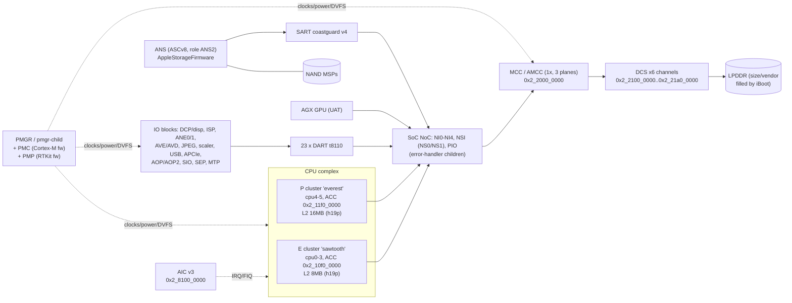
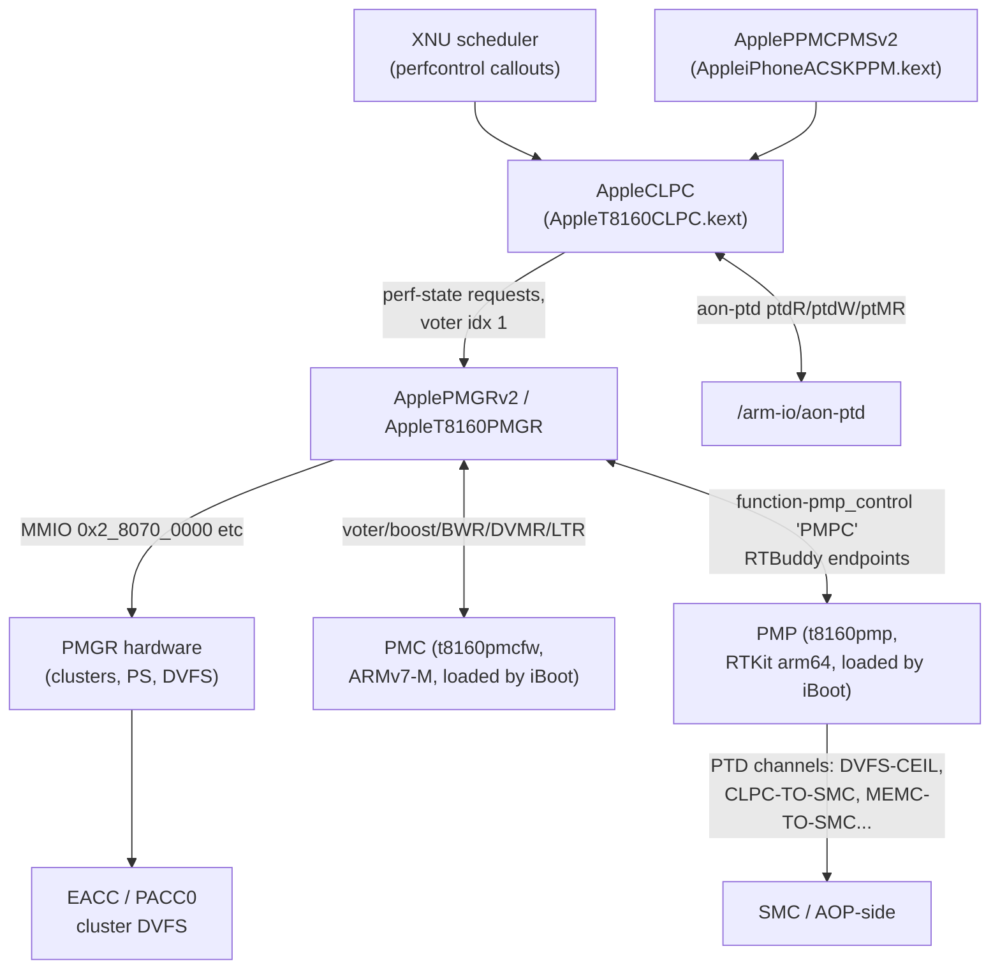
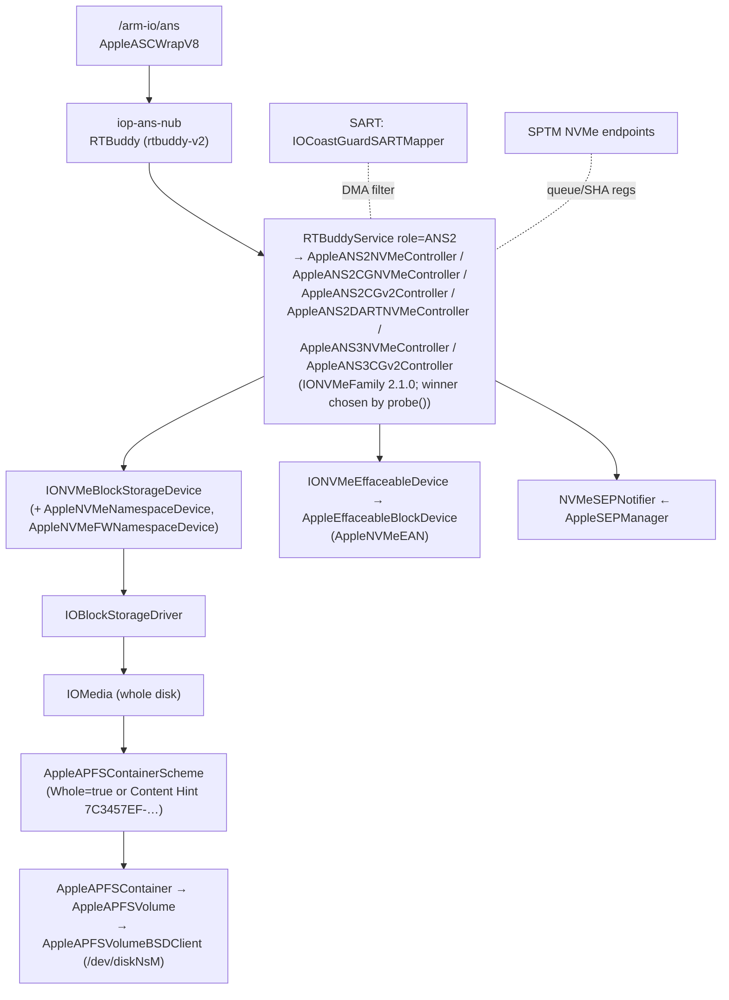

# 01: The SoC, CPU, memory and storage fabric (t8160 / A20 Pro)

Scope: the t8160 SoC as a whole and the fabric everything else hangs off. That covers the CPU clusters, the interrupt controller and timebase, power management (PMGR, PMC, PMP, CLPC), the memory cache controller and DRAM, every DART/SART IOMMU, the ANS NVMe storage controller up to APFS, the watchdog, GPIO controllers, every low-speed bus (SPMI, I²C, SPI, UART) with every device on it, the SoC error handlers, the SoC reporter, and the SPTM/TXM monitors as far as they police memory and DMA. Other chapters cover each peripheral in depth. This chapter gives their addresses, interrupts, IOMMUs and buses.

Evidence labels: **[DT]** device tree (`Firmware/all_flash/DeviceTree.v68ap.im4p`, tag `EmbeddedDeviceTrees-12661.52.3`), **[KC]** kernelcache `kernelcache.release.v6x-pandia`, **[FW]** firmware payloads in the IPSW, **[DSC]** dyld shared cache, **[PUB]** public source, **[INF]** my inference.

Raw evidence for this chapter is in [`data/01-soc-cpu-memory-storage/`](../data/01-soc-cpu-memory-storage/). It holds full property dumps of every node discussed here and decoded PMGR/PMP tables. I decoded those tables directly from the device tree's binary properties, not from the lossy `devicetree-nodes.json`.

---

## 0. Summary and biggest findings

- **The CPU complex is 4 E-cores + 2 P-cores in two clusters, exactly as Apple's spec says.** `/cpus/cpu0-3` are `apple,sawtooth`, `cluster-type "E"`, `cluster-id 0`. `/cpus/cpu4-5` are `apple,everest`, `cluster-type "P"`, `cluster-id 1` [DT]. `/arm-io/pmgr-child` `clusters = <4 2>` [DT]. Public: "6-core CPU (2P+4E)" [PUB].
- **One device tree ships both chip bins.** The root node `/:borneo` has `option = "h19p" | "h19a"`. Overlay children named `:borneo_h19p_N` and `:borneo_h19a_N` carry the bin-specific values [DT]. Two examples:
  - The h19p overlay gives an **8 MB E-cluster L2 and a 16 MB P-cluster L2**. The h19a overlay gives 4 MB and 8 MB.
  - Only the h19p overlay names an `ANE1` fast-die compute element, and it has 29 PMP temperature sensors against 22 for h19a.
  [INF] h19p is the A20 Pro bin used in this phone, and h19a is a smaller A20 bin. iBoot keeps the matching overlay at boot.
- **The IPSW device tree is a template, so the DRAM layout and carveouts in it are blank.** These are all zero or empty placeholders that iBoot fills at boot [DT]:
  - `/memory` `reg`
  - `/chosen/memory-map` (16 `MemoryMapReserved-N` slots)
  - `/chosen/carveout-memory-map`
  - `/chosen/dram-vendor` and `dram-vendor-id`
  - `/chosen/lock-regs/amcc/amcc-ctrr-a..d`
  - `/vram`, `/pram`, `/socd-trace-ram`
  - `/arm-io` `chip-revision` and `clock-frequencies`
  
  So DRAM size, vendor and the carveout map cannot be read from this IPSW. The only hint is `/product` `device-perf-memory-class = 12` [DT]. [INF] that is a 12 GB memory class.
- **There are 6 DRAM channels behind one AMCC.** `/arm-io/mcc`: `amcc-count 1`, `dcs-count-per-amcc 6`, `dcs-channel-enable-mask 0x3f`, `amcc-plane-enable-mask 0x7` [DT].
- **SPTM, not XNU, owns the NVMe submission path.** The `/defaults` property `nvme-iboot-sptm-security` is present. `pmap-io-ranges` tags four ANS register windows as `NVMe` and the SART as `SRT3`. The SPTM image contains `SPTM_NVME_ENDPOINTID_{INIT,ADMIN_QUEUE_REGS,IOSQ_REG,IOCQ_REG,SET_SQ_ENTRY,MAP_PAGES,UNMAP_PAGES,SHA_REG,ENABLE_CG}` and a family of `VIOLATION_NVME_*` panics [DT][FW]. The ANS node advertises a hashing engine: `nvme-ans-sha-present`, `nvme-ans-selected-hash-type "SHA3-256-4K"` [DT].
- **There are 23 DARTs (all `dart,t8110`), plus one SART (`sart,coastguard`) for storage and a GPU UAT mapper.** Several DARTs reserve **exclave stream IDs** (`exclave-sid`) for secure-world DMA: SEP, AOP/AOP2, DCP/DCPSEC/DCPEXT0, disp0/dispsec, ISP, ANE0/ANE1 [DT].
- **The PPM (peak power manager) knows the Duo has two batteries.** `/arm-io/pmgr/ppm` `number-of-battery-packs = 2` [DT]. That matches the two cells Apple announced [PUB].
- **Some oddities:**
  - `/arm-io/aop-gpio`'s `compatible` begins with a NUL byte (`"\0gpio,t8101"`), so the AP GPIO driver never matches it [DT][INF].
  - The kext `AppleEverestErrorHandler` matches `cpu-error-handler,everest`, but no node with that `compatible` exists [KC][DT].
  - P-core enable bits are `0x40`/`0x80` (bits 6–7) while E-cores use bits 0–3 [DT].

---

## 1. What the IPSW device tree can and cannot tell us

The IPSW's `DeviceTree.v68ap.im4p` is the **template** iBoot starts from. iBoot patches values into it before handing it to XNU. In this file:

| Kind of property | State in IPSW | Example |
|---|---|---|
| Hardware topology (nodes, `compatible`, `reg`, `interrupts`, `iommu-parent`, tunables) | **Populated** | `/arm-io/aic` `reg`, `/arm-io/pmgr/clpc` (197 properties) |
| Per-device identity | **Placeholder strings pointing at syscfg** | `serial-number = "syscfg/SrNm/0x20,zeroes/0x20"` |
| Boot-time memory layout | **Zeroed** | `/memory reg = <0 0>`, `/chosen/memory-map/MemoryMapReserved-0..15 = 16 bytes of 0`, `/chosen/carveout-memory-map` (empty node) |
| DRAM identity | **Zeroed** | `/chosen dram-vendor = <0 0 0 0>`, `dram-vendor-id = 0` |
| Lock regions | **Empty nodes** | `/chosen/lock-regs/amcc/amcc-ctrr-a`, `-b`, `-c`, `-d` |
| Clocks | **Zeroed** | `/arm-io clock-frequencies` = 96 zero words; `/ clock-frequency = 0` |

The kernel reads the filled-in versions. It has strings for `/chosen/memory-map`, `/chosen/carveout-memory-map`, and errors for `'dram-base'` / `'dram-size'` missing from `chosen` [KC]. It also has a sanity check: `memsize=%u MB leaves no memory for XNU/SPTM to manage: the iBoot carveouts alone are %llu MB` [KC]. **Everything about the runtime memory map is therefore a gap** (§16).

---

## 2. The SoC as a whole

### 2.1 Identity

| Fact | Value | Evidence |
|---|---|---|
| SoC | t8160 | `/arm-io` `compatible = "arm-io,t8160"`, `device_type = "t8160-io"` [DT] |
| Generation | `soc-generation = "H19"` | `/arm-io` [DT] |
| Bin overlays | `h19p`, `h19a` | `/:borneo option` [DT] |
| Board | V68AP, iPhone19,4, "iPhone Duo" | `/ compatible`, `/product product-name` [DT] |
| Kernel | `xnu-13432.52.2~7/RELEASE_ARM64_T8160`, built Tue Oct 13 2026 | version string [KC] |
| SoC kexts | `AppleT8160` (`AppleSoCIOPSD`, `AppleSoCErrorHandler`, `AppleSoCMisc`, `AppleSoCReporter`), `AppleT8160PMGR`, `AppleT8160CLPC`, `AppleT8160MCC`, `AppleT8160PCIe`, `AppleT8160TypeCPhy`, `AppleProcessorTraceT8160` | [KC] |
| Public | A20 Pro, 2 nm, 6-core CPU (2P+4E), 7-core GPU, dual 16-core Neural Engine | Apple spec summary in the project brief [PUB] |

### 2.2 Physical address map (the `/arm-io` `ranges`)

`/arm-io` has `#address-cells = 2`, `#size-cells = 2`. Its `ranges` property maps child bus addresses to CPU physical addresses [DT]:

| Child address | Physical address | Size | What lives there (from node `reg`s) |
|---|---|---|---|
| `0x0_0000_0000` | `0x2_0000_0000` | `0x2_8000_0000` | Almost all SoC MMIO: CPU cluster regs `0x2_10xx_xxxx`/`0x2_11xx_xxxx`, AMCC/DCS `0x2_2xxx_xxxx`, PMGR/AIC `0x2_8xxx_xxxx`, IO blocks up to `0x4_7FFF_FFFF` |
| `0x3_2000_0000` | `0x3_2000_0000` | `0x501_c000` | USB/ATC (`dart-usb0` at `0x3_2302_0000`) |
| `0x3_0800_0000` | `0x3_0800_0000` | `0x79b_8000` | APCIe 0/1 (`dart-apcie0` `0x3_0800_0000`, `dart-apcie1` `0x3_0900_0000`) |
| `0x3_1000_0000` | `0x3_1000_0000` | `0x502_0000` | APCIe-related |
| `0x1c_b000_0000`, `0x1c_9000_0000` | identity | `0x1000_0000` each | PCIe config/ECAM windows (`pmap-io-ranges` tag `PCIe`) |
| `0xb_c000_0000`, `0xb_8000_0000`, `0xa_c000_0000`, `0xa_8000_0000` | identity | `0x2000_0000`–`0x4000_0000` | PCIe memory windows (`/arm-io/apcie sptm-allow-reg` covers `0xb_c000_0000` and `0xb_8000_0000`) |

All absolute addresses in this chapter are computed through this table. Values written as `0x2_xxxx_xxxx` are CPU physical addresses.

`/arm-io` itself has these properties [DT]:
- Its `reg` lists eight 8 KB windows: the two ACC (cluster) blocks at `0x2_10f0_0000` and `0x2_11f0_0000`, and per-core implementation windows `0x2_1005_0000`, `0x2_1015_0000`, `0x2_1025_0000`, `0x2_1035_0000`, `0x2_1105_0000`, `0x2_1115_0000`.
- `acc-impl` and `cpm-impl` point at the ACC and CPM (cluster power manager) blocks for each cluster.
- `iommu-present` is set, and `mapping-enforcement-mode = 2`.
- PMGR hooks are exposed as `function-*` properties pointing at `/arm-io/pmgr`: `function-power_gate` (`pwrG`), `function-clock_gate` (`clkG`), `function-service_gate` (`SERV`), `function-service_state` (`SERG`) and `function-service_reset` (`SRST`).

Driver: `AppleSoCIOPSD` (kext `com.apple.driver.AppleT8160`), provider `IOPlatformDevice` [KC].

### 2.3 Fabric diagram

The NI/NSI/PIO names come from the error-handler children (§12). Their exact topology is [INF].

---

## 3. CPU complex

### 3.1 Per-CPU properties (every property in the node)

The table below lists every property of `/cpus/cpuN`, decoded from the binary [DT]. Register properties are `<addr_lo addr_hi size_lo size_hi>`, already absolute. `function-*` properties are `<phandle 'FOURCC' args…>`. `/cpus` has `#address-cells = 1`, `#size-cells = 0`.

| Property | cpu0 | cpu1 | cpu2 | cpu3 | cpu4 | cpu5 |
|---|---|---|---|---|---|---|
| `compatible` | `apple,sawtooth`, `ARM,v8` | same | same | same | `apple,everest`, `ARM,v8` | same |
| `device_type` | `cpu` | `cpu` | `cpu` | `cpu` | `cpu` | `cpu` |
| `reg` (MPIDR affinity) | `0x000` | `0x001` | `0x002` | `0x003` | `0x100` | `0x101` |
| `cpu-id` | 0 | 1 | 2 | 3 | 4 | 5 |
| `cluster-id` | 0 | 0 | 0 | 0 | 1 | 1 |
| `cluster-type` | `E` | `E` | `E` | `E` | `P` | `P` |
| `l2-cache-id` | 0 | 0 | 0 | 0 | 0 | 0 |
| `state` | `waiting` | `waiting` | `waiting` | `waiting` | `waiting` | `waiting` |
| `no-aic-ipi-required` | present | present | present | present | present | present |
| `interrupt-parent` | `/arm-io/aic` | ← | ← | ← | ← | ← |
| `interrupts` | 50 | 53 | 56 | 59 | 70 | 73 |
| `reg-private` | `0x2_1001_0000` | `0x2_1011_0000` | `0x2_1021_0000` | `0x2_1031_0000` | `0x2_1101_0000` | `0x2_1111_0000` |
| `cpu-impl-reg` | `0x2_1005_0000`+`0x9010` | `0x2_1015_0000`+`0x9010` | `0x2_1025_0000`+`0x9010` | `0x2_1035_0000`+`0x9010` | `0x2_1105_0000`+`0x9010` | `0x2_1115_0000`+`0x9010` |
| `cpu-uttdbg-reg` | `0x2_1004_0000`+`0xc8` | `0x2_1014_0000`+`0xc8` | `0x2_1024_0000`+`0xc8` | `0x2_1034_0000`+`0xc8` | `0x2_1104_0000`+`0xc8` | `0x2_1114_0000`+`0xc8` |
| `coresight-reg` | `0x2_1001_0000`+`0x300c8` | `0x2_1011_0000`+`0x300c8` | `0x2_1021_0000`+`0x300c8` | `0x2_1031_0000`+`0x300c8` | `0x2_1101_0000`+`0x300c8` | `0x2_1111_0000`+`0x300c8` |
| `acc-impl-reg` (cluster) | `0x2_10f0_0000`+`0x40088` | same | same | same | `0x2_11f0_0000`+`0x40088` | same |
| `cpm-impl-reg` (cluster) | `0x2_10e4_0000`+`0xc028` | same | same | same | `0x2_11e4_0000`+`0xc028` | same |
| `function-cpu_idle` | `/arm-io/pmgr` `cpuI` | ← | ← | ← | ← | ← |
| `function-enable_core` | pmgr `Core` arg `0x01` | `0x02` | `0x04` | `0x08` | `0x40` | `0x80` |
| `function-error_handler` | `/arm-io` `ErrH` arg 0 | 1 | 2 | 3 | 6 | 7 |
| Overlay L2 (`:borneo_h19p_*`) | 8 MB (`0x800000`) | ← | ← | ← | 16 MB (`0x1000000`) | ← |
| Overlay L2 (`:borneo_h19a_*`) | 4 MB | ← | ← | ← | 8 MB | ← |

What this tells us:
- **Two shared L2s, one per cluster.** The `l2-cache-size` is a cluster property duplicated per core [DT]. On the A20 Pro bin it is 8 MB for E and 16 MB for P (h19p overlay) [DT]. [INF] h19p is the active overlay on this device.
- **The P cluster's core indices start at 6.** Both `enable_core` masks and `ErrH` indices skip 4–5 for the P cores [DT]. [INF] The PMGR core-enable and error-handler numbering reserves slots per cluster. It may reflect a die floorplan with room for more cores than this product enables. Nothing here proves fused-off cores.
- **Per-core PMUs (`CPMU`).** `/defaults pmap-io-ranges` tags six 16 KB windows `CPMU` at `0x2_1003_0000`, `0x2_1013_0000`, `0x2_1023_0000`, `0x2_1033_0000`, `0x2_1103_0000`, `0x2_1113_0000` [DT].
- **No frequency or voltage table for the CPUs exists in the device tree.** Nothing like `voltage-states` or `perf-states` sits under `/cpus` or `/arm-io/pmgr*`. The only `perf-states` table in the tree belongs to the GPU (`/arm-io/sgx`). CPU P-states live in the ACC/PMGR hardware, programmed by iBoot and PMP [INF]. CLPC carries scalar frequency limits (§5.4).

### 3.2 Cluster-level blocks

| Block | Where | Evidence |
|---|---|---|
| ACC ("Apple CPU complex", cluster DVFS) | `EACC` = `0x2_10f0_0000`, `PACC0` = `0x2_11f0_0000` | `/arm-io acc-impl`; `pmgr-child acc-clusters = {EACC, PACC0}`; `acc-slew-rate-chip-partition = {EACC, PACC}` [DT] |
| CPM (cluster power manager) | `0x2_10e4_0000`, `0x2_11e4_0000` | `/arm-io cpm-impl`, `cpm-impl-reg` [DT] |
| Cluster control in PMGR | `pmgr-child cluster-ctl-offset = 0x80000`, `misc-cores-offset = 0x34000`, `misc-acg-offset = 0x38000` | [DT] |
| Cluster DVFS devices | `cluster-dvfs-devices = <0 3 1 4 1 6 1 7>` | [DT]. [INF] pairs of (cluster, SoC-device id), matching CLPC `soc-devices = <3 4 6 7>` |
| Core power-gate latency | `cpu-power-gate-latency-ns = 50000` (50 µs) | `pmgr-child` [DT] |
| Per-cluster thermal sensors | `mtr-sensor`: 2 in the E cluster (`Te00005i`, `Te0000ai`), 9 in the P cluster (`Tp00002i`…`Tp00018i`) | `pmgr-child` [DT]; the log line "`ApplePMGR: T8160MTRCluster initialized`" [KC] |
| Processor trace | `/arm-io/apple-processor-trace` (`apple-processor-trace,t8160`), 16 windows starting at `0x2_100f_0000`; driver `AppleProcessorTraceT8160` | [DT][KC]; SPTM has `SPTM_CPUTRACE_ENDPOINTID_*` and frame types `XNU_CPUTRACE_PA_BUFFER`/`VA_BUFFER` [FW] |
| Debug | `/arm-io/cpu-debug-interface` (driver `AppleARMLightEmUp`): `stop_clocks`, `enable_stop_clocks`, `aft-instance-list` names `AFI`, `AFC`, `AFG` fabric-trace instances, `panic-trace-mode = 0x24`, `sptm-allow-internal-reg`; `/arm-io/dbgCPU` (`AppleDebugCPU`, IRQ 374, no kernel match); `/arm-io/aod2..4` (Astris on-die debug over SWD, `function-aod_swclk`/`swdio` on `gpio0`; kext `AppleAstrisGpioProbe` matches `aod` by device_type) | [DT][KC] |

### 3.3 Kernel side

- **CPU nub.** `AppleARMCPU` (kext `com.apple.driver.AppleARMPlatform`) has `IONameMatch "cpu"` on `IOPlatformDevice` [KC]. The nodes are named `cpu0`…`cpu5`, so [INF] the match is on `device_type = "cpu"`, which IOKit's device-tree name comparison also checks.
- **CPU errors.** Every CPU's `function-error_handler` points at `/arm-io` (`ErrH`), which is `AppleSoCErrorHandler`'s domain. The separate `AppleEverestErrorHandler.kext` (`AppleARM64ErrorHandler`, matches `cpu-error-handler,everest`) is prelinked, but there is no such node in the tree [KC][DT]. `/defaults l2-ecc-correctable-panic = 1` [DT]. [INF] a correctable L2 ECC error escalates to a panic on this product.
- **sysctls the kernel publishes.** The kernel has the full `hw.perflevelN.*` family (N=0..2). Each has a description string: "Name of perflevel0", "L2 cache size in bytes for perflevel0", "Number of CPUs sharing an L2 cache…", "Bitmap of other perflevels sharing L2 cache", "Currently active physical CPUs in perflevel0", and so on. It also has `hw.nperflevels`, `cpufamily`, `cpusubfamily`, `l1icachesize`, `l1dcachesize`, `l2cachesize`, `l3cachesize`, `memsize`, `memsize_physical`, `cachelinesize`, `physicalcpu`, `logicalcpu`, `activecpu` and `packages` [KC].
- **`hw.optional.arm.FEAT_*` names in the kernel.** These include, among others: `FEAT_SME`, `FEAT_SME2`, `FEAT_SME2p1`, `FEAT_SME_F8F16`, `FEAT_SME_F8F32`, `FEAT_SME_LUTv2`, `FEAT_SVE_B16B16`, `FEAT_MTE`, `FEAT_MTE2`, `FEAT_MTE3`, `FEAT_MTE4`, `FEAT_MTE_STORE_ONLY`, `FEAT_MTE_CANONICAL_TAGS`, `FEAT_FP8`, `FEAT_FPMR`, `FEAT_LUT`, `FEAT_FAMINMAX`, `FEAT_CPA`, `FEAT_CPA2`, `FEAT_PAuth_LR`, `FEAT_CSSC`, `FEAT_HBC`, `FEAT_WFxT`, `FEAT_ECV`, `FEAT_AFP`, `FEAT_RPRES`, `FEAT_SPECRES2` [KC]. The kernel knowing a feature name does **not** prove that the A20 Pro implements it. The values are probed at boot (gap).
- **Kernel-side scheduler and DT tunables.** `/defaults` sets these boot defaults [DT]:
  - `kern.vm_compressor = 0x20`
  - `kern.swap_all_apps = 1`
  - `kern.max_task_pmem = 0xd30` (3376 MB), `kern.entitled_max_task_pmem = 0x1800` (6144 MB), `kern.entitled_dev_max_task_pmem = 0x1a00` (6656 MB)
  - `kern.memstat_reaper_mb = 0x96a` (2410)
  - `kern.vm_reclaim_max_threshold = 0x20000000`
  - `kern.maxvnodes = 0x4650`
  - `kern.gpu_pmem_selector = 1`
  
  The per-task memory limits are consistent with a ~12 GB device [INF].

### 3.4 Userland and app-facing API

- `sysctlbyname("hw.perflevel0.physicalcpu")`, `hw.perflevel1.*`, `hw.nperflevels` and `hw.l2cachesize` are the supported ways for apps to discover the P/E topology [PUB: Apple "Tuning your code's performance for Apple silicon", https://developer.apple.com/documentation/apple-silicon/tuning-your-code-s-performance-for-apple-silicon]. On this device the kernel will report 2 levels from the topology above [INF].
- `ProcessInfo.processorCount` / `activeProcessorCount` [PUB] are backed by `hw.ncpu`/`hw.activecpu` [INF].
- QoS classes (`DispatchQoS`, `pthread_set_qos_class_self_np`) are how apps influence E/P placement. CLPC and the scheduler make the decision (§5.4). The dyld cache contains `libdispatch.dylib`, `libsystem_pthread.dylib`, `PerformanceControlKit.framework`, `kperf.framework`, `kperfdata.framework`, `ktrace.framework` and `ProcessorTrace.framework` [DSC image list].

---

## 4. Interrupts and time

### 4.1 AIC v3

| Item | Value | Evidence |
|---|---|---|
| Node | `/arm-io/aic`, `compatible "aic,3"`, `interrupt-controller "master"`, `#interrupt-cells 1` | [DT] |
| MMIO | `0x2_8100_0000` + `0x1cc000` | [DT] |
| Layout properties | `rev-offset 0x0`, `cap0-offset 0x4`, `maxnumirq-offset 0xc`, `aicglbcfg-offset 0x14`, `extint-baseaddress 0x10000`, `extintrcfg-stride`/`intmaskset-stride`/`intmaskclear-stride`/`hwintmon-stride 0x4a00`, `max_irq_interrupt_umask 0xffff`, `cap0_max_interrupt_umask 0xffff` | [DT] |
| Timestamps | `#shared-timestamps 16`, `pubstampcfg0-offset 0x1000`, `pubstamplo0-offset 0x1008`, `pubstampdhi-offset 0x100c`, `pubstampstride-mask 0x10`, `pubstampdcfg0en-mask 0x80000000`, `pubstampcfg0inttype-mask 0x3` | [DT] |
| CPUs | `#main-cpus 6` | [DT] |
| Driver | `AppleInterruptControllerV3` (`com.apple.driver.AppleInterruptControllerV3`) | [KC] |
| Load | ≈332 interrupt specifiers in the tree name the AIC directly. The highest is 1516 (`dart-usb0` uses 1492) | [DT], counted from every node |

The CPUs carry `no-aic-ipi-required`. [INF] IPIs use the core-local fast-IPI path rather than AIC registers.

**Second-level interrupt controllers** (`interrupt-controller` nodes that themselves sit on the AIC) [DT]:

| Controller | Specifiers routed through it | Notes |
|---|---|---|
| `/arm-io/gpio0` (AP GPIO, 214 pins, 7 IRQ groups 327–333) | ≈4 | Codec IRQ pin 134, NFC (stockholm) pin 142 |
| `/arm-io/nub-gpio` (32 pins, IRQ 553–559) | ≈4 | Touch ID sensor `mesa` (pin 12); `event_name-mask15 "dock"` |
| `/arm-io/aop-gpio` (95 pins, IRQ 456–462) | 1 | `event_name-mask16 "baseband"`; **compatible starts with NUL** (§10) |
| `/arm-io/smc-gpio` (6 pins), `/arm-io/mtp-gpio` (18 pins) | – | |
| `/arm-io/nub-spmi0..2`, `/arm-io/aop-spmi0..1` | 20–41 each | Each SPMI master is an interrupt controller for its slaves (§11) |
| `/arm-io/aon-ptd` (`ptd,v1`, 32 vectors on AIC 617–648) | 28 | "PTD" = always-on doorbell/trigger block. CLPC, PPM, BTM and pmgrtools use it with four-character vector names. Drivers: `ApplePTD`, `AppleSPUAONPTDDriver` |
| `/arm-io/smc/iop-smc-nub/smc-pmu` | 2 | |

### 4.2 Timebase and global time

- `/arm-io/aic-timebase`: `device_type "timer"`, `reg 0x2_8118_0000+0x1000`. No `compatible` and no kernel driver [DT]. [INF] XNU's ARM generic-timer code reads it directly.
- `/arm-io/soc-misc` `glb-time-source = <0 4 5>` and `wake-time-counter` (four counter pairs at offsets `0x1000`–`0x101c`) [DT].
- `/arm-io/soc-reporter` `free-running-counter` [DT].
- The real-time clock is in the PMU (`AppleDialogSPMIPMURTC` personality under `AppleDialogSPMIPMU`) [KC]. See `06-power-battery-thermal.md`.

### 4.3 What can wake the AP

`/arm-io/soc-misc ap-wake-sources` names the AP wake sources [DT]:
- `AIC.WakeAP`
- `AOP.CPUWakeupAP`, `AOP.SPMI0.SW3`, `AOP.SPMI1.SW3`, `AOP.GPIO.IRQ6`
- `ATC0_PMGR_USB_WAKEUP`
- `MTP.OutboxNotEmpty`
- `PMGR_AON_AIC_AP_WATCHDOG`
- `NUB.APWakeupTime`, `NUB.SPMI0.SW3`, `NUB.SPMI1.SW3`, `NUB.WakeupAP`
- `SMC.CPUWakeupAP`, `SMC.OutboxNotEmpty`
- `AOP2.CPUWakeupAP`

Driver: `AppleSoCMisc` [KC].

---

## 5. Power, clocks and performance control

Three agents share the SoC's power state. **PMGR** is the clock/power-gate/DVFS register block driven by XNU. **PMC** is a small Cortex-M microcontroller that arbitrates votes. **PMP** is an RTKit coprocessor that runs bandwidth, thermal and lifetime control loops. **CLPC** (in the kernel) and **PPM** (peak-power manager, in the kernel) set policy on top of them. Battery-side power is in `06-power-battery-thermal.md`.

### 5.1 PMGR (`/arm-io/pmgr` and `/arm-io/pmgr-child`)

- **`/arm-io/pmgr`** (`pmgr2,arch`, `device_type "pmgr"`) → `ApplePMGRv2` (`com.apple.driver.ApplePMGR`) [DT][KC].
  - Properties: `pmgr-ver 2`, `chiplet-count 1`, `clpc 3`, `pmp 2`, `pmc 1`, `pmc-pmgr 0x1f`, `pmc-ltr-ka 1`.
  - It is the phandle every `function-power_gate`, `clock_gate`, `cpuI` and `Core` property points at.
  - Its children `clpc`, `ppm` and `pmgrtools` are published as `ApplePMGRNub`s. The CLPC personality also requires `clpc-match-version = 3` [KC].
- **`/arm-io/pmgr-child`** (`pmgr2,t8160`, `device_type "cpmgr"`) → `AppleT8160PMGR` [DT][KC].
  - 71 properties; full dump in `data/01-soc-cpu-memory-storage/dt-arm-io-core.txt`.
  - MMIO: 54 windows starting at `0x2_8070_0000`+`0xd0000`, `0x2_8828_0000`+`0x80000`, `0x2_8000_0000`+`0x40000` and `0x2_8820_0000`+`0x40000`. The list continues with every CPU-cluster register window (ACC, CPM, per-core).
  - IRQs: 314, 299, 44, 46, 64, 66.
  - `interrupt-config` names them: `DVFM_COP`, `DVC_DONE_ERR`, `SLEW_RATE1`…`SLEW_RATE4`.

Decoded `pmgr-child` tables [DT]:

| Table | Entries |
|---|---|
| `perf-domains` | `SOC`, `ECPU`, `DCS`, `PCPU`, `ANE`, `ANE1`, `DISP` |
| `devices` (PS-managed fabric devices) | `AFCMCCNI0`, `PIOGW`, `AFIMCCNI0`, `AFINS1`, `AFISOCNI1`, `AFISOCNI2`, `SBR`, `MSG`, `PMS_BUSIF`, `PMS`, `PMP`, `PMS_SRAM`, `SEP` |
| `voter-agent` | `PMP` (idx 0), `CLPC` (1), `GFX` (2), `AP` (3). Also `pmp-`, `clpc-`, `gfx-` and `ap-voter-agent-idx` |
| `voter-rail-data` | rails `DCS`, `SOC`, `DISP`, `AVE` |
| `boost-agent` | `DISPINT_PRI_DCP`, `DISPINT_PRI_M3`, `DISPINT_SEC_DCP`, `DISPINT_SEC_M3`, `EDISP_DCP`, `EDISP_M3`, `ANS`, `AVE_SOC`, `AVE_DCS`, `AVD`, `MSR`, `JPG`, `PRORES`, `ISP` |
| `bwr-agent` (bandwidth requesters) | `DISP_INT_PRI`, `DISP_INT_SEC`, `ISP`, `DISP_EXT0`, `AUSBC0`, plus spares |
| `dvmr-agent` | `INVALID` (unused) |
| `hw-dpe-reg` (digital power estimators) | `GPU`, `ANE0`, `ANE1`, `ISP`, `AVE`, `MSR`, `AMCC`, `DCS`, `DRAM`, `DISP` |
| `service` | virtual services `MSG`, `VIRT_PMP`, `VIRT_PMS_SRAM`, starting at `virt-service-start 0x96` |
| `mtr-sensor` | `Te00005i`, `Te0000ai`, `Tp00002i`, `Tp00005i`, `Tp00007i`, `Tp0000ai`, `Tp00010i`, `Tp00014i`, `Tp00015i`, `Tp00016i`, `Tp00018i` |
| `perf-state-boost-route` | 14 routes. [INF] boost-agent → perf-domain mapping |
| Others | `sbd`, `reg-maps`, `reg-groups`, `perf-groups`, `perf-counters` (496 words), `ps-groups`, `ptd-*` offsets, `psd-*`, `volman-*`, `acc-slew-rate-monitor 0x11`, `acc-harvesting 0`, `soc-dpe 1`, `ane-dpe 0`, `default-boot-ok 1`, `edt-property-ver 2`, `reporter-enable-mask 0xa` |

`pmgr-child` has a direct line to PMP: `function-pmp_control = <&/arm-io/pmp/iop-pmp-nub 'PMPC'>` [DT].

**`/arm-io/pmgr/pmgrtools`** (no kernel match) [DT]:
- `soc-device-ps-map` maps the PMGR's power-state ids to devices: `AGX` 0x67, `ANE0` 0xd, `ANE1` 0xe, `ISP` 9, `DISP0` 0xa, `DISP1` 5, `DISPEXT` 0xb, `AVE` 0xf, `AVD` 0x10, `MSR` 0xc, `JPEG` 8, `PRORES` 6, `ATC` 0x63.
- It reaches the main PMU through `function-pmuaccess_L1DY = <&pmu-main 'pmuR'>`.

**PMC firmware.** `Firmware/pmc/t8160pmcfw.im4p` is IM4P type `pmcf`, payload 36,396 bytes. It is a 32-bit ARM Mach-O with `cpusubtype 15`. [INF] That is ARMv7-M, a Cortex-M class core. It has no readable strings [FW]. The BuildManifest entry is `Ap,ApplePMCFirmware` with `IsLoadedByiBoot: true`, `IsFUDFirmware: true` and `Personalize: true` [FW manifest]. The kernel's PMGR logs which PMC interfaces are off, e.g. "`pmc-pmgr: 0x%x, ApplePMC: VOTER INF Disabled`", and the same for `BOOST`, `BWR`, `DVMR` and `LTR`. It also knows a long list of `PMC_ASSERT_*` codes such as `PMC_ASSERT_BWR_INVALID_DCS_THR_TUNABLES` and `PMC_ASSERT_BOOST_INVALID_RAIL_MAP` [KC]. Together with `pmc-pmgr = 0x1f` (five bits, five interfaces) [DT], this identifies PMC as the arbiter of voter, boost, bandwidth-request, DVMR and LTR requests [INF].

### 5.2 PMP (Power Manager Processor)

| Item | Value | Evidence |
|---|---|---|
| Node | `/arm-io/pmp`, `iop,ascwrap-v8`, `role "PMP"` | [DT] |
| MMIO | ASC `0x2_80e0_0000`+`0x74000`, `0x2_8085_0000`, `0x2_9602_0000`, SRAM region `0x2_8050_0000`+`0xb0000` (`region-base`), `0x2_803d_0000` | [DT] |
| IRQs | 198, 158, 118 | [DT] |
| IOMMU | `iommu-parent` → `/arm-io/dart-sbr/mapper-pmp` (SID 6) | [DT] |
| Mailbox | `msgbox-using-postoffice`, `msgbox-mailbox-num 4`, `pio-vm-base 0xc0000000` + 1 GB | [DT] |
| Firmware | `t8160pmp.im4p`, IM4P `pmpf`, 737,280-byte arm64 Mach-O; banner `RTKit_armv8_chinook_Oz_flto-3514.40.18.release`; `firmware-name "t8160pmp"`. BuildManifest `PMP`: `IsLoadedByiBoot: true` | [FW] |
| Kernel chain | `AppleASCWrapV8` → `RTBuddy` (`iop-nub,rtbuddy-v2`) → `ApplePMPFirmware` (matches `role = PMP`), then `ApplePMPv2`/`ApplePMP` on `PMPEndpoint1`, `ApplePMPThermal` on `PMPEndpoint2` | [KC] |

The PMP nub (`/arm-io/pmp/iop-pmp-nub`, 114 properties) is the richest tuning table in the tree [DT]:
- **Control loops** (`controller`): `DIE-TEMP`, `DCS-BW`, `DCS-WR-BW`, `AGX-DCS-BW`, `AGX-AF-RD-BW`, `AGX-AF-WR-BW`, `ANE-DCS-BW`, `ANE0-DCS-BW`, `ANE1-DCS-BW`, `ANE0-AF-BW`, `ANE1-AF-BW`, `ANE0-LINK0-AF-BW`, `ANE0-LINK1-AF-BW`, `ANE1-LINK0-AF-BW`, `ANE1-LINK1-AF-BW`, `SOC-NI0-BW`…`SOC-NI3-BW`, `AFI-TOP-BW`, `MEM-CACHE`, `LIFETIME-SERVO`. Each has `*-threshold-{a,b,c}`, `*-constraint-*`, `*-enable` and `*-dvfs-filter` tables.
- **DVFS domains PMP manages** (`dvfs-domain`): `DCS`, `SOC`, `DISP`, `AVE`.
- **PTD channels** (`ptd-range`): `PTD-NULL`, `PMP-STATUS`, `DVFS-STATE`, `PMPTOOL`, `PMS-PMGR-PKT`, `PMS-DPE-PKT`, `PMS-DEVC-PKT`, `SOC-DEV-PKT`, `SOC-DEV-PS-REQ`, `SOC-DEV-PS-ACK`, `SOC-DEV-DVFS`, `SOC-DEV-BWR`, `MC-DRV-TO-CTRL`, `AVD-NRG`, `SOC-AON-NRG`, `SOC-REST-NRG`, `MC-CTRL-TO-DRV`, `FAST-DIE-CE`, `SMC-TO-PPM`, `PMU-TO-CLPC`, `LTS-VOLT-CAP`, `PPM-TO-SMC`, `CLPC-TO-SMC`, `GFX-TO-SMC`, `FAST-DIE-TO-SMC`, `MEMC-TO-SMC`, `LTS-TO-GFX`, `PMU-TO-GFX`, `DVFS-CEIL`. These are the named data paths between PMP, CLPC, PPM, GFX and SMC.
- **Lifetime servo** (`lts-config`, `lts-voltage` names `PACC0` and `AGX`, `lts-ctrl-loop`). The firmware has strings `lts-acsk-tddb-config`, "`LTS_CTRL: Max voltage overriden for %s loop`" and "`Fast Die Throttling`" [FW]. [INF] LTS caps P-cluster and GPU voltage to meet a silicon-ageing (TDDB) budget.
- **Memory-cache streams** (`mcache-stream`, 588 words) and memory-controller quota policy (`mc-quota-policy 2`, `mc-cue-quota-cfg`, `mc-dsid-ptd-config`). [INF] PMP sets SLC partitioning and QoS.
- **Temperature sensors** (bin overlay `:borneo_h19p_2 temp-sensor`, 29 entries): `Ta00000i`…`Ta0000ci` (8), `Te00005i`, `Te0000ai` (E cluster), `Tp00002i`…`Tp00018i` (9, P cluster), `Ta00101i`…`Ta00118i` (9), and `MTR_TOP_AGX`. The h19a overlay has 22. `sochot-sensors` lists 28 (h19p) or 22 (h19a).
- **Fast-die control** (`:borneo_h19p_0 fast-die-ctrl-ce-map`): compute elements `EACC` and `PACC_ANE0_ANE1` (h19a: `PACC_ANE0`).

### 5.3 SoC power states visible to the kernel

The `soc-device-ps-map` (above) and PMP's `soc-device` table (930 words) assign each IO block a PS id. Each IO node's `power-gates`/`clock-gates`/`service-gates` lists point into that space. Examples:
- PMP: `0x97 0x98`
- i2c2/3/4: `service-gates 0xd`, `0xe`, `0xf`
- uart0: `service-gates 5`
- spi1: `service-gates 0x12`

The `/arm-io` `function-power_gate`, `function-clock_gate` and `function-service_*` properties route those requests to PMGR [DT].

### 5.4 CLPC (closed-loop performance controller)

- Node `/arm-io/pmgr/clpc`, `clpc,t8160`, `device_type "clpc"`, **197 properties** [DT]. By prefix: 85 `cpu-*`, 35 `pkg-*`, 17 `mem-*`, 14 `dram-*`, 6 `ane-*`, 5 `ui-*`, 5 `ca-*` (client-adaptive), 4 `fab-*`.
- Driver `AppleCLPC` (`com.apple.driver.AppleT8160CLPC`), source path `AppleCLPC/CLPC/source/apple_clpc.cpp`. User client `AppleCLPCUserClient`. In-kernel clients reach it through `IOPerfControlClient` (`IOPerfControl.cpp`). Boot-args/DT overrides include `clpc-disable-cpu-turbo`, `clpc-cpu-mhz`, `clpc-disable-pmc` and `clpc-debug`. A `/usr/local/bin/clpcctrl` path appears (internal tool) [KC].
- IRQs: AIC 1063, plus seven four-character vectors via `/arm-io/aon-ptd`. It reads and writes the PTD (`function-clpc_clvr_read_0 'ptdR'`, `clpc_clvr_peek_0 'ptdP'`, `lostperf_report_write 'ptdW'`, `ptd_read_mult 'ptMR'`). It reads ANE performance counters (`function-ane_perf_ctr` → `/arm-io/ane0 'ANCR'`, `function-ane_perf_ctr1` → `/arm-io/ane1`) [DT].
- `sptm-allow-reg` names three windows the SPTM allows CLPC's driver to map: `0x2_8c84_0000`+256 KB (aon-ptd), `0x2_8021_0000`+64 KB, and `0x2_803c_0000`+256 KB (an MCC window) [DT].

Selected scalar values [DT]. Units are not stated in the tree; the units column is [INF].

| Property | Raw | Likely meaning |
|---|---|---|
| `sampling-interval-ms` | 4 | Control-loop period 4 ms |
| `thermal-interval-ms` | 12 | Thermal loop 12 ms |
| `cpu-io-lim-min-freq` | 4500 | MHz floor when IO-limited [INF] |
| `cpu-low-power-frequency-max` | 2412 | MHz cap in low-power mode [INF] |
| `cpu-upo-frequency-min-e` | 1116 | E-core minimum under "UPO" [INF] |
| `ane-utility-max-freq` | 1404 | ANE MHz [INF] |
| `cpu-e-step-down-delay-us` | 500 | |
| `cpu-sched-lat-ui-target` / `nonui-target` | 1000 / 4000 | µs scheduling-latency targets |
| `ui-present-boost-constraint-us`, `ui-present-constraint-min-us` | 3000, 2000 | Frame-present boosting |
| `cpu-dynamic-core-rotation-mode` | 2 | Core rotation for thermal spreading [INF] |
| `cpu-migr-pref-eligible-mask` | 0x3 | |
| `soc-devices` | 3 4 6 7 | Matches `cluster-dvfs-devices` |
| `gpu-unified-budget-interface` | 1 | GPU shares the package budget |
| `pkg-avg-max-power`, `pkg-lowpeak-max-power` | `0x38d9db` | 16.16 fixed point ≈ 56.85 [INF: W] |
| `pkg-sustainable-power-target` / `-B` | `0x36666` / `0x4b333` | ≈ 3.4 / 4.7 [INF: W, "B" maybe 2nd battery or bigger-screen mode] |
| `carplay-power-limit` | `0x18000` | ≈ 1.5 |
| `clpc-dev-intrs-timeout` | 500000 | |

The scheduler side has `sched_perfcontrol` callouts; the kernel strings show `_clpcPerfController` and `ApplePMP::clpcPerfControllerArrivalHandler` [KC]. [INF] CLPC is the kernel's perfcontrol client. It gets thread-group work intervals and sets per-cluster performance through PMGR/ACC every 4 ms.

### 5.5 PPM, soc-reporter, temperature

- **`/arm-io/pmgr/ppm`** (`ppm,iphoneacsk`) → `ApplePPMCPMSv2` (`com.apple.driver.AppleiPhoneACSKPPM`), AIC IRQ 1064, 88 properties [DT][KC].
  - Notable: `number-of-battery-packs = 2`, `btm-enabled`, `function-btm-*` → `/arm-io/nub-spmi0/btm`, `continuous-NAND-client = 1`, `cpms-batt-model-{1ms,100ms,1s}-fallback` tables. Detail in `06-power-battery-thermal.md`.
  - **`nvme-ans-ppm-budget = 0xbb8` (3000)** on `/arm-io/ans` [DT]. [INF] Storage has a dedicated peak-power budget (mW).
- **`/arm-io/soc-reporter`** → `AppleSoCReporter`: `reporter-mask 0x5` and a `perf-counters` table of 7,568 words over the same PMGR windows [DT][KC]. It feeds IOReport.
- **IOReport groups the kernel registers:** `CPU Stats`, `CPU Core Performance States`, `CPU Complex Performance States`, `Energy Model`, `SoC Stats`, `AMC Stats`, `CLPC Stats`, `GPU Stats`. Channel names include `ECPU_VIRTUAL`, `PCPU_VIRTUAL`, `EACC0`, `PACC0`, `PCPU1` [KC]. Userland reads these through `libIOReport.dylib` [DSC image list]. [INF] Clients include `powerd`/PowerLog (`PowerLog.framework`, `PowerlogCore.framework`) and `PerfPowerServices*` frameworks [DSC image list].
- **`/arm-io/smctempsensor0`** → `AppleSMCSensorDispatcher`, `sensor "mTPLmTLLmETW"`, `timerInterval 1000` [DT][KC].
- **Thermal daemon:** the kernel references `/usr/libexec/thermalmonitord` and `com.apple.thermalmonitord` (`thermalmonitord.watchdog`) [KC]. App API: `ProcessInfo.thermalState` and `ProcessInfo.thermalStateDidChangeNotification` [PUB https://developer.apple.com/documentation/foundation/processinfo/thermalstate]. [INF] thermalmonitord reads PMP/SMC sensors through IOKit and publishes the pressure level that Foundation exposes.

---

## 6. Memory: MCC, DRAM, carveouts

### 6.1 Memory controller (`/arm-io/mcc`)

`mcc,t8160` → `AppleT8160MemCacheController` (`com.apple.driver.AppleT8160MCC`) [DT][KC].

| Property | Value |
|---|---|
| MMIO (14 windows) | `0x2_8078_0000` (MCC control), `0x2_2000_0000`+1 MB (AMCC), `0x2_4f01_0000`, `0x2_5001_0000`, `0x2_5101_0000`, `0x2_5201_0000` (SoC NI0–NI3, `socni-count 4`, `socni-reg-idx 2`), `0x2_803c_0000`, `0x2_803d_0000` (PMP doorbell/update, `pmp_ptd_db_reg_idx 6`, `pmp_ptd_update_reg_idx 7`), `0x2_2100_0000`…`0x2_21a0_0000` (6 × DCS, `dcs-reg-idx 8`) |
| `amcc-count` / `amcc-plane-enable-mask` | 1 / `0x7` (3 planes) |
| `dcs-count-per-amcc` / `dcs-channel-enable-mask` | 6 / `0x3f` (6 channels) |
| `dramcfg-data` | `<0x133 0x55555340>` (opaque) |
| `dsid_mgmt` | 1. Data-stream-ID management for SLC partitioning [INF] |
| `skip-mcc-off-to-s2r` / `flush-cache-on-panic` | 1 / 0 |
| `ptd-range-ctrl2drv` / `ptd-range-drv2ctrl` | `0x1e` / `0xe` (match PMP `MC-CTRL-TO-DRV` / `MC-DRV-TO-CTRL`) |

The error handler has `function-amcc-sram-eventhandler = <&mcc 'M$DS'>` [DT].

`pmap-io-ranges` tags these memory-controller windows [DT]:
- `AMCP` ×4 (`0x2_2000_0000`, `0x2_2004_0000`, `0x2_2008_0000`, `0x2_200c_0000`)
- `DMCA` ×18 (inside the DCS windows)
- `SKIO` (secure-kernel IO) blocks inside each DCS (`0x2_2104_0000`+`0x1c000`, `0x2_2108_0000`+`0x144000`, …)

`pmap-io-filters` lists the individual `AMCP` and `DMCA` register offsets XNU may still touch: AMCP `0x4082c`, `0x40b68`, `0x41400`, `0x42800`, `0x42844`, and DMCA `0x43c00`–`0x43c3c` [DT]. [INF] The SPTM/pmap restrict the memory controller's registers to a small allow-list.

### 6.2 DRAM

- **Size, vendor and channel width:** not in the IPSW tree (`/memory reg = <0 0>`, `dram-vendor = 0`) [DT].
- **What is there:**
  - Six DCS channels [DT].
  - `/product device-perf-memory-class = 12` [DT].
  - The `/defaults` per-task memory limits (§3.3).
  - DRAM frequency points for slow adaptive clocking: `/arm-io/error-handler/sac-error-handler dram-saca-freqs = <0 0 0 0 0 0xc2d30 0 0x104028 0>`. Nonzero entries are 798,000 and 1,065,000 (units unknown) [DT]. `function-saca_dram` → `/sacm-general 'SACA'`; the SACM driver is `AppleARMSlowAdaptiveClockingManager` [KC].
- **Public:** the brief's spec list does not give RAM size. I am not inventing one. [INF] 12 GB, from `device-perf-memory-class 12`.

### 6.3 Carveouts and reserved regions

| Node | IPSW state | What the kernel does with it |
|---|---|---|
| `/chosen/memory-map` (`kernel-only "true"`, 16 slots) | All zero [DT] | iBoot fills named regions here. XNU reads `/chosen/memory-map` [KC] |
| `/chosen/carveout-memory-map` | Empty [DT] | iBoot fills it. XNU reads it [KC]. Users include IOMobileFramebuffer ("`IOMFB: carveout memory region \"%s\" not found`"), the GPU ("`GPU Carveout`") and APT ("`apt-carveout-size-mb`") [KC] |
| `/vram` (`device_type vram`, 2 reg tuples) | Zero [DT] | IOSurface: "`discovered %u display carveout(s) in /vram`" [KC]. [INF] Two tuples, one per panel (inner/outer) |
| `/pram`, `/socd-trace-ram` | Zero [DT] | Persistent RAM / SoC-debug trace buffer |
| `/chosen/lock-regs/amcc/amcc-ctrr-a..d` | Empty [DT] | CTRR (configurable text read-only region) lock windows in the AMCC. Kernel strings: "`CTRR type supported by hardware/kernel`", "`CTRR write protect`" [KC] |
| `/dart-tlbi-aperture` | `reg <0 0 0x4000 0>` placeholder [DT] | A 16 KB TLB-invalidate aperture shared by DARTs (each DART has `tlbi-aperture-offset`) |
| `/arm-io/sapt` (no compatible) | `policy 2`, `apf` table of 8 address-protection ranges [DT] | Ranges: `0x2_200c_4000`–`0x2_200d_bfff` (AMCC), `0x2_803c_0000`–`0x2_803c_3fff`, `0x2_803d_0000`–`0x2_803d_3fff`, `0x2_8c84_0000`–`0x2_8c86_3fff` (aon-ptd), `0x2_83a0_0000`–`0x2_83bf_ffff`, `0x2_9600_0000`–`0x2_961f_ffff`, `0x2_8028_0000`–`0x2_8029_ffff`, `0x2_a800_0000`–`0x2_abff_ffff`. [INF] Hardware-enforced access-protection filters on sensitive MMIO |

**Who owns what memory (protection model).** SPTM frame types (strings in `sptm.t8160.release`) name the owners [FW]:
- XNU: `XNU_DEFAULT`, `XNU_PAGE_TABLE`, `XNU_IOMMU`, `XNU_ROZONE`, `XNU_USER_EXEC`, `XNU_USER_JIT`, `XNU_USER_TPRO`, `XNU_COMMPAGE_*`, `XNU_TAG_STORAGE`, `XNU_PROTECTED_IO`, `XNU_RESTRICTED_IO`
- TXM: `TXM_DEFAULT`, `TXM_SLAB_CODE_SIGNATURE`, `TXM_SLAB_TRUST_CACHE`, `TXM_SEP_SECURE_CHANNEL`, …
- Secure kernel: `SK_DEFAULT`, `SK_SHARED_RO`, `SK_SHARED_RW`, `SK_XNU_CONTENT`
- `SPTM_XNU_CODE`, `SPTM_UNTYPED`, …
- TrustZone region registers `TZ_REGION0..2_{START,END,OFFSET}`

[INF] Every physical page is typed by SPTM. XNU can only retype pages through SPTM calls. IOMMU page tables are a distinct `XNU_IOMMU` type ("`retyping from XNU_IOMMU but not to XNU_DEFAULT`"). The security chapter covers how SPTM/TXM boot.

**`/defaults exclave-io-ranges`** lists seven MMIO windows reserved for exclaves: `0x2_d603_0000`, `0x2_c82a_8000`, `0x2_c82b_0000`, `0x3_c3b1_0000`, `0x2_da00_0000`, `0x2_e504_0000`, `0x2_c070_0000`. None corresponds to an AP-visible node `reg` [DT]. [INF] They are secure-world-only device registers.

**TXM ↔ SEP channel.** `/chosen txm-secure-channel = 1`. `/arm-io/dart-sep` has `txm-secure-channel-base = 0x100_0000_4000` and `-size = 0x4000` [DT]. The kernel has "`using TXM-SEP secure channel with fixed DVA without DART`" [KC]. TXM image: `TrustedExecutionMonitor_Guarded-217.0.2`, `AppleImage4_txm-374~8641` [FW].

---

## 7. IOMMUs: every DART, the SART, and UAT

All DARTs are `dart,t8110` → `AppleT8110DART`. Each child `mapper-*` (`iommu-mapper`, `device_type dart-mapper`) → `IODARTMapper` (`com.apple.driver.IODARTFamily`) [KC]. Common properties are `page-size 0x4000`, `flush-by-dva 1` and `error-reflector 0x2_7f00_0000`. The `instance` string names the sub-blocks: `DART`, `DARTLLT`, `DARTBLK`, `DARTRT`, `DARTASC`, `SMMU`, `DAPF`/`CPU_DAPF`, `DARTBRD`, `DARTBWR` [DT]. `exclave-sid` lists SIDs reserved for exclave (secure-world) mappings. "Used by" is resolved from every node's `iommu-parent` phandle.

| DART | MMIO | IRQ | SIDs / count | exclave-sid | Mappers → SID → consumer |
|---|---|---|---|---|---|
| `dart-sep` | `0x2_a0c8_0000`+128K | 429 | 0,1 / 3 | 2 | `mapper-sep` 0 → `/arm-io/sep`; `mapper-sep-exclave` 2 → `/arm-io/esm` (ExclaveSEPManager). Also `txm-secure-channel-*`, `vm-reserve` |
| `dart-sio` | `0x2_a506_0000`+128K | 1356 | 0,1 / 2 | – | `mapper-sio` 0 → `/arm-io/sio`; `mapper-aes` 1 → `/arm-io/aes` (`AppleS8000AESAccelerator`) |
| `dart-sbr` (`always-on`) | `0x2_9810_0000`+48K | 102 | 0,2,4,6,25,40,44,46,47 / 57 | 1,3,43,45 | `mapper-aop` 0 → aop; `mapper-aop2` 2 → aop2; `mapper-exclave-aop` 1 → aop-exclave-mailbox; `mapper-exclave-aop2` 3 → aop2-exclave-mailbox; `mapper-mtp` 4 → mtp; **`mapper-pmp` 6 → pmp**; `mapper-admac-leap-ns` 44, `mapper-admac-base-ns` 46 → audio DMA; `mapper-admac-leap-s` 43, `mapper-admac-base-s` 45 → audio-shared-dart-proxy; `mapper-scm` 25 → AOP `rose` (UWB); `mapper-rsm` 47 → `/arm-io/rsm` |
| `dart-usb0` | `0x3_2302_0000`, `0x3_2304_0000` | 1492 | 1,14 / 16 | – | `mapper-usb` 1 → usb-drd0 (`protection-granularity 16`) |
| `dart-dcp` | `0x3_863c_0000` | 771 | 3 / 15 | 4 | `mapper-dcp` 3 → dcp; `mapper-dcp-exclave` 4 → dcp-exclave-mailbox |
| `dart-disp0` | `0x3_8638_0000`, `0x3_8639_4000` (SMMU) | 771 | 11,21 / 31 | 14,15 | `mapper-disp0` 11, `-piodma` 21 → disp0; `-scl` 14, `-sca` 15 → exdisplaypipe |
| `dart-dispgrt` | `0x3_863a_0000`, `0x3_863b_4000` | 771 | 1 / 16 | – | `mapper-dispgrt` 1 → (no consumer in tree) |
| `dart-disp0-isoc` | `0x3_8624_0000` | 794 | 0 / 1 | – | `mapper-disp0-dpa` → admac-dispint0 (DP audio) |
| `dart-dcpsec` | `0x3_8a3c_0000` | 880 | 3 / 15 | 4 | `mapper-dcpsec` → dcpsec; `-exclave` → dcpsec-exclave-mailbox |
| `dart-dispsec` | `0x3_8a38_0000`, `0x3_8a39_4000` | 880 | 11,21 / 31 | 14,15 | → dispsec; `-scl`/`-sca` → exdisplaypipe1 |
| `dart-dispsecgrt` | `0x3_8a3a_0000` | 880 | 1 / 16 | – | (no consumer) |
| `dart-dcpext0` | `0x3_8e3c_0000` | 989 | 3 / 15 | 4 | → dcpext0; `-exclave` 4 → (no consumer) |
| `dart-dispext0` | `0x3_8e38_0000`, `0x3_8e39_4000` | 989 | 11,21 / 31 | – | → dispext0 (USB-C DisplayPort) |
| `dart-dispext0-isoc` | `0x3_8e24_0000` | 1012 | 0 / 1 | – | → admac-dispext0 |
| `dart-scaler` | `0x4_0926_0000` | 1291 | 0,1 / 16 | – | → scaler0 (MSR scaler, §13) |
| `dart-jpeg` | `0x4_0702_0000` | 1283 | 0 / 1 | – | → jpeg |
| `dart-isp` | `0x3_82b4_0000` (+5 more incl. SMMU, DAPF) | 416 | 0,12,13 / 16 | 3,4,5,9 | `mapper-isp` 0, `-mpm` 12, `-epipe0-exclave` 4, `-epipe1-exclave` 5, `-piodma1-exclave` 9, `-exclave-secure1` 3 → ispRtb + isp |
| `dart-ave` | `0x4_0302_0000`, `0x4_0303_0000` (CPU_DAPF) | 1209 | 0 / 16 | – | → ave |
| `dart-avd` | `0x4_0502_0000` | 1183 | 0,1,2 / 16 | – | `mapper-avd`, `-piodma`, `-adsbuf` → avd |
| `dart-ane0` | `0x4_0f04_0000` (+LLT/BRD/BWR/DAPF) | 679 | 0,10,11,13,15 / 16 | 1–7 | `mapper-ane0` 0, `-mpm` 11 → ane0; `-iso1..7` 1–7 (no AP consumer: exclave isolation contexts [INF]) |
| `dart-ane1` | `0x4_1304_0000` (+…) | 727 | same | 1–7 | same, for ane1 |
| `dart-apcie0` | `0x3_0800_0000` | 1458 | 1–4,16–19 / 20 | – | `mapper-apcie0-control` 1, `-alpha` 2, `-beta` 3 → `pci-bridge0/centauri-*`; `-piodma` 17, `-plce` 19 (`protection-granularity 128`, `vm-offset`) |
| `dart-apcie1` | `0x3_0900_0000` | 1470 | same | – | `mapper-apcie1` 1 → `pci-bridge1/baseband-pcie-leda`; `-piodma` 17; `-plce` 19 |

The tree has exactly 23 `/arm-io/dart-*` nodes, and the table has one row for each [DT].

Other translation agents:
- **SART** `/arm-io/sart-ans` (`sart,coastguard`, `sart-version 4`, `sart-power-managed`, `sart-power-reg-offset 0x13e8`). MMIO `0x3_05c5_0000`+48K, `0x3_05d4_4000`, `0x3_05cc_0000`. Driver `IOCoastGuardSARTMapper` (`com.apple.driver.AppleSART`). It is ANS's `iommu-parent` [DT][KC]. A SART is a short list of allowed physical ranges rather than a page table [INF]. `pmap-io-ranges` tags its window `SRT3` [DT].
- **UAT (GPU)** `/arm-io/mapper-gfx-asc` (`iommu-mapper,gfx`) → `AGXArmFirmwareMapper` [KC]. SPTM has `SPTM_UAT_ENDPOINT_*` (MAP, UNMAP, SET_CTX_ID, `REVOKE_SAPT_MULTIPAGE`, …) and `IOMMU_ID_UAT` [FW]. `/defaults uat-vaddr-size 0x2b`, `uat-enforce-gpu-carveout 0` [DT]. Detail in [the GPU chapter](03-gpu-and-displays.md).
- **SPTM's IOMMU drivers** (`IOMMU_ID_*`): `DART_T8110`, `DART_T8020`, `DART_T6000`, `DART_GEN3`, `SART`, `SHART`, `NVME`, `UAT`, `CPUTRACE` [FW]. [INF] SPTM, not XNU, writes the IOMMU page tables for these.
- **`pmap-io-ranges` DART tags** cover 28 DART register windows. Four DART windows are **absent** from that list: `dart-dispgrt` `0x3_863a_0000`, `dart-dcpsec` `0x3_8a3c_0000`, `dart-dispsec` `0x3_8a38_0000` and `dart-dispsecgrt` `0x3_8a3a_0000`. The two APCIe DARTs are tagged `DSID`, not `DART` [DT]. One `DART`-tagged window, `0x4_0b02_0000`, matches no node in the tree [DT]. I can't tell from these sources why. [INF] It may be the ProRes engine (a `PRORES` boost agent and PS id exist with no node).

---

## 8. Storage: ANS → NVMe → APFS

### 8.1 Hardware and firmware

| Item | Value | Evidence |
|---|---|---|
| Controller | `/arm-io/ans`, `iop,ascwrap-v8`, `device_type "ans"`, `role "ANS2"` | [DT] |
| MMIO | ASC `0x3_0160_0000`+`0x74000`; `0x3_0105_0000`; `0x2_9602_0000`; NVMe block `0x3_05cc_0000`+`0x60000`; `0x3_0300_0000`+16 MB; `0x3_05b9_0000`; `0x3_05d4_7c00`; `0x3_0504_0000` (remaining 7 tuples zeroed) | [DT] |
| IRQs | 201, 161, 121, **1280** (`nvme-interrupt-idx 3` → 1280 is the NVMe completion IRQ) | [DT] |
| IOMMU | `iommu-parent` → `/arm-io/sart-ans` | [DT] |
| Clocks | `clock-ids <0x14d 0x14c 0x14e>`; `power-gates`/`clock-gates` empty; `ignore-gating` | [DT] |
| NVMe parameters | `nvme-queue-entries 64`, `nvme-linear-sq`, `nvme-secure-reg-layout`, `nvme-ans-sha-present`, `nvme-ans-supported-hash-types "SHA3-256-4K:SHA3-384-4K:SHA3-512-4K"`, `nvme-ans-selected-hash-type "SHA3-256-4K"`, `nvme-ans-ppm-budget 3000` | [DT] |
| Namespaces | `namespaces` triples `(nsid, type?, size?)`: (1,1,0) (2,14,0x800) (3,3,0x20) (4,4,2) (5,5,2) (6,8,0x100) (7,13,0x8000) (8,15,0xff000000) | [DT]; meaning of fields 2–3 [INF] |
| NAND side | `msp-phy-fw-path "t303.aus5"`, `msp-bfh-params` (contains ASCII `NoO_reversed`), `nand-debug <1 0>`, `tunable-table-bundle "qwdbnujv"` | [DT] |
| Pins | `function-spi0_sclk_config` → gpio0 pin 22, `function-spi0_mosi_config` → pin 21 | [DT]. [INF] Pins shared with a debug or boot path; there is no `/arm-io/spi0` node |
| Nub | `/arm-io/ans/iop-ans-nub` (`rtbuddy-v2`): `power-managed`, `continuous-time`, `no-hibernate-sleep`, `cold-boot-after-hibernate`, `shutdown-sleep`, `quiesced`, `crashlog-non-fatal` | [DT] |
| Firmware | `ansf.t8160.release.im4p` (IM4P `ansf`) and `rans.t8160.release.im4p` (IM4P `rans`). **Identical payloads** (SHA-256 `0b7af58e…102a`), 5,739,968-byte arm64e Mach-O, version `AppleStorageFirmware-3975.40.15~303`, built on `RTKit_armv8_chinook_Oz_flto_pac_no_implicit_float-3514.40.18.release` | [FW] |
| Manifest | `ANS`: `IsFirmwarePayload: true`, `IsLoadedByiBoot: false`. `RestoreANS`: `IsLoadedByiBoot: true`, `IsFUDFirmware: true` | [FW manifest]. [INF] Normal boot: the ANS image is stored in the firmware area and brought up by the boot chain's storage path. Restore: iBoot loads it from the restore bundle |

What the ANS firmware says about the NAND side [FW strings]:
- The ANS core is an **"ASP"** (Apple Storage Processor) running "ASP3" code paths ("`!!!!! Running ASP3 on pre ASP3 device?`").
- It talks over "APCIe" links ("`PCI link up failed, apcie=%d, link=%d, bfh=%d`", "`APCIe %d is configured as unused.`") and an "ASI" protocol to one or more **MSP** controllers. MSP = NAND-package storage processors with their own firmware ("`MSP FW Version: %s`", "`MSP PHY FW Version`", "`Bad MSP idx %d, num_msps %d`").
- The MSPs boot from a ROM/"BFH" ("`BFH ROM`", "`BFH OFW`").
- There are "`S6E`" workarounds ("`S6E Detected. Workarounds active.`").
- It manages SLC/TLC/QLC bands ("`Adding to QLC bin`", "`Alternating mode is supported only for QLC`").
- It does inline AES on the data path ("`AES Write Data Beat received from F2H`").
- It has "sidebar" metadata namespaces and Effaceable support ("`ean/ASP major:%u/%u`").

The NAND vendor, die count and capacity are not in these strings or the tree (gap).

### 8.2 Kernel driver chain

- All six ANS controller classes match `IOPropertyMatch {role: "ANS2"}`, and the personalities carry no `IOProbeScore` [KC]. Which one attaches is decided in `probe()` at runtime (gap). [INF] The `ASP3` firmware strings suggest one of the `AppleANS3*` classes.
- The other classes present include `AppleNVMeEAN`, `AppleNVMeSMARTUserClient`, `AppleNVMeUpdateUC`, `AppleNVMeFWNamespaceUC`, `AppleEmbeddedNVMeTemperatureSensor`, `AppleEmbeddedNVMeDiagnostics`, `IONVMeLifeboatBlockDevice` and `AppleNANDConfigAccess` [KC]. `AppleDiagnosticDataAccessReadOnly` matches `AppleNANDConfigAccess` [KC].
- **SPTM sits in the submission path** (`/defaults nvme-iboot-sptm-security`; the `NVMe`/`SRT3` pmap tags; the SPTM endpoints listed in §0) [DT][FW]. [INF] Command flow: XNU asks SPTM to write SQ entries, ring queues and map DMA pages. SPTM validates queue IDs, CIDs, tails and page counts (the `VIOLATION_NVME_*` list). The ANS SHA engine hashes 4 KB pages with SHA3-256, which SPTM can check. That is how code pages read from storage can be verified without trusting XNU.

### 8.3 Filesystem layout (from the tree)

`/filesystems` has `e-apfs = 1`; `/defaults` has `content-protect`, `cpx-encryption-mode 2`, `data-journaling`, `use-lwvm`, `no-effaceable-storage`, `ean-storage-present` and `pcie-nand-boot-supported` [DT]. The normal-boot fstab (`/filesystems/fstab`, `os_env_type 1`, `max_fs_entries 7`) [DT]:

| Volume | `fs_name` | Mount point | `fs_type` | Role | Options | Order |
|---|---|---|---|---|---|---|
| system-vol | System | `/` | ro | 0x1 | – | 0 |
| preboot-vol | Preboot | `/private/preboot` | ro | 0x10 | nosuid,nodev,nobrowse | 1 |
| xart-vol | xART | `/private/xarts` | rw | 0x100 | nosuid,nodev,nobrowse | 2 |
| data-vol | Data | `/private/var` | rw | 0x40 | nosuid,nodev | 3 |
| baseband-vol | Baseband-Data | `/private/var/wireless/baseband_data` | rw | 0x80 | nosuid,nodev,nobrowse | 4 |
| update-vol | Update | `/private/var/MobileSoftwareUpdate` | rw | 0xc0 | nosuid,nodev,nobrowse | 5 |
| hardware-vol | Hardware | `/private/var/hardware` | rw | 0x140 | nosuid,nodev,nobrowse | 6 |

There are also ephemeral fstabs for recovery (`os_env_type 2`, RAM-backed Data `size=524288`), diagnostics (type 3, `size=3145728`) and device-recovery (type 9) [DT]. Apple documents that the system volume is a sealed, read-only snapshot [PUB https://support.apple.com/guide/security/signed-system-volume-security-secd698747c9/web].

### 8.4 Userland and API

- **dyld cache images:** `APFS.framework`, `apfs_boot_mount.framework`, `AppleNVMe.framework`, `NANDInfo.framework`, `MobileStorage.framework`, `StorageKit.framework`, `DiskImages2.framework`, `MobileObliteration.framework`, `livefiles_apfs.dylib`, `IOKit.framework` [DSC image list].
- **App-facing API:** standard POSIX/Foundation file I/O. `URLResourceKey.volumeAvailableCapacityForImportantUsageKey` reports free space; data protection classes (`FileProtectionType`) map onto APFS per-file keys and SEP-held class keys [PUB https://developer.apple.com/documentation/foundation/fileprotectiontype].

### 8.5 End-to-end: an app writes a file

1. The app calls `write()` / `Data.write(to:options:.completeFileProtection)` [PUB].
2. The VFS hands the write to APFS (`com.apple.filesystems.apfs` 3288.52.1). APFS allocates blocks in the Data volume's container and wraps the data with the file's per-file key under the chosen protection class [KC][PUB].
3. APFS issues block I/O to `IOMedia` → `IOBlockStorageDriver` → `IONVMeBlockStorageDevice` → the ANS NVMe controller [KC].
4. The controller builds an NVMe write command. On this device the SQ entry write, doorbell and DMA mapping go through the SPTM NVMe endpoints [FW][DT]. [INF] The key tag travels with the command, and SEP and AppleKeyStore supply the keys over the SEP mailbox (`NVMeSEPNotifier`).
5. ANS firmware (AppleStorageFirmware on the ASP) fetches the data from DRAM. The fetch goes through the SART allow-list (`sart-ans`) [DT]. The firmware encrypts it inline ("AES write data beat") [FW], writes it to an SLC or TLC band through the MSPs over its APCIe/ASI links [FW], and posts a completion.
6. The completion arrives on AIC IRQ 1280 (`nvme-interrupt-idx 3`) [DT]. IOKit completes the request back up the stack.
7. PPM budgets the operation: `continuous-NAND-client 1`, `nvme-ans-ppm-budget 3000` [DT]. PMGR has an `ANS` boost agent [DT].

---

## 9. Watchdog

| Item | Value | Evidence |
|---|---|---|
| Node | `/arm-io/wdt`, `wdt,t8101` / `wdt,s5l8960x`, `wdt-version 2` | [DT] |
| MMIO | `0x2_882b_0000`+16K, plus single registers `0x2_882b_c058`, `0x2_882b_8008`, `0x2_882b_802c`, `0x2_882b_8020` | [DT] |
| IRQ | 341 | [DT] |
| Panic signalling | `function-panic_notify` → gpio0 pin 0x40 (64), flags `0x100`; `panic-save-flag-bit 0`; `awl-scratch-supported 1` | [DT] |
| Cross-trigger | `trigger-config`: one entry per CPU at `0x2_1002_0284`, `0x2_1012_0284`, `0x2_1022_0284`, `0x2_1032_0284`, `0x2_1102_0284`, `0x2_1112_0284`; `trigger-ce 0x2_8078_0068` (MCC) | [DT] |
| Reconfig | `simple-reconfig-wdog-support`, `simple-reconfig-wdog-icc-time 5`; `clock-ids 4` | [DT] |
| Driver | `AppleARMWatchdogTimer` (`com.apple.driver.AppleARMWatchdogTimer`), provider `AppleARMIODevice` | [KC] |
| Userland | `IOWatchdog` / `IOWatchdogUserClient` service. Kernel strings: "`WDT timeout: CPU %d failed to respond`", "`IOWatchdog not immediately available`" | [KC]. [INF] `watchdogd` pets it through that user client |

`/defaults panic-reset-type 2` [DT]. A PMGR always-on watchdog wake source also exists (`PMGR_AON_AIC_AP_WATCHDOG`) [DT].

---

## 10. GPIO controllers

All are `gpio,t8101` → `AppleT8101GPIOIC` (`com.apple.driver.AppleGPIOICController`), except `aop-gpio` (below) [DT][KC].

| Node | Role | Pins | MMIO | AIC IRQs | Wake / notes |
|---|---|---|---|---|---|
| `/arm-io/gpio0` | `AP` | 214 (`0xd6`) | `0x2_9a00_0000`+1 MB | 327–333 (7 groups) | `glitchless`, `ie-fix`. Users: watchdog panic pin 64, uart0 TX/RX pins 66/67, i2c2 SCL/SDA 202/203, i2c3 200/201, i2c4 210/211, ANS spi0 pins 21/22, AOD SWD pins 104/98, codec IRQ 134, NFC 142 |
| `/arm-io/nub-gpio` | `NUB` (always-on) | 32 | `0x2_881f_0000` | 553–559 | `wake-events 0xf06`, `supported-int-groups 4 5 6`, `event_name-mask15 "dock"`; Touch ID IRQ pin 12 |
| `/arm-io/aop-gpio` | `AOP` | 95 | `0x2_9082_4000` | 456–462 | `wake-events 0x1006`, `event_name-mask16 "baseband"`. **`compatible` = `"\0gpio,t8101"`** (leading NUL) → no AP driver match ([DT]; `devicetree-map.md` shows none). [INF] Deliberately disabled for the AP because AOP owns it |
| `/arm-io/smc-gpio` | `SMC` | 6 | `0x2_8c82_0000` | 606–612 | `supported-int-groups 5 6` |
| `/arm-io/mtp-gpio` | `MTP` | 18 | `0x2_9481_c000` | 1392–1398 | multitouch processor GPIOs |
| `/arm-io/gpio-canary` | – | – | – | – | `gpio-canary,t8101` → `AppleGPIOCanary` |

Pin-to-function assignments for peripherals (e.g. camera, haptics) appear as `function-*` / `gpio-*` properties on their own nodes. The other chapters cover them.

---

## 11. Bus fabric: every bus and every device on it

### 11.1 Low-speed buses

SPMI masters are all `aapl,spmi`, `gen 4`, `queue-depth <256 256>` → `AppleSPMIController` (`com.apple.driver.AppleSPMI`). Each has 3 MMIO windows and acts as an interrupt controller for its slaves [DT][KC]. The `reg` of an SPMI child is its 4-bit slave ID (USID). I²C child `reg` is the 7-bit address; the second cell (`0x3e8`/`0x9c4`) is listed raw. Its meaning is [INF] the bus speed in kHz-like units (1000 / 2500).

| Bus | Controller driver | MMIO / AIC IRQ | Child | Address | `compatible` | Child driver (kext) | Detail chapter |
|---|---|---|---|---|---|---|---|
| **nub-spmi0** | AppleSPMIController | `0x2_8871_4000`, `…0_4000`, `…0_0000` / IRQ 563 | `pmu-main` | USID 0xe | `pmu,spmi`, `pmu,becketts` | `AppleDialogSPMIPMU` (AppleSPMIPMU), `ApplePMUFirmwareDriver` | power |
| | | | ↳ `sgpio-bridge-pmu-main` | – | `sgpio-bridge` | `AppleSGPIOHostBridgeController` (AppleSGPIO) | power |
| | | | ↳↳ `pmu-secondary` | USID 0x1 (over SGPIO bridge) | `pmu,spmi`, `pmu,fairmont` | AppleDialogSPMIPMU, ApplePMUFirmwareDriver | power |
| | | | `btm` | USID 0xe | `btm,phone` | `AppleBTM` (ApplePhoneBTM); IRQs via aon-ptd `btm0..3` | power |
| **nub-spmi1** | AppleSPMIController | `0x2_8861_4000`… / IRQ 568 | `shamisen` | USID 0xc | (none) | none in kernel | power / audio [INF] |
| | | | `stonehenge` | USID 0xf | (none) | none in kernel | [INF] unknown, possibly a second PMIC/charger |
| **nub-spmi2** | AppleSPMIController | `0x2_8891_4000`… / IRQ 573 | `spmi-hpm0` | USID 0xc | `usbc,cbtl1702,spmi` | `AppleHPMARMSPMI` (AppleHPM) | USB-C |
| **aop-spmi0** | AppleSPMIController | `0x2_9091_4000`… / IRQ 497 | `wlan-heb` | USID 0xe | (none) | none | wireless |
| | | | `baseband-heb` | USID 0xd | `baseband,heb` | `AppleBasebandSPMIHEB` (AppleBasebandINT1), `AppleSARSPMIHEB` (AppleSARService) | cellular |
| | | | `stockholm-spmi` | USID 0x8 | `nfc,primary,spmi` | `AppleStockholmSPMI` | NFC |
| | | | ↳ `stockholm` | – | `nfc,primary,gpio` | `AppleStockholmControl` | NFC |
| | | | `hammerfest-spmi` | USID 0xc | `nfc,secondary,spmi` | `AppleStockholmSPMI` | NFC |
| | | | ↳ `hammerfest` | – | `nfc,secondary,gpio` | `AppleStockholmControl` | NFC |
| | | | `uwb0` | USID 0xf | (none) | none | UWB |
| **aop-spmi1** | AppleSPMIController | `0x2_90b1_4000`… / IRQ 501 | `uwb` | USID 0xf | (none) | none | UWB |
| | | | `wlan-idc` | USID 0xe | `wlan,idc` | `AppleSARSPMIIDCWLAN` | wireless |
| | | | `baseband-idc` | USID 0xd | `baseband,idc` | `AppleBasebandSPMIHEB`, `AppleSARSPMIIDC` | cellular |
| **i2c2** | `AppleS5L8940XI2CController` + `AppleARMSoftIICController` | `0x2_a501_8000` / IRQ 1346; SCL/SDA gpio0 202/203 | `audio-codec` | 0x4a (`0x3e8`) | `audio-control,cs42l79` | `AppleCS42L79Audio` | audio |
| **i2c3** | same | `0x2_a501_c000` / IRQ 1347; gpio0 200/201; `wakeup-device mogul-display, mogul-display2` | `display-eeprom` | 0x52 | `eeprom,i2c` | `AppleARMI2CEEPROM` | display |
| | | | ↳ `display-eeprom-data` | off 0xc80 len 0xf380 | `diagnostic-data,format1` | `AppleDiagnosticDataAccessReadOnly` | display |
| | | | ↳ `display-eeprom-generic-data` | off 0x440 len 0x126 | `display-generic-data,rw` | `AppleEmbeddedTouchEEPROMDriver` | display |
| | | | `display-eeprom-hi` | 0x53 | `eeprom,i2c` | AppleARMI2CEEPROM | display |
| | | | ↳ `display-eeprom-data-hi` | off 0 len 0xe280 | `diagnostic-data,format1` | AppleDiagnosticDataAccessReadOnly | display |
| | | | `display-eeprom-2` | 0x54 | `eeprom,i2c` | AppleARMI2CEEPROM | display (2nd panel) |
| | | | ↳ `display-eeprom-data-2`, `display-eeprom-generic-data-2` | as above | as above | as above | display |
| | | | `display-eeprom-2-hi` | 0x55 | `eeprom,i2c` | AppleARMI2CEEPROM | display |
| | | | ↳ `display-eeprom-data-2-hi` | off 0 len 0xe280 | `diagnostic-data,format1` | AppleDiagnosticDataAccessReadOnly | display |
| | | | `mogul-display` | 0x10 | `mogul,a1222` | `MogulAuthI2CRelayInterface` / `MogulAuthSMCRelayInterface` (AppleAuthCP) | display / auth |
| | | | `mogul-display2` | 0x60 | `mogul,a1222` | same | display / auth |
| **i2c4** | same | `0x2_a502_0000` / IRQ 1348; gpio0 210/211; `wakeup-device mogul-mlb` | `mogul-mlb` | 0x60 | `mogul,a1222` | same | auth |
| **spi1** | `AppleSPIMCController` (AppleSPIMC) | `0x2_a510_4000` / IRQ 1337; `dma-channels` 0x16/0x17 via `dma-parent`; `spi-version 1` | `mesa` | CS 0 | `biosensor,mesa` | `AppleMesa`, `AppleSandDollar` (AppleBiometricSensor); IRQ nub-gpio pin 12 | Touch ID / security |
| **uart0** | `AppleSamsungSerial` + `AppleSerialShim` | `0x2_a520_0000` / IRQ 1328; TX/RX gpio0 66/67; `boot-console`, `no-flow-control` | `debug-console` | – | (none) | – | debug |
| **dockchannel-uart** | `AppleSerialShim` | `0x2_8812_8000`, `0x2_8810_c000` / IRQ 550; `max-aop-clk 0x112a8800` | (no children) | – | `aapl,dock-channels` | – | debug / HID transport |

Notes:
- **Some bus numbers are missing.** The AP device tree has no `i2c0`, `i2c1`, `spi0` or `uart1+` nodes [DT]. [INF] Those controllers either don't exist or belong to AOP/SMC firmware, which run their own buses for sensors and charging. This tree only describes buses the AP drives.
- **`pmu-main` and `btm` share USID 0xe** on nub-spmi0 [DT]. [INF] BTM (battery trip monitor) is a function block inside the main PMU.
- **Two display EEPROM sets and two `mogul-display` authentication chips** match the Duo's two panels [DT][PUB].

### 11.2 Mailbox, PCIe and other buses (pointer table)

These are listed so the bus inventory is complete. Each owning chapter has the details.

| Bus | Parent node | Children (from the tree) |
|---|---|---|
| AOP RTBuddy (ASC mailbox) | `/arm-io/aop/iop-aop-nub` | `aop-pio-filters`, `aop-gapf-filters`, `als2a`, `als2b`, `als`, `accel`, `accel_1`, `hgaccel`, `hgaccel_1`, `gyro`, `gyro_1`, `compass`, `compass_1`, `pressure`, `spherecontrol`, `prox`, `SPUApp`, `aop-audio`, `aop-voicetrigger`, `smc-control`, `aop-smart-cover`, `rose`, `jarvis`, `gnss`, `dcp-control`, `grimaldi-control`, `cma` |
| AOP2 RTBuddy | `/arm-io/aop2/iop-aop2-nub` | (none) |
| SMC RTBuddy | `/arm-io/smc/iop-smc-nub` | `smc-pmu`, `smc-charger`, `smc-ext-charger`, `smc-aop`, `smc-power-out`, `smc-acam`, `smc-charger-util` |
| MTP RTBuddy | `/arm-io/mtp/iop-mtp-nub` | `multi-touch`, `multi-touch2`, `sync-agent`, `nova`, `mtp` |
| SEP mailbox | `/arm-io/sep/iop-sep-nub` | `Sandcat`, `xART`, `InvalidateHmac` |
| SIO RTBuddy | `/arm-io/sio/iop-sio-nub` | `sio-dma` |
| PMP RTBuddy | `/arm-io/pmp/iop-pmp-nub` | bin overlays only (§5.2) |
| ANS RTBuddy | `/arm-io/ans/iop-ans-nub` | (none; NVMe is published by the controller) |
| APCIe | `/arm-io/apcie` (`apcie,t8160` → `AppleT8160PCIe`) | `pci-bridge0` → `centauri-control`, `centauri-alpha`, `centauri-beta`; `pci-bridge1` → `baseband-pcie-leda` |
| Audio DMA | `/arm-io/admac-*`, `/arm-io/iop-audio-controller` | see [the audio chapter](05-sensors-touch-audio-haptics.md) |
| Touch HID mux | `/arm-io/mtp-aop-mux` (`hid-transport,mux`) | – |

---

## 12. Error handling, event logs, SoC reporter

`/arm-io/error-handler` (`error-handler,t8160`) → `AppleSoCErrorHandler` (kext `AppleT8160`; source files `AppleSoCErrorHandlerT8160.cpp`, `…T8160AFX.cpp`, `…T8160AMCC.cpp`) [DT][KC]. Its children have no `compatible`. The parent driver handles them by `device_type`. Each carries `nametag` (a reversed 4CC), `reg` and `interrupts` [DT]:

| Child | nametag | MMIO | AIC IRQs | What it watches [INF from name] |
|---|---|---|---|---|
| amcc-error-handler | `ccma` (AMCC) | `0x2_2000_0000`+1 MB | 356, 358, 360 | Memory cache controller |
| dcs-error-handler | `scd` (DCS) | 6 × 192 KB DCS + 3 × 16 KB | 362, 363, 365, 366, 368, 369 | DRAM channel controllers |
| pmgr-error-handler | `rgmp` | `0x2_8000_0000`, `0x2_8072_8000`, `0x2_8076_8000`, `0x2_882c_8000`, `0x2_8200_0000`+16 MB, `0x2_803d_0000` | 1118, 1112 | PMGR |
| cllt-error-handler | `tllc` | `0x2_8077_0000`, `0x2_8077_1000` | 304 | "CLLT". The kernel prints `CLLT_GLB_CTL`/`CLLT_STATUS` alongside ISP/DISP/ADMA control and `PMC_ESCALATION_CTL` [KC]. [INF] A clock-latency/low-latency tracker |
| sep-error-handler | `pes` | `0x2_a0d8_0000` | 428, 427 | SEP fabric |
| ni0..ni4-error-handler | `0in`…`4in` | `0x2_4f00_0000`, `0x2_5000_0000`, `0x2_5100_0000`, `0x2_5200_0000`, `0x2_5500_0000` | 80, 81, 82, 83, 84 | NoC network interfaces |
| nsi-error-handler | `isn`, `afi-ns-names " 0SN 1SN"` | `0x2_5700_0000`, `0x2_5800_0000` (16 MB each) | 85, 86 | NS0/NS1 fabric switches |
| pio-error-handler | `oip` | `0x2_5b00_0000` | 87 | Programmed-IO fabric |
| psd-error-handler | `dsp` | 5 windows incl. `0x2_8352_0000` | 1128 | PSD (power-state domains); `psd-panic-data` names e.g. `PSD.DebugReg` |
| gpce-error-handler | `cpg` | `0x2_8044_0000`, `0x2_8044_4000` | 1093, 1095 | GPU-side coherence (GPCE) |
| ipce-error-handler | `cpi` | 34 windows across IO blocks | 17 IRQs (105…1490) | IO-side coherence engines (IPCE); DART nodes carry `ipce-hw-retention` |
| sac-error-handler | – | – | – | Slow-adaptive clocking: `dram-saca-freqs`, `function-saca_dram`, `function-avoid_perf_state` (`APRF` on pmgr) |

**Event logs.** `/arm-io/event-log-handler` (`event-log-handler,t8101`) → `AppleEventLogHandler`. It has 15 IRQs, `panic-on-event-log-intr 1` and `panic-on-missing-event-log 1`, and an `event-logs` table (198 words) over 58 register windows starting at `0x2_8000_0000` [DT][KC].

**SoC reporter.** See §5.5.

---

## 13. Firmware in scope

| Image (IPSW path) | IM4P type | Payload | Runs on | Loader / manifest flags | Version string |
|---|---|---|---|---|---|
| `Firmware/ansf.t8160.release.im4p` | `ansf` | 5.74 MB arm64e Mach-O | ANS ASP (ASCv8) | `ANS`: firmware payload, not loaded by iBoot, personalized | `AppleStorageFirmware-3975.40.15~303`; RTKit `3514.40.18` |
| `Firmware/rans.t8160.release.im4p` | `rans` | identical to `ansf` | ANS (restore) | `RestoreANS`: loaded by iBoot, FUD | same |
| `Firmware/pmp/t8160pmp.im4p` | `pmpf` | 737 KB arm64 Mach-O | PMP (ASCv8) | `PMP`: loaded by iBoot, FUD, personalized | `RTKit_armv8_chinook_Oz_flto-3514.40.18.release` |
| `Firmware/pmc/t8160pmcfw.im4p` | `pmcf` | 36 KB ARM (cpusubtype 15) | PMC | `Ap,ApplePMCFirmware`: loaded by iBoot, FUD | none readable |
| `Firmware/msr/t8160.msrf.im4p` | `msrf` | 166 KB ARM (cpusubtype 15) | "MsrCPU" in the scaler | `Ap,MSRFirmware`: FUD, not loaded by iBoot | none readable |
| `Firmware/msr/t8160.rmsr.im4p` | `rmsr` | identical to `msrf` (SHA-256 `5c2360aa…5cc1`) | same (restore) | `Ap,RestoreMSRFirmware`: loaded by iBoot | – |
| `Firmware/sptm.t8160.release.im4p` | `sptm` | 1.33 MB arm64e | AP at the SPTM privilege level | `Ap,SecurePageTableMonitor` (FUD); restore variant uses payload type `rspt` | `SPTM-820.40.24`, built 2026-10-03 |
| `Firmware/txm.iphoneos.release.im4p` | `trxm` | 557 KB arm64e | AP (TXM) | `Ap,TrustedExecutionMonitor`; restore uses `rtrx` | `TrustedExecutionMonitor_Guarded-217.0.2`; `AppleImage4_txm-374~8641` |

On MSR, the kernel's `IOSurfaceAccelerator` scaler driver loads it: "`Failed to load MsrCPU firmware %s: MSR%u scaler %u … ibootFw=%d ctrrLock=%u`", with `IosaFirmwareControlMSR2x*` classes [KC]. MSR also appears as a PMGR boost agent, PS id `0xc` and a DPE domain [DT]. [INF] MSR is the scaler/rotator engine's embedded controller, so it belongs to the media chapter. It is listed here because the brief put it in scope.

"FUD" = `IsFUDFirmware`. The images are verified with Image4 like everything else. All are `Personalize: true` (per-device signed) [FW manifest].

---

## 14. IOKit registry names and userland hooks (quick reference)

| Hardware | IOKit class (registry name) | Userland touch-points |
|---|---|---|
| Platform | `AppleARMPE` on `IOPlatformExpertDevice`; `AppleSoCIOPSD` on `arm-io` | `IODeviceTree:/` plane; `MobileGestalt` (`libMobileGestalt.dylib`) reads `/product` (e.g. `product-description`, `artwork-*`) [DSC image][INF] |
| CPUs | `AppleARMCPU` ×6 | `sysctl hw.perflevel*`, `hw.ncpu`; `host_processor_info()` |
| AIC | `AppleInterruptControllerV3` | – |
| PMGR | `ApplePMGRv2`, `AppleT8160PMGR`, `ApplePMGRNub` | IOReport |
| CLPC | `AppleCLPC`, `AppleCLPCUserClient` | `PerformanceControlKit.framework`, IOReport "CLPC Stats" |
| PPM | `ApplePPMCPMSv2` | powerd [INF] |
| PMP | `ApplePMPFirmware`, `ApplePMPv2`, `ApplePMPThermal` | thermalmonitord [INF] |
| MCC | `AppleT8160MemCacheController` | IOReport "AMC Stats" |
| DARTs | `AppleT8110DART`, `IODARTMapper` | – |
| SART | `IOCoastGuardSARTMapper` | – |
| ANS | `AppleASCWrapV8` → `RTBuddy` → `AppleANS*NVMeController` → `IONVMeBlockStorageDevice` → `IOMedia` → `AppleAPFS*` | `AppleNVMe.framework`, `NANDInfo.framework`, `APFS.framework` |
| Watchdog | `AppleARMWatchdogTimer`, `IOWatchdog` | `IOWatchdogUserClient` |
| GPIO | `AppleT8101GPIOIC` | – |
| SPMI / I²C / SPI / UART | `AppleSPMIController`, `AppleS5L8940XI2CController`, `AppleSPIMCController`, `AppleSamsungSerial`/`AppleSerialShim` | `IOSerialBSDClient` (`/dev/cu.*`) for UARTs [KC] |
| Error handling | `AppleSoCErrorHandler`, `AppleEventLogHandler` | panic logs → `OSAnalytics.framework` [DSC image][INF] |

---

## 15. End-to-end: a UI touch makes a P-core speed up

This flow is in scope because it shows the fabric pieces working together. Touch input itself is in the multitouch chapter.

1. MTP receives the touch and raises `MTP.OutboxNotEmpty`, an AP wake source [DT]. The AIC delivers the interrupt and the HID event reaches backboardd and the app [see touch chapter].
2. The app's main thread (QoS user-interactive) becomes runnable. XNU's scheduler places it on a P-core. CLPC's `cpu-migr-pref-eligible-mask` and `cpu-sched-lat-ui-target` (1000 µs) shape that choice [DT][INF].
3. CLPC samples every 4 ms (`sampling-interval-ms`). It sees UI-thread-group utilization and raises the P-cluster performance state. It does this through PMGR's cluster control (`cluster-ctl-offset 0x80000`) and the PACC0 ACC block at `0x2_11f0_0000` [DT][INF].
4. PMGR and the ACC slew voltage and frequency. Slew-rate interrupts `SLEW_RATE1..4` and `DVC_DONE_ERR` report back [DT]. PMP's `DVFS-CEIL` and LTS loops may cap the result for thermal or ageing reasons (`LTS-VOLT-CAP`) [DT][FW].
5. When the frame is presented, `ui-present-*` boosts decay. Once the thread idles, `cpu-e-step-down-delay-us` (500) and core power-gating (`cpu-power-gate-latency-ns` 50 µs, `function-cpu_idle`) return the cluster to low power [DT].

---

## 16. Gaps and limits

- **The runtime memory map, DRAM size and DRAM vendor are unknowable from the IPSW.** iBoot fills `/memory`, `/chosen/memory-map`, `/chosen/carveout-memory-map`, `dram-vendor`, `/vram`, `/pram` and the CTRR lock regions at boot. All are zero here. Reading them needs a live device tree (`ioreg -p IODeviceTree` on hardware). `device-perf-memory-class 12` is a hint, not a size.
- **CPU frequencies, voltages and P-state tables are not in the tree.** CLPC's frequency-like scalars (4500, 2412, 1116) have no unit in the tree. The MHz reading is my inference.
- **Which bin overlay applies.** The tree carries both `h19p` and `h19a`. That this device uses `h19p` is inferred from the public "A20 Pro" name and the dual-ANE (`ANE1`) content.
- **L1 cache sizes, core microarchitecture and which `FEAT_*` features are actually implemented** are runtime values (sysctl). They are not in these files.
- **Which ANS controller class binds** (ANS2 vs ANS3 variants) is decided in `probe()` at runtime.
- **NAND facts are not here:** vendor, process, die count, capacity, the meaning of the `namespaces` triples, and the MSP firmware contents. `t303.aus5` and the MSP firmware are not separate files in this IPSW.
- **PMC and MSR firmware** have no readable strings, so their internals are opaque beyond the kernel's view of them.
- **Register-level semantics.** Offsets such as `cluster-ctl-offset` and the AIC strides are given by Apple in the tree. What the bits inside those registers do is not public, and I did not invent any.
- **The dyld shared cache was deleted at about 20:04, partway through this work (not by this chapter's author), and was not re-extracted to save disk space.** Userland evidence in this chapter is therefore limited to the image list captured before then (`ipsw dyld info -l`: `IOKit`, `libIOReport`, `PerformanceControlKit`, `AppleNVMe`, `NANDInfo`, `APFS`, `MobileStorage`, `PowerLog*`, `kperf`, `ProcessorTrace`, `libMobileGestalt`, …), plus kernel strings and public API docs. I did not inspect the ObjC classes or symbols inside those images.
- **The SPTM/TXM boot and attestation flow** is out of scope here (security chapter). Only their memory and DMA policing is described.
- **No schematics, die photos or transistor-level data** exist in any source used here.
