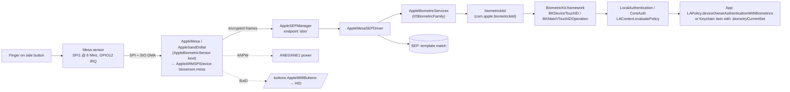

# 02: Boot and security

This chapter follows the iPhone Duo (`iPhone19,4`, `V68AP`, SoC `t8160`, iOS 27.2 `24B91020`) from power-on to a running kernel. It then covers every processor and block that enforces security: the Secure Enclave, SPTM, TXM, exclaves, the AES engine, the Secure Element, the eUICC, the Secure M3 and Touch ID in the side button. Every claim is labelled with its evidence. The labels are defined in [00-method-and-evidence.md](00-method-and-evidence.md).

The device tree in the IPSW is a **template**. Most `/chosen` values read `0` in it, and iBoot fills them in at boot. When this chapter lists a `/chosen` property, it is saying that the property **exists** and iBoot populates it. It is not saying what value the property has on a real device. iBoot's own strings confirm that it writes most of these names (see [§3](#3-chosen-what-iboot-tells-the-kernel)).

Cross-references: DRAM, ANS/NVMe and the DARTs are in [01-soc-cpu-memory-storage.md](01-soc-cpu-memory-storage.md). DCP and the display exclave are in [03-gpu-and-displays.md](03-gpu-and-displays.md). ISP, the camera exclave and the ANE are in [04-camera-media-neural-engine.md](04-camera-media-neural-engine.md). AOP and audio exclaves are in [05-sensors-touch-audio-haptics.md](05-sensors-touch-audio-haptics.md). PMU and SMC are in [06-power-battery-thermal.md](06-power-battery-thermal.md). NFC radio, baseband and UWB are in [07-networking-and-connectivity.md](07-networking-and-connectivity.md). The fold and cover state are in [08-foldable-system-and-chassis.md](08-foldable-system-and-chassis.md).

---

## Contents

1. [The cold boot, step by step](#1-the-cold-boot-step-by-step)
2. [Boot-chain images: what is actually in the IPSW](#2-boot-chain-images-what-is-actually-in-the-ipsw)
3. [`/chosen`: what iBoot tells the kernel](#3-chosen-what-iboot-tells-the-kernel)
4. [Image4 and personalization](#4-image4-and-personalization)
5. [Every BuildManifest component and who consumes it](#5-every-buildmanifest-component-and-who-consumes-it)
6. [Trust caches and code signing](#6-trust-caches-and-code-signing)
7. [Cryptex1](#7-cryptex1)
8. [SPTM and TXM](#8-sptm-and-txm)
9. [Exclaves](#9-exclaves)
10. [Secure Enclave (SEP)](#10-secure-enclave-sep)
11. [AES engine, GID and UID keys](#11-aes-engine-gid-and-uid-keys)
12. [Data protection, APFS, effaceable storage, xART](#12-data-protection-apfs-effaceable-storage-xart)
13. [Touch ID in the side button](#13-touch-id-in-the-side-button)
14. [Secure M3 and the camera/mic indicator](#14-secure-m3-and-the-cameramic-indicator)
15. [Secure Element, NFC and Apple Pay](#15-secure-element-nfc-and-apple-pay)
16. [eUICC (eSIM)](#16-euicc-esim)
17. [NVRAM, syscfg, repair history, liquid detection](#17-nvram-syscfg-repair-history-liquid-detection)
18. [OS environments: recovery, diagnostics, darwinOS](#18-os-environments-recovery-diagnostics-darwinos)
19. [Surprises and contradictions](#19-surprises-and-contradictions)
20. [Gaps and limits](#20-gaps-and-limits)

---

## 1. The cold boot, step by step

### Who runs what

| Core / processor | What it is | Evidence |
|---|---|---|
| AP `cpu0` | `apple,sawtooth` efficiency core, `cpu-id 0`, `cluster-id 0`. Template `state: "waiting"` | **[DT]** `/cpus/cpu0` |
| AP `cpu1`–`cpu3` | More `apple,sawtooth` E-cores | **[DT]** `/cpus/cpu1..3` |
| AP `cpu4`, `cpu5` | `apple,everest` cores, `cluster-type "P"` | **[DT]** `/cpus/cpu4`, `/cpus/cpu5` |
| SEP | A separate core behind an ASC wrapper, with an `aarch64` property | **[DT]** `/arm-io/sep` (`compatible "iop-sep,ascwrap-v8"`, `aarch64`) |
| Secure M3 | An Armv7-M microcontroller next to the ISP | **[FW]** `securem3fw-v68.im4p`: `RTKit_armv7m_Oz_floatabisoft-3514.40.18`; **[FW]** iBoot string `ISP_SECURE_M3` |
| AOP, AOP2, SIO, ANS, PMP, SMC, DCP, ISP, ANE… | RTKit co-processors that iBoot or the kernel load later | **[DT]** `iop,ascwrap-v8` nodes; see chapters 01 and 03–07 |

The 4 + 2 split of `sawtooth` and `everest` cores matches the public "2P + 4E" CPU **[DT][PUB]**. That the boot runs on `cpu0`, and that the other cores stay parked until XNU starts them, is an **[INF]** from the template `state` property and from conventional Apple SoC behaviour. The IPSW does not prove it.

### The sequence

```mermaid
sequenceDiagram
    autonumber
    participant ROM as SecureROM (AP cpu0, mask ROM)
    participant BOOT as LLB = iBoot (mBoot-20457.52.7)
    participant SEPROM as SEP Boot ROM (SEP core)
    participant SPTM as SPTM (AP)
    participant TXM as TXM (AP)
    participant CL4 as cL4 / ExclaveCore (AP)
    participant XNU as XNU kernelcache (AP)
    ROM->>ROM: Reset; read fuses (ECID, security domain, prod/dev)
    ROM->>BOOT: Load LLB (illb) from NAND; verify IM4M (APTicket) and digest
    Note over ROM: DFU path: load iBSS (ibss) over USB instead, then iBEC (ibec)
    BOOT->>BOOT: DRAM init (DCS/AMCC), PMU over SPMI, display + Apple logo
    BOOT->>BOOT: Read syscfg (v3, HMAC'd), NVRAM, boot-args, liquid / battery checks
    BOOT->>SEPROM: Hand over sep-patches (SepStage1) and sep-firmware (img4)
    BOOT->>BOOT: Load and verify FUD firmware (AOP, AOP2, SIO, PMP, ANE, GFX, ISP, Secure M3…)
    BOOT->>BOOT: Load DeviceTree, iBootData, StaticTrustCache, ExclaveOS TC + catalog, kernelcache
    BOOT->>BOOT: Lay out SPTM, TXM, cL4 objects; fill /chosen; lock CTRR regions
    BOOT->>SPTM: Jump
    SPTM->>TXM: Bring up TXM ("TXM-entry")
    SPTM->>CL4: Bring up exclave kernel + roottask (via secure-kernel entry)
    SPTM->>XNU: "Bootstrapping XNU..."
    XNU->>XNU: IOKit matching: AppleSEPManager, AppleKeyStore, AMFI, AppleImage4, …
    XNU->>SEPROM: Boot SEP OS (AppleSEPManager); keybag unlock path ready
```

What each step rests on:

1. **SecureROM starts on the AP.** SecureROM is mask ROM, so it is not in the IPSW. Its existence and role come from **[PUB]** the [Apple Platform Security guide](https://support.apple.com/guide/security/welcome/web), in its "Boot process for iPhone and iPad devices" section. The device tree's root node has `device_type "bootrom"` **[DT]** `/`.
2. **SecureROM loads LLB.** BuildManifest component `LLB` → `Firmware/all_flash/LLB.v68.RELEASE.im4p`, IM4P type `illb`, flagged `IsFirmwarePayload`, `Trusted`. It has a `MemoryMap` and a `BuildString` of `iBoot-15391~1757` **[FW]**. In DFU, the host sends `iBSS` (`ibss`) and then `iBEC` (`ibec`). The iBEC IM4P carries property `iocv = 2` **[FW]**. iBoot shows the USB identities "Apple Mobile Device (DFU Mode)" and "Apple Mobile Device (Recovery Mode)" **[FW iBoot strings]**.
3. **LLB / iBoot brings up the platform.** iBoot strings include:
   - `DCS Init … for ChipID==0x%04x`, AMCC density programming, and DRAM fuse reads (`fuse_get_bin_support`). These cover DRAM training.
   - `NUB_SPMI0..2`, `AOP_SPMI0/1`, and `ApplePMUFirmware-743.40.11~956.release`. These are the PMU, which iBoot can update.
   - `battery voltage %d mV…`, `precharge-battery-state` and `boot-battery-state`.
   - The image names `AppleLogo`, `RecoveryMode`, `Liquid` and `AudioBootChime` (`/product has-boot-chime = 1` **[DT]**).

   **[FW]**
4. **iBoot reads system configuration.** The strings include:
   - `nvme_syscfg%d`, `iboot-syscfg`, and `sysConfig3CreateFullHMAC`, `sysConfig3IsValidHMAC`, `_sysConfig3SetManifest`. Syscfg v3 is HMAC-protected and can carry a manifest.
   - `syscfg-erly-kbgs`, `syscfg-keybag-ids` and `syscfg-keybag-fallback-allowed`. These are early keybags held in syscfg.
   - NVRAM: `nvram-bank-count`, `nvram-proxy-data`, `boot-args`, `auto-boot`, `recovery-boot-mode`.

   **[FW]**
5. **iBoot loads the SEP images.** The paths `/usr/standalone/firmware/sep-patches.img4` and `/usr/standalone/firmware/sep-firmware.img4`, plus `seppatches-path`, `sepfw-path`, `sepfw-loaded` and `sep-boot-slot` appear in iBoot **[FW]**. `/chosen sepfw-load-at-boot = 1` **[DT]**. The SEP verifies and decrypts its own firmware. Apple documents this in **[PUB]** the Platform Security guide, "Secure Enclave". That the SEP does the decryption is consistent with the `sepi` payload being GID-wrapped (see [§10](#10-secure-enclave-sep)).
6. **iBoot loads the co-processor firmware.** iBoot names each image as `<Component>.img4` and reads it from `%s/usr/standalone/firmware/FUD/%s` **[FW]**. The names are `AOP.img4`, `AOP2.img4`, `SIO.img4`, `PMP.img4`, `ANE.img4`, `Ap,ANE1.img4`, `GFX.img4`, `Ap,GFX1Firmware.img4`, `ISP.img4`, `AVE.img4`, `Ap,AVD.img4`, `Ap,AppleVideoEncoder0..8.img4`, `Ap,MSRFirmware.img4`, `Ap,SecureM3Firmware.img4` and `MtpFirmware.img4`. Each matches a BuildManifest entry flagged `IsLoadedByiBoot` ([§5](#5-every-buildmanifest-component-and-who-consumes-it)).
7. **iBoot loads the OS objects.**
   - DeviceTree: `/usr/standalone/firmware/devicetree.img4`.
   - iBootData.
   - `StaticTrustCache.img4`.
   - `Ap,ExclaveOSTrustCache.img4` and `Ap,ExclaveOSIntegrityCatalog.img4`.
   - `Ap,cL4.img4`, `Ap,SecurePageTableMonitor.img4` and `Ap,TrustedExecutionMonitor.img4`.
   - `root_hash.img4`, which is the sealed system volume's root hash.
   - The kernelcache from `/System/Library/Caches/com.apple.kernelcaches/kernelcache`.

   **[FW iBoot strings]**. The strings also include `lay_out_sptm_objects`, `In load_kernelcache`, `lay_out_opaque_kernelcache`, `cL4-kernel/mmio`, `cL4-kernel/asc`, `exclave-memory-map`, `exclave-io-ranges` and `cl4-entropy` **[FW]**.
8. **iBoot locks memory and fills `/chosen`.**
   - Locks: the strings include `kernel-ctrr-to-be-enabled` and `ctrr-a`…`ctrr-d` **[FW]**. The template device tree has `/chosen/lock-regs/amcc/amcc-ctrr-a`…`-d` **[DT]**.
   - `/chosen`: iBoot writes `boot-manifest-hash`, `boot-nonce`, `effective-production-status-ap`, `effective-security-mode-ap`, `certificate-production-status`, `gid-aes-key`, `sidp-rom-manifest-hash` and more **[FW]**. See [§3](#3-chosen-what-iboot-tells-the-kernel).
9. **iBoot jumps to SPTM, and SPTM brings up the rest.**
   - SPTM's strings include `TXM-entry`, `TXM-virt`, `Bootstrapping XNU...` and `[SPTM] Synchronous exception taken from guest before XNU bootstrap` **[FW]** `sptm.t8160.release.im4p`.
   - XNU reaches the exclave kernel through `sk_enter`. The kernel strings include `sk_enter returned RINGGATE_STATUS_ERROR in exclaves_bootinfo`, `exclaves_boot.c` and `exclaves_boot_stage` **[KC]**.
   - The order SPTM → TXM → cL4 → XNU in the diagram is an **[INF]** from these strings.
10. **XNU starts.** The kernel version is `Darwin Kernel Version 27.2.0 … root:xnu-13432.52.2~7/RELEASE_ARM64_T8160` **[KC]**. Security services then match in IOKit:
    - `AppleSEPManager` ← `/arm-io/sep/iop-sep-nub`
    - `AppleImage4`, `Image4` and `AppleMobileApNonce` ← `/defaults`
    - `AppleMobileFileIntegrity` ← `IOResources`
    - `AppleKeyStore` ← `IOResources`
    - `ExclaveSEPManagerProxy` ← `/arm-io/esm`

    **[KC][DT]**

### Single-stage boot: LLB *is* iBoot

The four bootloader payloads, once extracted from their IM4P wrappers, are **byte-identical**. Each decompresses from LZFSE to 5,712,360 bytes with SHA-1 `b61306e0…` **[FW]**.

| Component | IM4P type | Version | Payload SHA-1 |
|---|---|---|---|
| `LLB` | `illb` | mBoot-20457.52.7 | b61306e0c480… |
| `iBoot` | `ibot` | mBoot-20457.52.7 | b61306e0c480… |
| `iBSS` | `ibss` | mBoot-20457.52.7 | b61306e0c480… |
| `iBEC` | `ibec` | mBoot-20457.52.7 | b61306e0c480… |

The wrappers differ. They have different type tags. LLB and iBSS carry an `mmap` property, and iBEC carries `iocv`. `/product single-stage-boot = 1` **[DT]**. The binary's banner is `iBoot for v68 Copyright 2007-2026`, and it contains `iboot-stage-one-tag`, `boot-stage` and `nsLLBL` **[FW]**. Every BuildManifest entry has `IsLoadedByiBootStage1 = false` **[FW]**.

**[INF]** On this device, SecureROM loads one unified "mBoot" image. That image acts as LLB or iBSS depending on the tag it was loaded under, and goes on to load the kernel itself. There is no separate second-stage iBoot. The `iBoot` and `iBEC` components still exist for restore and update flows. The `mBoot` version string is new compared with the `iBoot-NNNN` scheme. The BuildManifest `BuildString` still says `iBoot-15391~1757`.

The payloads are **not encrypted**: no KBAG is present **[FW]**. This differs from SEP ([§10](#10-secure-enclave-sep)).

`iBootData` (`ibdt`, 494,528 bytes) is a separate data blob. Its header has magic `0xb001da1a` and the version string `mBoot-20457.52.7`. The rest is mostly padding or tables **[FW]**. iBoot loads it from `/usr/standalone/firmware/FUD/iBootData.img4` or `/boot/iBootData` **[FW]**. What it contains (DRAM tables or UI assets) is not identifiable from strings; that is listed under [Gaps](#20-gaps-and-limits).

---

## 2. Boot-chain images: what is actually in the IPSW

| Image | File | IM4P type | Size (payload) | Format / note |
|---|---|---|---|---|
| LLB / iBoot / iBSS / iBEC | `all_flash/LLB.v68.RELEASE.im4p` etc. | `illb`/`ibot`/`ibss`/`ibec` | 5.7 MB LZFSE | Identical arm64 payload, unencrypted **[FW]** |
| iBootData | `all_flash/iBootData.v68.RELEASE.im4p` | `ibdt` | 494 KB | Data, magic `0xb001da1a` **[FW]** |
| DeviceTree | `all_flash/DeviceTree.v68ap.im4p` | `dtre` | 447 KB | `EmbeddedDeviceTrees-12661.52.3` **[FW]** |
| SEP OS | `all_flash/sep-firmware.v68.RELEASE.im4p` | `sepi` | 7.2 MB | **Encrypted**, PRODUCTION + DEVELOPMENT keybags **[FW]** |
| SEP ROM patch | `all_flash/sep-patches.v68.im4p` | `stg1` | 20 KB | **Encrypted**, `AppleSEPROM-1483.0.0.100.14` **[FW]** |
| SPTM | `sptm.t8160.release.im4p` | `sptm` (restore `rspt`) | 1.33 MB | arm64e Mach-O, base `0xfffffff027004000` **[FW]** |
| TXM | `txm.iphoneos.release.im4p` | `trxm` (restore `rtrx`) | 557 KB | arm64e Mach-O, base `0xfffffff017004000`, has `__info_plist` **[FW]** |
| cL4 / ExclaveCore | `image4/exclavecore_bundle.v68.RELEASE.im4p` | `excl` (restore `rxcl`) | 33.5 MB | Bundle `BUND` type 4 with compartments `kernel`, `roottask`, `pmm_exclave`, `sharedcache` **[FW]** |
| Kernelcache | `kernelcache.release.v6x-pandia` | `krnl` (restore `rkrn`) | 78.7 MB decompressed | 322 kexts **[KC]** |
| Secure M3 | `M3/bin/securem3fw-v68.im4p` | `sm3f` (restore `rsm3`) | 99.5 KB | Armv7-M RTKit Mach-O **[FW]** |
| Apple logo / recovery / liquid | `all_flash/applelogo@2d~iphone.im4p`, `recoverymode@…`, `liquiddetect@…` | `logo`/`recm`/`liqd` | — | `EmbeddedImages-184.40.2` **[FW]** |
| Boot chime | `embeddedaudioresources/image4/v68-boot-chime.im4p` | `aubt` | 587 KB | `IsiBootNonEssentialFirmware` **[FW]** |

**SPTM and TXM IM4P properties.** These IM4Ps carry Image4 properties named `kcep`, `kcev`, `kclf`, `kclo`, `kclz`, `kcrf`, `kcrz`, `kcwf`, `kcwz`, `kcxf`, `kcxz`, `kcbz` and `kcuu` **[FW]**.

**[INF]** These describe how iBoot lays the image out in memory: entry point, and offsets and sizes of the read-only, writable and executable regions. That matches the iBoot strings `lay_out_sptm_objects` and `SPTM-uuid-offset`.

---

## 3. `/chosen`: what iBoot tells the kernel

All values in the template are `0` or empty unless shown. iBoot populates them **[DT][FW]**.

| Property | Meaning | Evidence |
|---|---|---|
| `chip-id`, `board-id`, `die-id`, `unique-chip-id`, `unique-device-id` | SoC (`0x8160`) and board (`0x0E`) identity. `unique-chip-id` is the ECID | **[DT]**; values from BuildManifest `ApChipID 0x8160`, `ApBoardID 0x0E` **[FW]** |
| `security-domain` (iBoot string), `ApSecurityDomain 0x01` | Production security domain | **[FW]** |
| `secure-boot`, `production-cert`, `development-cert` | Fuse-derived boot policy | **[DT]** |
| `effective-production-status-ap`, `effective-security-mode-ap` | Effective production/secure status of the AP, after demotion | **[DT][FW]** |
| `effective-production-status-sep`, `effective-security-mode-sep` | The same for the SEP | **[DT]** |
| `certificate-production-status`, `certificate-security-mode` | What the signing certificate allowed | **[DT][FW]** |
| `debug-enabled`, `consistent-debug-root` | Debug fuse state and debug-region root | **[DT]** |
| `mix-n-match-prevention-status` | Whether the boot objects were all personalized together | **[DT]** |
| `boot-manifest-hash` | Hash of the IM4M that booted this OS | **[DT][FW]**; read by `AppleImage4` **[KC]** string `boot-manifest-hash` |
| `boot-nonce` (`com.apple.System.boot-nonce` in NVRAM) | The AP nonce for the next personalization | **[FW]**; `AppleMobileApNonce` ← `/defaults` **[KC]** |
| `sidp-rom-manifest-hash` | Manifest hash for a secondary ROM | **[DT][FW]** |
| `image4-cert-type = 1`, `secureboot-certificate-format "im4c"`, `secureboot-key-scheme "rsa4096"`, `crypto-hash-method "sha2-384"` | Image4 crypto suite | **[DT]** |
| `cryptex1-certificate-format "x509"`, `cryptex1-key-scheme "rsa4096"` | Cryptex1 crypto suite | **[DT]** |
| `gid-aes-key`, `uid-aes-key` | Flags for whether the GID and UID keys are still usable (no key material) | **[DT][FW]** |
| `amfi-allows-trust-cache-load`, `amfi-only-platform-code`, `cs-system-policy "default"` | Code-signing policy | **[DT]** |
| `system-trusted`, `protected-data-access = 1`, `sepfw-load-at-boot = 1` | OS-environment switches (see [§18](#18-os-environments-recovery-diagnostics-darwinos)) | **[DT]** |
| `txm-secure-channel = 1` | TXM↔SEP channel enabled | **[DT]** |
| `cl4-entropy` | Seed for the exclave kernel | **[DT][FW]** |
| `random-seed` | Seed for XNU | **[DT]** |
| `nvram-bank-count`, `nvram-bank-size`, `nvram-current-bank`, `nvram-proxy-data`, `max-env-*` | NVRAM handed to the kernel | **[DT][FW]** |
| `repair-history "syscfg/RCHL"`, `repair-status "syscfg/rpcp"`, `repair-environment` | See [§17](#17-nvram-syscfg-repair-history-liquid-detection) | **[DT]** |
| `darwinos-security-environment`, `osenvironment`, `ephemeral-storage`, `unrestricted-subsystem-root` | See [§18](#18-os-environments-recovery-diagnostics-darwinos) | **[DT]** |
| `boot-type "local"`, `root-matching`, `bootp-response` | Boot source | **[DT]** |

### `/chosen` child nodes

- `/chosen/manifest-properties` and `/chosen/manifest-object-properties`. Each has `Unused{Boolean,Integer,String}Property0..19` placeholders. iBoot copies IM4M properties into them **[DT]**.
- `/chosen/boot-object-manifests`, `/chosen/secure-boot-hashes`, `/chosen/dynamic-object-map`, `/chosen/memory-map` (`kernel-only = "true"`, `MemoryMapReserved-0..15`) and `/chosen/carveout-memory-map` **[DT]**.
- `/chosen/iBoot` (`start-time`, `load-kernel-start`, …). TXM reads `iboot-build-variant` from this node **[FW TXM strings]**.

---

## 4. Image4 and personalization

**[PUB]** Apple Platform Security guide; **[FW]** for the specifics below.

- **IM4P (payload).** Holds a 4-character type, a version string, an optional compressed payload, optional keybags (KBAG, wrapped with the GID key) and optional properties. Examples here:
  - `illb` / LZFSE.
  - `sepi` with two KBAGs.
  - `sptm` with the `kc*` layout properties.
  - `sepi` properties `ar1s`, `arms`, `cons` and `drmc`. **[INF]** `ar*` looks like an anti-replay or region size. The others are not documented.
- **IM4M (manifest / APTicket).** Apple's signing server (TSS) issues it for one device. It binds:
  - ECID, chip and board, security domain, and production mode.
  - The **AP nonce**: `RequiresNonceSlot = true`.
  - The SHA2-384 digest of every component (`Digest`, plus `RawDataDigest`, `ObjectPayloadPropertyDigest` and `TBMDigests` for SEP).

  The iBoot strings `/boot/apticket.der` and `Tag was not the expected manifest tag` relate to this **[FW]**. The request also includes `Ap,Timestamp` and `Ap,VM` (`RequestManifestProperties`) **[FW BuildManifest]**.
- **IM4R (restore info).** Carries the boot nonce generator and similar data during restore. This is **[PUB]** only. The IPSW cannot show it, because the host builds it at restore time.

### BuildManifest identity facts

**[FW]**

- `ApChipID 0x8160`, `ApBoardID 0x0E`, `ApSecurityDomain 0x01`.
- `Ap,Target V68AP`, `Ap,OSLongVersion 24.2.102.9.0,0`.
- `RequiresUIDMode = true`, `RestoreAttestationMode = 8`, `FDRSupport = true`.
- `NeRDEpoch 0`. The Recovery identity has `AllowNeRDBoot` (NeRD = network recovery).
- `PearlCertificationRootPub` is present (see [§19](#19-surprises-and-contradictions)).
- Co-processor chip IDs:
  - `Cellular1,ChipID 16416`
  - `Wireless1,ChipID 8230`
  - `Rap,ChipID 8228` (Rose, the UWB chip)
  - `SE,ChipID 0x91`
  - `eUICC,ChipID 32`
  - `BMU,ChipID 58629` (two BMUs: `BMU`, `BMU2`)
  - `YonkersIR1,ChipID 2325`, `YonkersIR2,ChipID 2326`
  - `Cryptex1,ChipID 0xFF10`

There are three build identities **[FW]**:

| # | Variant | Components | Notes |
|---|---|---|---|
| 0 | Customer Erase Install (IPSW) | 172 | Full set |
| 1 | Customer Upgrade Install (IPSW) | 172 | Different RestoreRamDisk (`141-29011-104.dmg`) |
| 2 | Recovery Customer Install | 79 | `Ap,OSReleaseType "Darwin Recovery"`. Has no `SEP`, `LLB`, `iBoot` or `Ap,cL4`, only `Ap,RestorecL4`. Its OS is `141-28683-104.dmg.aea`. This is recoveryOS (`/product supports-recoveryos = 1` **[DT]**) |

The kernel's Image4 code knows these chip environments **[KC]** (`CHIP_*` strings):

- AP: `CHIP_AP_SHA2_384`, `CHIP_AP_DDI_SHA2_384`, `CHIP_AP_PDI_SHA2_384`, `CHIP_AP_KCINSTALL`, `CHIP_AP_SRDP`, `CHIP_AP_SOFTWARE_FF00/FF01/FF06`.
- Cryptex1: `CHIP_CRYPTEX1_BOOT_AP`, `CHIP_CRYPTEX1_GENERIC_AP`, `CHIP_CRYPTEX1_ASSET_BRAIN_AP`, `CHIP_CRYPTEX1_MOBILE_ASSET_*`.
- VM: `CHIP_VMA2`, `CHIP_VMA3`.

---

## 5. Every BuildManifest component and who consumes it

Identity 0 has 172 entries. The flags come from each entry's `Info` dict. "Consumer" is the processor that executes or verifies the blob. A consumer that is not stated by a flag, a string or a device-tree link is marked **[INF]**.

### AP boot chain and OS

| Component | File | Flags | Consumer |
|---|---|---|---|
| `LLB` | all_flash/LLB.v68.RELEASE.im4p | FirmwarePayload, Personalize, Trusted | SecureROM → AP |
| `iBoot` | all_flash/iBoot.v68.RELEASE.im4p | FirmwarePayload | AP (same binary as LLB) |
| `iBSS`, `iBEC` | dfu/*.im4p | Personalize | AP in DFU/recovery |
| `iBootData` | all_flash/iBootData.v68.RELEASE.im4p | FUD, LoadedByiBoot | iBoot |
| `DeviceTree` / `RestoreDeviceTree` (`rdtr`) | all_flash/DeviceTree.v68ap.im4p | FirmwarePayload | iBoot → XNU |
| `KernelCache` / `RestoreKernelCache` (`rkrn`) | kernelcache.release.v6x-pandia | Personalize | AP (XNU) |
| `Ap,SecurePageTableMonitor` / `Ap,RestoreSecurePageTableMonitor` (`rspt`) | sptm.t8160.release.im4p | FUD / LoadedByiBoot | AP (SPTM) |
| `Ap,TrustedExecutionMonitor` / `Ap,RestoreTrustedExecutionMonitor` (`rtrx`) | txm.iphoneos.release.im4p | FUD / LoadedByiBoot | AP (TXM) |
| `Ap,cL4` / `Ap,RestorecL4` (`rxcl`) | image4/exclavecore_bundle.v68.RELEASE{,.restore}.im4p | FUD / LoadedByiBoot | AP (exclave kernel) |
| `Ap,ExclaveOS` | 141-27521-104.dmg.aea | ExcludeFromiBootSystemContainer, sha2-384 | Exclave userland image |
| `Ap,ExclaveOSTrustCache` | 141-27521-104.dmg.aea.trustcache (`extc`) | FUD | TXM/exclaves [INF] |
| `Ap,ExclaveOSIntegrityCatalog` | …integrity_catalog | FUD | Exclaves [INF] |
| `Ap,ExclaveOSVolume` | …root_hash | FUD, ExcludeFromiBootSystemContainer | Exclaves [INF] |
| `OS` | 141-28898-095.dmg.aea | sha2-384 | Sealed system volume |
| `SystemVolume` | …root_hash | FUD | iBoot `root_hash.img4` → APFS seal **[FW]** |
| `Ap,SystemVolumeCanonicalMetadata` | …mtree | FUD | Restore/APFS [INF] |
| `StaticTrustCache` | 141-28898-095.dmg.aea.trustcache (`trst`) | FUD | iBoot → TXM/AMFI |
| `RestoreRamDisk` / `RestoreTrustCache` (`rtsc`) | 141-28940-105.dmg (+.trustcache) | LoadedByiBoot | Restore OS |
| `Cryptex1,SystemOS` / `,SystemTrustCache` (`trcs`) / `,SystemVolume` | 141-28400-098.dmg.aea | Personalize (TC, volume) | [§7](#7-cryptex1) |
| `Cryptex1,AppOS` / `,AppTrustCache` (`trca`) / `,AppVolume` | 141-28395-106.dmg | Personalize | [§7](#7-cryptex1) |
| `ftap`, `ftsp`, `rfta`, `rfts` | (none) | sha2-256, `ftap` Trusted | **[INF]** Hashes of ftab-format firmware for the AP and SEP, plus restore variants |

### Security processors

| Component | File | Flags | Consumer |
|---|---|---|---|
| `SEP` / `RestoreSEP` (`rsep`) | all_flash/sep-firmware.v68.RELEASE.im4p | SecondaryFirmwarePayload | SEP core |
| `SepStage1` (`stg1`) | all_flash/sep-patches.v68.im4p | SecondaryFirmwarePayload | SEP Boot ROM (patch) |
| `Ap,SecureM3Firmware` / `Ap,RestoreSecureM3Firmware` (`rsm3`) | M3/bin/securem3fw-v68.im4p | FUD / LoadedByiBoot | Secure M3 (ISP side) |
| `SE,UpdatePayload` | SE/Stockholm91.RELEASE.sefw | Personalize; dev and prod hashes | Secure Element |
| `SE,RapRTKitOS` (`rkos`), `SE,RapSwBinDsp` (`sbd1`) | Rose/r2p1/ftab.bin | FTAB | **[INF]** Rose (UWB) images signed in the SE namespace |
| `eUICC,Gold`, `eUICC,Main` | vinyl_20.vnlfw | (digest only) | eUICC ([§16](#16-euicc-esim)) |

### Co-processors in other chapters

| Component | Consumer (chapter) |
|---|---|
| `AOP`, `AOP2`, `Ap,LowPowerMode` (`alpm`, iBootEAN) | AOP/AOP2 (05) |
| `ANE`, `Ap,ANE1`, `Ap,RestoreANE1` (`ran1`) | ANE0/ANE1 (04) |
| `ISP` (`ispf`) | ISP (04) |
| `AVE`, `Ap,AppleVideoEncoder0..8`, `Ap,AVD` | Video encode and decode (04) |
| `GFX`, `Ap,GFX1Firmware` | AGX GPU firmware (03) |
| `DCP` (iBootEAN), `RestoreDCP` (`rdcp`) | DCP (03) |
| `ANS`, `RestoreANS` | ANS NVMe (01) |
| `SIO` | Smart I/O (01) |
| `PMP`, `Ap,ApplePMCFirmware` | Power management (06) |
| `Ap,MSRFirmware`, `Ap,RestoreMSRFirmware` | MSR (04) |
| `Multitouch`, `MtpFirmware` | Touch (05) |
| `LeapHaptics`, `Ap,HapticAssets`, `Ap,MandoFW` | Haptics (05) |
| `WCHFirmwareUpdater` | Wireless charging (06) |
| `BMU,DigestMap`, `BMU,FirmwareMap`, `BMU2,*` | Two battery-management units (06) |
| `Cellular1,*` (10 entries) | C2 modem (07) |
| `Wireless1,*` (38 entries) | N1 Wi-Fi/BT (07) |
| `Rap,*` | Rose UWB (07) |
| `YonkersIR1,SysTopPatch0..F`, `YonkersIR2,SysTopPatch0..F` | Camera-sensor security chips (04, and [§19](#19-surprises-and-contradictions)) |
| `AppleLogo`, `RecoveryMode`, `Liquid` | iBoot display (EAN images) |
| `Ap,AudioBootChime` | iBoot audio |

`IsiBootEANFirmware` marks six images: `AppleLogo`, `RecoveryMode`, `Liquid`, `DCP`, `Ap,LowPowerMode` and `WCHFirmwareUpdater`. **[INF]** iBoot reads these from the NVMe "EAN" area before APFS is available. The iBoot strings include `nvme_ean` and `trace-ce-ean-point`, and `/defaults ean-storage-present` exists **[FW][DT]**.

---

## 6. Trust caches and code signing

### Trust caches in this IPSW

Dumped with `ipsw fw tc` **[FW]**:

| File | IM4P type | Role | TC format version | Entries |
|---|---|---|---|---|
| 141-28898-095.dmg.aea.trustcache | `trst` | **StaticTrustCache**: main OS | 2 | 3,920 |
| 141-28683-104.dmg.aea.trustcache | `trst` | recoveryOS static TC | 2 | 334 |
| 141-28400-098.dmg.aea.trustcache | `trcs` | **Cryptex1 SystemOS** | 2 | 131 |
| 141-28395-106.dmg.trustcache | `trca` | **Cryptex1 AppOS** | 2 | 34 |
| 141-27521-104.dmg.aea.trustcache | `extc` | **ExclaveOS** | 1 | 73 |
| 141-28940-105.dmg.trustcache | `rtsc` | Restore ramdisk (erase) | 1 | 370 |
| 141-29011-104.dmg.trustcache | `rtsc` | Restore ramdisk (update) | 1 | 377 |

Format-2 entries carry a `category` field (1, 2, 4…). **[INF]** These are launch-constraint categories. `ipsw` labels the ExclaveOS entries `flags=ANE`, and what that flag means is not known.

### The code-signing path

| Layer | Evidence |
|---|---|
| iBoot verifies and loads the static TC and the ExclaveOS TC | **[FW]** `StaticTrustCache.img4`, `Ap,ExclaveOSTrustCache.img4` |
| TXM (Trusted Execution Monitor) | **[FW]** TXM image, plus kernel strings `TXM channel…` and `using TXM-SEP secure channel with fixed DVA without DART` **[KC]**. **[INF]** As on other 2024+ Apple SoCs, TXM holds the trust caches and makes code-signing decisions. XNU asks TXM, and SPTM keeps XNU from changing executable mappings |
| AMFI | `com.apple.driver.AppleMobileFileIntegrity` (`AppleMobileFileIntegrity` ← `IOResources`) **[KC]**. Strings: `AMFI: Developer Mode Is On`, `Developer Mode can not be enabled on trusted darwinOS`, `%s: PID %d is requesting a trust cache load`, `…not allowed for Restricted Execution Mode state (%s): code is not present in any trustcache` **[KC]** |
| CoreTrust | `com.apple.kext.CoreTrust` **[KC]** checks CMS signatures |
| Policy flags | `/chosen amfi-allows-trust-cache-load`, `amfi-only-platform-code`, `cs-system-policy` **[DT]**. Kernel strings: `cs_enforcement disabled by boot-arg`, `can't has cs_enforcement_disable` **[KC]** |
| Sandbox / Lockdown Mode | `com.apple.security.sandbox`, `com.apple.driver.AppleLockdownMode` **[KC]** |
| Userland | `AppleMobileFileIntegrity.framework`, `libimage4.dylib`, `libImage4_V2.dylib`, `CryptexKit`, `libcryptex*.dylib`, `LockdownMode.framework` **[DSC]** (from the image list) |

---

## 7. Cryptex1

**[FW]** BuildManifest:

- `Cryptex1,SystemOS` = `141-28400-098.dmg.aea`. Size info `Cryptex1,SystemOSSize 5918`.
- `Cryptex1,AppOS` = `141-28395-106.dmg`. `Cryptex1,AppOSSize 16`.
- Each has a trust cache and a root hash. Both are `Personalize`.
- Keys: `Cryptex1,ChipID 0xFF10`, `Cryptex1,Type 1`, `Cryptex1,SubType 1`, `Cryptex1,ProductClass 0xF2`, `Cryptex1,NonceDomain 1`, `Cryptex1,KeyAlgorithm 0x101201301`, `Cryptex1,Version` / `PreauthorizationVersion 24.2.102.9.0,0`.
- `VariantContents` names them `CryptexOne`.

**[KC]** `/private/preboot/Cryptexes` and `/com.apple.security.cryptexd`. **[FW]** iBoot string `%s/%s/LocalPolicy.cryptex1.img4`. **[DT]** `/chosen cryptex1-*`.

**[INF]** As on iOS 16 and later, SystemOS carries the dyld shared cache and most system frameworks. It is personalized separately, so Rapid Security Responses can update it without a full OS update. AppOS (16 MB here) carries app-side content such as Safari components. The `Cryptex1,*` digests are not `Trusted` in the manifest. **[INF]** They are verified after boot (cryptexd / Image4 kext) rather than by iBoot.

---

## 8. SPTM and TXM

### SPTM: Secure Page Table Monitor

- **Image [FW].** `sptm.t8160.release.im4p`, IM4P type `sptm`. An arm64e Mach-O with segments `__TEXT`, `__DATA_CONST`, `__LATE_CONST`, `__TEXT_EXEC` (with `__exc`), `__LAST`, `__DATA` and `__BOOTDATA`.
- **Strings [FW].**
  - `Bootstrapping XNU...`, `init_xnu_ro_data`, `BootKC rs region does not fit xnu_ro_data`.
  - Page retyping checks such as `retyping from XNU_IOMMU but not to XNU_DEFAULT`. SPTM tracks a type for every physical page.
  - `TXM-entry`, `TXM-virt`.
- **MMIO allow-lists [DT].** SPTM only lets XNU map device MMIO that the device tree allows. Nodes carry `sptm-allow-reg`:
  - `/arm-io/pmgr/clpc`, `/arm-io/smc/iop-smc-nub`, `/arm-io/mtp`, `/arm-io/jpeg`, `/arm-io/ane0`, `/arm-io/ane1`, `/arm-io/apcie`.
  - `/arm-io/cpu-debug-interface` carries `sptm-allow-internal-reg` instead.
  - `/defaults` has `pmap-io-ranges` (PCIe and others), `pmap-io-filters` and `nvme-iboot-sptm-security`.
  - iBoot has `sptm-locks-gapf`.
- **CTRR [DT][FW].** `/chosen/lock-regs/amcc/amcc-ctrr-a..d` and iBoot `kernel-ctrr-to-be-enabled` lock the kernel's read-only text in the memory controller.
- **[INF]** SPTM runs at a higher privilege than XNU, in Apple's "guarded" execution level. XNU's `pmap` requests page-table changes from SPTM. The IPSW does not show the exception level.

### TXM: Trusted Execution Monitor

- **Image [FW].** `txm.iphoneos.release.im4p` (`trxm`). Mach-O with `__TEXT`, `__TEXT_EXEC`, `__TEXT_BOOT_EXEC` (with `__bootcode`), `__DATA` and an embedded `__info_plist`.
- **Strings [FW].**
  - `developer mode enabled due to PCC research build`, `developer mode disabled due to PCC release build`.
  - It reads `/chosen/iBoot iboot-build-variant` and `/product udid-version` (= 2 **[DT]**).
- **TXM↔SEP channel.**
  - `/arm-io/dart-sep` has `txm-secure-channel-base = 0x10000004000` and `txm-secure-channel-size = 0x4000` **[DT]**.
  - `/chosen txm-secure-channel = 1` **[DT]**.
  - Kernel strings: `unable to insert TXM-SEP secure channel mapping`, `txm-secure-channel-base not available with a SEP DART` **[KC]**.

  **[INF]** TXM and the SEP talk through a fixed 16 KB shared page, mapped at a fixed DVA in the SEP's DART. This is how code-signing state such as developer mode and local signing can be attested by the SEP.

---

## 9. Exclaves

Exclaves are isolated execution domains on the AP cores. They run under a small L4-family kernel (`cL4`) that is separate from XNU. They own hardware that XNU must not touch directly: camera and microphone privacy indicators, parts of ISP, ANE and DCP, and some audio paths. **[DT]** `/product has-exclaves = 1`, `exclaves-enabled = 1`.

### The pieces

| Piece | Evidence |
|---|---|
| **cL4 kernel + roottask** | `exclavecore_bundle.v68.RELEASE.im4p` (`excl`). The bundle has compartments `kernel` (SYSTEM), `roottask`, `pmm_exclave` and `sharedcache` (APP), plus a `brkr_artifact` (the broker or service manifest, DER) **[FW]** `ipsw fw exclave -i`. `pmm_exclave` calls `L4_Cap_Mint_Ep(…)`, confirming an L4-style capability API **[FW]**. The sharedcache is tagged `__BUNDLE_VARIANT: RELEASE` **[FW]** |
| **ExclaveOS** | `Ap,ExclaveOS` = `141-27521-104.dmg.aea`, with its own 73-entry trust cache (`extc`), integrity catalog and root hash **[FW]**. The ExclaveKit binaries live under `/System/ExclaveKit/...` (paths in the broker artifact) **[FW]** |
| **XNU side** | `exclaves_boot.c`, `sk_enter`, `RINGGATE_STATUS_*` **[KC]**. Kexts: `ExclaveSEPManagerProxy`, `SecureRTBuddyProxy`, `ExclavesAudioKext`, `EXBrightKext`, `ExclaveKextClient`, `com.apple.kec.XrtHostedXnu`, `AFKTightbeamEndpoint` (Tightbeam is the IPC format) **[KC]** |
| **Restore** | `Ap,RestorecL4` = `exclavecore_bundle…restore.im4p` (18 MB), loaded by iBoot in restore **[FW]** |
| **Userland** | `AlwaysOnExclavesDaemon`, `ASMExclaveSupport`, `AccessorySensorManagerExclaveDaemon`, `ISPExclaveKitServices`, `AppleCameraISPExclaveKitServices`, `CoreSpeechExclave`, `ExclaveFDRDecode`, `ExclavesMessageQueue*`, `ExclavesOutbox*`, `ExclavesStats`, `MobileAssetExclaveServices`, `ModelManagerExclaveInternal`, `PolarisExclaveSupport`, `SiriRaiseToSpeakExclave`, `libmalloc_exclaves_introspector` **[DSC]** (image list) |

### Every exclave-related device-tree node

Each node below has `exclave-assigned` **[DT]**. The XNU proxy class comes from **[KC]**.

| Node | `exclave-service` (and `_EDK` twin) | XNU class | Purpose |
|---|---|---|---|
| `/arm-io/aop-exclave-mailbox` | `com.apple.service.SecureRTBuddyAOP` | `SecureRTBuddyProxy` | Secure mailbox from exclaves to the AOP (role `AOP-EXCLAVE`). Shares the exclave MMIO window `reg 0x2d6030000/0x4000`. **[INF]** This is the always-on sensor and mic path into exclaves |
| `/arm-io/aop-exclave-ioreporting` | endpoint `M` | `SecureRTBuddyIOReporting` | IOReporting for that link |
| `/arm-io/aop2-exclave-mailbox` / `-ioreporting` | `SecureRTBuddyAOP2` | `SecureRTBuddyProxy` | The same for AOP2 (role `AOP2-EXCLAVE`) |
| `/arm-io/dart-sbr/mapper-exclave-aop`, `mapper-exclave-aop2` | — | `IODARTMapper` | DMA translation for the exclave AOP paths |
| `/arm-io/esm` | `com.apple.service.ExclaveSEPManager` | `ExclaveSEPManagerProxy` | Exclave↔SEP manager. See [§10](#10-secure-enclave-sep) |
| `/arm-io/dart-sep/mapper-sep-exclave` | — | `IODARTMapper` | SEP DART context for the ESM (`exclave-sid 2`) |
| `/arm-io/dcp-exclave-mailbox` / `-ioreporting` (endpoint `N`) | `SecureRTBuddyDCP` | `SecureRTBuddyProxy` | Exclave mailbox to the inner/outer display controller (see 03) |
| `/arm-io/dcpsec-exclave-mailbox` / `-ioreporting` (endpoint 153) | `SecureRTBuddyDCPSEC` | `SecureRTBuddyProxy` | Exclave mailbox to the second DCP (`dcpsec`) |
| `/arm-io/exdisplaypipe`, `/arm-io/exdisplaypipe1` | `EXDisplayPipeDriver_xnuproxy`, `EXDisplayPipe1Driver_xnuproxy` | `EXDisplayPipe` | Exclave-owned display pipes. **[INF]** One per DCP: the exclave draws the privacy indicator straight into each panel's pipe |
| `/arm-io/exdisplaypipe-s-proxy`, `exdisplaypipe1-s-proxy` | — | — | Register windows handed to the exclave |
| `/arm-io/dart-dcp`, `dart-dcpsec`, `dart-dcpext0` (`exclave-sid 4`), `dart-disp0`, `dart-dispsec` | — | `AppleT8110DART` | Exclave stream IDs on display DARTs |
| `/arm-io/isp` (also), `/arm-io/isp-exclave-proxy` | `com.apple.service.ISPEngine` | `AppleExclaveCameraProxy` | Secure camera pipeline (see 04) |
| `/arm-io/isp-exclave-s-proxy` | — | — | ISP register windows for the exclave |
| `/arm-io/dart-isp/mapper-isp-epipe0-exclave`, `-epipe1-exclave`, `-piodma1-exclave`, `-exclave-secure1` | — | `IODARTMapper` | ISP DMA contexts owned by the exclave |
| `/arm-io/ane-exclave-proxy`, `/arm-io/ane1-exclave-proxy` | `ANEExclave`, `ANE1Exclave` | `ANEExclaveProxy` | Exclave access to each Neural Engine. `exclave-reg` = `0x44f400000/0x88000` and `0x453400000/0x88000`. `ane0`/`ane1` have `exclave-proxy-parent` |
| `/arm-io/dart-ane0`, `dart-ane1` | `exclave-sid` list 1–7 | `AppleT8110DART` | ANE DMA streams |
| `/arm-io/iop-audio-controller/lp-mic-io-buffer-device` | `AudioDriverLPMic` | `IOPAudioIsolatedIOBufferDevice` | Low-power mic buffer owned by the exclave |
| `/arm-io/iop-voicetrigger-controller/audio-vt-device` | `AudioDriverVT` | `IOPAudioIsolatedVoiceTriggerDevice` | "Siri" voice trigger in the exclave |
| `/arm-io/admac-hp-mic-ec-proxy`, `admac-speaker-tx-ec-proxy`, `admac-receiver-tx-ec-proxy`, `admac-sllb-ec-proxy` | `AudioDriver`, `SpeakerOutputStreamDMA`, `ReceiverOutputStreamDMA`, `SecureLEAPLoopbackDMA` | `DMAChannelProxy` | Audio DMA channels given to the exclave. Linked from `admac-base-s/base-s-adma-tx-2/-tx-3/-rx-4` and `admac-leap-s/leap-s-adma-rx-2` by `service-exclave_proxy` |
| `/arm-io/audio-speaker-tx-stream-proxy`, `audio-receiver-tx-stream-proxy` | `SpeakerOutputStreamDriver`, `ReceiverOutputStreamDriver` | `IISAudioIsolatedOutputStreamECProxy` | Exclave-owned speaker and receiver output |
| `/arm-io/audio-sllb-proxy`, `audio-hp-proxy` | `SecureLEAPLoopbackDevice`, `HPMicAudioDriver` | `IISAudioIsolatedStreamECProxy` | Secure loopback; headphone mic |
| `/arm-io/audio-shared-dart-proxy` | `AudioSharedDARTMapper` | `SharedDARTMapperProxy` | Shared audio DART |
| `/arm-io/eic` | (no service) | — | **Exclave Indicator Controller** [INF from name and properties]. `cil = 1`, `mil = 1`, `policy-alt-indicator`, `policy-allow-prox-suppression`, `policy-allow-accessory`, `policy-override-chill-pill = 1000`. It owns MMIO for a GPIO bank (`0x2da000000`), the flash PWM (`0x2e5040000`), the global timebase (`0x2c82a8000`), two watchdogs (`wd-e 0x2c82b0000`, `wd-isp 0x3c3b10000`) and power-state (`0x2c0700000`) |
| `/exbright` | `EXBrightCore` | `EXBrightKext` | Exclave brightness core. **[INF]** It keeps the indicator visible at any brightness |
| `/display-health-monitor` | `DisplayHealthMonitor_Companion` | `DisplayHealthMonitorCompanion` | Display health monitor in the exclave |
| `/exclaves-test` | `HelloDrivers` / `ExclaveDriverKit` | `AppleExclaveExampleKext` | Example or test service |
| `/arm-io/dart-sbr` | `exclave-sid` `+`, `-` | `AppleT8110DART` | SBR DART exclave streams |

**`/defaults exclave-io-ranges` [DT]** decodes to seven MMIO windows. These are exactly the `eic` windows plus the shared exclave mailbox page `0x2d6030000/0x4000`. So XNU is told up front which device registers belong to exclaves.

### Conclaves and components

The broker artifact names these conclaves (exclave "processes") **[FW]**:

| Conclave | What it contains | Purpose |
|---|---|---|
| `Audiomxd` | Sound-analysis echo canceller, mic pre-processor, anomaly detector, attack detector, speaker and receiver DSP controllers | Audio |
| `Backboardd` | `AppleProxExclaveService`, `silmanager` shared memory (exsurface), `ExclaveFDRDecodeRawDataStoreService`, `ExclaveFDRDecodeTrustEvaluationService` | **[INF]** SIL = sensor indicator light |
| `Cameracaptured` | `T8160_RGB_ISP_EK_Component`, `T8160_IR_ISP_EK_Component`, FDR decode | Camera |
| Others | `CoreSpeechConclave`, `SoundAnalysisConclave`, `Securepairingd` / `SecurePairingdConclave` (pairing tone and passcode encoder), `AONSenseExclave`, `AlwaysOnExclaves`, `MobileAsset`, `ModelManager` | — |

Kernel-facing indicator hooks: `AppleCamera … [CIL] Finished exclaves_sensor_start(CAM)` and `exclaves_sensor_start(FACEID)` **[KC]**.

**End-to-end example: the green camera dot.**

1. An app opens the camera.
2. `AppleCamera` (XNU) calls `exclaves_sensor_start(CAM)` **[KC]**.
3. The exclave camera stack (`Cameracaptured.T8160_RGB_ISP_EK_Component`) starts the ISP through `/arm-io/isp-exclave-proxy` **[DT][FW]**.
4. The indicator controller (`/arm-io/eic`, `cil = 1`) and the Backboardd conclave's `silmanager` draw the indicator through `EXDisplayPipe`/`EXDisplayPipe1` into both display pipes, so it shows whether the phone is folded or open.
5. XNU never holds the registers needed to suppress the dot.

Steps 4–5 are **[INF]** from node and component names.

---

## 10. Secure Enclave (SEP)

### Hardware [DT]

| Node | Key properties |
|---|---|
| `/arm-io/sep` | `compatible "iop-sep,ascwrap-v8"`, `device_type "sep"`, `role "SEP"`, `aarch64`, `iop-version 1`. `reg` (DT, pre-translation): `0xa2600000/0x74000`, `0xa2050000/0x60000`, `0xa2700000/0x14000`. `interrupts 0x1a8, 0x1a7` on AIC (phandle `0x2d`). `iommu-parent` → `/arm-io/dart-sep/mapper-sep`. `clock-ids 401`. `sika-support 1`, `SEPHiddenKeySupport`, `ucert-offset 0`/`ucert-size 588`, `ucont-offset 592`/`ucont-size 1324`, `low-power-enable`, `self-power-gate` |
| `/arm-io/sep/iop-sep-nub` | `iop-nub,sep`, `rom-panic-bytes 472`, `function-wait_for_power_gate` |
| `…/iop-sep-nub/Sandcat` | `epoch-bumps`, `factory_key_disable` |
| `…/iop-sep-nub/xART` | (anti-replay storage, see [§12](#12-data-protection-apfs-effaceable-storage-xart)) |
| `…/iop-sep-nub/InvalidateHmac` | `config 1`, `reg-block 0x2882dc000/0x18000`, `sio-hmac1-offset`, `sio-hmac1-disable-mask 1` |
| `/arm-io/dart-sep` | `dart,t8110`, `reg 0xa0c80000/0x20000`, `interrupts 429`, `sid-count 3`, `exclave-sid 2`, `txm-secure-channel-base/size`, `vm-base-0/1/2` |
| `/arm-io/dart-sep/mapper-sep` (reg 0), `mapper-sep-exclave` (reg 2) | Two DART contexts: one for XNU↔SEP, one for exclave↔SEP |
| `/arm-io/esm` | `iop,exclave-sep-manager`, `reg 0x2e2710000/0x4000`, `interrupts 0x1a9, 0x1aa`, `iommu-parent` → `mapper-sep-exclave` |
| `/arm-io/error-handler/sep-error-handler` | `reg 0xa0d80000/0x40000`, `interrupts 0x1ac, 0x1ab` |

**[INF]** `ucert` and `ucont` are offsets in a SEP-owned region, possibly a unit certificate and its contents. Two more points are inferences:

- `InvalidateHmac`'s `reg-block` sits in the same `0x…882dc000` window as `/arm-io/aes`'s second `reg`, which suggests the SEP can invalidate an SIO HMAC key.
- `sika-support` is not explained anywhere in these sources.

### Firmware [FW]

- **`sep-firmware.v68.RELEASE.im4p`** (`sepi`, 7.2 MB). Encrypted, with a PRODUCTION and a DEVELOPMENT KBAG. Each KBAG holds an IV and key that are themselves wrapped with the SEP's GID key, so the plaintext keys are not recoverable from the IPSW.
  - IM4P properties: `ar1s 8388608`, `arms 19398656`, `cons`, `drmc`.
  - Manifest entry: `Digest`, `RawDataDigest`, `ObjectPayloadPropertyDigest`, `TBMDigests`, `MemoryMap`, `Trusted`.
  - The contents cannot be read here.
- **`sep-patches.v68.im4p`** (`stg1`, BuildManifest `SepStage1`). Version `AppleSEPROM-1483.0.0.100.14`, encrypted, with an `rddg` property.

  **[INF]** A patch applied to the SEP Boot ROM before it loads SEP OS. The name says so, and so do iBoot's `SEPPatches` and `seppatches-path`.

### Kernel drivers: endpoint map [KC]

`AppleSEPManager` (`com.apple.driver.AppleSEPManager` 1.0.1) binds `iop-nub,sep`. It publishes one `AppleSEPDeviceService` per endpoint, and each endpoint has its own driver:

| Endpoint | Driver class (kext) | Purpose |
|---|---|---|
| `sbio` | `AppleMesaSEPDriver` (AppleMesaSEPDriver 100.99) → `AppleBiometricServices` | Touch ID |
| `sprl` | `ApplePearlSEPDriver` | Face ID |
| `eprl` | `ApplePearlExclaveSEPDriver` | Face ID via exclave |
| `sse` | `AppleSSE` (+ `AppleSSEUserClient`) | Secure Element link [INF] |
| `hdcp` | `AppleSEPHDCPManager` | HDCP for DisplayPort |
| `xarm`, `xars` | `AppleSEPXARTService` | xART (anti-replay) |
| `artr`, `arts` | `AppleSEPARTRequestsService`, `AppleSEPARTStorageService` | Anti-replay requests and storage |
| `pair` | `AppleSEPPairing` | Pairing |
| `hilo` | `AppleSEPHiloService` | Also referenced by `/arm-io/dispsec/hilo` (see 03) |
| `log`, `debu`, `unit` | `AppleSEPLoggerService`, `AppleSEPDebugService`, `AppleSEPTestingService` | Logging, debug, testing |
| — | `AppleKeyStore` (AppleSEPKeyStore), `AppleCredentialManager` (AppleSEPCredentialManager) | On `IOResources`; talk to the SEP through the manager |
| — | `NVMeSEPNotifier` (IONVMeFamily) ← `AppleSEPManager` | Storage ↔ SEP coordination |

### Exclave ↔ SEP

The broker artifact defines shared-memory channels for `ExclaveSEPManager` **[FW]**:

| Channel | Direction |
|---|---|
| `SKS` | in / out |
| `SKSD` | in / out |
| `SCRD` | in / out |
| `TRNG` | in / out |
| `ISP PCE` | in / out |
| `ISP Config` | in / out |

There is also an `AppleKeyStore` exclave component with `AppleKeyStore__tightbeam__` and a `DeviceMemoryKeyStore` storage client **[FW]**.

**[INF]**

- `SKS` is the SEP KeyStore service.
- `TRNG` is the SEP's true random number generator, offered to exclaves.
- `ISP PCE` / `ISP Config` let the secure camera pipeline get keys from the SEP.

### Userland

**[DSC]** (from the image list): `Security.framework`, `AppleKeyStore.framework`, `MobileKeyBag.framework`, `LocalAuthentication*`, `CryptoTokenKit`, `DeviceCheck`, `AppAttestInternal`. The daemon binaries (`securityd`, `keybagd`, `coreauthd`, `sepd`…) are not in the shared cache, and the cache was not available to check their names; see [Gaps](#20-gaps-and-limits).

---

## 11. AES engine, GID and UID keys

- **Node [DT].** `/arm-io/aes`: `compatible "aes,s8000"`, `aes-version 6`.
  - `reg 0xa500c000/0x4000`, `0x882dc000/0x8000`, `0x88078000/0x4000`.
  - `interrupts 1343`.
  - `iommu-parent` → `/arm-io/dart-sio/mapper-aes`. The AES engine DMAs through the SIO DART.
  - `clock-gates 25`, `service-gates 25`.
  - `sioaesdisable-offset 0`, `sioaesdisableuid1-offset 4`, `sioaesdisablegid0-offset 8`, `sioaesdisablegid1-offset 12`.
- **Driver [KC].** `AppleS8000AESAccelerator` (`com.apple.driver.AppleS8000AES`). `/defaults aes-service-publish-timeout` **[DT]**.
- **Concept [PUB].** The Platform Security guide describes two key types:
  - The **GID** key is shared by every device of one SoC family. It decrypts firmware KBAGs such as SEP's.
  - The **UID** key is unique per device, fused at manufacture, and never readable by software. It is the root of data-protection key derivation inside the SEP.

  Both are usable only as AES engine operations, never as readable values.
- **[INF]** The `sioaesdisable*` offsets name registers that turn off GID0, GID1 and UID1 for the SIO-side AES path. iBoot or the kernel set them after boot, so later software cannot use the keys for decryption. `/chosen gid-aes-key` / `uid-aes-key` report the state.

---

## 12. Data protection, APFS, effaceable storage, xART

### Volumes [DT]

`/filesystems/fstab` (`os_env_type 1`, `max_fs_entries 7`):

| Volume | Mount | Role | Mode |
|---|---|---|---|
| System | `/` | 1 | ro (sealed; root hash = `SystemVolume`) |
| Preboot | `/private/preboot` | 16 | ro |
| xART | `/private/xarts` | 256 | rw |
| Data | `/private/var` | `@` (64) | rw |
| Baseband-Data | `/private/var/wireless/baseband_data` | 128 | rw |
| Update | `/private/var/MobileSoftwareUpdate` | 192 | rw |
| Hardware | `/private/var/hardware` | 320 | rw |

### Key storage

- **`/defaults`** has `content-protect`, `cpx-encryption-mode 2` and `no-effaceable-storage` **[DT]**.
- **The kernel** has `"================ no-effaceable-storage is ON ================"`, `AppleEffaceableStorage not immediately available`, and `get escrow token from effaceable` **[KC]**.
- **Effaceable kexts.** `AppleEffaceableStorage` exists, and `AppleEffaceableBlockDevice` matches `IONVMeEffaceableDevice` **[KC]**.
- **[INF]** On this SoC, the classic "effaceable storage" area of NAND (which held the class keys' wrapping key, so it could be erased instantly) is not used. Erasure is anchored in the SEP's own Secure Storage Component and xART instead. The kernel keeps a compatibility path.
- **xART** (anti-replay):
  - The `/private/xarts` volume **[DT]**.
  - The `/arm-io/sep/iop-sep-nub/xART` node **[DT]**.
  - SEP endpoints `xarm`, `xars`, `artr`, `arts` **[KC]**.
  - BiometricKit's `isXARTAvailable:` **[DSC]**.
- **Keybags.** iBoot reads early keybags from syscfg (`syscfg-erly-kbgs`, `syscfg-keybag-ids`) **[FW]**. `AppleKeyStore` holds the system and user keybags in XNU and forwards key operations to the SEP **[KC]**.
- **Classes [PUB].** Apple Platform Security guide, "Data Protection classes":
  - **A** (Complete Protection): key evicted shortly after lock.
  - **B** (Protected Unless Open).
  - **C** (Until First User Authentication): the default.
  - **D** (No Protection): protected only by the UID-derived key.

  APFS encrypts per file, or per extent with per-file keys, and wraps each file key with its class key. The AES engine does inline encryption on the storage path, and keys never appear in AP memory in the clear. **[KC]** shows `apfs` 3288.52.1 with data-protection strings such as "upgrade of data protection class".

**[INF] End-to-end: unlocking after reboot.**

1. The user types the passcode. SpringBoard calls `LocalAuthentication`/`MobileKeyBag`.
2. `AppleKeyStore` (XNU) sends the passcode to the SEP over the SEP mailbox.
3. The SEP mixes it with the UID key (tangling), unwraps the class keys, and releases class keys A/B/C to the AES engine path as wrapped key handles.
4. APFS can now open Class A–C files on `/private/var`.

---

## 13. Touch ID in the side button

The public spec says "Touch ID in side button" **[PUB]**. The device tree shows how it is wired.

### Sensor node [DT]: `/arm-io/spi1/mesa`

| Property | Value | Meaning |
|---|---|---|
| `compatible` / `device_type` | `biosensor,mesa` / `mesa` | Mesa is Apple's name for the Touch ID sensor |
| parent | `/arm-io/spi1` (`spi-1,spimc`, `reg 0xa5104000/0x4000`, IRQ 1337, `clock-ids 404`, `dma-parent` → `/arm-io/sio/iop-sio-nub/sio-dma`, two DMA channels, `function-spi_cs0`) | **SPI bus 1**, DMA through the Smart I/O co-processor |
| `reg` | chip-select / config words `0x0, 0x1f4, 0x08010100, 0x0, 0x14 …` | **[INF]** SPI device config. The exact encoding is not public |
| `spi-frequency` | `0x7a1200` = 8 MHz | SPI clock |
| `interrupt-parent` | phandle `0x73` → `/arm-io/nub-gpio` | Finger-on and data-ready interrupt from an always-on GPIO |
| `interrupts` | `0xc, 0x05000003` | GPIO pin 12 (flags word not decoded) |
| `sensor-id` | `"X3"` | Sensor variant |
| `mesaType` | `2` | Sensor family selector |
| `invert-menu-key` | `1` | The button doubles as the old "menu/home" key, inverted for the side position |
| `function-mesa_pwr` | → `/arm-io/smc/iop-smc-nub/smc-pmu` (`0x9f`), fourccs `pKW8` / `pcLD` | Sensor rail power through the PMU via SMC |
| `function-monitor-current-3v0` | → `smc-pmu`, `pKR8 aDCR IPdl` | 3.0 V rail current monitor (`monitor-current-3v0-threshold 130`, `-count 3`) |
| `function-over-current-detection` | → `smc-pmu`, `keyR pmOC` | Over-current protection |
| `monitor-power-threshold 190`, `-interval 1000`, `-avg-count 20` | | Power watchdog |
| `function-hid_event_dispatch` | → `/buttons` (`0x1c4`), `ButD` | Delivers button events to the button driver |
| `function-ane_power_func`, `function-ane0_power_func` | → `/arm-io/ane0` (`0x13e`), `ANPW` | **Touch ID powers the Neural Engines** |
| `function-ane1_power_func` | → `/arm-io/ane1` (`0x14a`), `ANPW` | (see above) |
| `power-on-delay 7`, `max-scan-time 0x13333`, `time-between-scans 0x20000`, `scan-timer-reset-time 0x9999` | | Scan timing |

The fourccs are written here in readable order (the device tree stores them as little-endian u32). Their meaning beyond the obvious ones is not public.

`/buttons` **[DT]** (`AppleM68Buttons`):

- `button-names` = `volup`, `voldown`, `hold`.
- `home-button-type 2`, `button-priority_hold 1`, `button-delay_hold 75000`.
- `/product side-button-location` and `supports-camera-button = 1`.

### Driver chain [KC]



- **Sensor-side kext.** `com.apple.driver.AppleBiometricSensor` has these classes:
  - `AppleMesa` and `AppleSandDollar`. Both match `biosensor,mesa`, and the source file is `AppleSandDollar.cpp`.
  - `AppleMesaShim` ← `AppleMesa`.
  - `AppleMesaResources` ← `IOResources`.

  Known sensor types are `kSensorTypeNavajo`, `Sanddollar`, `Triton`, `TritonA2`, `Poseidon`, `PoseidonA2` and `Oceanus`. The kext has `provisionSandDollar` and `sanddollar-converter` **[KC]**.
- **Encryption.** `AppleMesa::handleCMD -- kCMDSetEncryptedParameters buffer too large` shows that sensor parameters and images are encrypted. The kernel moves ciphertext only **[KC]**.
- **Part pairing.** `_invalidModuleSerialNumber` is checked alongside `_mesaDisabled`. **[INF]** The sensor module is paired to this SEP, which is Apple's documented Touch ID sensor pairing **[PUB]** (Platform Security guide, "Touch ID").
- **Fold awareness.** The kernel logs `touchIDButtonPressed:%d (_displayStatus:%u, isEnabledForUnlock():%u, _mesaDisabled:%u, _commandMode:%u, _autoMatchStarted:%u, _displayCoverClosed:%u)` **[KC]**. **[INF]** `_displayCoverClosed` is the fold or cover state from chapter 08. The driver changes auto-match behaviour depending on whether the device is folded.
- **AOP side.** `AppleSPUMesaDriver` ← `IOHIDInterface` in `AppleSPU` **[KC]**. **[INF]** The always-on processor sees Mesa or button HID events for wake.
- **SEP side.** `AppleMesaSEPDriver` ← `AppleSEPDeviceService (sep-endpoint,sbio)`, then `AppleBiometricServices` ← `AppleMesaSEPDriver` **[KC]**.
- **Userland [DSC].**
  - `BiometricKit.framework` has `BKDeviceTouchID` (`createMatchOperationWithError:`, `createEnrollOperationWithError:`, `enableBackgroundFingerDetection:error:`), `BKMatchTouchIDOperation`, `BKEnrollTouchIDOperation`, `BKExtendEnrollTouchIDOperation` and `BKFingerDetectOperation`.
  - Its XPC protocol `BiometricKitXpcProtocol` has `match:options:async:client:replyBlock:`, `isFingerOn:`, `dropUnlockToken:`, `isXARTAvailable:` and `getSensorInfo:`.
  - The delegate gets `touchIDButtonPressed:client:` and `homeButtonPressed:`.
  - The daemon's service name is `com.apple.biometrickitd`. It appears as a string in `BiometricKitUI`, `SpringBoard` and `AVFCapture`. `BiometricSupport` has queue names `com.apple.biometrickitd.ongoingBiometricOperation` and others.
  - Other images: `BiometricKitUI`, `BiometricSupport`, `LocalAuthentication` (+ `DaemonUtils`, `MechanismBase`, `ModuleBase`, `SharedUtils`), `LocalAuthenticationCore`, `LocalAuthenticationCredentialServices`, `LocalAuthenticationPreboard` and `PasscodeAndBiometricsSettings`.
- **Public API.** `LocalAuthentication` (`LAContext`, `LABiometryType.touchID`), and Keychain access control (`SecAccessControlCreateWithFlags` with `.biometryCurrentSet`) **[PUB]**.

**[INF] End-to-end: "a finger on the side button unlocks the phone".**

1. The capacitive ring or finger detect raises GPIO 12 on `nub-gpio`.
2. `AppleMesa` wakes, powers the sensor rail through the SMC/PMU, and clocks the image out over SPI1 with SIO DMA. The image is encrypted between sensor and SEP.
3. `AppleMesa` passes the ciphertext to the SEP on endpoint `sbio`.
4. SEP decrypts it and matches it against enrolled templates. The `ANPW` functions suggest the Neural Engine is powered for part of this work, but the IPSW does not show that the ANE runs matching code.
5. On a match, the SEP releases the class keys the unlock needs and returns a match result.
6. `AppleBiometricServices`, then `biometrickitd`, then `BiometricKit` deliver `matchResult:details:client:`. SpringBoard and CoreAuth unlock.

There is no Touch ID exclave service in the device tree or the exclave broker. The fingerprint path is **SEP-only**. Contrast this with Face ID's `eprl` exclave path, which exists in the kernelcache **[DT][FW][KC]**.

---

## 14. Secure M3 and the camera/mic indicator

- **Firmware [FW].** `M3/bin/securem3fw-v68.im4p` (`sm3f`). A 32-bit Mach-O built with `RTKit_armv7m_Oz_floatabisoft-3514.40.18`, version `20.112` (built `Oct 21 2026`). The same version number appears on the `AppleCamera` kext (20.112) **[KC]**. Source-file names:
  - `CILMonitor.c`, `CILMonitorThread`, `CLPDPACIController.c`.
  - `isp_to_m3_tightbeam.c`, `secureM3_tb_ipc.c`, `secureM3_tb_translator.c`, `m3_tb_server`, `m3_tb_client`.
  - `CSensorDriver.c`.
  - `SpmiControllerCommon.c`, `AldaSTI2cController.c` (three I2C command threads).
  - `rtk_mbi_messagebox.c`, `securem3_coredump`.
- **Loading.** `Ap,SecureM3Firmware` (FUD) and `Ap,RestoreSecureM3Firmware` (`rsm3`, LoadedByiBoot) **[FW]**. iBoot has `ISP_SECURE_M3` and the boot-arg `-no-load-isp-securem3` **[FW]**.
- **Kernel.** `AppleCamera:%s - [Exclave] SendCmdSecureM3Isr…` and `TB_FATAL: invalid result returned from secureM3Isr` **[KC]**. The ISP exclave services the M3's interrupt.
- **[INF]** The Secure M3 is a small Cortex-M class controller attached to the camera subsystem. It owns its own SPMI and I2C controllers to camera modules or power, and it monitors the **camera indicator light (CIL)**. The DT `/arm-io/eic cil = 1` is the matching exclave policy flag. The M3 talks to the ISP or exclave over Tightbeam, giving a hardware-rooted guarantee that the indicator turns on whenever a camera sensor is powered.

---

## 15. Secure Element, NFC and Apple Pay

### Hardware [DT]

Both NFC controllers hang off the **AOP's SPMI bus 0** (`/arm-io/aop-spmi0`, `aapl,spmi`, gen 4, `AppleSPMIController`):

| Node | compatible | Key properties | Driver [KC] |
|---|---|---|---|
| `/arm-io/aop-spmi0/stockholm-spmi` | `nfc,primary,spmi` | SPMI address word `8`, 7 SPMI interrupts, `nfccModel 223` (`-A0 218`), `required-functions support_host_wake_spmi, support_data_over_spmi`, `spmiFollowerReset` | `AppleStockholmSPMI` |
| `…/stockholm-spmi/stockholm` | `nfc,primary,gpio` | `rf-antenna-name "RTM8_8"`, `nfcWithRadio`, `sn450WithLoadSwitch 1`, `eos-halley-config 1`, `supports-nfc-reader-mode`, `function-enable`, `function-boot_measurements`, **`function-se_boot_measurements`**, `required-gpios` incl. `support_bootstop-interrupts` | `AppleStockholmControl` |
| `/arm-io/aop-spmi0/hammerfest-spmi` | `nfc,secondary,spmi` | SPMI address word `0xc`, `nfccModel 189` (`_A0 188`) | `AppleStockholmSPMI` (`AppleHammerfestSPMI`) |
| `…/hammerfest-spmi/hammerfest` | `nfc,secondary,gpio` | `rf-antenna-name "RTM8_8S"`, `nfcWithRadio`, `supports-nfc-reader-mode` (no SE boot-measurement function) | `AppleStockholmControl` (`AppleHammerfestControl`) |

**[INF]** The Duo has two NFC front ends, `RTM8_8` and `RTM8_8S`. Only the primary "Stockholm" has the embedded Secure Element (it has `se_boot_measurements`). The secondary "Hammerfest" is likely a second radio or antenna for the other half of the fold, so tap-to-pay works folded or open. That placement is an inference; see chapter 08. `sn450` names an NXP SN-series NFC controller **[INF]** from the property name.

`/product` **[DT]** has `nfc-express = 1`, `low-power-wallet-mode = 1` and `low-power-express = 1`. That is Express Transit, including with the battery in power reserve.

### Firmware [FW]

- `SE,UpdatePayload` = `SE/Stockholm91.RELEASE.sefw`. A DER container that is encrypted or opaque, with readable `DP-00-000` and version `22.7.14-014;22.7-1.14-0060`.
- `SE,ChipID 0x91`.
- The manifest holds `DevelopmentUpdatePayloadHash` and `ProductionUpdatePayloadHash` rather than a single digest. The SE checks the update itself.

### Kernel and userland

| Layer | Pieces |
|---|---|
| **[KC]** | `AppleStockholmControl` (+ `AppleStockholmControlUserClient`), `AppleStockholmSPMI`, `AppleSSE` (+ `AppleSSEUserClient`) on SEP endpoint `sse` |
| **[DSC]** | `NearField.framework`, `NearFieldPrivateServices`, `libNFC_HAL.dylib`, `libNFC_Comet.dylib`, `SEService.framework`, `SecureElementCredential.framework` (public), `CoreNFC.framework` (public), `PassKit`/`PassKitCore`/`PassKitServices`, `ProximityReader*` |

### Apple Pay key flow [PUB][INF]

From the Platform Security guide's "Apple Pay" and "Secure Element and NFC controller" sections:

1. **Provisioning.** The card's Device Account Number is written into an applet in the **Secure Element**. It is not in the AP and not in the SEP.
2. **Payment.** The user double-clicks the side button and authenticates with Touch ID ([§13](#13-touch-id-in-the-side-button)). The SEP then sends a signed authorization to the SE over a dedicated channel. **[INF]** In XNU terms, that channel is `AppleSSE` / endpoint `sse`.
3. **Transaction.** The SE applet generates the transaction cryptogram. The NFC controller routes the RF field straight to the SE, so the AP never sees the cryptogram. Express Transit skips step 2.

---

## 16. eUICC (eSIM)

The Duo is eSIM-only **[PUB]**.

**[FW] — the firmware:**

- `eUICC,Gold` and `eUICC,Main` both point to `Firmware/vinyl_20.vnlfw`. It is a ZIP whose directory is a SHA-256 name, containing `update/gold/firmware.der` and more.
- `eUICC,ChipID 32`. `VariantContents VinylFirmware: Release`.
- `vinyl_20.plist` lists `eUICC,Gold` / `eUICC,Main` digests and `_FirmwareMetadata`. The keys are `kVinylFwUpdateLoaderVersion`, `KeyId`, `GoldFwMac` and `CurrentVersion`. The variants are named `G&D_CI27AJEC_CSD_M001002_V1A02` … `M113000_V2E00`.

  **[INF]** G&D is the eUICC silicon or OS supplier (Giesecke+Devrient), with about 13 hardware or firmware lots supported.
- **[INF]** "Gold" is the factory or recovery image and "Main" is the operational OS.

**[DSC]** `libVinylUpdater.dylib`, `libVinylNonUpdater.dylib`, `CellularPlanManager.framework`.

**[DT]** No device-tree node names the eUICC.

**[INF]** As on earlier iPhones, the eUICC sits on the baseband's SIM interface and is reached through the modem (chapter 07). Profile download goes through CommonCenter/CellularPlanManager.

---

## 17. NVRAM, syscfg, repair history, liquid detection

### NVRAM

- The kernel has `AppleARMNORNVRAM` (matches `nvram,nor`/`nvram,chrp`), but **no device-tree node uses that compatible** **[KC][DT]**.
- `/chosen nvram-proxy-data`, `nvram-bank-*` **[DT]**.
- iBoot has `nvram-raw`, `nvram-migrate`, `guid-var-trans` and `2nvram` **[FW]**.
- **[INF]** NVRAM lives on NVMe, managed by iBoot. The kernel gets a proxy copy and writes it back through `IONVRAM`.
- Variables named in iBoot: `boot-args`, `auto-boot`, `auto-boot-once`, `com.apple.System.boot-nonce`, `recovery-boot-mode`, `recovery-reason`, `panicmedic-*`, `SystemAudioVolume…` **[FW]**.

### syscfg

- iBoot parses syscfg v3 with per-entry and full HMACs and an optional manifest **[FW]**.
- The device tree references syscfg keys by 4-character code **[DT]**:
  - Identity: `SrNm` (serial), `MLB#`, `Mod#`, `Regn`, `RMd#`, `CFG#`.
  - Colors and materials: `CLHS`, `CLBG`, `CGMt`, `EnMt`, `BGMt`.
  - Display calibration: `DPCl`, `DBCl`, `DTCl`.
  - Sensor calibration: dozens under AOP, such as `ARSC`, `GRXN`, `CPAS`, `PxCl`.
  - Camera calibration: `PrCL`, `RxCL`.
  - MAC addresses: `BMac`, `WMac`, `EMac`, `EMc2`.

### Repair history

- `/chosen repair-history = "syscfg/RCHL"` and `repair-status = "syscfg/rpcp"` **[DT]**.
- The OS-environment switch `repair-environment` **[DT]**.
- iBoot strings `repair`, `rsepfirmware` **[FW]**.
- The kernel string `repair-history` **[KC]**.
- `/arm-io/secure-repair` (`secure-repair,1`, `AppleSecureRepair`, role `AOP`, `gpio-repair_en`, 7 GPIO interrupt groups). Its `reg 0x90824000/0x4000` is **the same window as `/arm-io/aop-gpio`** **[DT][KC]**.
- Userland: `CoreRepairCore`/`Kit`/`Lite`/`UI`, `libFDR.dylib`, `libFDRDecode.dylib` **[DSC]**.
- Exclave: `ExclaveFDRDecodeTrustEvaluationService` in the Backboardd and Cameracaptured conclaves **[FW]**.

**[INF]** RCHL holds a record of parts repaired or replaced. Parts identity is checked against FDR (Factory Data Restore) sealed data. For the camera and display parts, that check runs inside exclaves. The "secure-repair" GPIO block lets an AOP-side repair-enable line be asserted for Apple's Self Service Repair flow.

### Liquid detection

- iBoot shows `liquiddetect@2d~iphone.im4p` (`liqd`, EAN image) when the port reports liquid **[FW]**.
- In the kernel, `AppleHPMInterface::setLDCMLiquidDetected`, `AppleTCController::setLDCMLiquidDetected` and `_handleMitigationsForLiquidState` handle it. LDCM is liquid detection and corrosion mitigation on the USB-C controller **[KC]**.
- Details of the USB-C side are in chapter 07.

---

## 18. OS environments: recovery, diagnostics, darwinOS

`/osenvironments` **[DT]** holds patch sets that iBoot applies to the device tree for non-normal boots:

| Environment | Changes |
|---|---|
| `recovery-environment` | `fstab` → `fstab-ephemeral-recovery-data` (512 KB tmpfs `/private/var`); `ephemeral-storage = 1`; **`sepfw-load-at-boot = 0`**; **`protected-data-access = 0`**; `amfi-allows-trust-cache-load = 1`; `disable-av-content-protection`; `use-recovery-securityd`; `disable-accessory-firmware`; `image4-allow-magazine-updates` |
| `diagnostics-environment` | Ephemeral diag fstab (3 MB); `disable-transport-rm`; `protected-data-access = 0`; `amfi-allows-trust-cache-load = 1` |
| `darwinos-ramdisk-environment` | `isp-horizon = 1`; ephemeral; no protected data; no SEP firmware; `ephemeral-data-mode = 0` |
| `macos-darwinos-environment` | `darwinos-security-environment = 4`; `unrestricted-subsystem-root` |
| `embedded-darwinos-environment` | `darwinos-security-environment = 5` |
| `trusted-darwinos-environment` | `darwinos-security-environment = 6`; `darwinos-userspace-reboot = 1` |
| `repair-environment` | `repair-environment = 1` |
| `device-recovery-environment` | `fstab-ephemeral-devrecov-data` (keeps xART); `amfi-allows-trust-cache-load = 1` |

In recovery and diagnostics, the user's data is unreachable. No SEP OS is loaded and `protected-data-access` is 0. Extra trust caches may load there.

---

## 19. Surprises and contradictions

1. **LLB, iBoot, iBSS and iBEC are one binary.** Their decompressed payloads have the same SHA-1, the version string is `mBoot-20457.52.7` rather than `iBoot-…`, and `/product single-stage-boot = 1` **[FW][DT]**.
2. **Face ID / Pearl material is present on a Touch ID phone.**
   - The BuildManifest has `PearlCertificationRootPub`.
   - The ISP node has `pearl-calibration-data "syscfg/PrCL"`, `rosaline-calibration-current "syscfg/RxCL"` and `face-detection-support`. The AOP node has `isp-aop-pearl-config` **[DT]**.
   - The exclave bundle has `Cameracaptured.T8160_IR_ISP_EK_Component` **[FW]**.
   - The manifest personalizes `YonkersIR1` and `YonkersIR2` patches. The kernel treats Yonkers as a camera-sensor authentication chip with `YonkersIR1Nonce`/`PubKey`/`UID`/`SNUM` next to `Savage*` and `JasmineIR*` **[KC]**.
   - The kernel has `ApplePearlSEPDriver` and `ApplePearlExclaveSEPDriver` **[KC]**.

   The public spec lists only Touch ID **[PUB]**. **[INF]** One explanation is shared t8160 templates and kexts across the iPhone 19 family. *(Resolved in [chapter 12](12-userland-camera-ane-audio-security.md): the Face ID code is gated by MobileGestalt `PearlIDCapability`/`PearlCameraCapability`, and needs a `FRONT_IR` camera channel, a projector and SEP endpoints that V68 does not describe, so it is very likely unreachable. `YonkersIR1/2` are security-chip patches for the two front camera modules, not IR sensors.)* "Yonkers" is **not** the Touch ID sensor here: that is Mesa/SandDollar.
3. **Touch ID powers the Neural Engines.** `/arm-io/spi1/mesa` has `function-ane{,0,1}_power_func` → `/arm-io/ane0`, `/arm-io/ane1` **[DT]**.
4. **Two NFC controllers**, primary `stockholm` and secondary `hammerfest`, each with its own antenna name **[DT]**.
5. **`no-effaceable-storage`** is set in `/defaults` **[DT]**.
6. **The secure-repair block reuses the AOP GPIO window** (`0x90824000`) **[DT]**.
7. **The exclave MMIO list is fully enumerated in `/defaults exclave-io-ranges`**, and it matches the `eic` node, the indicator controller **[DT]**.
8. **The Touch ID driver tracks `_displayCoverClosed`**, so fold state reaches the biometric path **[KC]**.

---

## 20. Gaps and limits

- **SecureROM and SEP Boot ROM.** These are mask ROM. Their code, the exact fuse map, and which core they start on are not in the IPSW. The step order in [§1](#1-the-cold-boot-step-by-step) follows Apple's public description plus string evidence.
- **SEP OS and SepStage1.** Both are encrypted with GID-wrapped KBAGs. Endpoint names come from the kernel only, and nothing inside SEP OS (applets, matching algorithm, key hierarchy) is observable here.
- **Secure Element and eUICC.** Their OS and applets are opaque.
- **Exception levels.** Where SPTM, TXM and cL4 run (privilege level and "guarded" mode) is inferred, not shown. iBoot's exact jump target is also inferred.
- **`/chosen` values.** The IPSW device tree is a template. Real values such as the ECID, the nonce, effective production status and the `boot-manifest-hash` exist only on a live device.
- **Undecoded fields.** Device-tree `reg` values are pre-translation (relative to `/arm-io` ranges). The Mesa `reg` layout, the GPIO interrupt flag word, and the function fourccs (`pKW8`, `pcLD`, `keyR`, `pmOC`…) are not decoded. Their semantics are Apple-internal.
- **iBootData** contents are not identified.
- **Userland side.**
  - The dyld shared cache was deleted at about 20:04, partway through this research, and was not re-extracted.
  - **[DSC]** claims here are limited to the image list, the BiometricKit ObjC dump, and a few string hits for `com.apple.biometrickitd` gathered before the deletion.
  - Daemon binaries (`biometrickitd`, `nfcd`, `seld`, `securityd`, `keybagd`, `coreauthd`, `amfid`, `cryptexd`) are not in the shared cache. Their exact mach-service names, other than biometrickitd, were not verified.
- **The Apple Pay, data-protection-class and Touch ID pairing flows** follow Apple's public Platform Security guide (<https://support.apple.com/guide/security/welcome/web>). These sources do not show them.
- **Hardware below the device tree.** No register specifications, no schematics, and no information on how the side-button sensor connects across the hinge.
