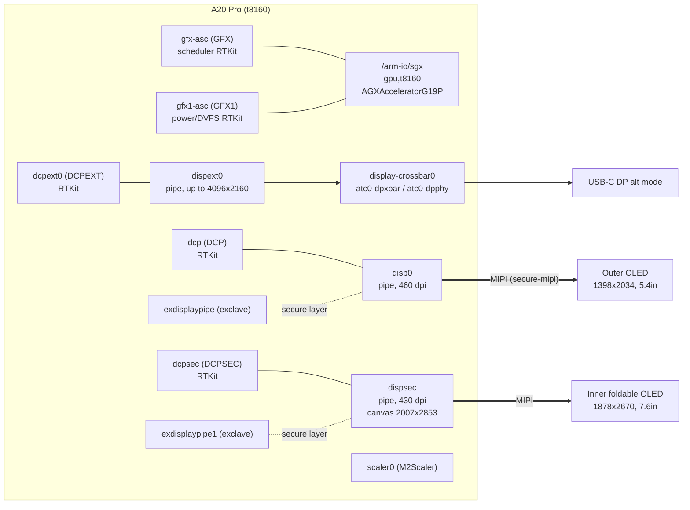

# 03: GPU and displays

Scope: the A20 Pro GPU (`AGXG19P`) and its two firmware co-processors; the three display co-processors (DCP, DCPSEC, DCPEXT); both OLED panels; the exclave display pipes; the USB-C DisplayPort path; the scaler; brightness; and the userland that decides which panel is live. It ends with one frame traced from a Metal app to light leaving the inner panel.

Evidence labels follow [00-method-and-evidence.md](00-method-and-evidence.md): **[DT]** device tree, **[KC]** kernelcache, **[FW]** firmware, **[DSC]** dyld shared cache, **[PUB]** public source, **[INF]** inference. All addresses are as written in this build's device tree (`DeviceTree.v68ap`, iOS 27.2 24B91020). They are relative to the `/arm-io` ranges and are observations, not constants. Small raw excerpts that back this chapter are in [`data/03-gpu-and-displays/`](../data/03-gpu-and-displays/).

## Summary of findings

| # | Finding | Evidence |
|---|---|---|
| 1 | **The inner panel is 1878 × 2670 physical pixels, and its rendering canvas is 2007 × 2853.** Both are true; they are two coordinate spaces for the same glass. The Apple figure is the panel. The vphone-duo figure is the canvas, defined at 460 dpi so that one UI point is the same physical size on both panels. | [DT] `/product/display1` `special-region-1-type = "Fold"` frame `{0, 1335, 1878, 0}`; [DT] `/arm-io/dispsec` `canvas-width = 2007`, `canvas-height = 2853`, `dot-pitch-float = 430.0`; Simulator profile (below) `2007 × 2853 @ 460 dpi`; [DSC] QuartzCore `CA::WindowServer::IOMFBDisplay::set_physical_and_canvas_sizes` |
| 2 | **There are three DCPs, not one:** `dcp` drives the outer panel, `dcpsec` drives the inner, `dcpext0` drives USB-C DisplayPort. Each has its own RTKit ASC, DART, exclave mailbox, expert node and display pipe. | [DT] `/arm-io/dcp`, `/arm-io/dcpsec`, `/arm-io/dcpext0`; [KC] `AppleCLCD2` matches `disp0,t8160`, `dispsec,t8160`, `dispext0,t8160` |
| 3 | **Outer = display 0 = `disp0` = DCP. Inner = display 1 = `dispsec` = DCPSEC.** Dot pitch 460 vs 430, matching Apple's 460 ppi outer and 430 ppi inner. Touch controllers point at the same pipes. | [DT] `disp0` `dot-pitch-float = 460.0`; `dispsec` `= 430.0`; `multi-touch` `service-display = 233` (`disp0`), `multi-touch2` `service-display = 258` (`dispsec`) |
| 4 | **The DCP firmware knows the hinge angle.** It has a hinge-angle EPIC client, reads the angle from the always-on PTD, filters it, and applies an angle-dependent correction ("RDLC") with an end-to-end latency budget. | [FW] `t8160dcp.im4p`: `IOMFBHingeServiceEPIClient`, `read_hinge_angle_from_ptd`, `set_angle_filter_config`, `IOMFB RLDC hinge angle E2E latency %d > %d us` |
| 5 | **The GPU has two firmware co-processors with separate jobs.** `gfx-asc` (role `GFX`, `armfw_g19p`) schedules work. `gfx1-asc` (role `GFX1`, `armfw1_g19p`) runs power, DVFS and thermal. | [KC] `AGXFirmwareKextG19PRTBuddy` personalities `Firmware-Sched` (role GFX) and `Firmware-Power` (role GFX1); [FW] string sets differ accordingly |
| 6 | **Each GPU firmware image is an `rkosftab` with three Mach-O slices:** `g19p` A0, `g19p` B0, and `g19a` A0. One image covers two silicon steppings and a second GPU variant name. | [FW] `ipsw fw gpu` split; banners `FW Build variant: g19p/g19a`, `FW Build version: a0/b0` |
| 7 | **Both panels have an exclave-owned display pipe** (`exdisplaypipe`, `exdisplaypipe1`). Each has its own secure register alias. This is the path for the secure camera/mic indicator. | [DT] `exclave-service = "com.apple.service.EXDisplayPipeDriver_xnuproxy"` / `EXDisplayPipe1Driver_xnuproxy`; `-s-proxy` reg windows |
| 8 | **Under-display ambient light sensing is computed per panel** from what the panel is showing. The windows sit around each panel's camera cut-out. | [DT] `isp-alss-zone-*` on `disp0`/`dispsec`; [FW] `ALSS FCAM window[%d]`, `ACSSMultipleALSCount` |
| 9 | **The `/product/display*` nodes carry geometry, not drivers.** Display 0 has a `Jindo` region, a 111 px circular cut-out at (1199, 88). Display 1 has a `BlankableRR` region (the under-display camera) at (63, 710) and a `Fold` line at y = 1335. | [DT] `/product/display0`, `/product/display1` |
| 10 | **Device-tree property names do not mean what they look like.** `disp0` (outer) has `primary = 0` and `dispsec` (inner) has `primary = 1`. This is an index, not a "main display" flag: QuartzCore uses it to pick entry N of `DisplayExtendedProperties`. | [DT]; runtime finding in vphone-duo `iphone_duo_fold.md` |

## 1. Physical blocks and where they sit



The panel link is drawn as MIPI. The DCP firmware has `mipiLaneCount` and `secure-mipi`, and the kernel has `IOMIPIFamily` (`DCPMIPIControllerProxy`, `AppleDCPMIPIRemotePowerController`). The device tree does not name the link per panel, so the per-panel link type is **[INF]**.

### 1.1 GPU: `/arm-io/sgx`

| Property | Value | Meaning |
|---|---|---|
| `compatible` | `gpu,t8160` | **[DT]** |
| `reg` | `0xa8000000 + 0x4000000` (64 MiB), `0xa8d00000 + 0x180000` | **[DT]** MMIO windows |
| `interrupts` | 1226, 1227, 1228, 1229, 1260, 1262, 1241, 1243 | **[DT]** decoded from LE u32; 8 AIC lines (`interrupts-valid = 223`, a bitmask) |
| `gpu-device-max-power` | 5160 | **[DT]**; unit not stated. Milliwatts **[INF]** |
| `gpu-num-perf-states` | 2 | **[DT]**. `perf-states` and `perf-state-count` are 0 in the restore tree; iBoot fills them per device **[INF]** |
| `gpu-power-sample-period` / `gpu-pwr-sample-period-aic-clks` | 8 / 200000 | **[DT]** power-sampling cadence |
| `gfx-qos` | `0x1_00000001` | **[DT]** |
| `metal-standard` / `opengl-standard` | 256 / 768 | **[DT]** |
| `agx-address-space-mgmt-mode` | 1 | **[DT]** |
| `has-kf` | 1 | **[DT]**; meaning not stated |
| `function-mcc_dataset` | `"SD$M"` | **[DT]** the GPU can select a memory-cache-controller dataset (MCC) |
| `procedural-antialiasing` | present (null) | **[DT]** |
| `/product` `graphics-featureset-class` | `APPLE11`, fallbacks `APPLE10:…:GLES2,0` | **[DT]** Metal GPU family exposed to apps |
| `/defaults` | `kern.gpu_pmem_selector = 1`, `uat-enforce-gpu-carveout = 0` | **[DT]** |
| `/arm-io/pmgr/clpc` | `dram-power-limit-spl-gpu-c0..c3`, `-t1`, `-t2` | **[DT]** CLPC caps DRAM power on behalf of the GPU (see [06-power-battery-thermal.md](06-power-battery-thermal.md)) |
| `/arm-io/pmgr-child` | `gfx-voter-agent-idx = 2` | **[DT]** the GPU is voter agent 2 in the PMGR performance voting |

The device tree carries **no shader-core count**. Apple states 7 GPU cores, each with a Neural Accelerator **[PUB]** (Apple spec page, https://www.apple.com/iphone-duo/specs/, as given in the shared brief). Nothing in the DT, kext or firmware strings read here confirms or contradicts the number.

### 1.2 GPU firmware co-processors: `gfx-asc` and `gfx1-asc`

| | `/arm-io/gfx-asc` | `/arm-io/gfx1-asc` |
|---|---|---|
| compatible | `iop,ascwrap-v8` → `AppleASCWrapV8` | same |
| `role` | `GFX` | `GFX1` |
| ASC reg | `0xaa600000 + 0x74000` | `0xaae00000 + 0x74000` |
| CPU-control reg | `0xaa050000 + 0x8` | `0xaa850000 + 0x8` |
| shared reg | `0x96000000 + 0x1c000` | `0x96000000 + 0x1c000` (same window; a shared mailbox/post-office block **[INF]**) |
| mailbox | `msgbox-mailbox-num = 5`, `msgbox-using-postoffice` | `6`, post-office |
| interrupts | `0x9f_000000c7` → 199, 159 | `0xa0_000000c8` → 200, 160 |
| `iommu-parent` | 349 = `/arm-io/mapper-gfx-asc` | 349 |
| nub | `iop-gfx-nub`, `firmware-name = "GFX"`, `user-power-managed` | `iop-gfx1-nub`, `firmware-name = "GFX1"`, `power-managed` |
| both nubs | `data-isolation = 1`, `coredump-enable`, `coredump-copy-buffer = 32768` | |

Driver chain **[KC]**:

```
AppleARMIODevice(gfx-asc) → AppleASCWrapV8 (com.apple.driver.AppleA7IOP-ASCWrap-v8)
  → RTBuddy (iop-gfx-nub, rtbuddy-v2) → RTBuddyService{role=GFX}
     → AGXFirmwareKextG18RTBuddy  personality "Firmware-Sched"  (com.apple.AGXFirmwareKextG19PRTBuddy)
AppleARMIODevice(gfx1-asc) → … → RTBuddyService{role=GFX1}
     → AGXFirmwareKextG18RTBuddy  personality "Firmware-Power"
AppleARMIODevice(mapper-gfx-asc, iommu-mapper,gfx) → AGXArmFirmwareMapper (com.apple.AGXG19P)
AppleARMIODevice(sgx, gpu,t8160) → AGXAcceleratorG19P (com.apple.AGXG19P, v362.5) : IOGPU (IOGPUFamily 162.16.1)
```

The firmware kext's class is named `G18` but ships in the `G19P` bundle. The GPU firmware also prints `G18 Firmware initializing` **[FW]**, so the G19 firmware builds on the G18 code base **[INF]**.

The GPU firmware has no DART of its own. Its IOMMU is `mapper-gfx-asc`, bound by `AGXArmFirmwareMapper`, which maps the firmware through the GPU's own page tables (UAT) rather than a DART **[INF]**, based on the kernel classes `AGXUAT`, `AGXGart`, `AGXSharedGartTableBacking` **[KC]**.

### 1.3 GPU firmware images

| BuildManifest key | File | IM4P type | Loaded by | Personalized |
|---|---|---|---|---|
| `GFX` | `Firmware/agx/armfw_g19p.im4p` (3,460,945 B) | `gfxf` | iBoot (`IsLoadedByiBoot`), `IsFUDFirmware` | yes |
| `Ap,GFX1Firmware` | `Firmware/agx/armfw1_g19p.im4p` (3,411,889 B) | `gf1f` | iBoot, FUD | yes |

**[FW]** Both payloads are uncompressed and unencrypted. Each begins with an `rkosftab` table of three Mach-O (`MH_PRELOAD`, arm64e) slices:

| Slice | `FW Build variant` | `FW Build version` |
|---|---|---|
| `a000` | g19p | a0 |
| `b000` | g19p | b0 |
| `a010` | g19a | a0 |

All slices are `RTKit_armv8_lightning_Oz_flto_pac-3514.40.18.release` and report `FW Build running in SKSM Enabled mode`. The slices have segments `__TEXT.__gxf_code` and `__gxf_shr_code`, plus `__DATA.__gxf_data`. Part of the firmware therefore runs in Apple's guarded execution level (GXF). That matches the kernel's `AGXSecureMonitor`/`AGXSecureMonitorG19P`, `AGXSecureGart`, and the `…SKSM` channel classes (`AGX3DChannelSKSMG19P`, `AGXTAChannelSKSMG19P`, `AGXCLChannelSKSMG19P`) **[KC]**. SKSM appears to be a secure kernel-scheduling mode in which GPU work submission is mediated by a guarded monitor **[INF]**.

The two images do different jobs, judging by the strings unique to each **[FW]** (excerpt in [`gpu-firmware-strings-excerpt.txt`](../data/03-gpu-and-displays/gpu-firmware-strings-excerpt.txt)):

- **GFX (scheduler):**
  - KSM kick queues ("Out of order completion within a queue");
  - USC pipe state (`AGX_CR_USC_{CDM,PDM,VDM}_SERV`, the compute, pixel and vertex data masters);
  - context store and restore timeouts;
  - parameter-buffer and page-pool starvation (tile-based deferred rendering memory);
  - compression errors (`AGX_CR_DCMP_ERROR`);
  - lockup and recovery ("Thor Hammer Mode", `agf_lockup_hint_irqs` boot-arg).
- **GFX1 (power):**
  - MTR thermal-sensor alarms and slew-rate events ("IP Block=GPU MTR_TOP");
  - `AGFSoCHotHandleAlarmInterrupt`;
  - CRE register save/restore across power cycles;
  - `AGFHALWaitForPerfState`;
  - throttle-counter residency snapshots;
  - frame-interval histogram buckets;
  - AON PTD enable masks.

Both list the hardware regions the firmware maps (`kAGFIPIORegionType…`). They include `DVFMMgpuRegisters`, `GFXCLKGENMGPU`, AFR clock generators, the "Fender" power registers (`FenderRegsDFenderPowerTransG16G`, `…GCPMS`, `…KSMFE`), `ANE0Registers`/`ANE1Registers` and `AONPTDSpace`. The register layouts themselves are not in the image.

### 1.4 GPU kernel driver (`com.apple.AGXG19P`)

**[KC]** 119 C++ classes. The groups that matter:

- **Accelerator and scheduling:** `AGXAcceleratorG19P`, `AGXScheduler`, `AGXKSMKickQueueG19P`, `AGXQOSManager`, `AGXPeakPowerManager`, `AGXEnergyAttributor`.
- **Memory:** `AGXUAT`, `AGXGartG19P`, `AGXSharedGartTableBackingG19P`, `AGXSecureSharedGartTableBacking`, `AGXParameterManagementVirtual`, `AGXUSCPrivMemPoolSMAV2`.
- **Channels:** `AGX3DChannel`, `AGXTAChannel` (tiler), `AGXCLChannel` (compute), each with SKSM variants.
- **User interface to the process:** `AGXDeviceUserClient`.
- **Counters:** `AGXPerfCtrSamplerGen15`, `AGXMTLCounterSampler`.
- **Internal stepping-specific names:** `AGX·PI_400·P·A0·Accelerator`, `…RenderTarget`, `…SecureMonitor`. "PI_400" looks like an internal GPU configuration name **[INF]**.

### 1.5 Metal stack in userland **[DSC]**

The images are in the 27.2 shared cache:

- `/System/Library/Extensions/AGXMetalG19P.bundle/AGXMetalG19P` is the user-mode Metal driver.
- `AGXCompilerCore.framework` and `MTLCompiler.framework` (versions 32023 and 32024 both present), with `GPUCompiler.framework/Versions/32023` (`libGPUCompiler`, `libLLVM`).
- `IOGPU.framework` is the user-kernel transport.
- `Metal`, `MetalFX`, `MetalPerformanceShaders` (including `MPSRayIntersector`, `MPSNeuralNetwork`), `MetalPerformancePrimitives`, `MetalPerformanceShadersGraph`.
- `AGXGPURawCounter`.

The `AGXMetalG19P` Objective-C classes ([list](../data/03-gpu-and-displays/agxmetalg19p-classes.txt)) show the feature set:

- **Metal 4 (`_mtlnext`):** `AGXG19FamilyCommandQueue_mtlnext`, `…CommandAllocator_mtlnext`, `…ArgumentTable_mtlnext`, `AGXG19FamilyCompiler : _MTL4Compiler`.
- **Neural Accelerators in the GPU:** `AGXG19FamilyMLContext : IOGPUMetal4MachineLearningCommandEncoder`, `AGXG19FamilyTensor : IOGPUMetalTensor`, `AGXG19FamilyTensorAuxiliaryPlane`. Metal 4's tensor and machine-learning encoder is the app-facing route to them. That the ML encoder executes on the per-core Neural Accelerators is **[INF]** from Apple's public description; the class names show only that the G19 driver implements the encoder natively.
- **Ray tracing:**
  - `AGXG19FamilyRayTracingAccelerationStructure` (hardware format) and `…RayTracingAccelerationStructureSW` (a software fallback format);
  - `AGXG19FamilyRayTracingGPUBuilder` and `…CPUBuilder`;
  - `AGXG19FamilyIntersectionProgram`, `AGXG19FamilyUserIntersectionFunctionTable`;
  - helper classes `AccelerationStructureBuilder`, `GPUSorter`.
- **Mesh shading and tile shading:** `AGXG19FamilyMeshProgram`, `AGXG19FamilyObjectProgram`, `AGXG19FamilyTileProgram`.
- **Variable rasterization rate:** `AGXG19FamilyRasterizationRateMap`.
- **Deadline scheduling:** `AGXG19FamilyDeadlineProfile`, `AGXG19FamilyPerformanceStateAssertion`.
- The device class is `AGXG19PDevice : AGXG19FamilyDevice : IOGPUMetalDevice`.

## 2. Display controllers: three DCPs

The three DCPs are built from the same template. All three are `iop,ascwrap-v8` → `AppleASCWrapV8`, each with an `iop-*-nub` (`rtbuddy-v2`) → `RTBuddy` **[DT][KC]**.

| | DCP (outer) | DCPSEC (inner) | DCPEXT (USB-C DP) |
|---|---|---|---|
| ASC node | `/arm-io/dcp` | `/arm-io/dcpsec` | `/arm-io/dcpext0` |
| `role` | `DCP` | `DCPSEC` | `DCPEXT` |
| ASC reg | `0x186e00000 + 0x74000` | `0x18ae00000 + 0x74000` | `0x18ee00000 + 0x74000` |
| other regs | `0x186850000 + 0x4000`, `0x186e0c000 + 0x3c008` | `0x18a850000`, `0x18ae0c000` | `0x18e850000`, `0x18ee0c000` |
| shared reg | `0x96020000 + 0x10000` | same | same |
| mailbox | 9 | 11 | 10 |
| `service-reset` | 13 | 14 | 12 |
| `hdcp-channels` | 5 | 6 | 7 |
| IOMMU | `/arm-io/dart-dcp/mapper-dcp` (+ `mapper-dcp-exclave`) | `dart-dcpsec/mapper-dcpsec` (+ `-exclave`) | `dart-dcpext0/mapper-dcpext0` (+ `-exclave`) |
| nub | `internal-index = 0`, `routes = 251` | `internal-index = 1`, `routes = 271`, `no-hibernate-sleep`, `cold-boot-after-hibernate` | `external-index = 1`, `port-type = 2`, `port-number = 1`, `cold-boot-after-hibernate` |
| expert | `/arm-io/dcp0-expert` IRQ 766 | `/arm-io/dcpsec-expert` IRQ 875 | `/arm-io/dcpext0-expert` IRQ 984 |
| exclave mailbox | `dcp-exclave-mailbox` (mailbox 21, `SecureRTBuddyDCP`) | `dcpsec-exclave-mailbox` (mailbox 30, `SecureRTBuddyDCPSEC`) | none |
| DisplayPort switch | none | none | `dp-switch-parent = 219` (`display-crossbar0`), `audio = 289` (`dp-audio1`) |

`routes` on DCP points at phandle 251 (`dcp-exclave-mailbox`), and DCPSEC's at 271 (`dcpsec-exclave-mailbox`). The internal-panel DCPs therefore route some RTKit endpoints to an exclave **[DT]**. DCPEXT has no exclave route.

The ASC's `interrupts` value prints as one byte (`{`, `}`, `|`, that is 123, 125, 124) in the dump. The full AIC numbers for the ASCs could not be decoded reliably from these sources.

### 2.1 Expert nodes (`dcp-expert-v1` → `AppleDCPExpert`, `com.apple.driver.AppleDCP`)

Each expert node carries:

- `failsafe-category-0..7`: `displayInternalFailures`, `sysClkInputFailures`, `alpdpMainLinkTrainingFailures`, `alpdpAuxFailures`, `alpdpMainLinkPayloadFailures`, `alpdpMainLinkTimingFailures`, `mainLinkXsyncMismatchFailures`, `noActionFailures`;
- `failsafe-telemetry-event = com.apple.display.HealthMonitor.DisplayFailsafeCategorization`;
- `support-health-telemetry`, `support-dptx-fifo-telemetry`, `support-psd-self-vote`;
- `mogul-auth-key = "auth-passed"`;
- `mogul-auth-provider`: 193 on DCP, 194 on DCPSEC.

Phandles 193 and 194 are `/arm-io/i2c3/mogul-display` and `/mogul-display2`, both `mogul,a1222` → `MogulAuthI2CRelayInterface` (`com.apple.driver.AppleAuthCP`). **Each internal panel has its own authentication chip on I²C3**, and the DCP expert waits for it to pass **[DT][KC]**. This is the panel genuineness check behind iOS's "unknown part" display message **[INF]**. Each panel also has a pair of display EEPROMs on I²C3 (see §3.4).

"alpdp" in the failure categories suggests the internal panel link is DisplayPort-derived (an Apple low-power DP), carried alongside or instead of MIPI. This is **[INF]**; the DT also has a `lpdptx` endpoint on the crossbar (§5).

### 2.2 Display pipes (`AppleCLCD2`, `com.apple.driver.AppleMobileDispH19P-DCP` v140)

| | `/arm-io/disp0` | `/arm-io/dispsec` | `/arm-io/dispext0` |
|---|---|---|---|
| compatible | `disp0,t8160` | `dispsec,t8160` | `dispext0,t8160` |
| `device_type` | `display-subsystem` | `display-subsystem` | `ext-display-subsystem` |
| main reg | `0x184000000 + 0xe2c000` | `0x188000000 + 0xe2c000` | `0x18c000000 + 0xe2c000` |
| other regs | `0x1862c0000 + 0x10000`, `0x18642c000 + 0x4000`, `0x186800000 + 0x7f4000` | `0x18a2c0000`, `0x18a42c000`, `0x18a800000` | `0x18e2c0000`, `0x18e42c000`, `0x18e800000` |
| common reg | `0x82800000 + 0x1d4000` (same on all three) | | |
| `dot-pitch-float` | **460.0** | **430.0** | none |
| canvas | none | **`canvas-width = 2007`, `canvas-height = 2853`** | `framebuffer-width = 4096`, `-height = 2160` |
| `primary` | 0 | 1 | none |
| `surface-type` | 1 | 2 | none |
| `always-on-time` | 1 | 1 | none |
| `supports-apt` | 1 | 1 | none |
| `max-scaling-ratio` | `0x20000` = 2.0 (16.16) | 2.0 | none |
| `max-avg-bpp` / `max-peak-bpp` | 891290 = 13.6 (16.16) | same | none |
| `energy-adder` | 79953 | 165806 | none |
| `power-lut-vbatt-cur-nominal` | 315 | 660 | none |
| `power-lut-data-*` | 28 × 21 LUT, y index 0..100 step 5 | same shape | none |
| `first-frame-response-threshold` | 5 values: 1006633, 1090519, 1174405, 1258291, 1509949 (≈ 15.36, 16.64, 17.92, 19.2, 23.04 in 16.16) | same | none |
| `isp-alss-zone-*` | 11 zones | 11 zones | none |
| `clock-ids` | 361, 416 | 366, 417 | 338, 418 |
| IOMMU (`iommu-parent`) | 239/240 = `dart-disp0` mappers | 264/265 = `dart-dispsec` mappers | 283/284 |

`energy-adder` and `power-lut-vbatt-cur-nominal` are about twice as large for `dispsec`. That is consistent with the inner panel being about twice the area of the outer **[INF]**.

The kernel side is in two kexts **[KC]**:

- `AppleMobileDispH19P-DCP` (classes `AppleCLCD2`, `UnifiedPipeline2`, `IOMobileFramebufferShim`, `IOMobileFramebufferTilingMgr`, `AppleDCPLinkServiceSoC`). One personality matches all three pipes. `AppleDCPLinkServiceSoC` binds `DCPEndpoint24`, `DCPSECEndpoint24` and `DCPEXTEndpoint24`.
- `IOMobileGraphicsFamily-DCP` (`IOMobileFramebufferAP`, `DCPLink`, `DCPPowerManager`, `AppleDCPLinkService`, `SharedEventResourceManager`, `IOMFBTTRReport`) on `IOMobileGraphicsFamily` 343.
- Firmware service: personality `DCPFirmwareService` (IOClass `AFKFirmwareService`) for role `DCP` (`DCPAVFamilyProxy`) and `DCPFirmwareServiceEXT` for role `DCPEXT` (`AppleDCP`). No personality in the prelink list names role `DCPSEC`. It is either matched by a property this map does not list or handled through `RTBuddy` alone; that part is **[INF]**/open.
- The other EPIC endpoints are generic `DCPEndpointV2` (`DCPEndpoint1…`) plus the `DCPAV*`, `DCPDP*` and `DCPMIPIControllerProxy` proxies keyed on `EPICName`.

The kernel also has `IOMFB: resizing canvas: %d %d` and reads `canvas-` properties **[KC]**.

DARTs (all `dart,t8110` → `AppleT8110DART`) **[DT]**:

| Pipe | DARTs (reg) | IRQ | Mappers (SID) |
|---|---|---|---|
| outer | `dart-dcp` `0x1863c0000`; `dart-disp0` `0x186380000`; `dart-dispgrt` `0x1863a0000`; `dart-disp0-isoc` `0x186240000` | 771 (771 shared), 794 isoc | `mapper-dcp` 3, `mapper-dcp-exclave` 4, `mapper-disp0` 11, `-piodma` 21, `-scl` 14, `-sca` 15, `mapper-dispgrt` 1, `mapper-disp0-dpa` |
| inner | `dart-dcpsec` `0x18a3c0000`; `dart-dispsec` `0x18a380000`; `dart-dispsecgrt` `0x18a3a0000` | 880 | `mapper-dcpsec` 3, `-exclave` 4, `mapper-dispsec` 11, `-piodma` 21, `-scl` 14, `-sca` 15, `mapper-dispsecgrt` 1 |
| external | `dart-dcpext0` `0x18e3c0000`; `dart-dispext0` `0x18e380000`; `dart-dispext0-isoc` `0x18e240000` | 989, 1012 isoc | `mapper-dcpext0` 3, `-exclave` 4, `mapper-dispext0` 11, `-piodma` 21, `mapper-dispext0-dpa` |

The inner pipe has no `-isoc` DART and no `dpa` mapper. The outer pipe has both, and so does the external pipe, which needs them for DP audio (`admac-dispext0`, `dp-audio1`). The outer pipe's `admac-dispint0` and `dp-audio0` are attached to the internal DCP, which suggests audio-over-display plumbing kept from the single-display design **[INF]**.

`dcp-sac-controller` (`DCPAVSACController`) has `function-saca_lcd0`/`lcd1` → `ACAS0dcl`/`ACAS1dcl`, with `sac-index-count = 2`. These are two SAC (system-level adaptive clocking **[INF]**) indexes, one per panel.

### 2.3 DCP firmware (`t8160dcp.im4p`)

| BuildManifest key | File | Type | Notes |
|---|---|---|---|
| `DCP` | `Firmware/dcp/t8160dcp.im4p` (3,016,187 B) | `dcpf` | `IsiBootEANFirmware = true`, personalized |
| `RestoreDCP` | `Firmware/dcp/t8160dcp_restore.im4p` | `dcpf` (`Img4PayloadType rdcp`) | loaded by iBoot during restore |

**[FW]** The payload decompresses to 17 MB and contains one arm64e `MH_PRELOAD` Mach-O. Its segments are `__TEXT` (7.5 MB), `__DATA`, `__OS_LOG`, `__DATA_CONST`, `__DATA_SHARED_RW`, `APPCONFIG` and `METADATA`. **One image serves all three DCPs**; the manifest has no separate DCPSEC or DCPEXT firmware. The firmware carries IOMFB itself (the framebuffer logic runs on the DCP), with code paths for a secondary pipe:

- `no matching primary timing for secondary element ID`;
- `PTUC_BLOCK_CLASS: In secondary Context`;
- `dispsec-spi`.

Panel-relevant strings ([excerpt](../data/03-gpu-and-displays/dcp-firmware-strings-excerpt.txt)):

- **Panel control bus:** `TCON SPI eeprom erase/write/read` and `TCONSPIRTKService`. The firmware also has `lcd-spi-clk`, `lcd-spi-cs`, `lcd-spi-mosi`, `lcd-on-to-spi-clk-delay` and `dispsec-spi`. The DCP therefore talks SPI to each panel's timing controller (TCON), in addition to the pixel link.
- **Hinge:** see §4.3.
- **Refresh:**
  - `AODdisplayMinRefreshInterval`, `AODdisplayMaxRefreshInterval`, `AODdisplayRefreshStep`, `AODFixedRR` and `1hz_flipbook_frame_count` cover Always-On at down to 1 Hz.
  - `fixed refresh rate only supported on APT/VRR devices` and `forcing refresh rate: %d subframes` cover variable refresh expressed in subframes.
  - `dcvrr_a..d` and `VRR SDP` are VRR on the DP side.
- **Pixel structure:** `enableSubPixelLayoutCompensation` and `ColorDitherRemoval`. A non-standard subpixel layout is compensated in the pipe. That this relates to the inner panel's "oval pixels" **[PUB]** is **[INF]**.
- **Burn-in and aging:** `APTDevice`, `APTEnableCA`, `apt_mX_hal`, and PDC buffers (`cdi PDC DC/PM buffer`, `PDC temperature hint`). APT and PDC are the panel aging and pixel-degradation compensation that the DT enables with `supports-apt` and `/product supports-burnin-mitigation` **[INF]** on the expansions.
- **Under-display ALS:** `ALSSSupported`, `ALSSWindowCount`, `ALSSChannelCount`, `ALSS FCAM window[%d] size from EDT unexpected`, `IOMFB 2DVT: init - alss_x=%u, alss_y=%u, channels=%u, windows=%u, bl_zones=%u`, `ALSS capture aborted by SPU driver`.
- **ALS colour compensation:** `ACSS*` (`ACSSMultipleALSCount`, `ACSSRegionConfig.cpp`, `ACSS: Found XD PCS zero angle`).
- **Proximity:** `prox GPIO config not available from EDT`, `Using default prox GPIO config`. The DCP drives the proximity sensor's GPIO configuration. `display0` has `has-prox = 1` and `display1` has `has-prox = 0`.

## 3. The two panels

### 3.1 What the device tree says about each

Two layers describe the panels:

- **Silicon**, under `/arm-io`: the pipe, DCP, DART and ALSS zones.
- **Product geometry**, under `/product/display0` and `/product/display1`.

The product nodes have no `compatible`, so no kernel driver binds them. Userland reads them through MobileGestalt and `AppleEmbeddedDisplayServices` **[DT]**; vphone-duo confirmed this at runtime by grafting the nodes into a VM tree.

| | `/product/display0` (outer, cover) | `/product/display1` (inner, foldable) |
|---|---|---|
| `display-index` | 0 | 1 |
| `display-rotation` | 0 | **270** |
| `display-scale` | 3 | 3 |
| `surface-type` | 1 | 2 |
| `framebuffer-identifier` | `1C896A2B-F0D7-405C-8D0F-66E4B80AD044` | `BF0DC480-5EE2-4EC1-B02B-C75E94759832` |
| `chrome-identifier` | `com.apple.dt.devicekit.chrome.phone15` | `…phone14` |
| `display-corner-radius` | 8, 8, 59, 59 | 55, 55, 55, 55 |
| `special-region-0` | `Jindo`, circular, frame (1199, 88, 111, 111) | `BlankableRR`, circular, frame (63, 710, 111, 111) |
| `special-region-1` | none | **`Fold`, frame (0, 1335, 1878, 0)** |
| `has-prox` | 1 | 0 |
| `front-cam-offset-from-center` | 48230, 30480, 3670, 1000 | 71590, 48230, 3670, 1000 |
| button/camera-button locations | per panel (both sets present) | |

Frames are floats `{x, y, w, h}` and were decoded from the base64 property data **[DT]**. Notes on the table:

- **Corner radii.** The Simulator profile lists the outer corners as UL 8, LL 8, UR 59, LR 59. The outer panel's two hinge-side corners are therefore almost square, and its free-edge corners are fully rounded.
- **Jindo.** "Jindo" is Apple's internal name for the Dynamic Island cut-out **[INF]**. On the outer panel it is a 111 px circle with its centre at x = 1254.5 px (≈ 90%; corrected by [FACTCHECK](FACTCHECK.md)) across the 1398 px width. That reads as a punch-hole camera near one corner, not a centred island. vphone-duo saw iOS draw exactly this circle when the node was present.
- **BlankableRR.** This is the inner panel's under-display camera region **[INF]**: a circle the compositor can blank (black) while the camera is in use. Apple publicly states the inner FaceTime camera is under the display **[PUB]**.
- **Fold.** A zero-height line across the full 1878 px width at y = 1335. That is exactly half of 2670, so it is the crease in native panel coordinates. The native panel is portrait, with the crease horizontal. With `display-rotation = 270`, the open phone shows a 2670 × 1878 landscape surface with a vertical crease **[INF]**, consistent with vphone-duo's reading.

### 3.2 The resolution question: 1878 × 2670 or 2007 × 2853?

| Source | Inner size | Density |
|---|---|---|
| Apple spec page **[PUB]** | 1878 × 2670 | 430 ppi |
| `/product/display1` `Fold` region **[DT]** | width 1878; crease at 1335 = 2670 / 2 | none |
| `/arm-io/dispsec` `dot-pitch-float` **[DT]** | none | **430.0** |
| `/arm-io/dispsec` `canvas-width/height` **[DT]** | **2007 × 2853** | none |
| Xcode Simulator profile `iPhone Duo.simdevicetype/Contents/Resources/capabilities.plist`, display `LCD-1` / `primary-1` (local Xcode install) | **2007 × 2853** | **`hdpi = vdpi = 460`** |
| vphone-duo VM | 2007 × 2853, taken from the Simulator profile | none |

Both sizes are real and describe the same glass:

- 1878 / 430 = 4.367 in and 2670 / 430 = 6.209 in, a 7.59 in diagonal. That matches Apple's 7.6 in.
- 2007 / 460 = 4.363 in and 2853 / 460 = 6.202 in, a 7.58 in diagonal.
- The scale factors on both axes agree: 2007 / 1878 = 1.0687 and 2853 / 2670 = 1.0685. Both are close to 460 / 430 = 1.0698.

**Conclusion [INF, strongly supported].** The physical inner panel is 1878 × 2670 at 430 ppi. iOS renders it into a 2007 × 2853 canvas at the outer panel's 460 ppi, so one point (at 3×) is the same physical size on both screens. The display pipe then scales the canvas down by about 0.936 to the native panel.

The mechanism is in the code:

- QuartzCore asks IOMFB for both sizes (`CA::WindowServer::IOMFBDisplay::set_physical_and_canvas_sizes`, `IOMobileFramebufferGetCanvasSizes`) **[DSC]**.
- QuartzCore checks the scale against a limit: `"Display %u Canvas Scaling Req[%.2f, %.2f] over Limit[%.2f, %.2f] DownScaleLimit[DISP:%.2f MSR:%.2f]"` **[DSC]**. MSR is the DT's `max-scaling-ratio`, 2.0.
- IOMFB exports `IOMobileFramebufferSetCanvasSize` **[DSC]**.
- The kernel logs `IOMFB: resizing canvas` **[KC]**.

`disp0` has no canvas property, so the outer panel renders 1:1 at 1398 × 2034.

In points, at 3×:

- inner canvas: 669 × 951 pt;
- outer: 466 × 678 pt;
- a VM booted at the raw 1878 × 2670: 626 × 890 pt.

vphone-duo booted at 1878 × 2670 and saw an off-centre icon grid. That fits SpringBoard expecting the 2007 × 2853 canvas **[INF]**.

### 3.3 Brightness, EDR, Always-On

`/backlight` → `AppleARMBacklight` (`backlight` name match) has `supports-twilight`, `supports-gcp` and `number-of-ca-flipbooks = 1` **[DT]**.

`/core-brightness` (read by CoreBrightness in userland; no kernel driver) has `aod-high-luminance-supported`, `sync-display-state-control`, `syncdbv-supported` and `sil-enabled`. It has three children, one per panel configuration **[DT]**:

| Child | `display-id` | `dcp-brightness-node` | `plt-logic-version` | Notable |
|---|---|---|---|---|
| `brightness-primary` | 0 | `DCP` | 1 | outer panel |
| `brightness-secondary` | 1 | `DCPSEC` | 2 | inner; `ring-light-supported` |
| `brightness-secondary-doe1` | 1 | `DCPSEC` | 2 | an alternative inner-panel tuning; adds `boost-enabled`, `energy-consumption-target`, `paa-sdr-lut`, CLTM-aware "aurora" |

"doe1" is an alternative set for the same panel. A second panel supplier or configuration selected at runtime is **[INF]**.

Decoded values (float32 unless noted) **[DT]**:

- **EDR:** `edr-max-nits = 1600`, `edr-potential-headroom = 8.0`, `edr-reference-headroom = 12.0`, `edr-seconds-per-stop = 0.1`, `edr-exit-seconds-per-stop = 0.75`. These are the same on all three children.
- **User maximum:** `user-accessible-max-nits = 1060` (16.16), the SDR slider maximum. `aab-constraint-lmax = 1060` and `aab-constraint-emax = 5000`.
- **Outdoor boost (`aml-nits-table`):**
  - primary (outer) steps 100 → **3000 nits** across `aml-lux` 5,000 → 150,000 lux;
  - `brightness-secondary` (inner) stops at **2175 nits**;
  - `…-doe1` reaches 3000.
- **Supporting tables:** `bdm-nits1 = 850`, `bdm-nits2 = 1600`; `rtplc-nits-table` 1600, 1600, 1200, 1200; `paa-sdr-lut` (doe1) 850, 1000, 1060; `max-aurora-gain` 2.5, 2.83, 2.83.
- **Twilight:** the `tw-*` tables run 1 → 10 nits.

`/exbright` → `EXBrightKext` is backed by the exclave service `com.apple.service.EXBrightCore` (+ `_EDK`) **[DT][KC]**. It has:

- `DBVMax = 2047`, an 11-bit display brightness value;
- `LmaxProduct = 3000` and `LminProduct = 10` (16.16);
- `formula-max-nits = 3250`;
- `panel-gamma = 2200` (2.2);
- `als-types` × 3;
- MIB curves (`mib-curve-lux` 0 … 100,000 lux);
- two `contrast-indicator-0/1` children with different cover-glass reflectance (`cg-reflectance = 19660` vs `4`).

A brightness computation therefore runs inside an exclave. Kernel classes: `EXBrightKext`, `EXBrightCalibrationLoader`, `TelemetryManager`, plus `EXBrightCalibrationConsumer` **[KC]**. That the exclave holds the "contrast indicator" (privacy-indicator visibility) logic is **[INF]** from the node names.

`/display-health-monitor` → `DisplayHealthMonitorCompanion` is backed by the exclave service `com.apple.service.DisplayHealthMonitor_Companion` **[DT][KC]**. It pairs with the expert nodes' failsafe telemetry.

**Always-On** is enabled per pipe (`always-on-time = 1` on `disp0` and `dispsec`) **[DT]**. On the CPU side QuartzCore has `CAFlipBook`, `IOMFBFlipBook::_enter`, `DeviceSupportsAlwaysOnTime` and `CA_FORCE_FLIPBOOK_LPR` **[DSC]**: CA pre-renders a "flipbook" of future frames that the DCP shows on its own while the AP sleeps. The DCP side is `process_flipbook_swap`, `AOD*RefreshInterval` and `1hz_flipbook_frame_count` **[FW]**. `AlwaysOnExclavesServices`/`AlwaysOnExclavesDaemon` frameworks exist **[DSC]**.

**ProMotion and refresh rate:** both panels are 120 Hz ProMotion **[PUB]**. This build's device tree contains no refresh-rate table; the rates are decided in the DCP firmware and by the panel timing it reads. On the CPU side, QuartzCore has `CA_FORCE_120HZ`, `CA_DISABLE_48HZ_AUTO_VFD`, `CAFrameRateRangeGroup` and `AGX vsync hints will track display %u with %u Hz refresh rate` **[DSC]**. The last ties the GPU's frame pacing to a specific display's rate. The Simulator profile lists both panels at 60 Hz, but that is a Simulator value, not hardware.

### 3.4 Per-panel EEPROM, authentication, touch

All on `/arm-io/i2c3` **[DT][KC]**:

| Node | I²C address | Driver |
|---|---|---|
| `display-eeprom` | 0x52 | `AppleARMI2CEEPROM`; children `display-eeprom-data` → `AppleDiagnosticDataAccessReadOnly`, and `display-eeprom-generic-data` (`display-index = 0`) → `AppleEmbeddedTouchEEPROMDriver` |
| `display-eeprom-hi` | 0x53 | `AppleARMI2CEEPROM` |
| `display-eeprom-2` | 0x54 | as above, `display-index = 1` |
| `display-eeprom-2-hi` | 0x55 | `AppleARMI2CEEPROM` |
| `mogul-display` | 0x10 | `MogulAuthI2CRelayInterface` (outer panel auth) |
| `mogul-display2` | 0x60 | `MogulAuthI2CRelayInterface` (inner panel auth) |

The address is the low byte of `reg`.

The generic-data EEPROMs are written through `AppleEmbeddedDisplayServices`, which runs a `BIMUpdater` (`BIMUpdaterCreateWithIndex`, `bim-epic`, "BIM Display Power Assertion", `display-index`) **[DSC]**. Per-panel burn-in-mitigation state is kept in each panel's own EEPROM **[INF]** on what "BIM" stands for.

Touch for each panel is a separate controller on the MTP co-processor **[DT]** (covered in [05-sensors-touch-audio-haptics.md](05-sensors-touch-audio-haptics.md)):

- `/arm-io/mtp/iop-mtp-nub/multi-touch`: `service-display = 233` (`disp0`), `hid-merge-personality = "V68PS1"`;
- `multi-touch2`: `service-display = 258` (`dispsec`), `hid-merge-personality = "V68SS1"`, FDR identifiers `ZG:CoverGlassSerialNumberSecondary`;
- both use the firmware `V68_Multitouch.im4p` (`mtfw`).

`service-display` is how backboardd learns which display a touch belongs to. vphone-duo found that `BKIOHIDService.displayUUID` drives touch routing at runtime. The touch scan is synchronized to display timing; the DT read here holds no TE/vsync GPIO for it, so that synchronization is **[INF]** and listed in the gaps.

### 3.5 Ambient light under the panels

There are two ALS channels on the AOP: `/arm-io/aop/iop-aop-nub/als2a` and `als2b`. Both have `angle-dependent = 1`, `digitizer-location-id = 545`, `supports-float-lux` and their own `hotspot-center-x/y` **[DT]**.

Each display pipe defines 11 ALSS zones (`isp-alss-zone-x/y/width/height/weight`) **[DT]**:

- **outer (`disp0`):** zones at x 639…1343 px, the top-right area around the `Jindo` cut-out (x 1199–1310);
- **inner (`dispsec`):** zones at x 0…229 and y 506…876, around the `BlankableRR` camera region at (63–174, 710–821).

The DCP sums the RGB light the panel itself emits over those windows and feeds the result to the ALS path. Light from the screen can then be subtracted from what an ALS behind or near the glass reads. The firmware strings `ALSS FCAM window` (FCAM = front camera), `ALSSRGBCoeffsPrecision`, `ALSS capture aborted by SPU driver` and `ACSSMultipleALSCount` support this **[FW]**. `als2a`/`als2b` both being `angle-dependent` means the hinge angle matters for ALS too **[DT]**. This is the "ALS-under-panel" mechanism; its exact sensor placement is not in the sources.

The AOP also has a `dcp-control` child → `AppleSPUDCPDriver` **[DT][KC]**: the always-on processor has a control channel to the DCP. It is used for AOD and the brightness/ALS loop **[INF]**.

## 4. Which panel is live: folded vs open

### 4.1 The chain

```mermaid
sequenceDiagram
  participant H as Hinge sensor (AOP / SPU)
  participant CM as locationd: CoreMotion CLAngleNotifier
  participant SB as SpringBoard: SBFDevicePoseProvider
  participant R as SBFDisplayContentModeResolver + policies
  participant BK as backboardd: BKSDisplayService traits
  participant CA as QuartzCore / IOMFB
  participant DCP as DCP (outer) and DCPSEC (inner)
  H->>CM: HID event type 0x2C (page 0xFF0C, usage 0x21): angle, mechanicalAngle, velocity
  CM->>SB: cmAngle and cmMagicPose (hingeState, tabletopPose)
  SB->>R: devicePose (hinge regions, transitionProgress, continuousFoldPosition)
  R->>BK: per-display surface type (.cover = 1, .inner = 2) via DeviceSurfaceType
  R->>CA: activate the content mode: primary to .inner (open) or .cover (closed)
  CA->>DCP: swaps on the active display; the other gets a passive shield or backlight off
  H-->>DCP: hinge angle also reaches the DCP directly (AON PTD / EPIC), for angle-dependent correction
```

### 4.2 Userland pieces

From prior research, [DSC] plus vphone-duo runtime findings:

- **Hinge event.** `IOHIDEventCreateHingeAngleEvent(allocator, timestamp, angle, mechanicalAngle, velocity, options)` (IOKit) produces event type `0x2C`. The kernel has a matching personality, `HID SensorEvent Driver - Hinge Angle`, and HID descriptor strings counting `hingeangle` **[KC]**. Details are in [08-foldable-system-and-chassis.md](08-foldable-system-and-chassis.md).
- **Angle reader.** `CLAngleNotifier` and `CLSPUAngleServiceControl` in locationd read the angle. On a VM, locationd deliberately skips the physical HID device.
- **Pose.** `SBFDevicePoseProvider` computes a `devicePose` struct. Its type encoding (in the 27.2 cache) has:
  - `orientation`, `coverOrientation`, `innerOrientation`;
  - `hinge` {`isAvailable`, `position`, `state`, the regions `fullyClosed`, `closed`, `partiallyOpen`, `openFlat`, `activateFoldAvoidance`, `transitionToOpen`, `transitionToClosed`, plus `transitionProgress`, `progressToSwap`, `progressFromSwap`, `continuousFoldPosition`, `velocity`, `acceleration`};
  - `uiHingeStatus`, `cmAngle`, `cmMagicPose`, `flipState`;
  - `settings` (`closedToPartiallyOpenBoundary`, `partiallyOpenToOpenFlatBoundary`, `invertHingeAngles`, `continuousFoldEnabled`, fold-avoidance prediction windows);
  - `internal.isOnVM`.
- **Content-mode policies.** `SBFDisplayContentModeResolver` picks among `SBFSingleIntegratedDisplay…`, `SBFFoldingDualDisplay…`, `SBFFullyClosedDisplay…`, `SBFTentModeDisplay…`, `SBFYoinkDisplay…` and `SBFForceCoverDisplayOnlyDisplayContentModeResolutionPolicy` (`preferredPrimarySurfaceTypeForDevicePose:`, `resolvedModeForDisplayProxy:devicePose:`). `SBDisplayContentModeCoordinator acquireForceCoverDisplayOnlyEnabledAssertionWithReason:` can pin the cover display.
- **Fold animation.** `SBContinuousFoldController` maps angle to fold progress (`SBContinuousFoldAngleProgressForHingeAngleDegrees` and its inverse) and remembers `_lastHingeAngleDegrees`. *(Corrected by [chapter 10](10-userland-display-fold-touch.md): the QuartzCore `fold_transparency_layer` string belongs to `CA::CG::ContextDelegate::pop_and_try_fold_transparency_layer`, a CoreGraphics transparency-layer optimisation unrelated to the hinge.)*
- **Surface identity.**
  - `-[SBFDisplayContentModeResolver _surfaceTypeForWindowScene:]` asks ShellSceneKit, which asks `BKSDisplayService traitsForDisplayUUID:`.
  - backboardd answers from `DeviceSurfaceType` in the display's extended properties.
  - QuartzCore reads entry N of MobileGestalt's `DisplayExtendedProperties` (both strings are in QuartzCore **[DSC]**), where N is the framebuffer's `primary` index.
  - The DT `primary = 0` (outer) and `1` (inner) and `surface-type = 1` / `2` therefore line up exactly with `.cover = 1` and `.inner = 2` (vphone-duo runtime; [DT]).
- **App-facing.** `_UISceneHingeStateHostComponent setHingeAngle:` carries hinge state into each UIScene (UIKit). An app sees the change as a new scene or window size, trait changes, and a display switch (the UIScene moves to the other `UIScreen`). Which public API exposes the angle itself was not established.

vphone-duo saw this log on the VM:

```
DCMResolved: FullyClosed→FoldingDual | legacyMain: target pri→aux, resolved pri→aux
COMPLETED: .cover:aux | 180.0° … openFlat
[Auxiliary Content] keeping .cover inactive for .passiveShield
```

Open flat, the primary content goes to `.inner` and `.cover` gets auxiliary content (a passive shield). Closed, `.cover` becomes primary.

### 4.3 The DCP's own use of the hinge angle **[FW]**

The DCP firmware has:

- `IOMFBHinge`, `IOMFBHingeServiceEPIClient` (with `Connected/Disconnected Hinge Interface`), `HingeAngleHandler.cpp`;
- `read_hinge_angle_from_ptd` and `IOMFB: %s: PTD read failed for hinge angle`;
- `process_hinge_angle_packet`, `enable_hinge_angle_update`;
- `set_angle_filter_config`, `set_angle_threshold_config` and `Hinge AngleFIRConfig`, `Hinge MinAngleThreshold`;
- `IOMFB RLDC hinge angle E2E latency %d > %d us` and `IOMFB hinge angle latency - RDLC: update->programmed %llu us`;
- runtime overrides `iomfb_RuntimeProperty_enableHingeAngleOverride`, `…hingeAngleOverrideValue`, `…RDLCAngleOverride`.

The kernel exposes the same override names (`EnableHingeAngleOverride`, `HingeAngleOverrideValue`) **[KC]**.

So the hinge angle reaches the display controller over an EPIC service, or from the always-on PTD (the GPU firmware also maps `AONPTDSpace`). The controller then:

1. FIR-filters the angle;
2. thresholds it;
3. applies an angle-indexed correction ("RDLC"; `unable to find index/weight for angle` suggests interpolation in a table) within a microsecond latency budget.

Read together with the angle-dependent ALS and the `ACSS … XD PCS zero angle` strings, this compensates colour and luminance of the folding OLED for the viewing geometry of each half as the phone opens **[INF]**. The expansion of "RDLC" is not in the sources.

## 5. External display: USB-C DisplayPort

**[DT][KC]**:

- **`/arm-io/display-crossbar0`:** `display-crossbar,t8112` → `AppleT8112DisplayCrossbar` (`com.apple.driver.AppleDisplayCrossbar`), parent of `AppleDisplayConnectionManager`. `ufp-endpoints = [dispext0, dispext1]`, `ufp-count = 1`, `dfp-endpoints = [atc0, lpdptx]`. Only `dispext0` exists on this board.
- **`/arm-io/atc0-dpxbar`:** `atc-dpxbar,t602x` → `AppleT602XATCDPXBAR`, reg `0x323074000 + 0x4000`.
- **`/arm-io/atc0-dpphy`:** `atc-dpphy,t8160`, `device_type = AAPL,atc-dpphy` → `AppleATCDPAltModePort` / `AppleATCDPHDMIPort` (matched on `port-type`), or `IODPTXVirtualPort` in virtual mode. Properties: `atc-phy = 222` (`/arm-io/atc-phy0`, the USB-C PHY), `dpxbar-parent = 220`, `dp-switch-parent = 219`, `transport-type = 5`, `transport-tunneled = 0`.
- **`dcpext0`** points back at the crossbar (`dp-switch-parent = 219`, `dp-switch-ufp-port = 0`).
- **`dispext0`:**
  - `framebuffer-width/height = 4096 × 2160` (maximum external framebuffer);
  - `display-timing-info` = 1024, 50, 51, 50, 600, 218, 6, 50 (a default timing);
  - `function-send_disp_clock`;
  - DP audio over `admac-dispext0` and `dp-audio1` (`DCPAVAudioDMADelegate`).
- **HDCP:** `IOHDCPFamily`, `AppleSEPHDCPManager` (keys in the SEP) and `AppleDCPDPTXRemoteHDCP*` proxies.
- **AV stack:** `IOAVFamily` (`IOAVService`, `IOAVSplitDisplay`) and `IODisplayPortFamily` (`IODPService`, `IODP13Service`).

The external pipe has no canvas and no exclave pipe. The `/product` node has `display-mirroring = 1` and `external-hdr` **[DT]**. IOMFB exports `IOMobileFramebufferSetMirrorContentRegion`, `GetDigitalOutMode` and `SetTVOutMode` **[DSC]**.

USB-C carries DisplayPort **[PUB]**. Whether the external output mirrors the active internal panel or extends it is a userland policy; this chapter did not establish it.

## 6. Scaler and the secure display path

### 6.1 Scaler

**[DT][KC]**:

- `/arm-io/scaler0`: `scaler,t8101`/`scaler,s5l8960x` → `AppleM2ScalerCSCDriver` (v265), `hardware-version = 27`. Interrupts 1290…1305 plus 168, 208, 128; mailbox 14; `coprovider-group = "scaler"`; perf-state functions `GFRP`/`SFRP`.
- `/arm-io/dart-scaler`, reg `0x209260000`, IRQ 1291, mappers `mapper-scaler` and `-piodma`.
- Userland reaches it through `IOSurfaceAccelerator` **[DSC]**.

This is the memory-to-memory blit, scale and colour-convert engine. It is **not** the per-pipe canvas downscaler: that uses the pipe's own `mapper-disp*-scl` and `-sca` DART streams **[INF]**.

### 6.2 Exclave display pipes and the privacy indicator

| | `/arm-io/exdisplaypipe` | `/arm-io/exdisplaypipe1` |
|---|---|---|
| compatible | `exdisplaypipe,t8160` | `exdisplaypipe1,t8160` |
| `display-index` | 0 | 1 |
| interrupts | 803, 804, 762, 805 | 912, 913, 871, 914 |
| exclave service | `com.apple.service.EXDisplayPipeDriver_xnuproxy` (+ `_EDK_xnuproxy`) | `…EXDisplayPipe1Driver_xnuproxy` |
| `tunable-target` | `TDispTargetP68` | `TDispTargetS68` |
| secure alias node | `exdisplaypipe-s-proxy`: `0x3c4000000 + 0xe2c000`, `0x3c5000000 + 0xe2c000`, `0x3c6430000 + 0xc000`, `0x3c64b0000 + 0x17c000` | `exdisplaypipe1-s-proxy`: `0x3c8000000…`, `0x3c9000000…`, `0x3ca430000…`, `0x3ca4b0000…` |

The kernel driver is `EXDisplayPipe` (`com.apple.driver.EXDisplayPipeH19P`), which matches both. It is an XNU proxy for a driver that lives in an exclave **[KC]**.

The `-s-proxy` windows are the same size as `disp0`'s main register window (`0xe2c000`). They are a second, secure alias of each display pipe that only the exclave maps **[INF]**. The DCPs' `mapper-*-exclave` DART streams and `dcp*-exclave-mailbox` (`SecureRTBuddyDCP`, `SecureRTBuddyDCPSEC`) complete that path.

The DCP firmware checks `TZ Protection for PIODMA`, and IOMFB exports `IOMobileFramebufferSwapSecureLayer` and `SwapSetSecureAnimation` **[DSC]**. Together these describe how the camera/microphone indicator dot is composited: from an exclave, as a layer the AP kernel cannot alter or hide, on whichever panel is live **[INF]** (the purpose is Apple's stated design for the secure indicator on exclave devices). `tunable-target` P68 and S68 are the primary (outer) and secondary (inner) display targets for the V68 board **[INF]**.

## 7. End to end: a Metal frame to photons on the inner panel

The phone is open, so the content mode is `FoldingDual` and primary content is on `.inner`.

```mermaid
flowchart TD
  A["App: CAMetalLayer.nextDrawable()<br/>IOSurface in canvas space<br/>(e.g. 2007x2853 px @3x, or less)"] --> B["Metal: MTL4CommandQueue / MTLCommandBuffer<br/>AGXMetalG19P encodes 3D/compute/ML commands<br/>shaders compiled by MTLCompiler / AGXCompilerCore"]
  B --> C["IOGPU.framework → IOConnectCallMethod<br/>AGXDeviceUserClient (com.apple.AGXG19P)"]
  C --> D["AGXAcceleratorG19P: AGXScheduler,<br/>KSM kick queue, UAT page tables<br/>(SKSM: kick mediated by AGXSecureMonitor/GXF)"]
  D --> E["gfx-asc RTKit (armfw_g19p, role GFX):<br/>kicks VDM/PDM/CDM, tiler (TA) and 3D<br/>gfx1-asc (armfw1_g19p, role GFX1): DVFS, thermal"]
  E --> F["GPU cores render the tiles to DRAM;<br/>completion stamp → interrupt (AIC 1226–1262)"]
  F --> G["backboardd's CA render server (QuartzCore):<br/>composites layers, may composite on GPU,<br/>picks per-layer hardware planes"]
  G --> H["IOMobileFramebuffer.framework:<br/>SwapBegin / SwapSetLayer / SwapEnd<br/>on the DCPSEC framebuffer (primary index 1)"]
  H --> I["Kernel: IOMobileFramebufferAP / AppleCLCD2 (dispsec)<br/>→ DCPLink EPIC → dcpsec ASC (mailbox 11)"]
  I --> J["DCPSEC firmware (t8160dcp): IOMFB swap,<br/>VRR subframe pacing, brightness / EDR,<br/>hinge-angle RDLC correction, subpixel compensation,<br/>APT/PDC aging, ALSS window sums"]
  J --> K["dispsec pipe: scans out via dart-dispsec (SID 11),<br/>scales canvas 2007x2853 → 1878x2670 (≤ 2.0 MSR),<br/>blends secure layer from exdisplaypipe1 (exclave)"]
  K --> L["Panel link (MIPI/ALPDP, [INF]) + TCON SPI<br/>inner foldable OLED, 430 ppi, rotation 270"]
  L --> M["Photons: crease at panel row 1335;<br/>BlankableRR region over the under-display camera"]
```



Step by step:

1. **Drawable.** The app gets a drawable from `CAMetalLayer` (QuartzCore). The drawable is an `IOSurface` (`IOSurfaceRoot` in `com.apple.iokit.IOSurface`). Its size follows the scene's bounds × 3 in canvas space **[INF]**.
2. **Encoding.** `AGXG19FamilyCommandBuffer` / `…_mtlnext` and the render, compute or ML encoders (§1.5) build the hardware command stream **[DSC]**.
3. **Submission.** The commands are submitted through `IOGPU` to `AGXDeviceUserClient`. `AGXScheduler` places them on a KSM kick queue (`AGXKSMKickQueueG19P`) **[KC]**.
4. **GPU firmware.** The GFX co-processor's firmware takes the kick ("KSM kick queue … Valid parent mask") and runs the vertex data master, tiler and pixel data master **[FW]**. GFX1 holds the GPU's performance state (`AGFHALWaitForPerfState`) inside the thermal and power budget (`gpu-device-max-power = 5160`) **[FW][DT]**.
5. **Completion.** A timestamp-queue completion (`AGXTimeStampQueue`) signals the shared event the compositor waits on **[KC]**.
6. **Compositing.** The render server inside backboardd (QuartzCore; "CA Server" strings) composites the layer tree for display 1. It calls `IOMobileFramebufferSwapBegin`, `SwapSetLayer`, `SwapSetEventWait` and `SwapEnd` on the framebuffer whose `primary` index is 1 **[DSC]**.
7. **Kernel to DCPSEC.** In the kernel, `AppleCLCD2` (on `/arm-io/dispsec`) and `IOMobileFramebufferAP` forward the swap over `DCPLink` / the EPIC endpoints to the DCPSEC ASC **[KC]**.
8. **DCPSEC firmware.** It programs the pipe for the next refresh: VRR subframes, the EDR headroom from CoreBrightness, the hinge-angle correction and subpixel-layout compensation **[FW]**.
9. **Pipe.** The pipe fetches the surface through `dart-dispsec` and scales the 2007 × 2853 canvas to 1878 × 2670. The exclave's secure layer is merged on top **[DT][INF]**.
10. **Panel.** Pixels leave over the panel link to the inner OLED's driver IC and TCON. The DCP also holds a SPI side-channel to the TCON. The pixels light up in the panel's native portrait orientation; the UI looks upright because everything above was rotated 270° **[DT]**.
11. **Feedback.** The DCP signals "on glass" (`SwapSetEventSignalOnGlass`) and the ALSS window sums for the next brightness decision **[DSC][FW]**.

## 8. Public facts used **[PUB]**

From Apple's iPhone Duo specs (https://www.apple.com/iphone-duo/specs/, as summarised in the shared brief and cited in vphone-duo's research):

- **GPU:** A20 Pro, 2 nm; 7-core GPU with Neural Accelerators; dual 16-core Neural Engine.
- **Inner panel:** 7.6 in, 1878 × 2670, 430 ppi folding OLED, nano-texture, oval pixels.
- **Outer panel:** 5.4 in, 1398 × 2034, 460 ppi.
- **Both panels:** ProMotion up to 120 Hz.
- **Camera:** under-display inner FaceTime camera.
- **Ports:** USB-C with DisplayPort.

The device tree independently confirms:

- the two densities (460, 430);
- the outer size (Simulator and DT `Jindo` geometry fit 1398);
- the inner width (1878) and height (2 × 1335 = 2670);
- the 270° mount;
- the under-display camera region.

The local sources have no trace of "nano-texture" or "oval pixels" by those names. `enableSubPixelLayoutCompensation` is the nearest firmware hook. Apple does not use the internal name "Jindo" publicly.

## 9. Gaps and limits

- **No register-level knowledge.** The `reg` windows and IRQ numbers are known; what is inside them is not. That covers GPU, DCP and pipe register maps, the scaler programming model, and the TCON command set. Nothing here invents them.
- **GPU shader-core count, clocks and perf-state table.** Not in the restore device tree: `perf-states` is 0, filled by iBoot per device. `gpu-num-perf-states = 2` is as found and is likely not the whole DVFS table. The 7-core figure is [PUB] only.
- **Neural Accelerators.** The evidence is the Metal 4 ML encoder and tensor classes in `AGXMetalG19P`. How the hardware implements them is not visible.
- **Panel link.** "MIPI" and "ALPDP" both appear (`secure-mipi`, `mipiLaneCount`, `alpdp…` failsafe categories). Which one each panel uses, the lane count and the link rate are not stated.
- **No panel timing, TE or vsync GPIO in the DT read.** These live in the panel EEPROM and DCP firmware, not in readable form. Refresh-rate ranges (1–120 Hz) are [PUB] plus firmware string names only.
- **Panel suppliers and driver ICs.** Not named in any source. `brightness-secondary-doe1` hints at two inner-panel configurations.
- **The 2007 × 2853 canvas.** That it is the 460-dpi re-expression of the 1878 × 2670 panel, scaled down by the pipe, is an inference from consistent numbers and CA/IOMFB symbols. The scaler stage that does it was not seen in code.
- **ASC interrupt numbers** for `dcp`, `dcpsec` and `dcpext0` were not decodable from the dump.
- **DCPSEC firmware-service matching.** No prelinked personality names role `DCPSEC`, so how its `AFKFirmwareService` attaches is unresolved.
- **"RDLC", "ACSS", "ALSS", "APT", "PDC", "BIM".** Only the abbreviations appear. The expansions given are [INF].
- **Exclave internals.** `EXDisplayPipe`, `EXBrightCore` and `DisplayHealthMonitor` run in exclaves whose code is in `exclavecore_bundle.v68.RELEASE.im4p`, which was not analysed here (see [02-boot-and-security.md](02-boot-and-security.md)). Only their XNU-side proxies and DT contracts are described.
- **Userland after the cache was deleted.** The dyld shared cache used for this chapter was deleted from the shared scratch area during the work. The [DSC] facts here were gathered before that:
  - `AGXMetalG19P` ObjC classes;
  - `IOMobileFramebuffer` exports;
  - QuartzCore canvas and flipbook strings;
  - `AppleEmbeddedDisplayServices` BIM strings;
  - the image list.

  The SpringBoard pose, policy and `_UISceneHingeStateHostComponent` facts come from vphone-duo's earlier extraction of the same 27.2 cache. These were not re-read:
  - the full backboardd and FrontBoard display arbitration code;
  - `CoreBrightness`'s use of the `/core-brightness` tables;
  - which public UIKit API surfaces the hinge angle.
- **Runtime.** Nothing was observed on a real Duo. The only runtime data is vphone-duo's single-display VM, which cannot present both panels.
