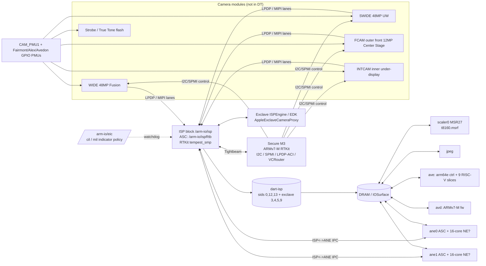
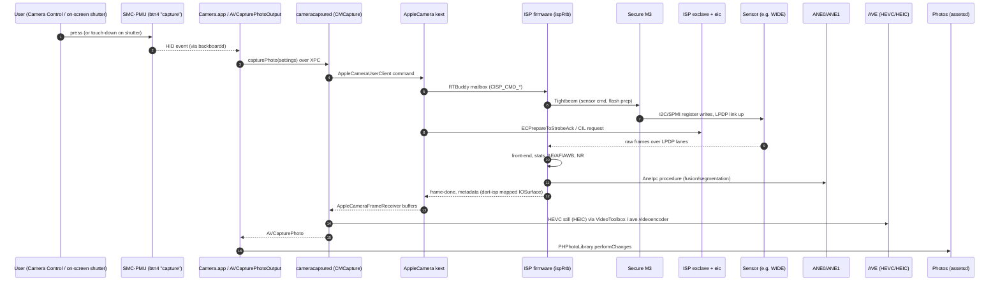
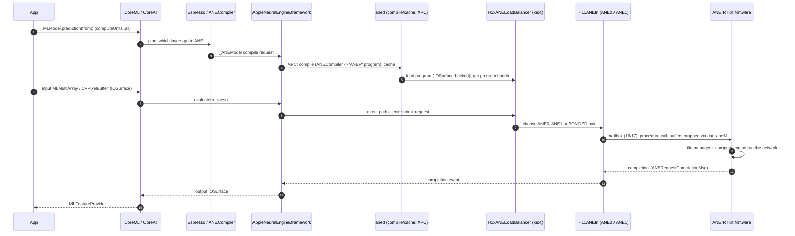

# 04: Camera, media and the Neural Engine

This chapter covers imaging, media codecs and the Neural Engine on the iPhone Duo (`iPhone19,4`, `V68AP`, `t8160`, iOS 27.2 `24B91020`). It runs from the camera modules, through the ISP and its new Secure M3 sensor controller, the scaler and JPEG block, the AVE encoder and AVD decoder, to the two ANE instances. It also covers the exclave paths and the userland stacks that reach them.

Evidence labels are as in [00-method-and-evidence.md](00-method-and-evidence.md). The raw string excerpts this chapter quotes are in [`data/04-camera-media-neural-engine/`](../data/04-camera-media-neural-engine/). Per-node property dumps are in [`reference/devicetree/`](../reference/devicetree/), and per-kext pages are in [`reference/kexts/`](../reference/kexts/).

> **A note on the userland evidence.** The iOS 27.2 dyld shared cache was deleted from the shared scratch area partway through this work. A list of its 4,776 image paths had already been taken, so **[DSC]** claims here only say that a framework, plug-in or bundle *exists* at a given path. Claims about class or symbol content inside those images are marked **[INF]**, or are drawn from kernel-side strings.

---

> **Address convention (added after [FACTCHECK-3](FACTCHECK-3.md)).** Register addresses for `/arm-io` children in this chapter are **`/arm-io` bus addresses** unless marked otherwise. Add `0x2_0000_0000` to get the CPU physical address used in chapter 01, `docs/MAP.md`, `reference/maps/physical-address-map.md` and `tools/duomap.py addr` (e.g. ISP ASC `0x1_8160_0000` → `0x3_8160_0000`, AVE `0x2_0306_4000`-range → `0x4_0306_4000`). The `isp-exclave-s-proxy` windows (`0x3c1800000` …) are outside the ranges table and are printed as-is.

## 1. Summary of findings

| # | Finding | Evidence |
|---|---|---|
| 1 | The device tree has **no node per camera sensor**: no I²C addresses, no MIPI ports. Sensor control belongs to firmware. The ISP firmware's V68 board table names exactly four cameras: **`WIDE`, `SWIDE`, `FCAM`, `INTCAM`**. Each has its own 24 MHz clock and shutdown GPIO on a camera PMU (`CAM_PMU1`), and dedicated rails except FCAM, which only has the shared `WIDE_FCAM_INTCAM_SWIDE_VDDIO` (corrected by [FACTCHECK](FACTCHECK.md)), plus a `STROBE_HWEN` line for the flash. | [FW] `adc-boreas-v68` |
| 2 | **A new co-processor, the Secure M3.** It runs `Firmware/M3/bin/securem3fw-v68.im4p` (IM4P `sm3f`; manifest `Ap,SecureM3Firmware` and `Ap,RestoreSecureM3Firmware`/`rsm3`). It is an ARMv7-M RTKit image whose threads drive sensor **I²C, SPMI, LPDP-ACI link training and a "VC router"**. It talks to the ISP and exclaves over **Tightbeam**. The ISP firmware has `_M3` variants of four sensor drivers, and the kext shows a `secureM3Isr` exclave call. | [FW] [KC] |
| 3 | Newer sensors connect over **LPDP**, a DisplayPort-derived serial link with AUX channel and link training, rather than MIPI CSI-2. LPDP strings appear 86 times in the ISP firmware, against 20 for MIPI. | [FW] |
| 4 | **The under-display inner camera has its own ISP mode.** The firmware has `CISP_CMD_CH_UDC_MULTI_PASS_ENABLE` and `MLVNR UDC can not keep up`, the kext has fault latches `INT_FAULT_BBA_UDC_LATCH` and `…BBB_UDC_LATCH`, and the device tree's `/product/camera` has `inner-camera = 1` and `inner-max-video-fps-1080p = 30`. | [FW] [KC] [DT] |
| 5 | **The camera privacy path runs through exclaves.** `/arm-io/isp-exclave-proxy` binds `AppleExclaveCameraProxy` (`com.apple.service.ISPEngine`). Four ISP DART stream IDs are reserved for exclaves (`epipe0`, `epipe1`, `piodma1`, `secure1`). An `/arm-io/eic` node carries `cil = 1`, `mil = 1`, `policy-alt-indicator` and a watchdog window into ISP (`mmio-wd-isp`). The ISP firmware implements a **"CIL breaker"** that turns on **pixel masking** and stops AF/AWB. | [DT] [KC] [FW] |
| 6 | **The flash ("strobe") is arbitrated by an exclave client.** Strings in the kext include `fExclaveStrobeControlClient`, `ECPrepareToStrobeAck` and `ECEndStrobeAck`. `cameracaptured` is refused a device open while "strobe control is active". | [KC] |
| 7 | **The nine AVE "slice" firmwares (`AVE0`–`AVE8`) are RISC-V.** Each is a 32-bit Mach-O with `cputype 0x18` (LLVM's `CPU_TYPE_RISCV`), and its first instructions are `auipc` / `addi` / `csrw mtvec` / `csrw mscratch`. Each carries `RTKit-3491.release`, and each is signed as its own manifest entry, `Ap,AppleVideoEncoder0` to `Ap,AppleVideoEncoder8`. The main AVE firmware is arm64e RTKit (`chinook`). | [FW] |
| 8 | The AVE kext encodes **H.264, HEVC, MV-HEVC (spatial video) and AV1**. AVD has H.264, HEVC and AV1 decode capability keys, plus an "ADS" secure-decode block. | [KC] |
| 9 | **Two ANEs, one firmware source.** `ane0` and `ane1` are separate ASC-wrapped instances, each with its own DART, mailbox and power gate. They run separately signed builds of the same `AppleH16AneFW` source, which differ in their DSID window (24–27 against 124–127). The kext implements a **"bonded" mode**, in which one inference uses both ANEs, and **"ANE0 harvested"** handling, in which ANE0 is fused off and IPC/exclave moves to ANE1. | [DT] [FW] [KC] |
| 10 | **The ISP calls the ANE directly.** The ISP node has `function-ane_*` and `function-ane1_*` power, endpoint and data hooks. The ISP firmware has `CAneClient` and `AneIpc`. The ANE kext creates an "ANE<->ISP endpoint service" and remaps ISP surfaces into ANE DART space. | [DT] [FW] [KC] |
| 11 | `Firmware/msr/t8160.msrf.im4p` (`Ap,MSRFirmware`) is the **scaler's (M2Scaler "MSR") firmware**, an ARMv7-M image. The scaler node reports `hardware-version = 27`, which matches the kext's `IosaFirmwareControlMSR27Rtk` and `IosaTunableControlMSR27` classes. | [FW] [DT] [KC] |
| 12 | **Device-tree residue that contradicts the public spec.** The ISP node still carries `pearl-calibration-data` (Face ID) and `rosaline-calibration-current` (`syscfg/RxCL`), but the Duo uses Touch ID, and there is no Pearl SEP endpoint. `/product/camera` sets `front-flash-capability = 1` (see §3.6). | [DT] |

---

## 2. Block diagram



---

## 3. Imaging: modules, ISP, Secure M3, flash and privacy

### 3.1 What the device tree says about the camera hardware

There is **no device-tree node for any camera sensor, actuator or flash driver** **[DT]**. Searches of `data/devicetree.txt` for `camera`, `strobe`, `mipi` and `csi` find only the following.

- **`/arm-io/ispRtb`** (`compatible = iop-isp,ascwrap-v8`) is the ISP's ARM co-processor wrapper ([node](../reference/devicetree/root__arm-io__ispRtb.md)) **[DT]**.
  - Bound by `AppleASCWrapV8SISP` in `com.apple.driver.AppleA7IOP-ASCWrap-v8`, and its child `iop-isp-nub` (`iop-nub,rtbuddy-v2`) by `RTBuddy` **[KC]**.
  - Registers:
    - `0x3_8160_0000` (bus address `0x1_8160_0000`), size `0x74000`: the ASC window, the same size as the ANE and GPU ASC windows.
    - `0x181050000`, size `0x4000`.
    - `0x96020000`, size `0x10000`.
    - `0x180000000`, sizes `0x8000` and `0x4000000`: the 64 MB ISP block.
    - `0x80700000`, size `0x1c000`, and `0x80724000`, size `0x4000`: power-manager windows shared with ANE and AVE.
  - Interrupts: `212, 172, 132, 410, 411, 412, 413, 183`.
  - `msgbox-mailbox-num = 18`, `msgbox-using-postoffice = 1`, `role = "ISP"`, `iop-version = 1`.
  - The nub has `coredump-enable`, `reboot-firmware`, `user-power-managed` and `ap-recoverable-panics`.
- **`/arm-io/isp`** (`compatible = isp,isp-generic-ex`, `isp,s5l8960x`) is the main ISP node ([node](../reference/devicetree/root__arm-io__isp.md)) **[DT]**.
  - Bound by `AppleCamera` in `com.apple.driver.AppleCamera` 20.112 **[KC]**. The same kext also matches `RTBuddyService` with `role = ISP`, for the firmware side.
  - Interrupts: `410, 411, 412, 413, 183`.
  - `iommu-parent` phandles 301–306: the six `dart-isp` mappers below.
  - Clocks `344` and `346`; power, clock and service gates `0x1e`, `0x1f`, `0x20` and `0x21`; `service-reset = 15`.
  - The node is marked `exclave-assigned`, with `exclave-service = "com.apple.service.ISPEngine"` and `exclave-edk-service = "com.apple.service.ISPEngine_EDK"`.
  - `camera-rear = 1`, `camera-front = 1`, `sensor-type = 131`, `has-sphere = 1`, `face-detection-support = 1`.
  - Calibration pointers into `syscfg`:
    - `camera-strobe-color-cal = syscfg/STRB`: the True Tone flash colour calibration.
    - `back-camera-autofocus-recal = syscfg/BCAR`.
    - `photon-detector-cal-data` / `-offset = syscfg/RACa`, `RACm`.
    - `pearl-calibration-data = syscfg/PrCL`.
    - `rosaline-calibration-current = syscfg/RxCL`.
  - Platform-function hooks:
    - `function-saca0`…`saca5` and variants: SACA clients for the AOP.
    - `function-motion_*`: motion data from the AOP, for EIS and OIS.
    - `function-conf_isp_ref{0,1,2}_clk_freq`.
    - `function-mcc_dataset`: memory-cache dataset IDs.
    - `function-ane_power_func`, `function-ane_ep_control` and `function-ane_data_param_{get,set}`, and the same for `ane1_*` (§7.4).
- **`/arm-io/dart-isp`** (`dart,t8110`): registers `0x182b40000`… (six windows); interrupt 416; `sid-count 16`; `sid = 0, 12, 13`; `real-time`; DAPF filter instance. Its mappers ([node](../reference/devicetree/root__arm-io__dart-isp.md)) **[DT]**:

  | Mapper | `reg` (SID) | Notes |
  |---|---|---|
  | `mapper-isp` | 0 | normal AP-owned buffers |
  | `mapper-isp-mpm` | 12 | "MPM", memory used by the firmware (also in ANE) |
  | `mapper-isp-exclave-secure1` | 3 | exclave-owned |
  | `mapper-isp-epipe0-exclave` | 4 | exclave pipe 0 |
  | `mapper-isp-epipe1-exclave` | 5 | exclave pipe 1 |
  | `mapper-isp-piodma1-exclave` | 9 | exclave PIO-DMA |

- **`/arm-io/isp-exclave-proxy`** (`isp,isp-exclave-proxy`) binds `AppleExclaveCameraProxy` (`com.apple.driver.AppleCamera`) **[DT][KC]**.
- **`/arm-io/isp-exclave-s-proxy`** has no `compatible`, is `exclave-assigned`, and covers four register windows: `0x3c1800000`/`0x480000`, `0x3c2980000`/`0x1ac000`, `0x3c2b2c000`/`0x4000` and `0x2d6010000`/`0x4000` **[DT]**. This is the MMIO the exclave side owns **[INF]**.
- **`/arm-io/msg`** (`msg-mapper`) has `sync_lookup = back-camera-complex, front-camera-complex` and `trigger_lookup = external-sync-primary/secondary` **[DT]**. This is the hardware frame-sync / genlock block for multi-camera capture **[INF]**. The ISP firmware's `V68_GPIO_ISP_TO_GENLOCK_LS_EN` is consistent with it.
- **The AOP side** (see [05-sensors-touch-audio-haptics.md](05-sensors-touch-audio-haptics.md)) has these camera-related nodes **[DT]**:
  - `spherecontrol` carries `isp-aop-control-config`, `isp-aop-pearl-config`, `isp-aop-motion_1-config` and `isp-aop-motion_full_rate-config`. All are 16-byte records pointing into `0x290610000`. It is bound by `AppleSPUSphereDriver` (`com.apple.driver.AppleSPUSphere`, matching `AOP_spherecontrol`) **[KC]**. "Sphere" is Apple's name for sensor-shift OIS, which needs gyro data at full rate **[INF]**.
  - `als` has `occlusion-drives-grimaldi = 1` and `strobe-coex = 2`. It coordinates the ambient light sensor with flash firing.
  - `grimaldi-control` has `function-flicker_bias`.
  - **`/arm-io/grimaldi`** (`aop,h16,vd5b704`, `host = "AOP"`) is bound by `AppleCameraPhotonDetector` **[KC]**. The VD5B704 is an AOP-hosted photon/flicker detector the camera uses for anti-flicker exposure **[INF]**. Its calibration is `syscfg/RACa`.
- **The SMC** `smc-ext-charger` has `camera-driver = "AppleCamera"`, `has-ironman-camera-cloak = 1` and `has-ironbull-camera-cloak = 1` **[DT]**. The SMC tells the camera when a magnetic charger is attached, so that OIS and AF can compensate ("cloak") **[INF]**. `smc-acam` binds `AppleSMCACAMDriver` **[KC]**.
- **The power manager** names the per-block power states **[DT]**:
  - `soc-device-ps-map` lists `ANE0`, `ANE1`, `ISP`, `AVE`, `AVD`, `MSR`, `JPEG` and `PRORES`.
  - `hw-dpe-reg` lists `@ANE0`, `@ANE1`, `@ISP`, `@AVE` and `@MSR`.
  - `bwr-agent` lists `ISP`.
  - `perf-counters` include `ISPSENS0`, `ISPSENS1`, `ISP_CPU_CORE0` and `ISP_CPU_CORE1`. The ISP co-processor has two cores, which matches the firmware's `RTKit_armv8_tempest_smp` build.

### 3.2 `/product/camera`: the capability table userland reads

`/product/camera` ([node](../reference/devicetree/root__product__camera.md)) is a flat capability table **[DT]**. Values are decoded from single-byte strings: `"<"` = 60, `"x"` = 120, `"d"` = 100.

- **Rear:**
  - Maximum video frame rate is 120 fps at 4K and 1080p and 60 fps at 720p (`rear-max-video-fps-4k`, `-1080p`, `-720p`).
  - Slo-mo is 240 fps at 1080p and 720p.
  - `rear-max-video-zoom = 3`, `rear-cam-superwide-capability = 1`, `rear-cam-sup-wide-af-capability = 1`.
  - `rear-low-light-photo`, `rear-hdr`, `rear-auto-hdr`, `rear-stage-light-portrait`.
  - Burst up to 600 frames.
- **Front:**
  - 60 fps at 4K, 1080p and 720p; slo-mo 120 fps.
  - `front-auto-focus = 1`, `front-cam-superwide-capability = 1`, `front-flash-capability = 1`, `front-max-video-zoom = 1`.
- **Inner camera:** `inner-camera = 1` and `inner-max-video-fps-1080p = 30`. These two keys are new compared with single-display iPhones **[INF]**.
- **System:**
  - `aggregate-camera = 1`, `aggregate-cam-photo-zoom = 0x7d0`, `aggregate-cam-video-zoom = 0x4b0`.
  - `spatial-over-capture`, `deferred-processing`, `pipelined-stillimage-capability`, `photo-capture-on-touch-down`.
  - `p3-color-space-video-recording`, `camera-hdr-version = 3`, `camera-ui-version = 2`, `live-photo-capture`, `moment-capture`.
- **`/product/facetime`** carries the encode and decode resolution tables, and `tnr-mode-front` / `tnr-mode-back`.
- **`/product`** itself has `supports-camera-button = 1` and `front-cam-rotation-isp = 180`. `/product/display0` and `/product/display1` each carry their own `camera-button-location`, `rear-cam-offset-from-center` and `front-cam-offset-from-center`. The second display has different values for both offsets, consistent with the inner panel having its own front camera position ([08-foldable-system-and-chassis.md](08-foldable-system-and-chassis.md)).

### 3.3 The ISP firmware: `adc-boreas-v68`

- **The image.** `Firmware/isp_bni/adc-boreas-v68.im4p` is IM4P type `ispf`, 29.9 MB. Its manifest key is `ISP`, `IsLoadedByiBoot = true` and personalized **[FW]**. The payload is an arm64e `PRELOAD` Mach-O built as `RTKit_armv8_tempest_smp_Oz_flto_pac-3514.40.18.release`, with the banner `boreas/P borneo v68 SMP`. Its layout:
  - 11 MB of `__text` and 9.5 MB of `__const`.
  - An RTKit patchbay, tunables and a 4 MB page table.
  - UUID `0FA02189-9D7C-3451-9012-12DDCAADF7A7`.
- **Loading.** iBoot loads and verifies the image **[FW: manifest]**. `AppleASCWrapV8SISP` starts the ASC, and `RTBuddy` brings up the RTKit endpoints. `AppleCamera` attaches as the `RTBuddyService` client with `role ISP` **[KC]**. The kext has an `ISPCoredump` class, and `ap-recoverable-panics` in the device tree lets the AP restart the firmware without a kernel panic **[DT][KC]**.
- **Source layout.** The paths in the firmware (`./h10isp/common/misc/H19/CPowerSupplyV68.cpp`, `./h10isp/drivers/SENSOR/<model>/…`, `./h10isp/controller/target/H8/…`) show a single ISP codebase ("h10isp") with per-SoC (`H19`) and per-board (`V68`) modules **[FW]**.

#### 3.3.1 The V68 board table: four cameras

`CPowerSupplyV68` and `CConnectivityTableV68` contain these board-specific names **[FW]** (full list in the excerpt file):

| Signal / rail | Camera |
|---|---|
| `V68_CLK_CAM_PMU1_TO_WIDE_24M`, `V68_GPIO_CAM_PMU1_TO_WIDE_SHDN`, `V68_PMU1_WIDE_DVDD`, `…WIDE_AVDD1/2` | **WIDE**: rear main |
| `…TO_SWIDE_24M`, `…TO_SWIDE_SHDN`, `…SWIDE_AVDD1/2` | **SWIDE**: rear ultra-wide ("superwide") |
| `…TO_FCAM_24M`, `…TO_FCAM_SHDN` | **FCAM**: front camera on the outer display |
| `…TO_INTCAM_24M`, `…TO_INTCAM_SHDN`, `…INTCAM_AVDD1/2` | **INTCAM**: the "internal" camera, under the inner display |
| `V68_PMU1_INTCAM_SWIDE_DVDD_BUCK1`, `V68_PMU1_WIDE_FCAM_INTCAM_SWIDE_VDDIO` | shared digital core and I/O rails |
| `V68_GPIO_CAM_PMU1_TO_STROBE_HWEN` | flash LED driver hardware enable |
| `V68_PP_CAM_VCM_PVDD` | voice-coil (AF/OIS) actuator supply |
| `V68_GPIO_ISP_TO_CAM_PMU1_RESET`, `…TO_BOOST_VSEL_RESET`, `…TO_PVDD_RESET` | PMU control |
| `V68_GPIO_ISP_TO_GENLOCK_LS_EN` | frame-sync level shifter |
| `V68_PMU1_TDIE_BUCKS`, `…TDIE_LDOS` | PMU die temperatures |
| `V68_PMU_FAIRMONT`, `V68 optical card ID: %x` | a second PMU ("Fairmont") and an "optical card" revision readout |

- **The camera count.** The table names four cameras, which matches the public spec: 48MP Fusion main, 48MP ultra wide, 12MP Center Stage front, and an inner under-display FaceTime camera **[PUB, per brief]**. There is no telephoto **[FW]**.
- **The FCAM supply.** FCAM gets only `VDDIO` from `CAM_PMU1`. Its analogue rails probably come from the Fairmont PMU or another GPIO PMU **[INF]**. The firmware also contains the generic PMU and GPIO drivers `CGPIODriverAlda`, `AldaST`, `Alex`, `Avedon`, `Fairmont`, `Adams` and `SN65709X`.
- **Which bus carries the commands.** I²C, SPMI and SMB lanes appear only as indices in `CConnectivityCommon`'s debug dump. That dump prints, per virtual channel: `SIF`, `ESIF`, `AUX`, `MIPI`, `FEProc`, `ModuleName`, `powerChannel`, `camGroup`, `camType`, `I2Cs[13]`, `phyLanes`, `dataLaneSwapped`, `clockLaneSwapped`, `LpdpTxMillivolts` and `LpdpMaxFrequency`. The actual numbers sit in binary tables, not strings. **This chapter therefore cannot give I²C addresses or PHY port numbers** for each camera (see §10).

#### 3.3.2 Sensor drivers, module tunings and the likely V68 parts

The firmware carries drivers for many sensors, not just this board's **[FW]**:

`CImageSensorIMX3x3, IMX575, IMX903, IMX905, IMX907, IMX915(+_M3), IMX916(+_M3), IMX919, IMX954(+_M3), IMX972(+_M3), IMX973, IMX982, S5KJMB, VD56G8(+Security, +Utility), _M3 base`.

Module tuning sets, as `<module>_<integrator>_<rev>_mode…` strings, tie modules to sensors **[FW]**:

| Tuning set | Sensor | Full-res mode | Notes |
|---|---|---|---|
| `villanova_appleton_a0_v118` | IMX954 | 8448×6048 @30 (`sifr`), 4224×3024 @120 | 51 MP-class quad-Bayer |
| `Kerns_PDX25_B0_v141` | IMX972 | 8448×6048 @15, 4224×3024 @60 | AE tables call it `SW` (superwide). Also `IMX972_V68P1::…` and `"V68 P1 PDX-D was rotated 180 degree from RGGB to BGGR"` |
| `KernsT_MEM_B0_v143` | IMX973 | 8448×6048 | AE tables call it `Tele` |
| `KernsW_SEA_B0_v144` | IMX982 | 8448×6048 | "W" = wide |
| `Grassland_PSM_A0_v011` | Samsung S5KJMB | 8448×6048 | |
| `Glenbrook_RNO_A0_v005` | IMX916 | 4896×4896 square, 2448×2448 @60 | RNO = "Reno". The kext has `FrontCameraReno*` |
| `Lakeville_BOS_A0_v006` | IMX915 | 4896×4896 square, crops to 3680×4896 / 2448×1376, up to 120 fps | |
| `Allster_TN` | IMX903 | 8448×6048 | |
| (VD56G8, ST) | VD56G8 | 1312×1108 global shutter, raw12 | has `strobe_config_normal`, `CImageSensorVD56G8Security` and an "Auth Boot" |

These are the **inferred** V68 sensors **[INF]**:

- **The four `_M3` drivers.** Only four sensor drivers have Secure-M3 variants: `IMX954_M3`, `IMX972_M3`, `IMX915_M3` and `IMX916_M3` (`"… Driver Initialized with M3 support"`, `"running at 24mHz over M3"`). The Secure M3 firmware exists only as `securem3fw-v68`. The four likely V68 cameras are therefore:
  - **IMX954** (villanova): the 48MP main / **WIDE**.
  - **IMX972** (Kerns PDX): the 48MP **SWIDE**. It has a dedicated `IMX972_V68P1` init and a V68-specific orientation note.
  - **IMX915** (Lakeville/BOS) and **IMX916** (Glenbrook/RNO): the two square front sensors, **FCAM** and **INTCAM**. Square sensors are what Center Stage cropping needs.
- **Which square sensor is inner.**
  - Glenbrook's tuning offers only 30/60 fps modes, and the device tree caps the inner camera at 1080p30.
  - Lakeville's tuning reaches 120 fps, and the device tree gives the front camera 120 fps slo-mo.
  - So Glenbrook/IMX916 is most likely INTCAM, and Lakeville/IMX915 most likely FCAM. This is a weak inference, and the binary connectivity table would settle it.
- **The `Glenbrook` and `Lakeville` firmware folders.** The IPSW has top-level `Firmware/Glenbrook/YonkersIR2,SysTopPatch0–F` and `Firmware/Lakeville/YonkersIR1,SysTopPatch0–F`. All are personalized, and none is loaded by iBoot **[FW: BuildManifest]**. The folder names match these two front-module tunings exactly. What "Yonkers" patches do, and which processor applies them, is not visible in any string **[INF; see §10]**.
- **Megapixel counts.** The public "12MP" front and "48MP" rear figures are output resolutions. The sensor arrays above (4896² ≈ 24 MP; 8448×6048 ≈ 51 MP) are larger, and are binned or cropped down **[INF]**.

#### 3.3.3 How sensors are wired: LPDP and the Secure M3

- **The link: LPDP.** Recent sensor drivers do **"LPDP"** link training, not CSI-2 bring-up. Examples are `IMX982 LPDP fast link training has failed`, `***** IMX954: Using ACI Fast Link Training *****`, `IMX575: Using AUX-LESS LPDP configuration`, `S5KJMB: … 4-byte S5KJMB_LINK_RATE`, the `CLPDP.cpp` AUX-channel reads, and the `ISP_CMD_CH_LPDP_EQUALIZTION` and `…HS_RECEIVER_TUNING_SET` commands **[FW]**. LPDP looks like a low-power DisplayPort-style serial link, with an AUX side-channel, equalisation and lane polarity swap **[INF]**. Older drivers (IMX3x3 and similar) still reference MIPI.
- **The Secure M3 firmware.** `securem3fw-v68` is ARMv7-M, built as `RTKit_armv7m_Oz_floatabisoft-3514.40.18.release`, with version `20.112`, built `Oct 21 2026`. Its source files and threads are **[FW]**:
  - `CSensorDriver.c`, with `SensorThread` and `SensorThreadLowPrio`.
  - `SpmiControllerCommon.c`, with `SpmiCmdThread` and `SpmiControllerThread`.
  - `AldaSTI2cController.c`, with `i2cCmdThread0/1/2` and `i2cControllerThread`.
  - `CLPDPACIController.c`.
  - `CVCRouter.c`.
  - `CILMonitor.c`, with `CILMonitorThread`.
  - `isp_to_m3_tightbeam.c`, `secureM3_tb_ipc.c`, `secureM3_tb_translator.c` and `tytbmxport`, which are Tightbeam transport.
  - `securem3_coredump`.
- **What the Secure M3 does.** It is the controller that physically drives the camera control buses (I²C, SPMI), the LPDP link and a virtual-channel router. The ISP and its exclave command it over Tightbeam **[INF from FW]**. The version `20.112` is the same as `com.apple.driver.AppleCamera` 20.112 **[KC]**, so the two are released together. The ISP firmware matches this design:
  - `SecureM3Driver`, `CSecureM3Driver`, `LPDPM3Wrapper` and `SmbSecureM3`.
  - `SecureM3 supported:` bitmask dumps over `VCROUTER` and `SENSOR_0…6`.
  - `ExclaveOnlyChannelStart`.
  
  The kext has `"invalid result returned from secureM3Isr"` and `SendCmdSecureM3Isr` on the exclave path, so the Secure M3's interrupts are forwarded through the exclave **[KC]**.
- **Where it lives.** No device-tree node names the Secure M3 **[DT]**. The power manager's `boost-agent` blob lists agents `DISPINT_PRI_M3`, `DISPINT_SEC_M3` and `EDISP_M3`. Those are M3 cores attached to the display pipes, see [03-gpu-and-displays.md](03-gpu-and-displays.md), and show Apple uses small M3 cores as secure helpers next to several real-time blocks **[DT][INF]**. Where the camera Secure M3 sits physically, and its MMIO, cannot be determined from these sources.
- **Sensor authentication.** The kext has these sensor-authentication strings **[KC]**:
  - `Sensor auth keys fetching`, `Sensor wrap keys fetching`.
  - `RearCameraAuthIC{ChipID,DeviceID,Nonce,PubKey,PubKeyHmac,UID,MNS,AuthResponse}`.
  - `AppleAuth`, a class in AppleCamera.
  - Per-camera `…ModuleSerialNumString` and `…SNUM` keys.

  The ISP firmware's sensor drivers carry `merkleRoot` / `leaf` arguments (`IMX954_M3`) and an `IMX919 Anti-Tamper Status` **[FW]**. Camera modules are cryptographically paired and checked, which is how "unknown part" messages after a module swap arise **[INF]**.

#### 3.3.4 Flash ("strobe") and the True Tone flash

- **Driver classes.** The ISP firmware contains `CStrobeDriver` and five chip-specific classes: `CStrobeAntlia`, `CStrobeCP5100` (configurations `CfgA` and `CfgB`), `CStrobeQuark`, `CStrobeRegulus` and `CStrobeRigel`. It also has `CAEFlash`, `CImageCaptureFlash` and the AE tables `AETable_Photo_Flash_Wide`, `_SW` and `_FFC` **[FW]**. Which strobe IC V68 uses is not in any string.
- **Hardware enable and calibration.** The hardware enable is `CAM_PMU1` GPIO `STROBE_HWEN` **[FW]**. Colour calibration is `syscfg/STRB` **[DT]**.
- **Torch and the exclave.** Torch mode exists (`CISP_CMD_CH_LED_TORCH_ON_INDICATOR`) **[FW]**. The kernel routes strobe control through an exclave client **[KC]**:
  - `fExclaveStrobeControlClient`.
  - `Registering exclave isp upcall for strobe control with notification Id`.
  - `ECPrepareToStrobeAck` and `ECEndStrobeAck`.
  - `Request for strobe mode OFF->ON transition`.
  - `Rejecting power-on request from %s - strobe control is active`.
  - `Rejecting device open from cameracaptured - strobe control is active`.
  
  The flashlight can therefore run while the camera pipeline is closed to normal clients. It is also arbitrated against the ALS (`strobe-coex = 2`) and the CIL breaker (`CISP_CMD_CIL_BREAKER_ACTIVATED skipped - strobe control active`).

#### 3.3.5 Under-display (inner) camera processing

- **ISP mode.** The ISP has a dedicated **UDC multi-pass** mode **[FW]**:
  - `CISP_CMD_CH_UDC_MULTI_PASS_ENABLE`.
  - The deprecated `ISP_PROPERTY_ALGOCONTROL_UDC_MULTI_PASS_ENABLE`.
  - `[%s] CH = %zu UDC Multi-Pass ISP enable=%d, useCase=%d, tappingPoint=%d`.
  - `MLVNR UDC can not keep up, ch=%d` (ML-based video noise reduction).
- **Fault latches.** AppleCamera exports two UDC-related fault latches, `INT_FAULT_BBA_UDC_LATCH` and `INT_FAULT_BBB_UDC_LATCH` **[KC]**.
- **Why.** Light through an OLED is attenuated and diffracted, so the inner camera's frames make extra passes through the ISP, partly using ML noise reduction. This is the likely reason the device tree limits it to 1080p30 **[INF]**.

### 3.4 Kernel driver chain for the camera

```
AppleARMIODevice /arm-io/ispRtb ── AppleASCWrapV8SISP ── AppleA7IOPNub iop-isp-nub ── RTBuddy ── RTBuddyService(role ISP) ── AppleCamera
AppleARMIODevice /arm-io/isp ──────────────────────────────────────────────────────────────────── AppleCamera (isp,isp-generic-ex)
AppleARMIODevice /arm-io/isp-exclave-proxy ────────────────────────────────────────────────────── AppleExclaveCameraProxy
AppleARMIODevice /arm-io/dart-isp ── AppleT8110DART ── IODARTMapper ×6
AppleSPUAppInterface AOP_spherecontrol ── AppleSPUSphereDriver
AppleARMIODevice /arm-io/grimaldi ── AppleCameraPhotonDetector (+UserClient)
```
**[DT][KC]**

AppleCamera's C++ classes, from [`data/kernel-cpp-classes.txt`](../data/kernel-cpp-classes.txt), are **[KC]**:

- `AppleCamera`, with an instance size of `0x84a28`. It is a very large object.
- `AppleCameraUserClient`.
- `AppleCameraFrameReceiver`, `…Buffer` and `…BufferPool`.
- `AppleCameraFrameMetadata` and `AppleCameraVMAllocator`.
- `ISPExclaveEventSource`, `ISPMainWorkLoopEventSource`, `ISPErrorEventSource` and `ISPLoggerEventSource`.
- `ISPSharedMemorySurfaceParams` and `ISPMPMMemoryParams`.
- `ISPCoredump` and `AppleAuth`.
- `ApplePearlCam` and `ApplePearlCamUserClient`.
- `AppleExclaveCameraProxy`.

The `ApplePearlCam` classes are compiled in. There is no Pearl SEP endpoint in this device tree, `ApplePearlSEPDriver` has nothing to match, and `AppleH10PearlCameraInterface` has no personalities at all **[DT][KC]**. They are dead weight on a Touch ID device **[INF]**.

**User clients.** `AppleCameraUserClient` logs its client by name **[KC]**:

- `cameracaptured`
- `mediaserverd`
- `cameraispd`
- `cameraispdarwind`
- `restorecameraispd`
- `camisp test app`

Other processes are rejected (`Process %s (pid %d) denied access`).

### 3.5 Exclave and privacy path

- **Exclave bring-up.** AppleCamera creates an exclave work loop and a command gate. It finds `/arm-io/isp-exclave-proxy` and gets the "Exclave Camera proxy handle". It then registers these event sources: an ISP interrupt source, an ISP mailbox interrupt source and a strobe upcall source. It calls `ISP_PowerOnExclaveCore` and `ISP_InitializeExclave`. Relevant strings **[KC]**:
  - `Sent Exclave on/off: TBErr=%U`.
  - `Sent SEAR approved Exclave HWIRQ`.
  - `"invalid result returned from exclaveIspHardwareIrq"`.
  - `Creating multicam session: Client=%s NumGroups=%d ExclaveMode=%d SecureFID=%d MicRecording=%d`.
  - `EC failed to read sensor NVM`.
  - `Reading sensor NVM failed, tberr`.
  
  The exclave ("EC", the exclave core) owns sensor power and NVM reads in secure mode, and the ISP DART has four exclave-only SIDs (§3.1) **[INF]**.
- **The indicator.** The ISP firmware has a "CIL" subsystem: `CILCal`, `CILDataBlockedIrq!`, `Enable/Disable CIL error interrupt`, `CISP_CMD_CIL_BREAKER_ACTIVATED`, `vc %zu fc %d exclave cilErrorSema`, `ch %zu … cilTargetFc … pixel masking is on`, `skip AF process because pixel masking is on`, `skip AWB process because pixel masking is on` and `Ignoring VCP err since CIL breaker is activated` **[FW]**. The Secure M3 runs a `CILMonitorThread` **[FW]**. The kext has `ISP_CILRequestPerChannel`, `ISP_CILManager_gated` and `[CIL] Force to turn off CIL` **[KC]**.
- **`/arm-io/eic`.** It is `exclave-assigned`, with no kernel driver, and has these properties **[DT]**:
  - `cil = 1` and `mil = 1`.
  - `policy-alt-indicator = 1`, `policy-allow-prox-suppression = 1`, `policy-allow-accessory = 1`, `policy-sensor-control = 0` and `policy-override-chill-pill = 1000`.
  - MMIO windows `mmio-ps` (`0x2c0700000`/`0x1c000`), `mmio-gpio` (`0x2da000000`), `mmio-fpwm` (`0x2e5040000`), `mmio-gltb` (`0x2c82a8000`), `mmio-wd-e` (`0x2c82b0000`) and `mmio-wd-isp` (`0x3c3b10000`/`0x8000`).
- **Inference: how the pieces fit [INF].**
  - "CIL" is most likely the *camera indicator light* and "MIL" the *microphone indicator light*.
  - `eic` is the exclave's indicator controller. It holds a watchdog over the ISP (`mmio-wd-isp`) and the exclave display pipe (`mmio-wd-e`), and touches power-state, GPIO and PWM windows.
  - It enforces that **if the camera is streaming, the on-screen green dot is drawn by the secure display pipe** (`/arm-io/exdisplaypipe`, `exdisplaypipe1`, one per panel; see [03-gpu-and-displays.md](03-gpu-and-displays.md)).
  - If that guarantee breaks, the ISP's "CIL breaker" masks the pixels, so the app receives black frames.
  - The two-panel Duo needs this to work on whichever display is lit. The device tree has `exdisplaypipe` and `exdisplaypipe1`, and the pmgr agents `DISPINT_PRI_M3` and `DISPINT_SEC_M3`.
- **Userland side [DSC].** These images exist; their contents could not be read:
  - `AppleCameraISPExclaveKitServices.framework` and `ISPExclaveKitServices.framework`.
  - `SecureCaptureKit.framework`.
  - `EXDisplayPipe.framework`.
  - `PrivacyDisclosureCore.framework` and `PrivacyDisclosureUI.framework`.
  - `CameraOverlayServices.framework`.

### 3.6 Device-tree notes that need care

- **`front-flash-capability = 1`.** No front strobe appears in the V68 rail list, which has a single `STROBE_HWEN`. This flag is the Retina-flash (screen-as-flash) capability, not an LED **[INF]**.
- **Pearl and Rosaline.** `pearl-calibration-data` and `rosaline-calibration-current` on the ISP node, and `isp-aop-pearl-config` in `spherecontrol`, are Face ID-era properties. Nothing in the tree consumes them: there is no `sep-endpoint,sprl` and no `ApplePearlSEPDriver` match. They contradict nothing in the public spec. They are template residue **[INF]**.
- **The VD56G8 driver.** The VD56G8 is a global-shutter driver with an authenticated "Security" boot, of the kind used for IR or biometric cameras **[FW]**. It is not one of the four `_M3` drivers, and nothing ties it to V68.

---

## 4. Scaler / colour-space converter (`/arm-io/scaler0`)

- **What it is.** A fixed-function scaler, colour-space converter and blitter for IOSurfaces ("M2Scaler", generation "MSR") **[DT][KC]**.
- **Device tree** ([node](../reference/devicetree/root__arm-io__scaler0.md)) **[DT]**:
  - `compatible = scaler,t8101, scaler,s5l8960x`; `hardware-version = 27`; `coprovider-group = "scaler"`; `workload-priority = 5`.
  - Twelve register windows: ten from `0x208000000` to `0x209340000` (one, `0x209210000`, listed twice) and the shared `0x80700000` and `0x96020000`.
  - Interrupts `1290, 1292–1294, 1298–1305, 168, 208, 128`.
  - `msgbox-mailbox-num = 14`, `msgbox-using-postoffice`.
  - Clock 350, power gate 45, `service-reset = 17`.
  - IOMMU `dart-scaler` (`0x2091…`, interrupt 1291) with mappers `mapper-scaler` and `mapper-scaler-piodma`.
- **Firmware.** `Firmware/msr/t8160.msrf.im4p` (type `msrf`, manifest `Ap,MSRFirmware`, not loaded by iBoot) and `t8160.rmsr.im4p` (`Ap,RestoreMSRFirmware`, loaded by iBoot for restore) **[FW]**. The payload is an ARMv7-M Mach-O with no readable strings.
- **Kernel driver.** `AppleM2ScalerCSCDriver` 265.0.0, matching `scaler,s5l8960x` **[KC]**. Its class set includes **[KC]**:
  - HAL classes for every MSR generation 2–30, such as `AppleM2ScalerCSCHalMSR27`, `IosaFirmwareControlMSR27Rtk`, `IosaPowerManagerMSR27`, `IosaTunableControlMSR27` and `IosaRdmaControlMSR27`.
  - A film-grain synthesiser.
  - A tiled-compressed-memory engine.
  - `IOSurfaceAcceleratorClient`.
- **How firmware reaches it.** The `…Rtk` control classes for MSR23 and later show that newer scalers run RTKit firmware. On t8160, that is the `msrf` image, delivered after boot (not by iBoot), most likely by the driver over the mailbox **[INF]**.
- **Userland.** `IOSurfaceAccelerator.framework` **[DSC]**. It is used by CoreImage, VideoToolbox (`VTPixelTransferSession`), the camera pipeline and the display stack for scaling and conversion **[INF]**.

## 5. JPEG codec (`/arm-io/jpeg`)

- **Device tree** ([node](../reference/devicetree/root__arm-io__jpeg.md)) **[DT]**:
  - `compatible = jpeg,t8101, jpeg,s5l8920x`.
  - Registers `0x207000000`/`0x4000`; interrupt 1282.
  - Power gate 44; clocks 328 and 329; `service-reset = 16`; `coprovider-group = "jpeg"`; `hw-type = "130000"`.
  - `sptm-allow-reg` restricts what the kernel may map, under SPTM ([02-boot-and-security.md](02-boot-and-security.md)).
  - IOMMU `dart-jpeg` (`0x207020000`, interrupt 1283, `mapper-jpeg`).
- **Firmware.** None. It is a register-programmed block **[FW: no image]**.
- **Kernel driver.** `AppleJPEGDriver` 8.1.8, with `AppleJPEGDriverUserClient`, `AppleJPEGHal` and wrapper-control generations `V8`, `V9`, `V11` and `V14`. Per-generation function tables have flower names: `Lotus`, `Tulipa`, `Kopsia`, `Nerine`, `Dahlia` and others **[KC]**.
- **Userland.** `AppleJPEG.framework`, `AppleJPEGXL.framework`, `ImageIO.framework`, and the `JPEGH1.videoencoder` and `JPEGH1.videodecoder` VideoToolbox plug-ins **[DSC]**.
- **Role.** JPEG output from the camera, and MJPEG in VideoToolbox. HEIC stills go through AVE instead (§6) **[INF]**.

## 6. AVE video encoder (`/arm-io/ave`)

- **Device tree** ([node](../reference/devicetree/root__arm-io__ave.md)) **[DT]**:
  - `compatible = ave2`, `soc-id = t8160`.
  - Registers `0x203064000`/`0x4000`, `0x201000000`/`0x7f4000`, `0x203050000`, `0x80708000` and `0x200000000`/`0x1000000`.
  - Interrupts `1210, 1199, 1198`.
  - Power, clock and service gate 47; clock 370; `service-reset = 11`.
  - IOMMU `dart-ave` (`0x203020000`, interrupt 1209, `sid-count 16`, `remap = 1`, `mapper-ave`).
  - The power manager's boost agents name `AVE_SOC` and `AVE_DCS` separately.
- **Firmware: ten signed images** **[FW: BuildManifest]**:

  | Manifest key | File | IM4P | Payload |
  |---|---|---|---|
  | `AVE` | `AppleAVE2FW_H19.im4p` | `avef` | arm64e RTKit `RTKit_armv8_chinook_Oz_flto_pac-3514.40.18`, 2.7 MB. The controller firmware (`CAVCControllerCommon.cpp`, LRME, MCTF, rate control) |
  | `Ap,AppleVideoEncoder0`…`8` | `AppleAVE2FW_H19_AVE0.im4p` … `_AVE8.im4p` | `ave0`…`ave8` | **32-bit RISC-V** Mach-O (`cputype 0x18`), `RTKit-3491.release`, 9.7–26 KB each. `AVE8` also has `cs2asc_ipc` |

  All ten are `IsLoadedByiBoot = true` and personalized. In each slice, the first instructions at `__text` decode as `auipc a7` → `addi a7` → `csrw mtvec,a7` → `csrw 0xbc6,a7` (a custom machine CSR) → … → `csrw mscratch,a0`, which is a standard RISC-V trap-vector setup **[FW]**.
- **What the slices are.** Nine small RISC-V cores sit inside the encoder (an "AVE" subsystem), each running a tiny RTKit. `AVE8` talks to the ARM ASC (`cs2asc_ipc`; "CS" possibly *command sequencer*) **[INF]**. This is the first RISC-V firmware observed in this IPSW for this chapter's blocks. The ANE, AVD, ISP and Secure M3 firmwares are all ARM.
- **Kernel driver.** `AppleAVE2Driver` 913.64.1, matching `ave2`, with `AppleAVE2UserClient`, `AVE_Drv`, `AVE_HwC`, `AVE_WorkPool`, `AVE_Thread`, `AVE_FwImg` and `AVE_FwLog` **[KC]**.
  - Strings show **H.264** (`H264EntropyMode`), **HEVC** (VPS/SPS/PPS/RPS, auxiliary/alpha layers), **MV-HEVC** (`MVHEVCLeftAndRightViewIDs`, i.e. spatial video), and **AV1 encode** (`AV1 GenerateTileMap`, `AV1 frame header`).
  - Also present: multi-pass search, MCTF (temporal filtering) and LRME (low-res motion estimation).
  - DCS power management (`DecideDCSPower`, `DPM … IOP Power / DCS Power / FAB Power`).
  - The kext selects and loads firmware images itself (`can not find matched firmware image`, `firmware image size 0x%x`).
- **Userland [DSC].**
  - `ave.videoencoder`, in `/System/Library/VideoCodecs`, is the VideoToolbox plug-in that opens `AppleAVE2UserClient` **[INF]**.
  - `VideoToolbox.framework` and `MediaToolbox.framework`.
  - `AV1SW.videoencoder` and `AV1SW.videodecoder` also ship, as software fallbacks.
- **ProRes.** `AppleProResHWEncoder.videoencoder` and `AppleProResHWDecoder.videodecoder` exist **[DSC]**, and pmgr has a `PRORES` power state **[DT]**. There is no ProRes device-tree node. *(Corrected by [chapter 12](12-userland-camera-ane-audio-security.md): a kext, `AppleProResHW` 600.53, does exist, but nothing in the V68 device tree matches it, so the hardware plug-ins fail and only the software ProRes codecs remain.)*

## 7. AVD video decoder (`/arm-io/avd`)

- **Device tree** ([node](../reference/devicetree/root__arm-io__avd.md)) **[DT]**:
  - `compatible = avd,t8103`, `avd-version = 4`.
  - Registers `0x204000000`/`0x163c000`, `0x88078000` and `0x96000000`/`0x1c000`.
  - Interrupts `207` and `167`.
  - Power, clock and service gate 46; clock 336.
  - Postoffice mailbox.
  - `ads-present = 1`, `avd-ads-keytype-version = 3`, `decode-samples-per-second = 28096`, `h264-playback-level = 42` (byte `"*"`).
  - IOMMU `dart-avd` (`0x205020000`, interrupt 1183) with SIDs 0, 1 and 2: `mapper-avd`, `mapper-avd-piodma` and `mapper-avd-adsbuf`.
- **Firmware.** `Firmware/avd/AppleAVDFW_H19P.im4p` (`avdf`, IM4P version `280d6e11`, manifest `Ap,AVD`, loaded by iBoot). An ARMv7-M Mach-O, 107 KB, with only `RTKSTACK` and `stk_fail` as strings **[FW]**.
- **Kernel driver.** `AppleAVD` 995, matching `avd,t8103` among others, with `AppleAVDUserClient` **[KC]**.
  - Capability keys include `IOAVDH264DecodeCapabilities`, `IOAVDAV1DecodeCapabilities`, `HEVCSupported`, `H264DecoderCanDo422/444` and `HEVCCanDecodeTileToCanvas`.
  - Multi-core load balancing (`coreIndex … loadScore`).
  - "ADS": a secure-decode block with an RTC (`ADS_RTC`), crypt info and a key-type version. It is used for protected (FairPlay) playback, with a dedicated `adsbuf` DART stream **[KC][INF]**.
- **Userland.** `AVD.videodecoder` **[DSC]**, used by VideoToolbox, AVFoundation playback and `mediaserverd` **[INF]**.

## 8. Apple Neural Engine (`/arm-io/ane0`, `/arm-io/ane1`)

### 8.1 Hardware description

| | `ane0` | `ane1` |
|---|---|---|
| `compatible` | `iop-ane,ascwrap-v8` | same |
| ASC window | `0x20fe00000`/`0x74000` | `0x213e00000`/`0x74000` |
| Engine window | `0x20e000000`/`0x1ff4000` (≈32 MB) | `0x212000000`/`0x1ff4000` |
| Other regs | `0x20f850000`, `0x96000000`/`0x1c000`, `0x80700000`, `0x80724000` | `0x213850000`, same shared windows |
| Interrupts | 210, 170, 678, 691 | 211, 171, 726, 739 |
| Mailbox | `msgbox-mailbox-num = 16`, postoffice | 17 |
| Power/clock gate | `0x40` (64) | `0x41` (65) |
| Clocks | 331, 330, 374 | same |
| `role` / `ane-id` / `die-ane-id` / `ane-subtype` | `ANE` / 0 / 0 / 0 | `ANE1` / 1 / 1 / 1 |
| `ane-type` | `0x400` | `0x400` |
| `die-id` | 0 | 0 |
| `exclave-proxy-parent` | phandle 342 → `ane-exclave-proxy` | 343 → `ane1-exclave-proxy` |
| `aot-power` | 1 | (absent) |
| DART | `dart-ane0` @ `0x20f040000`…, interrupt 679 | `dart-ane1` @ `0x213040000`…, interrupt 727 |

**[DT]** ([ane0](../reference/devicetree/root__arm-io__ane0.md), [ane1](../reference/devicetree/root__arm-io__ane1.md))

- **The DARTs.** Each has `sid = 0, 10, 11, 13, 15`, `exclave-sid = 1…7`, `dead-mappings`, `bypass-10/13/15`, and the instances `DARTLLT`, `DARTBRD` (×2), `DARTBWR` and `DAPFLLT`. Mappers: `mapper-aneN` (reg 0), `mapper-aneN-iso1…iso7` (regs 1–7, matching the seven exclave SIDs), and `mapper-aneN-mpm` (reg 11) **[DT]**.
- **The exclave proxies.** `ane-exclave-proxy` (`ane,ane-exclave-proxy`) has `exclave-service = com.apple.service.ANEExclave`, `exclave-edk-service = com.apple.service.ANEExclave_EDK` and `exclave-reg = 0x44f400000/0x88000`. `ane1-exclave-proxy` is `ane,ane1-exclave-proxy`. Both are `exclave-assigned` **[DT]**.
- **Per-node `sptm-allow-reg`.** Each ANE lists the windows SPTM lets the kernel map: `0x81200000`/`0xc000`, `0x803c0000`/`0x40000`, `0x11000000`/`0xff4000` (relative) and `0x882c8000`/`0x4000` **[DT]**.
- **Power management.** pmgr DVFS keys include `ane-utilization-target`, `ki/kp-up/down` and `ane-utility-max-freq = 0x57c`, with perf counters `function-ane_perf_ctr` and `ane_perf_ctr1` **[DT]**.
- **"Dual 16-core" [PUB].** The device tree describes **two independent ANE instances on one die** (`die-id 0` for both). The 16 neural cores within each are not enumerated anywhere in the device tree or firmware strings. "16-core" is the public figure.

### 8.2 Firmware

- **The images.** `h19_ane0_fw_perses_v6x.im4p` (IM4P type `anef`, manifest `ANE`, loaded by iBoot) and `h19_ane1_fw_perses_v6x.im4p` (type `ane1`, manifest `Ap,ANE1`, not loaded by iBoot; restore copy `Ap,RestoreANE1`/`ran1` is loaded by iBoot). Both are 1,556,480 bytes **[FW]**.
- **The build.** arm64e RTKit `RTKit_armv8_chinook_Oz_flto_pac-3514.40.18.release` **[FW]**:
  - Source tree `AppleH16AneFW/sne/…`.
  - Code paths named `H18g`: `CAneEngineExeLoopH18g`, `CSneCEDrvH18g` (compute engine), `CSneTMDrvH18g` (tile/task manager), `CSneItqDrvH18g` (interrupt/task queue) and `CPowerControlServiceAneH18g`.
  - Older layers still named H11 and H15.
- **The two builds differ.** They differ in 471,518 bytes. The meaningful diffs are the DSID windows (`dsid >= 24 && <= 27` against `124…127`) and build timestamps. **One source, two instance-specific builds** **[FW]**.
- **Programs.** The firmware loads programs with magic `'ANEP'`. Paths include `./program/program.bin`, `kernel.bin`, `procedure_%d/iobuf…` and `td.bin` (task descriptors). The firmware handles "procedure calls", data-chaining output sets, signals and `FwToFw` signals **[FW]**.
- **Security modes.** The firmware has `CSNE_CMD_EXCLAVE_MODE_START/STOP`, `ANE not in non-secure mode` and `Ack Secure Mode event` **[FW]**.
- **ISP interrupt buffer.** `CEispInterruptBuffer.cpp` shows the ANE takes interrupts and buffers from the ISP directly **[FW]**.
- **Cross-block debug names.** The firmware has register-name tables covering `ANE0_*`, `ANE1_*`, `DISPSEC_*` and `AON_DISP*`. These are debug and trace names for cross-block events **[FW]**.

### 8.3 Kernel driver: `com.apple.driver.AppleH16ANEInterface` 10.102.4

- **Personalities** ([kext page](../reference/kexts/com.apple.driver.AppleH16ANEInterface.md)) **[KC]**:
  - `H1xANELoadBalancer` on `IOResources`: the single entry point that spreads work across the ANEs.
  - `H11ANEIn` on `RTBuddyService` with `role ANE`, and again with `role ANE1`: one instance per ANE.
  - `ANEExclaveProxy` on the two proxy nodes, with `IOExclaveProxy = true` and probe score 10000.
  - Legacy `ane,t8020` and `ane,t8132exclave` matches, unused here.
- **Classes [KC]:**
  - `H11ANEInUserClient`, `H11ANEInDirectPathClient`, `H1xANELoadBalancerClient` and `H1xANELoadBalancerDirectPathClient`.
  - `ANEClientHintsUserClient`, `ANEPrivilegedVMAccessUserClient` and `ANEDriverDebugClient`.
  - `ANEScheduler`, `ANEPerfRequest`, `ANEThrottleUpdateMsg` and `ANEPowerOnMsg`.
  - `ANEExclaveMemoryWiringMsg`, `ANEIspIPCEPMsg`, `ANEFwToFwSignalMsg`, `ANEInVMAllocator` and `ANECoredump`.
- **Behaviour [KC strings]:**
  - **Bonded mode.** `Acquired Bonded NID:%u Secondary NID:%u`, `2 Bonded NIDs required but only 1 available`, `Execution time history - SINGLE: %llu ns, BONDED: %llu ns`, and `Forcing bonded peer ANE%u through firmware timeout recovery after TM sync error`. A client entitlement can opt out of bonded mode. **One network can be split across both ANEs, synchronised by the tile managers**, and the driver compares single against bonded latency **[INF]**.
  - **Harvesting.** `ANE0 harvested. Enable IPC/Exclave on ANE1`. Some parts may ship with one ANE fused off. The driver discovers instances at run time (`numANEs discovered so far`) **[INF]**.
  - **Exclave and SEP ownership.** `EXCLAVE mode -> SECURE mode`, `Exclave client leaving with SEP active, handing SECURE mode ownership to SEP`, `Masking Exclave interrupt for SEP transition` and `Exclave memory wired successfully`. An ANE can be handed to an exclave, and to the SEP, for secure inference. On this Touch ID device that is presumably biometric matching or on-device secure ML ([02-boot-and-security.md](02-boot-and-security.md)) **[INF]**.
  - **ISP link.** `/arm-io/isp or /arm-io/isp0 IORegistryEntry present, enable ISP<->ANE IPC`, `Created ANE<->ISP endpoint service`, `ANE-ISP procedure start/finished: networkId…`, `Failed to remap ISP surface-id` and `DART map for ISP tx buffer`.
  - **`aned` launch.** `Not starting aned, fAnedLaunchFromKernel` shows the kernel can launch `aned`, the ANE daemon.

### 8.4 ISP ↔ ANE

The camera pipeline uses the ANE without bouncing through userland **[DT][FW][KC]**:

- **[DT]** `ispRtb` and `isp` expose platform functions `ane_power_func` (`WPNA`), `ane_ep_control` (`ltCe`), `ane_data_param_get/set`, and the `ane1_*` equivalents.
- **[FW]** The ISP firmware has `./h10isp/filters/ane/CAneClient.cpp`, `AneIpcVersion`, `ANE IPC command 200ms timeout` and `[DSI] … maxAneIpcBufMsg`.
- **[KC]** The ANE kext creates the endpoint and maps ISP buffers into the ANE DART.

Semantic segmentation, the Deep Fusion and Photonic Engine stages, and ML video noise reduction (`MLVNR`) can therefore run as ISP-scheduled ANE procedures **[INF]**.

---

## 9. End-to-end flows

### 9.1 Pressing the shutter: from photons to the Photos library



1. **Trigger.**
   - **[DT]** The Camera Control is described only as `supports-camera-button = 1` and per-display `camera-button-location`. The SMC PMU names a button event `event_name-btn4 = "capture"`, next to `hold` and `action`, so the physical press is reported through the SMC.
   - **[INF]** The force and touch sensing on the button (light press, swipe) is not described in this chapter's sources. It may be handled by the multitouch/MTP firmware family (`V68_MandoFirmware`, a FlatPack MTP image). See [05-sensors-touch-audio-haptics.md](05-sensors-touch-audio-haptics.md).
   - **[DT]** `photo-capture-on-touch-down = 1` lets an on-screen shutter start capture on finger-down.
2. **App to daemon.**
   - **[DSC]** The app uses AVFoundation (`AVFoundation.framework`, `AVFCapture.framework`). That talks to the capture server: `CMCapture.framework`, `CMCaptureCore` and `CMCaptureDevice`. Camera.app itself uses `CameraUI.framework`; locked-screen capture extensions use `LockedCameraCapture.framework`.
   - **[KC][INF]** The capture server is `cameracaptured`, or `mediaserverd` on older paths. Both are named as AppleCamera user clients. The ISP-specific plug-ins are `/System/Library/MediaCapture/H16ISP.mediacapture` and `ISP.mediacapture` **[DSC]**, with `H16ISPServices.framework`, `ISPServices` and `ISPKit` **[DSC]**.
3. **Kernel to ISP.** `AppleCamera` turns user-client calls into `CISP_CMD_*` firmware commands over the RTBuddy mailbox (mailbox 18, postoffice) **[KC][DT]**. Frame and metadata buffers are IOSurfaces mapped through `dart-isp` SID 0 **[DT][INF]**.
4. **Sensor control.** The ISP firmware's sensor driver (for example `CImageSensorIMX954_M3`) sends exposure, gain, frame-length and mode-switch commands as Tightbeam messages to the Secure M3. The M3 performs the I²C/SPMI transactions and LPDP link training **[FW][INF]**. Power-up sequencing is described by `CPowerSupplyV68`: the 24 MHz clock, the `SHDN` GPIO, and the AVDD/DVDD/VDDIO rails on `CAM_PMU1` **[FW]**. On a magnetic accessory, the SMC's camera-cloak hint compensates OIS. The AOP streams gyro data for sensor-shift OIS ("Sphere") through `spherecontrol` **[DT][INF]**.
5. **Flash and indicator.** If flash is needed, the exclave strobe client acknowledges (`ECPrepareToStrobeAck`), and the `STROBE_HWEN` line and strobe IC fire in sync with the exposure **[KC][FW]**. Meanwhile the CIL path keeps the privacy dot asserted on the active panel, or masks the pixels **[FW][INF]**.
6. **Pixels.** Raw frames arrive over LPDP into the ISP front end. The ISP runs the real-time pipe (`RealtimePipe start done`), statistics, AE/AF/AWB and PDAF, then the non-real-time multi-band noise reduction (`RequestMBNRBuffers`, `mbnrMaxW:H`) **[FW]**. ML stages run on the ANE **[FW][KC]**. *(Corrected by [chapter 12](12-userland-camera-ane-audio-security.md): for the under-display inner camera, the ML clean-up (ABDNet) is scheduled from userland by ISPKit in `cameracaptured`, using the bonded ANE, not by the ISP firmware.)* `deferred-processing = 1` means part of the fusion can finish later in the background **[DT][INF]**.
7. **Encode.** For HEIC, the still is HEVC-encoded by AVE. VideoToolbox's `ave.videoencoder` drives `AppleAVE2UserClient` **[DSC][KC][INF]**. JPEG output uses `AppleJPEGDriver` (`JPEGH1`) **[DSC][KC][INF]**. Scaling for thumbnails and previews uses `scaler0` through `IOSurfaceAccelerator` **[INF]**.
8. **Store.** The app saves through `Photos.framework` (`PHPhotoLibrary`) **[DSC]**. The asset is written by the Photos daemon (`assetsd`, a binary not in the shared cache) **[INF]**.

### 9.2 A Core ML inference on the ANE



1. **Frameworks [DSC].** The images on the path are:
   - `CoreML.framework`, and the new `CoreAI.framework` with its sub-frameworks `CoreAIRuntime`, `CoreAICompiler` (with `libODIECompiler.dylib`), `CoreAIDelegates` and `CoreAICache`.
   - `Espresso.framework`.
   - `ANECompiler.framework` (with `libORTools.dylib`).
   - `AppleNeuralEngine.framework`, `ANEServices.framework` and `ANEClientSignals.framework`.
   - `MLModelCache.framework`.
   - `libBNNS.dylib` and `MPSNeuralNetwork` for the CPU and GPU fallbacks.
   
   The exact class names and call sequence inside these could not be read once the cache was gone. The flow above follows the frameworks' public roles and the kernel strings **[INF]**.
2. **Compilation.** The model is lowered to an ANE program with magic `ANEP` (§8.2), with kernel and text "splits" (`Number of program kernel splits`, `Mapped Split kernelSectionBuffer`) that the kext maps per procedure **[FW][KC]**. Compiling and caching happen in `aned`, which the kext can launch **[KC][INF]**.
3. **Submission.** User space opens a `H1xANELoadBalancer` client. A "direct path" client type exists for low-latency submission. The load balancer picks an ANE, or a **bonded** pair, from execution-time history. Entitlements and client hints (`ANEClientHintsUserClient`) can pin the choice **[KC]**.
4. **Execution.** The `H11ANEIn` for the chosen ANE sends the request through RTBuddy (mailbox 16 or 17). Buffers are mapped via `dart-ane0` or `dart-ane1` SID 0, and firmware-private memory via the `mpm` mapper. The firmware's execution loop runs the procedures on the tile manager and compute engine, then posts a completion (`ANERequestCompletionMsg`). Throttling (`ANEThrottleUpdateMsg`) and DVFS (the pmgr `ane-utilization-*` keys) adjust clocks **[KC][DT][FW]**.
5. **Secure variant.** If an exclave or the SEP needs the ANE, the driver switches modes (`EXCLAVE mode -> SECURE mode`). Exclave buffers then go through the `iso1–7` SIDs, and normal clients are paused **[KC][DT]**.

### 9.3 Video recording and playback (short)

- **Recording [INF + DSC/KC names].** `cameracaptured` streams ISP output IOSurfaces, which VideoToolbox (`ave.videoencoder`) feeds to AVE. AVE produces HEVC, H.264, MV-HEVC spatial or AV1 bitstreams. MediaToolbox and AVFoundation's `AVAssetWriter` mux them. ProRes uses `AppleProResHWEncoder`.
- **Playback [INF + DSC/KC names].** `AVPlayer`/MediaToolbox call VideoToolbox (`AVD.videodecoder`), which calls `AppleAVDUserClient`. AVD writes into IOSurfaces, which go to the display pipes, see [03-gpu-and-displays.md](03-gpu-and-displays.md). Protected content uses AVD's ADS block and its `adsbuf` DART stream.

---

## 10. Gaps and limits

- **No sensor-level wiring.** The device tree has no sensor nodes. The I²C bus and address, SPMI lane, LPDP/MIPI PHY port and lane map for each camera are held in binary tables (`CConnectivityTableV68`, `vcList`) inside `adc-boreas-v68`, which this chapter did not decode. The sensor-to-camera mapping in §3.3.2 is an **inference** from which drivers have Secure-M3 variants and from V68-specific strings, not a read of the board table.
- **The Secure M3's location.** There is no device-tree node and no MMIO; its interface is known only from firmware strings. Which bus it masters, and whether it sits in the camera module, on the logic board, or in the SoC, cannot be determined.
- **The strobe IC.** Five strobe driver classes exist (Antlia, CP5100, Quark, Regulus, Rigel). Which one V68 uses is not recoverable from strings.
- **The Camera Control button.** Only the device-tree flag, its location and the SMC `capture` button event are visible. The force and capacitive sensing path, its firmware and the HID descriptors are not established here.
- **Yonkers and the `Glenbrook`/`Lakeville` patches.** These are signed, per-module patch blobs whose consumer is unknown.
- **The exclave internals.** `ISPEngine`, `ANEExclave` and the indicator controller run inside the encrypted or opaque exclave bundle (`exclavecore_bundle.v68.RELEASE.im4p`). What exactly the CIL breaker checks is inferred from strings, not observed. See [02-boot-and-security.md](02-boot-and-security.md).
- **Neural-core counts and ANE microarchitecture.** "Dual 16-core" is the public figure. Neither the device tree nor the firmware strings enumerate the cores. `ane-type 0x400` is not decoded.
- **The RISC-V AVE slices.** The ISA is established from the Mach-O CPU type and the instruction encoding. What each of the nine slices does is not known.
- **The ProRes engine.** pmgr has a `PRORES` power state and HW ProRes plug-ins exist, but no kernel node or kext was found. How it is reached is unknown.
- **Userland internals.** The dyld shared cache was deleted mid-research, so only image *paths* are cited. Executables outside the cache (`cameracaptured`, `mediaserverd`, `aned`, `assetsd`) were not examined. The objc class and symbol flows in §9 are **[INF]**, based on public API roles and kernel-side strings.
- **Below the block boundary.** Register-level programming models, ISP pipeline stage internals, sensor register maps (beyond names) and silicon layouts are not public. Nothing here goes below the MMIO window and interrupt line the device tree gives.

## Reproduce

```bash
ipsw img4 im4p extract Firmware/isp_bni/adc-boreas-v68.im4p -o isp.bin && strings -n 5 isp.bin | grep -E 'V68|CImageSensor|_M3|LPDP|UDC|CIL'
ipsw img4 im4p extract Firmware/M3/bin/securem3fw-v68.im4p -o m3.bin && strings -n 5 m3.bin
ipsw img4 im4p extract Firmware/ave/AppleAVE2FW_H19_AVE0.im4p -o ave0.bin && xxd ave0.bin | head -2   # cputype 0x18 = RISC-V
ipsw kernel extract kernelcache.release.v6x-pandia.decompressed com.apple.driver.AppleCamera -o kexts/
```
