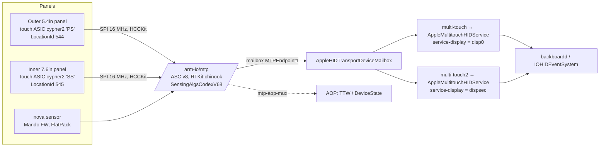
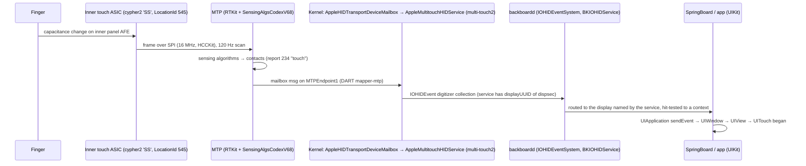

# 05 · Sensors, touch, buttons, audio and haptics

The always-on processors and everything on the iPhone Duo (iPhone19,4, V68AP, t8160, iOS 27.2 24B91020) that senses or makes sound or vibration.

Evidence labels follow [00-method-and-evidence.md](00-method-and-evidence.md):
**[DT]** device tree (`data/devicetree.txt`, `data/devicetree-nodes.json`), **[KC]** kernelcache (prelinked personalities, kext strings), **[FW]** firmware payloads extracted from the IPSW, **[DSC]** dyld shared cache, **[PUB]** public source, **[INF]** my inference. Raw excerpts backing this chapter are in [`data/05-sensors-touch-audio-haptics/`](../data/05-sensors-touch-audio-haptics/).

> **A note on the dyld cache.** The shared cache was deleted from scratch storage partway through this work, and I did not re-extract it. The [DSC] facts here come from a string sweep I made before the deletion (`dsc-hinge-strings-excerpt.txt`), one image-attributed search (`CLAngleNotifier` → CoreMotion), a sibling chapter's image list (`dsc_images`), and the prior vphone-duo research. Userland claims that would need the cache to check more deeply are marked [INF] and listed under [Gaps and limits](#gaps-and-limits).

---

## Contents

1. [Summary of findings](#1-summary-of-findings)
2. [The always-on complex: AOP, AOP2, SMC, aon-ptd](#2-the-always-on-complex-aop-aop2-smc-aon-ptd)
3. [Motion and environment sensors](#3-motion-and-environment-sensors)
4. [The hinge: angle, closure and pose](#4-the-hinge-angle-closure-and-pose)
5. [Multitouch on two panels (MTP)](#5-multitouch-on-two-panels-mtp)
6. [Buttons: side/Touch ID, Camera Control, volume](#6-buttons-sidetouch-id-camera-control-volume)
7. [Audio](#7-audio)
8. [Haptics: LEAP and the Taptic Engine](#8-haptics-leap-and-the-taptic-engine)
9. [End-to-end flows](#9-end-to-end-flows)
10. [Gaps and limits](#gaps-and-limits)

---

## 1. Summary of findings

| # | Finding | Evidence |
|---|---|---|
| 1 | **The hinge angle is computed on the AOP by fusing two IMUs.** There is no dedicated angle-sensor IC in the tree. Each half has its own accelerometer and gyroscope (`accel`/`gyro` and `accel_1`/`gyro_1`, plus `hgaccel`/`hgaccel_1`). The AOP's `CMAngleEstimatorInterface` logs `rot0`/`rot1` and `accelBias0`/`accelBias1`, and its `CMSPUAngleService` writes `mechanicalAngleDegrees` into the always-on `aon-ptd` table. | [DT] `/arm-io/aop/iop-aop-nub/*`; [FW] `aopfw-v68aop` strings |
| 2 | **Closure is sensed by a Hall-effect sensor ("HES") plus the angle.** On the AOP, `crane_hes`, `[CMSPUHES] HES changed to %u` and `MedinaState … hes, angleState, angleDegrees` combine them into a fold state. | [FW] |
| 3 | **The kernel has two HID personalities for the hinge.** `HID SensorEvent Driver - Apple Crane Driver` matches vendor page `0xFF0C` usage `0x1C`. `HID SensorEvent Driver - Hinge Angle` matches the HID Sensors page `0x20` usage `0xE4`. IOHIDEventDriver counts a `hingeangle` element class. CoreMotion's `CLAngleNotifier` asserts `kIOHIDEventTypeHingeAngle`. | [KC] prelink personalities; [DSC]; prior research |
| 4 | **There are two always-on processors with different software stacks.** AOP runs the sensor, audio, voice-trigger, prox/ALS, UWB-assist and hinge apps (`pitayaOS` roottask `IOP_ASC8_ETEXT`, kernel driver `AppleSPU`). AOP2 runs always-on networking (APSD push keepalive, ULPN, Find My), Wi-Fi CSI sensing and GNSS, and receives *relayed* IMU, device-motion and pressure streams (`aop2.imu100aop2`, `aop2.imu_1_100aop2`, `aop2.dm100aop2`, `aop2.pressure120aop2`). Its kernel side is `AppleAOP2` on AppleFirmwareKit/Tightbeam, not AppleSPU. | [FW], [KC], [DT] |
| 5 | **Each panel has its own touch controller, both behind one MTP co-processor.** `multi-touch` → `service-display` = `disp0`, the 5.4" outer panel at 460 ppi, personality `V68PS1`, LocationId 544. `multi-touch2` → `dispsec`, the 7.6" inner panel at 430 ppi with a 2007×2853 canvas, personality `V68SS1`, LocationId 545. Both controllers are "cypher2" Cortex-M (armv7em) ASICs on SPI at 16 MHz using the `HCCKit` protocol, with per-panel firmware in `V68_Multitouch.im4p`. | [DT], [FW] |
| 6 | **Mando is the firmware of the `nova` sensor, which I infer is the Camera Control's touch/force sensor.** The `nova` image-tag `odnm` is `mndo` reversed (Mando's IM4P type), its `hid-merge-personality` is `M1` (Mando's only personality key), its `bootloader-type` is `FlatPack` (Mando is a FlatPack table) and it carries `nova-touch-cal`/`nova-force-cal`. The Camera Control link itself is [INF]. | [DT], [FW], [KC] |
| 7 | **The tree names three ambient light sensors, not four.** They are `als` (outer, digitizer 544, prox-gated) and `als2a`/`als2b` (inner, digitizer 545, `angle-dependent: 1`). `exbright/als-types` has three entries. The fourth light-sensing device may be `grimaldi` (`aop,h16,vd5b704`, an AppleCameraPhotonDetector / flicker sensor), but that is a camera-side photon detector, not a display ALS. | [DT] |
| 8 | **The Taptic Engine runs closed-loop on a Hall position sensor, and the 50 KB LEAP haptics firmware is loaded into the LEAP block by AOP audio.** `/product/haptics closed-loop: 1`. `audio-haptic function-hall_ctrl`. LEAP firmware debug channels include `haly`, `cpos`, `mtrj`. Calibration comes from sysconfig `PSCl`, `CLCL` and `TCal`, which the CS42L79 codec also references as `halle-calibration`. | [DT], [FW] |
| 9 | **The audio path is a CS42L79 codec on I²C2 plus CS35L28 speaker amps driven from AOP firmware, with two amp channels named `arc` and `btmspk`.** Four ADMAC v5 controllers (base/LEAP × secure/non-secure) sit behind DART `dart-sbr`. The secure halves and voice trigger are exclave-assigned. | [DT], [FW], [KC] |
| 10 | **The SMC PMU names a button `action`**, alongside `hold` and `capture`. Neither `/product/display*` lists an action-button location, and the public Duo spec does not mention one, so this may be an inherited PMU event name. The physical button set is unconfirmed. | [DT], [PUB] |

---

## 2. The always-on complex: AOP, AOP2, SMC, aon-ptd

### 2.1 Common wrapper

AOP, AOP2, SMC and MTP are all `compatible = "iop,ascwrap-v8"`. Each binds **AppleASCWrapV8** (`com.apple.driver.AppleA7IOP-ASCWrap-v8`), and RTBuddy binds the child nub (`iop-nub,rtbuddy-v2`). [DT][KC] All four use the message box "post office" (`msgbox-using-postoffice`) with distinct `msgbox-mailbox-num` values. [DT] iBoot carries `IPCE_{SMC,AOP,AOP2,MTP}_CPU_PS_SAVE/RESTORE_IBOOT2` sequences (SEQ_41–48) for saving and restoring each CPU's power state. [FW iBoot strings]

| Node | role | mailbox | IOP IRQs (three per IOP; corrected by [FACTCHECK](FACTCHECK.md)) | Main reg (first) | DART | Firmware (IM4P type) | Loaded by |
|---|---|---|---|---|---|---|---|
| `/arm-io/aop` | AOP | 0 | `0xc2 0x9a 0x72` | 0x90600000 +0x74000 | `dart-sbr/mapper-aop` (+`mapper-exclave-aop`) | `Firmware/AOP/aopfw-v68aop.RELEASE.im4p` (`aopf`, 5.5 MB) | iBoot (`AOP.img4`) |
| `/arm-io/aop2` | AOP2 | 1 | `0xc3 0x9b 0x73` | 0x91600000 +0x74000 | `mapper-aop2` (+`mapper-exclave-aop2`) | `Firmware/AOP2/aop2fw-v68aop2.RELEASE.im4p` (`aop2`, 9.7 MB) | iBoot (`AOP2.img4`) |
| `/arm-io/smc` | SMC | 2 | `0xc4 0x9c 0x74` | 0x8c600000 +0x74000 | — | `firmware-name = "t8160smc"`; no separate IPSW component found | not established |
| `/arm-io/mtp` | MTP | 3 | `0xc5 0x9d 0x75` | 0x94600000 +0x74000 | `mapper-mtp` | `Firmware/V68_MtpFirmware.im4p` (`mtpf`) | iBoot (`MtpFirmware.img4`) |

Sources: [DT] node properties; the BuildManifest marks `IsLoadedByiBoot` true for AOP, AOP2 and MtpFirmware and `Personalize` true for each [DT/BuildManifest, `data/buildmanifest-components.json`]; [FW] iBoot strings list `AOP.img4`, `AOP2.img4`, `MtpFirmware.img4`. All four share a 64 KB register window at `0x96020000`. [DT] (INF: a common IOP fabric/interrupt block.) The raw IOP interrupt values print as single characters in this dump. They are consecutive (`r`,`s`,`t`,`u` = 0x72–0x75 if read as bytes), but I have not confirmed the encoding. [DT, INF]

### 2.2 AOP (Always-On Processor), the sensor hub

**Firmware.** [FW] `aopfw-v68aop` is a `DNUB` ("BUND") container whose BUILD-INFO reads `roottask.IOP_ASC8_ETEXT.RELEASE`, `ProjectName: pitayaOS`, `1223.40.8~1601`, built 2026-10-03, SDK 27.2 (24B91004), arm64e. "pitayaOS" is the IOP OS project name here, and RTKit-compat stubs (`libRTKitSPMI_stub.tbd`) are linked in. The embedded programs (`PROGRAM:/PROJECT:` tags; full list in `coprocessor-firmware-build-ids.txt`):

| Program | Project | Role ([INF] from name and strings) |
|---|---|---|
| `SPUMotion8160v68` / `SPUMotion8160v68Trusted` | CoreLocation-3187.0.1 | motion fusion, angle, device state, gestures |
| `SPUMotionTightbeam` | CoreLocation-3187.0.1 | Tightbeam IPC for the motion app |
| `AOPALSDriverV68Trusted/Untrusted` | AppleEmbeddedLightSensor-2300.52.5 | ALS driver (als, als2a, als2b) |
| `AtlantisFirmwareiPhone19{Trusted,Untrusted}Customer` | AtlantisFirmware-57.0.0 | prox ("Atlantis" prox: `AtlantisProx_c.c`, `[atlantis] …` logs) |
| `iphone19AOPAudio_{trusted,untrusted}` | AppleAOPAudioFirmware-610.18 | audio DSP and routing, CS35L28 driver, LEAP host |
| `VoiceTrigger64V5_{trusted,untrusted}` | AppleAOPVoiceTriggerFirmware-600.15 | "Hey Siri" first stage |
| `AudioProviderFrameworkR3_*`, `RTKitAudioFramework`, `RTKitAudioPeripherals` | 600.21 / 610.x | audio framework libraries |
| `RailEnergyBecketts` | powerlog-3486.52.2 | rail energy telemetry (reads `aon-ptd`) |

Each audio, ALS and prox program comes as a *trusted* and an *untrusted* build. Next to `aop-exclave-mailbox` (`exclave-service com.apple.service.SecureRTBuddyAOP`, mailbox 19) [DT], this indicates the AOP hosts one world that answers the AP kernel and one that answers exclaves. [INF]

**Kernel side.** [KC] `AppleSPU` provides `AppleSPUFirmwareService-AOP` (matches `role=AOP`), `AppleSPUTimesyncV2` (on `iop-aop-nub`), `AppleSPUAppInterface` children, and HID transport (`AppleSPUHIDDevice` → `AppleSPUHIDDriver` / `AppleSPUHIDEventDriver`, `Transport = SPU`). The kernel string table lists the SPU app ids: `aop_impact, aop_eclipse, aop_wombat, aop_threshold_als, aop_ped_fence, aop_bluetooth, sound_analysis, aop_prox, aop_crane, aop_orientation, aop_gesture1, aop_bump, aop_flip`. [KC strings] DT children of `/arm-io/aop/iop-aop-nub` and their drivers:

| DT child | Driver (kext) | Notes |
|---|---|---|
| `accel`, `gyro`, `hgaccel`, `compass`, `prox`, `als`, `pressure` | none by name; these become **SPU HID services**, matched by usage | see §3 |
| `accel_1`, `gyro_1`, `hgaccel_1`, `compass_1`, `als2a`, `als2b` | as above | second-half sensors |
| `SPUApp` | AppleSPUAppDriver | carries `spkamp-config_arc` / `_btmspk` |
| `aop-audio`, `aop-voicetrigger` | AOPAudioService (AOPAudio2), AppleAOPAudioController | §7 |
| `smc-control` | AppleAOPSMCDriver | AOP↔SMC link (`smc-aop-charge-config`) |
| `rose` | AppleSPURoseDriver(V2) | UWB assist (out of scope) |
| `gnss` | AppleSPUGNSSDriver (+ GNSSPassthroughLib plugin) | GNSS time-mark GPIO |
| `grimaldi-control` | AppleSPUGrimaldiDriver | flicker/photon detector control |
| `spherecontrol` | AppleSPUSphereDriver (`AOP_spherecontrol`) | ISP↔AOP motion feeds for OIS (`isp-aop-motion_*`) |
| `jarvis` | — | phi/theta attach/detach calibration ([INF] MagSafe accessory magnetometer detection) |
| `aop-smart-cover`, `cma`, `dcp-control` | AppleSPUSmartCoverDriver (HID), AppleSPUDCPDriver | `cma` has coex hooks to `IOPHaptics` |
| `aop-pio-filters`, `aop-gapf-filters` | — | fabric access filters |

Nub properties [DT]: `firmware-name v68aop`, `region-base 0x290c00000`, `region-size 0x3a0000`, `aop-target 1`, `has-baseband`, `aop-isp-v2protocol`, `watchdog-enable`, `no-shutdown 1`. The AOP owns two SPMI masters (`aop-spmi0`, `aop-spmi1`) carrying NFC, UWB, baseband and WLAN coex. [DT] (Covered by the radios chapter.)

**AOP endpoint names** (from firmware, `aop-endpoint-names.txt`): `aop.t.imu`, `aop.t.imu_1`, `aop.t.als/als2a/als2b` (+`.ex`, `.debug`), `aop.t.prox`, `aop.t.prox.eic`, `aop.t.motion.eic`, `aop.u.hes`, `aop.t.vt`, `aop.t.vtmodel`, `aop.t.lpmic`, `aop.t.audio`, `aop.t.sc`, `aop.t.spuapp`, and others. [FW] The `.t`/`.u` split matches the trusted/untrusted pairs. [INF]

### 2.3 AOP2, the second always-on processor

[DT] `/arm-io/aop2`: `role AOP2`, `iommu-parent → dart-sbr/mapper-aop2`, and a separate `aop2-exclave-mailbox` (`com.apple.service.SecureRTBuddyAOP2`, mailbox 20). The nub `iop-aop2-nub` has **no child nodes** and is marked `no-firmware-service`. Unlike AOP, no sensors hang off it in the tree.

[KC] `com.apple.driver.AppleAOP2` binds `AFKFirmwareService` (role AOP2), `AFKEPKextV2` on `AOP2Endpoint1`–`24`, `AppleAOP2SystemDriver` (`system-manager`) and `AppleAOP2IOPMService` over a Tightbeam endpoint `aop2.system-iopm`. **AOP2 is managed by AppleFirmwareKit (AFK), not by AppleSPU.**

[FW] `aop2fw-v68aop2`: BUILD-INFO `roottask.IOP_ASC8.RELEASE`, pitayaOS 1223.40.8. Programs are `AppleFirmwareKit-743.40.4` (`AFKNonShared` ×7), `ExclavesMessageQueueProducerIOP` (AlwaysOnExclaves-66.40.15) and `PolarisExclaveMessageQueueProducer`. Endpoint names (`aop2-endpoint-names.txt`) show what runs there:

| Group | Endpoints (selection) | Meaning ([INF] from names) |
|---|---|---|
| Always-on networking | `aop2.ulpn.*`, `aop2.net-aoptx/rx`, `aop2.ap2net_*`, `AONNetAOPDriver`, `AONNetworking` | ultra-low-power network stack offload |
| Push | `aop2.uapsd.apsd`, `APSDKeepalive`, `APSDConnection`, `APSDChannelSender/Receiver` | APNs keepalive while the AP sleeps |
| Find My | `aop2.uapsd.ufindmy.*` | offline-finding traffic |
| Wi-Fi sensing | `aop2.wificsi`, `aop2.wificsi.mcache`, `[WiFiCSI]` | channel-state-information sensing |
| GNSS | `aop2.gnss-shm`, `AOP2GNSS`, `aop2.gps-data`, `aop2.gps-debug` | GNSS processing |
| Sensor relays **from AOP** | `aop2.imu100aop2`, `aop2.imu_1_100aop2`, `aop2.dm100aop2`, `aop2.pressure120aop2`, `aop2.motion`, `aop2.asen-motion` | IMU0/IMU1 at ~100 Hz, device motion, barometer at ~120 Hz |
| Other | `aop2.audio`, `aop2.bt-data`, `aop2.rtp-hr`, `aop2.icmemory` | |

Both AOP and AOP2 strings carry `[ASEN]`, `[ULPN]` and `[WiFiCSI]` log tags, and AOP2 strings include `aop-comm/aop-access-control`. [FW] My reading is that sensors are physically wired to and owned by the **AOP**, and **AOP2** is a compute and networking peer fed over an AOP↔AOP2 channel. [INF]

### 2.4 SMC

[DT] `/arm-io/smc` (`aot-power 1`, `firmware-name t8160smc`, `region-base 0x28de00000`, `region-size 0x140000`, `user-power-managed 1`). Children:

- `smc-pmu` → **AppleSMCPMU**. It is an interrupt controller with event names `btn1 hold`, `btn3 action`, `btn4 capture`, `gpio6 baseband`, `gpio11 charger`, `gpio16 wifibt`, and `function-pmu_button`. **Button presses enter the system through the PMU, reported via SMC.** [DT][KC]
- `smc-charger` (AppleSMCCharger), `smc-ext-charger` (AppleSMCWirelessCharger; carries `audio-driver AppleCS42L79Audio`, `hd-mic-coex 1`), `smc-aop` (AppleAOPSMC; `function-link-data_enable/param_get/param_set` = the SMC↔AOP data link), `smc-power-out`, `smc-acam`, `smc-charger-util`. [DT][KC]
- `smc-gpio` @0x8c820000 (`gpio,t8101`, role SMC, AppleT8101GPIOIC, IRQs 606–612). [DT]

Power and charging belong to [the power chapter](06-power-battery-thermal.md). In this chapter the SMC matters as the button and PMU event source.

### 2.5 `aon-ptd`

[DT] `/arm-io/aon-ptd`: `compatible ptd,v1`, an **interrupt controller** with 32 interrupts (617–648) and four 16 KB register windows at 0x8c840000–0x8c860000, near `smc-gpio` (0x8c820000) in the SMC/always-on address region. [KC] It is bound twice: by **ApplePTD** (`com.apple.driver.ApplePTD`, which also has an `ApplePTDRemote` personality for `remote-ptd,v1`) and by **AppleSPUAONPTDDriver** (AppleSPU).

[FW] AOP firmware writes entries into it (`SPU_aon_ptd_write_entry`, `Unable to write PTD entry(%#x)`, `AON PTD outgrew reserved heap`), and the hinge service logs `[CMSPUAngleService] PTD = 0x%llX, mechanicalAngleDegrees = …`. `RailEnergyBecketts` reads from it, and the MTP's `mtp` info node has `function-ptd_lookup_mult`. **aon-ptd behaves as an always-on shared table plus doorbell block** that co-processors publish small values into (the hinge angle among them) and that raises interrupts to the AP. [INF] The acronym is not expanded anywhere in the evidence.

---

## 3. Motion and environment sensors

All of these appear as DT children of `iop-aop-nub`. None has its own bus node in the AP's tree, so the physical bus (SPI, I²C or I3C on AOP-private pins via `aop-gpio`) is **not visible** to the AP. [DT, INF] `aop-gpio` (@0x90824000, role AOP, IRQs 456–462) carries the AOP's GPIO interrupts. [DT] Data reaches the AP as **SPU HID** reports (`Transport = SPU`) on vendor page `0xFF00` or `0xFF0C`, or on standard pages. [KC]

| Sensor | DT node(s) | HID usage in DT (page/usage) | Calibration (sysconfig keys) | Kernel match [KC] |
|---|---|---|---|---|
| Accelerometer, half 0 | `accel` | 0xFF00 / 3 | `ARSC, ASCl, AICl, ARot, LTAO, ARXN, ARNC, ARXC, AROC` | AppleSPUHIDDriver/EventDriver; `AppleSPUAccCompassPlugin` HID plugin [DSC image list] |
| Accelerometer, half 1 | `accel_1` | 0xFF00 / 3 | `A2CL, A2NC, A2XC, A2oC` (+shared `ARSC, ARot, LTAO`) | same |
| High-g accelerometer ×2 | `hgaccel`, `hgaccel_1` | 0xFF00 / 30 | `AhXN` | same (`[HgAccel]` in FW) |
| Gyroscope ×2 | `gyro`, `gyro_1` | 0xFF00 / 9 | `GYTT, GICl, GRXC, GRNC` / `G2TT, G2CL, G2XC, G2NC` (+`GSCl, GRot, GRSC`) | same |
| Magnetometer ×2 | `compass`, `compass_1` | 0xFF00 / 10 | `CPAS, CSCM, CSCa` (**"closed"** sensitivity), `CRot`, `compass-orientation-p2`, `MDCC, CDCC, CMOC, CVCC`; `compass_1` uses `JRot` | `AppleSPUDispCompassPlugin` [DSC image list] |
| Barometer | `pressure` | dumped as page `20`, usage `'1'` (0x31). Read as 0x20 / 0x31, that is HID Sensors "atmospheric pressure" [INF: the page byte's encoding is ambiguous in the dump] | `PRTT, SPPO`; `pressure-heater-resistance` | SPU HID |
| Proximity | `prox` | 0xFF00 / 8 | `PxCl` | AppleProxHIDEventDriver / AppleAtlantisProxHIDEventDriver (`com.apple.driver.AppleProxDriver`, 0xFF00/8, Transport SPU) |
| ALS ×3 | `als`, `als2a`, `als2b` | (0xFF00 / 4 per kext) | `ce-model`, `hotspot-center-*`, `digitizer-location-id` | AppleSPUALS*Driver / AppleSPUCT7xx / AppleSPUCT836 / VD628x (AppleALSColorSensor, AppleEmbeddedLightSensor) |

Notes:

- **Two complete IMUs** (accel, gyro and high-g accel in each half) exist because the halves move independently. The AOP fuses them for the hinge angle (§4). [DT][FW] `[GyroBias]`, `[IMUCal]`, `[CMAngleGyroBiasEstimator] Resetting IMU%u bias estimator` [FW].
- **Magnetometer compensation is fold-aware.** `compass` carries `compass-sens-calibration-closed` and a second orientation (`-p2`). Its coex table names `IOPAudioSpeaker`, `IOPHaptics` and `AppleSARService` as interferers whose on/off notifications it receives (`coex0/1/2-driver-name`, `-notif-on/off`). [DT] Speaker coils, the Taptic magnet and RF bias the compass, and the AOP compensates. [INF]
- **ALS mapping to panels.** `als` has `digitizer-location-id 544`, which is the *outer* touch controller's LocationId (V68PS*, §5), plus `use-prox-for-occlusion 1` and `occlusion-drives-grimaldi 1`. `als2a` and `als2b` have `digitizer-location-id 545`, the *inner* panel, and `angle-dependent 1`. [DT][FW] Display brightness logic in CoreBrightness consumes the hinge angle: `CBCE5: refusing inference for NaN hingeAngle`, `CEOverride: extended input (xdxt: %@, hingeAngle: %f)`, `CBCMAngleService` [DSC]. Under the inner panel, ALS readings are corrected for fold angle. [INF]
- **Count.** The brief says four ALS. The tree has **three** display ALS (`exbright/als-types` has three entries) [DT]. The `grimaldi` node (`compatible aop,h16,vd5b704`, `host AOP`, driver **AppleCameraPhotonDetector**) is a separate photon/flicker detector [DT][KC]. That gives four light sensors only if grimaldi is counted. [INF]
- **Gestures and wake.** `AppleSPUGestureDriver` matches 0xFF0C / 3 [KC]. The AOP firmware has `[LiftToWake0/1]`, `[Flip]`, `[Eclipse][ViewObstructed]` (pocket detection), `[DeviceState]`, `[OrientationV68]` and `[Kappa]` (crash or fall detection; [INF] from Apple's naming of related features) [FW].

---

## 4. The hinge: angle, closure and pose

### 4.1 What is physically sensed

- **No dedicated hinge-angle IC appears in the device tree.** There is no `hinge`, `angle` or `lid` node anywhere in the 552 nodes. [DT]
- **Angle = IMU fusion on the AOP.** [FW `aop-hinge-angle-strings.txt`]:
  - `[CMAngleEstimatorInterface] Angle=%.2f deg, relGyroBias=%.3f deg/s, rot0=[…] deg, rot1=[…] deg, accelBias0=[…] g, accelBias1=[…] g, yOffset=%.3f deg, applyOffset=%u, externalCal=%u`
  - `cal: gyroScaleDevY=[%.4f,%.4f] percent, gyroBiasY=[…] deg/s, accelBiasXZ=[[…],[…]] g`. The hinge axis is the device Y axis, and each IMU's Y gyro is calibrated separately. The phone's spine running along Y also matches the 3D model in the prior research.
  - `[CMAngleOffsetCalibrator] Pushed candidate=%.4f deg (raw=…)`, `[CMAngleGyroBiasEstimator]`, and a FIR filter (`FIR config changed to { numTaps = %u, … }`, `kCMAngleMaxNumFIRTaps`).
  - Thresholds `kSpuPropertyCoreMotionMinAngleThreshold` and `…MinAngleThresholdToWake`, plus wake events (`Sent wake event: ma=%f …`, `AP on`/`AP off`). The AOP decides when a fold is large enough to wake the AP.
- **Closure = Hall-effect sensor.** `aop.u.hes`, `crane_hes`, `crane-hes-srvr`/`-cli`, `HES:0x%x ts:%llu`, `New state:%s ts:%llu hes:0x%x prox:0x%x`, `[CMSPUHES] HES changed to %u`. [FW] The node hosting the HES is not identifiable in the tree. It is **not** the codec's `Hall` channel, which belongs to the haptic actuator (§8). [INF]
- **Fold state = "Medina".** `MedinaStateAOP.c`, `CMSPUMedinaStateService.cpp`, `[MedinaState] t, %llu, state, %d, sensorFlag, %d, hes, %d, angleState, %d, angleDegrees, %.2f`, published to an "EIC Tightbeam endpoint". [FW] CoreMotion has a matching `CMMsl::MedinaState` and `CMMsl::FoldState` [DSC].
- **"Crane"** is the AOP app id `aop_crane` [KC strings] and the firmware relay `CraneAngleRelay: Could not find crane service '%s'` [FW]. It also names the kernel personality `HID SensorEvent Driver - Apple Crane Driver` [KC]. "Crane" is the hinge or fold sensing subsystem's codename. [INF]
- **Simulation.** `[CMAngleSimulator] Status changed from Scheduled to Running, sA=%f, eA=%f, dur=%llu, del=%llu, opts=%u` runs **inside AOP firmware** [FW]. That matches the prior research's finding that locationd's `CMAngleSimulator` is a command to the sensor processor.

### 4.2 Kernel: from SPU report to IOHIDEvent

[KC] prelinked personalities in IOHIDFamily (published by IOHIDEventDriverSafeBoot):

```
HID SensorEvent Driver - Apple Crane Driver
  IOClass IOHIDEventDriver, IOProviderClass IOHIDInterface
  DeviceUsagePairs = [{DeviceUsagePage 65292 (0xFF0C), DeviceUsage 28 (0x1C)}]
  IOPropertyMatch {Built-In = true}
  PrimaryVendorEvents = [0xFF0C001C, 0xFF000023]
HID SensorEvent Driver - Hinge Angle
  IOClass IOHIDEventDriver, IOProviderClass IOHIDInterface
  DeviceUsagePairs = [{DeviceUsagePage 32 (0x20 Sensors), DeviceUsage 228 (0xE4)}]
  IOPropertyMatch {Built-In = true}
```

IOHIDEventDriver's element census string ends `… heartrate:%d hingeangle: %d`, and its key table contains `HingeAngle`. **IOHIDEventDriver has a native parser that turns a hinge-angle HID element into a hinge-angle IOHIDEvent.** [KC strings] Other AppleSPU personalities on 0xFF0C are `AppleSPUGestureDriver` (usage 3) and an IOHIDFamily `HID Sensor` personality (usage 3). [KC]

The display driver also reads the angle: IOMobileFramebuffer runtime properties `HingeAngle`, `HingeAngleOverrideValue` and `EnableHingeAngleOverride` (`iomfb_RuntimeProperty_hingeAngleOverrideValue`). [KC strings] The inner panel's crease compensation or brightness depends on the angle. [INF] (Cross-reference: [the display chapter](03-gpu-and-displays.md).)

### 4.3 Userland

- **IOKit** exports `IOHIDEventCreateHingeAngleEvent(allocator, timestamp, angle, mechanicalAngle, velocity, options)`, building event type **0x2C** (prior research, `iphone_duo_fold.md`) [DSC].
  *(Corrected by [FACTCHECK-2](FACTCHECK-2.md): the function is exported by **IOKit** at 0x18eea44c8, not by HID.framework, which has the `HIDEvent` hinge accessors.)*
- **CoreMotion** (image confirmed by an `ipsw dyld str` hit before the cache was deleted) contains `CLAngleNotifier` (source path `Pop_CoreMotionFramework/Shared/Motion/Notifiers/Angle/CLAngleNotifier.mm`). It asserts `IOHIDEventGetType(event) == kIOHIDEventTypeHingeAngle` and logs `phase, state, angle, mechanicalAngle, velocity, timestamp, continuousTimestamp`. Per the prior research it matches services on **0xFF0C / 0x21** and runs inside **locationd**. A separate `CLLidAngleNotifier` exists. [DSC] The three usages seen (0xFF0C/0x1C "Crane", 0xFF0C/0x21 angle notifier, 0x20/0xE4 standard hinge angle) plausibly belong to different services (raw Crane state, Apple-vendor angle, standard-page angle), but I could not confirm which one the real device publishes. [INF]
- **CoreMotion API surface**: `-[CMAngleManager setAngleHandler:interval:]`, `CMAngleManagerInternal startAngleUpdatesPrivateToQueue:handler:`, `CMAngleManager.isAvailable`, `"CMAngle is not available in this device!"`, `CMMagicPoseManager` (`createMagicPoseEventFromDeviceStateEvent:`), and the log line `Ambient magic pose event detected [ tabletopPose ; hingeState ; deviceOrientation ; deviceOrientationForCover ; deviceOrientationForInner ]`. [DSC] Whether `CMAngleManager` is public SDK API is not established. Swift imports `So14CMAngleManagerC` exist in the cache, so it is at least visible to Swift system code. [DSC, INF]
- **SpringBoardFoundation** `SBFDevicePoseProvider` (pose = per-panel orientation + `hinge{isAvailable, position, state, regions…}` + `cmAngle` + `cmMagicPose`; defaults `SBFDevicePoseLastKnownCMAngle`/`…CMMagicPose`). **SpringBoard** `SBContinuousFoldController`/`Coordinator`, `SBButterflyContinuousFoldModifier`, `SBFHingeAngleHUDView`, and display-content-mode policies (`FoldingDual`, `FullyClosed`, `TentMode`, `ForceCoverDisplayOnly`, …). [DSC + prior research]
- **UIKit**: `UIHinge`, `UIHingeInteraction`, `_UIHingeState`, `_UISceneHingeState`, `_UISceneHingeStateHostComponent`/`ClientComponent`, and `mechanicalHingeAngleDegrees` (property `Td,N,V_mechanicalHingeAngleDegrees`). SwiftUI has `RootHingeStateProvider`. PosterKit has `PUIHingeState`. [DSC] This is how an app's scene learns the fold. Whether `UIHinge` is public API is not established. [INF]

For the full flow, see §9.2.

---

## 5. Multitouch on two panels (MTP)

### 5.1 Topology



[DT] `/arm-io/mtp` (role MTP, `iommu-parent → dart-sbr/mapper-mtp`, `sptm-allow-reg`). Under `iop-mtp-nub` (`agm-primary`/`agm-secondary = AppleHIDTransportDeviceMailbox`, `hid-merge-personality MTP_SYS`, `image-tag fptm`, `auth-supported`):

| Child | `service-display` | Personality | Auth | Calibration (FDR) |
|---|---|---|---|---|
| `multi-touch` | phandle 233 = **`/arm-io/disp0`** (`dot-pitch-float` 460.0, `primary 0`) → **outer** | `V68PS1` (fallback `non-auth`) | `auth-required`, `auth-source-index 1` | `DspB/{ADTN,CDTN,CMFS,DGFS,FDTN,FSPS,MTCL,PCFG,PDTN,PGFS,PSSS}`, keyed to a cover-glass serial identifier |
| `multi-touch2` | phandle 258 = **`/arm-io/dispsec`** (`dot-pitch-float` 430.0, canvas 2007×2853, `primary 1`) → **inner** | `V68SS1` | `auth-source-index 2`, `ZG:CoverGlassSerialNumberSecondary` | same classes |
| `nova` | — | `M1` | — | `syscfg/NvTh` (touch), `syscfg/NvFc` (force); bootloader `FlatPack`, `image-tag odnm` |
| `sync-agent`, `mtp` (`mtp-info`) | — | — | — | `function-ptd_lookup_mult` |

Each touch child has GPIO functions `power_1v2_core`, `reset` and `clock_enable` (references into a GPIO controller), `ttw-supported` and `bootloader-type CBOR`. [DT] `mtp-gpio` (@0x9481c000, 18 pins, IRQs 1392–1398) is the MTP's GPIO block. [DT] `mtp-aop-mux` (`compatible hid-transport,mux`) is a HID transport mux between MTP and AOP. [DT] The AOP firmware has `[DeviceState][Service] TTW MTP report, grossMotion, faceOrientation0, faceOrientation1, angleState` [FW]: **tap-to-wake touch reports go to the AOP while the AP sleeps, combined with motion and fold state.** [INF] `AOPTouchKext` (`AOPTouchHIDDriver`, 0x0D/1, Transport SPU) is the AP-side driver for that AOP touch path. [KC]

The identification of PS = outer and SS = inner rests on the `service-display` phandles and the panel geometry, all [DT]. The SensingAlgs interface classes also differ: PS uses `SASInterfaceCobalt` (PlatformID 546) and SS uses `SASInterfaceIndigo` (PlatformID 547). [FW]

### 5.2 Firmware

1. **`V68_MtpFirmware.im4p`** (`mtpf`, loaded by iBoot). An `rkosftab` with two entries: `P6S1` (a 2.2 MB Mach-O) and `iokt` (an IOKit-XML config). Strings: `RTKit_armv8_chinook_Oz_flto-3514.40.18.release`, `PROJECT:SensingAlgsCodexV68-62.8~10`. **The MTP is an RTKit arm64 core that runs Apple's touch sensing algorithms** (`SensingAlgsCodex`). [FW]
2. **`V68_Multitouch.im4p`** (`mtfw`, *not* loaded by iBoot; FUD, `Personalize` true). An IOKit-XML dictionary with personalities `V68PS0`, `V68PS1`, `V68SS0`, `V68SS1` and `non-auth` (`multitouch-firmware-summary.txt`). Each authenticated personality has: [FW]
   - `Config`: `Protocol HCCKit`, SPI `Clock Frequency 16000000`, bootloader SPI 16 MHz, `Boot Timeout {Normal 500 ms, Chip 50 ms}`, `Authentic true`, `Configuration Version 528`, `Memory Dump … Mach Architecture arm / armv7em`. **The touch controllers are Cortex-M class ASICs.**
   - Binaries `cypher2_v68ps_{TEXT,DATA,BOOTCFG,DATA_PSE_DSC,DATA_PSE_INIT}.bin` (TEXT ≈189 KB), or `cypher2_v68ss_*` for the inner panel. **"cypher2" is the touch ASIC family.**
   - Properties: `DTN parameters for Cantor/Fermat/Algs/pencil Algs`, `Full Spectrum Projector`, `Demodulation windows`, `Multitouch AFE configuration/calibration`, `Panel Configuration` (sysconfig `PCFG`), `PSPA and PSS full scale parameters`, `CM full scale`.
   - `DefaultMultitouchProperties`: `ScanRate 120`, `SupportTapToWake true`, `HSTouchHIDService true`, `BinaryFilters [SensingAlgs]`, `SensingAlgsConfig [{SensingAlgsCodexV68AP.framework, …}, {SensingAlgsService.framework, SASInterfaceTouch}]`. PS adds `ReportRoutingOverrides {ReportIDs [178, 98] → page 0xFF00 usage 0x71}`, and SS *denies* those report IDs. Only the outer panel's controller emits those reports. [FW] What reports 178 and 98 carry is not known.
   - `non-auth` personality: `Protocol HIDSPI` at 12 MHz bootloader SPI, `Authentic false`. This is the fallback when authentication fails. [FW][KC: "Overwriting hid-merge-personality with non-auth-personality"]
3. **`V68_MandoFirmware.im4p`** (`mndo`): personality `M1`, `Firmware Version 5.E`, `FlatPack Config {Bootload Timeout 5000 ms, Run In BootedOS true, Run In RestoreOS false}`, then a FlatPack table: a pre-download command, 58 × "load MTP FW image" (≈55.8 KB) and a post-download command (`mando-firmware-summary.txt`). The kernel's `AppleHIDTransportBootloaderFlatPack` consumes this (`FlatPackTableStart/Entry/End`, `buildFlatPackInstructions`). [FW][KC]

Pencil: `/product supports-apple-pencil 1` [DT], `ApplePencilDriver` kext present [KC], pencil DTN parameters in both touch personalities [FW]. Pencil hover and touch would go through the same controllers. [INF]

### 5.3 `mt-bt-timestamp-sync`

[DT] `/arm-io/mt-bt-timestamp-sync` (`compatible timestamp-sync`) has one GPIO function, `function-timestamp_sync`. [KC] **AppleMultitouchTimestampSync** (AppleMultitouchDriver) binds it, with a user client `AppleMultitouchTimestampSyncUC`. The receiving side `AMDTimestampSyncMgr` logs `Timestamp sync %u (host %u) received … with timestamp %ums (offset: %lldms)`. The name and GPIO suggest a hardware pulse shared between the multitouch subsystem and the Bluetooth chip, so BT-delivered input (Apple Pencil, if supported, or other BT HID) can be time-aligned with panel touches. [INF]

### 5.4 Kernel driver chain (touch)

[KC] `AppleASCWrapV8` (`/arm-io/mtp`) → `RTBuddy` (`iop-mtp-nub`) → `RTBuddyEndpointService "MTPEndpoint1"` → **`AppleHIDTransportDeviceMailbox (MTP)`** (also matched by `AppleGenericMultitouchDecider`). Per interface, `AppleHIDTransport` downloads `V68_Multitouch` firmware over HCCKit, authenticates it and merges the personality. The resulting `IOHIDInterface` gets **`AppleMultitouchHIDService`** (matches 0x0D/0x00, 0x0D/0x04, 0x0D/0x20). `AppleSPUControl` (AppleSPU) also matches the `multi-touch` name, for power and control sequencing. [KC] [INF on ordering] Userland-side: `MultitouchHID.plugin` (in AppleMultitouchSPI.kext), `MultitouchSupport.framework`, and the `SensingAlgsCodexV68AP` / `SensingAlgsService` frameworks named by the firmware config. [DSC image list]

---

## 6. Buttons: side/Touch ID, Camera Control, volume

| Button | Hardware path | Kernel | Evidence |
|---|---|---|---|
| Side ("hold") with **Touch ID** | `/buttons` lists `hold` with `function-button_hold`, priority 1; PMU event `btn1 hold`. Touch ID sensor `/arm-io/spi1/mesa` (`biosensor,mesa`, `mesaType 2`, `sensor-id X3`, SPI 8 MHz, `function-hid_event_dispatch`) | **AppleM68Buttons** (`buttons`), AppleSMCPMU; **AppleMesa / AppleSandDollar** (AppleBiometricSensor) | [DT][KC] |
| Volume up/down | `/buttons` `volup`/`voldown` (`function-button_volup/_voldown`, priority 2, `button-delay_*` 0x124f8) | AppleM68Buttons | [DT][KC] |
| **Camera Control** ("capture") | PMU event `btn4 capture` (the press); touch/force sensing via `nova` on the MTP with Mando firmware [INF] | AppleSMCPMU; AppleHIDTransport (`nova`, personality `M1`) | [DT][FW][KC]; `SensingAlgsTouchButtonHost.framework` in the cache [DSC image list] |
| "action" | PMU event `btn3 action` | AppleSMCPMU | [DT]. No `action-button-location` in `/product/display*`, which list only `side-`, `volume-up/down-` and `camera-button-location`. Presence is unconfirmed. |

`/buttons`: `home-button-type 2`, `stackshot-mask` volup+voldown+hold, `diagnostic-mask-all` the same three, `remap-usages`. [DT] A SPU button path also exists (`AppleSPUButtonDriver`, pages 0x0B/1 and 0x0C/1, Transport SPU), and the two `display0`/`display1` nodes give per-panel button geometry for UI hints. [KC][DT] Mesa sits on the AP's SPI1 controller (not on the MTP or AOP) and is secured through the SEP; see [the security chapter](02-boot-and-security.md).

---

## 7. Audio

### 7.1 Components

| Part | DT | Driver [KC] | Notes |
|---|---|---|---|
| **Cirrus Logic CS42L79** codec | `/arm-io/i2c2/audio-codec` (`audio-control,cs42l79`, I²C2 @0xa5018000, device reg low byte 0x4a) | **AppleCS42L79Audio** (personality named "AppleCS42L77Audio") | Channel descriptors `HPMic`, `LPMic`, `Receiver`, `Flicker`, `Hall`; ASP1–ASP4 serial ports; mics `imic`, `lmic`, `smic`, `fmic`; `listening-mic-mask 5`; `adc-gains`; `samplerate-default` 48 kHz; `halle-calibration syscfg/PSCl` |
| **CS35L28** speaker amps | `/arm-io/iop-audio-controller/audio-speaker-mca/audio-speaker` (`audio-data,cs35l28`) | driven **from AOP firmware** (`CS35L28Driver.cpp`, `CS35L28Hardware.cpp`) [FW]; AP side `IOPAudioSpeaker` | Two amp channels in `SPUApp`: `spkamp-names = arc, btmspk`; speaker sense selectors `0Vps 0Ips … 1Vps 1Ips` (V/I sense per amp) |
| Receiver | `audio-receiver` (`audio-data,external`, `private`) | AppleExternalSecondaryAudio | also a codec channel |
| Microphones | HP mic via codec (`HPMics`), LP mic (`lp-mic-device`), Siri listening device | IOPAudioLPMicDevice, IOPAudioClientManagerDevice | `/product/audio`: `mic-trim-gains` (`MiGH`, `MiGT`), `voiceTriggerChannels 5`, `supports-always-listening`, `stereo-sound-recording`, `supports-spatial-audio-capture` |

`/product/audio` also has `speaker-thiele-small-0 syscfg/SpPH` (per-unit speaker model for protection), `speaker-trim-gains-0 syscfg/SpGH`, `acoustic-id 0x1f5d`, `supports-spatial-facetime`, `supports-barge-in`, and `actuator-cpms-bgd_*` (actuator power budgets). [DT] Stereo speakers [PUB: Apple spec, two-speaker stereo is standard]: the evidence names two amp channels, `arc` and `btmspk`. Mapping `btmspk` to the bottom speaker and `arc` to the earpiece-area speaker is [INF].

### 7.2 Controllers, DMA and IOMMU

[DT] `/arm-io/iop-audio-controller` (`iop-audio,controller`, `iop-audio-service-name AOPAudioService`) → **IOPAudioController** (IOPAudioDriverFamily). Each child stream is `iop-adma-stream,{mca|leap}` → **AppleIOPADMAStream**, and/or **AppleAOPAudioClientManager** (AppleAOPAudio).

| ADMAC | compatible | reg | IRQ | role | IOMMU | Channels used |
|---|---|---|---|---|---|---|
| `admac-base-ns` | `admac-evolution,v5p0` → AudioDMAController-Gen5p0 | 0x93900000 | 528 | `SNAB` | `dart-sbr/mapper-admac-base-ns` (mapper reg 46) | rx-2 (speaker IV), rx-3 (speaker tap), rx-5 (flicker), tx-7 (LP-mic injection), tx/rx-8 (MCA loopback) |
| `admac-base-s` | same | 0x93700000 | 527 | `SSAB` | (exclave-side; `iommu-parent` nil) | tx-2 (**speaker**), tx-3 (**receiver**), rx-4 (**HP mic**) |
| `admac-leap-ns` | same | 0x93300000 | 531 | — | `mapper-admac-leap-ns` (mapper reg 44) | tx-1 (**haptic actuator**), rx-1 (haptic debug), tx/rx-3 (LEAP loopback) |
| `admac-leap-s` | same | 0x93100000 | 530 | `SSEL` | — | rx-2 (secure LEAP loopback, `is-development-only`) |
| `admac-aop-ced-ssw` | `admacled,v1p0` → AudioDMACLLTEscalationDetector | 0x93c80000 | 548 | `ADMAC-A` | — | latency-escalation detector over all four |

The **secure** controllers carry speaker, receiver and HP-mic audio, and are reached by the kernel only through proxies (`admac-*-ec-proxy` → **DMAChannelProxy**, `audio-*-proxy` → **IISAudioIsolatedStreamECProxy**, `audio-shared-dart-proxy` → SharedDARTMapperProxy). The nodes reference `isolated-audio-service-input/output`. [DT][KC] **Microphone and speaker samples on the secure path are owned by an exclave, and the AP kernel sees isolated proxies** (microphone-indicator integrity). [INF] `ExclavesAudioKext` is present [KC]. MCA is the multi-channel audio serial port block, with `clock-domain "niam"` (= "main"). [DT, INF]

### 7.3 Voice trigger ("Siri")

[DT] `/arm-io/iop-voicetrigger-controller` (`AOPVoiceTriggerService`) → `audio-vt-device` (`iop-audio,isolated-vt-device`, **exclave-assigned**, `exclave-service com.apple.service.AudioDriverVT`) → **IOPAudioIsolatedVoiceTriggerDevice**. [KC] `/arm-io/aop/iop-aop-nub/aop-voicetrigger` → AOPAudioService. [FW] AOP runs `VoiceTrigger64V5_{trusted,untrusted}` (`AppleAOPVoiceTriggerController v600.15`, `AOPVoiceTriggerSecure_Server.cpp`, `VoiceTriggerFirmwareTightbeam_C.c`), with `aop.t.vt`/`aop.t.vtmodel` endpoints. Userland: `VoiceTrigger.framework`, `CoreSpeech.framework`, **`CoreSpeechExclave.framework`**, `SecureVoiceTriggerAssets.framework` [DSC image list]. Flow [INF]: low-power mic (codec `LPMic`, `lp-mic-io-buffer-device` exclave service `AudioDriverLPMic`) → AOP first-stage detector → exclave-side check → wake → corespeechd/assistantd.

### 7.4 Boot chime

[FW] `Firmware/embeddedaudioresources/image4/v68-boot-chime.im4p` (`aubt`, 586 KB, BuildManifest `Ap,AudioBootChime`, `IsiBootNonEssentialFirmware true`, `Personalize true`). The payload is a short header followed by 16-bit PCM samples. [FW, INF on format] `audio-speaker` has `iboot-audio-volume 0x7fff` [DT], and the kernel references `iboot-audio-volume` [KC]. I did not find which stage (iBoot or the kernel audio driver) actually plays it; no iBoot string mentions the chime.

### 7.5 Userland

Public APIs: AVAudioSession / AVAudioEngine (AVFAudio), AudioToolbox, CoreAudio [PUB]. Present in the cache: `AudioToolbox` (+`libEmbeddedSystemAUs`, `libAudioDSP`), `CoreAudio`, `AudioSession`/`AudioSessionServer`, `MediaExperience`, `AudioDSPGraph`, `AudioDSPManager`, `CoreAudioOrchestration` [DSC image list]. The daemon chain (mediaserverd/audiomxd → HAL plugin → IOAudio2/IOPAudio user clients) is [INF]; I could not verify it in the cache after its deletion.

---

## 8. Haptics: LEAP and the Taptic Engine

**What LEAP is.** In this tree, LEAP is the haptics signal path through the audio subsystem: dedicated ADMACs (`admac-leap-*`), `iop-adma-stream,leap` streams, `audio-stream-formatter "pael"` (= "leap"), and `audio-haptic` with `model-name "leap"`. [DT] The AOP audio firmware contains `LEAPAudioDeviceNode.cpp`, `LEAPClusterNode.cpp`, `LEAPParkingSecure.cpp`, `LEAPMemoryAccessorNode.cpp`, `setLEAPFirmwareBuffers` and `super::loadFirmware(&leapFirmware)`. [FW] **The AOP loads the LEAP haptics firmware into a LEAP engine and feeds it audio-rate waveforms.** Whether that engine is a DSP core inside the audio block or the amp IC is [INF]/unknown.

| Item | Evidence |
|---|---|
| Actuator | `/product/haptics`: `closed-loop 1`, `controller-coeff-cal syscfg/CLCL`, `supports-3rd-party-haptics 1`, `power-control-features 2` [DT] |
| Closed-loop sensing | `audio-haptic` and `audio-hpdbg` both have `function-hall_ctrl`. The codec has a `Hall` channel and `halle-calibration syscfg/PSCl`. AOP has `setAmpHallCalibration`. LEAP firmware debug channels include `haly`, `cpos`, `mtrj`. **A Hall-effect sensor tracks the Taptic mass position for closed-loop drive.** [DT][FW][INF] |
| Support driver | `/arm-io/haptics-support-interface` (`haptics-support,leap`; cal keys `PSCl`, `CLCL`, `TCal` plus `-mi` mismatch variants) → **AppleHapticsSupportLEAP** 11.6 [DT][KC] |
| Control devices | `audio-haptic` → **IOPHaptics**; `audio-haptic-leap` → **IOPAudioHapticsLEAPControlDevice**, AppleAOPAudioHapticLEAP (`kci-name AppleHapticsAudioInterface`, parking node `Nkrp`); `audio-hpdbg` → IOPHapticDebug [DT][KC] |
| Budgets | `audio-haptic`: `peak-power-range`, `thermal-budget-range`, `function-power_peak_budget`, `function-thermal_budget`, `function-haptics_session` [DT] |
| **`V68_LeapHapticsFirmware.im4p`** (`lphp`) | IOKit-XML: `HapticsFirmware {Data 50,912 B, FW Version 722.0, SymbolTable 448 hashed symbols, Features, DebugChannelMap, HapticsBootActions}`, `HapticsSysconfigSymbolPatches`/`Description` for `CLCL`, `PSCl`, `TCal`, `HapticsCoefficients` (`Coefficients-2.3`, `-3.2`, `-4.1`). Boot actions validate the sysconfig blobs (PSCl 592 B, CLCL 80 B, TCal 80 B) and patch per-unit calibration into the firmware image before load. Symbol names are hashed. [FW] |
| **`V68_HapticAssets.im4p`** (`hpas`) | One asset: `ResourceID 0x10000`, `SampleRate 16000`, `BitDepth 16`, a short waveform, `PostSilence 0x780`. Copy in `data/05-sensors-touch-audio-haptics/`. The kernel has `initHapticAssetsSupport`, `hapticAssetsDownloadCallback`, `AFUHapticAssetsReceived`, `failed to create FUD nub`, so assets arrive via the firmware-update (FUD) path. [FW][KC] Whether this is the power-on or "click" waveform is unknown. |
| Userland | `CoreHaptics` (public), `Haptics.framework`, `AOPHaptics.framework`, `libVibeSynthEngine.dylib` (AudioToolbox) [DSC image list]. Apps reach haptics through **UIFeedbackGenerator** and **CoreHaptics CHHapticEngine** [PUB]. The daemon path is [INF]. |

Coex: `cma` and `compass` subscribe to `IOPHaptics` on/off notifications [DT], so the magnetometer is compensated while the Taptic engine runs. Speaker and actuator power budgets are shared (`actuator-cpms-*`, `speaker-cpms-*`). [DT]

---

## 9. End-to-end flows

### 9.1 A finger tap on the inner panel → `UITouch`



Step by step:

1. **Sensing.** The inner panel's AFE is scanned by the `SS` controller at `ScanRate 120`. Its firmware is `cypher2_v68ss_*`, calibrated from `DspB/*` FDR data tied to the secondary cover glass. [FW][DT]
2. **Transport to MTP.** The MTP talks HCCKit over SPI at 16 MHz. The reporter is `ReportID 234`, `SubgroupName "touch"`, `ReportLength 1451`. [FW] Both controllers' HID descriptors are identical (`05 0d 09 04 a1 01 …`, digitizer page 0x0D, touch screen usage 0x04). [FW]
3. **Algorithms.** `BinaryFilters [SensingAlgs]` with `SensingAlgsCodexV68AP.framework`/`SASInterfaceIndigo` (inner) or `…Cobalt` (outer). These are host-side frameworks in the cache [DSC image list]; the MTP firmware is also built from `SensingAlgsCodexV68` [FW]. The split of contact detection between MTP and host is [INF].
4. **Kernel.** `AppleHIDTransportDeviceMailbox` → `IOHIDInterface` for `multi-touch2` → `AppleMultitouchHIDService`, which creates IOHIDEvents. [KC]
5. **backboardd.** It reads the HID service's `displayUUID` once (`BKIOHIDService _setUpInitialProperties`). On the Duo, each touchscreen node names its panel (`multi-touch2 → service-display → dispsec`), whose framebuffer identifier is `BF0DC480-5EE2-4EC1-B02B-C75E94759832` (`/product/display1 framebuffer-identifier`). [DT + prior research] The event goes to the inner display's scene and is hit-tested to a client context. [prior research, INF for the exact path]
6. **UIKit.** The context's process receives the event. UIKit builds a `UIEvent` with `UITouch` phase `began`. The panel is mounted at 270° (`display1 display-rotation 270`), so coordinates are rotated into the scene's orientation. [DT; INF for where the rotation happens]

When the AP is asleep, the tap is instead routed through `mtp-aop-mux` to the AOP's tap-to-wake logic (`TTW MTP report … angleState`), which wakes the AP. [DT][FW][INF]

### 9.2 Folding from 180° to 0° → SpringBoard switches panels

```mermaid
sequenceDiagram
  participant IMU as IMU0 / IMU1 (accel+gyro per half), HES
  participant AOP as AOP: SPUMotion (CMAngleEstimator, MedinaState, Crane)
  participant PTD as aon-ptd
  participant K as Kernel: AppleSPU HID → IOHIDEventDriver (Crane / HingeAngle)
  participant L as locationd: CoreMotion CLAngleNotifier
  participant SB as SpringBoard: SBFDevicePoseProvider → DisplayContentMode
  participant D as DCP / IOMFB (both panels)
  IMU->>AOP: samples (~100 Hz relayed also to AOP2)
  AOP->>AOP: fuse rot0/rot1 about Y → angle; FIR; offset & bias cal
  AOP->>PTD: write mechanicalAngleDegrees entry
  AOP->>K: HID report (angle, state, phase); wake AP if over threshold
  K->>L: IOHIDEvent type 0x2C (hinge angle)
  L->>SB: CMAngle / CMMagicPose updates (cmAngle, hingeState)
  SB->>SB: pose: openFlat → … → fullyClosed (HES confirms closed)
  SB->>D: FoldingDual → FullyClosed: inner surface off, .cover becomes primary
```

1. **Sensing.** Each half's gyro sees rotation about the hinge (Y) axis. The accelerometers see gravity in each half's frame. The AOP estimates the relative rotation (`rot0`, `rot1`), removes relative gyro bias (`relGyroBias`) and filters the result (FIR). [FW]
2. **State.** `CMSPUAngleService` changes state as thresholds are crossed and sends a wake event (`Sent wake event: ma=%f, p=%u, s=%u …`). Near 0° the Hall-effect sensor flips (`HES changed to %u`), and `MedinaState` moves to closed. [FW]
3. **Publication.** The angle is written to `aon-ptd` [FW], and a HID report is produced on the SPU HID transport. The kernel's `IOHIDEventDriver` (Crane or HingeAngle personality) turns it into an IOHIDEvent. [KC] backboardd's event system has no destination for this event type and drops it from the UI path (prior research: `destinations for Unknown event: ()`).
4. **CoreMotion in locationd.** `CLAngleNotifier` receives `kIOHIDEventTypeHingeAngle` events (phase, state, angle, mechanicalAngle, velocity). It can also send commands to the sensor-processor angle service (`CLSPUAngleServiceControl`, `sendCommand`). [DSC + prior research]
5. **SpringBoard.** `SBFDevicePoseProvider` takes `cmAngle` and `cmMagicPose` (hinge state, per-panel orientation) and computes the pose. The display content-mode resolver moves from `FoldingDual` (inner primary, cover passive shield) to `FullyClosed` (cover primary). The prior research logged exactly this as `DCMResolved: FullyClosed→FoldingDual` / `COMPLETED: .cover:pri … fullyClosed` in the VM. During the motion, `SBContinuousFoldController` maps the hinge angle to fold progress and runs the continuous-fold animation (`continuousFoldPosition`, `continuousFoldVelocity`, `SBButterflyContinuousFoldModifier`). [DSC + prior research]
6. **Apps.** Scenes get `_UISceneHingeState` updates (`mechanicalHingeAngleDegrees`) through UIKit's scene component. [DSC]
7. **Display.** IOMFB also reads `HingeAngle` [KC]. Turning the inner panel off and the outer on is [the display chapter](03-gpu-and-displays.md)'s subject.

---

## Gaps and limits

- **Dyld shared cache.** It was deleted mid-task and deliberately not re-extracted. The following need the cache (or a device) to verify: which framework exports which hinge symbol beyond `CLAngleNotifier` → CoreMotion; whether `CMAngleManager` and `UIHinge` are public SDK API; the exact backboardd → UIKit touch routing code; the audio daemon chain (mediaserverd/audiomxd/HAL plug-ins); haptics daemons; and which process hosts the SensingAlgs frameworks.
- **Physical buses of AOP sensors.** The IMUs, magnetometers, barometer, ALS, prox and Hall sensor are DT children of the AOP nub with no bus or address information visible to the AP. Part numbers (except where a kext names a family: CT7xx, VD628x for ALS; Atlantis for prox; CS42L79 and CS35L28 for audio) are not in the evidence.
- **Hinge HID usages.** Three usages appear (0xFF0C/0x1C Crane, 0xFF0C/0x21 per the prior research, 0x20/0xE4 standard hinge angle). Which service a real Duo publishes, and the exact report layout, needs a live `ioreg`/`hidutil` dump.
- **Where the Hall-effect closure sensor is.** It is in the firmware strings only. Its location and magnet are unknown.
- **SMC firmware.** `t8160smc` has no separate BuildManifest component, and I could not identify its source. It may be part of another image.
- **`aon-ptd`.** Its acronym and register semantics are not public. Only its role as a co-processor-written table with AP interrupts is inferred.
- **Touch ASIC internals.** "cypher2" is Cortex-M (armv7em) by the firmware config. Electrode counts, AFE design and the meaning of DTN/Cantor/Fermat parameters are not public.
- **Camera Control = `nova`/Mando** is an inference from matching tags. Nothing in the evidence spells "Camera Control".
- **"action" button.** It is a PMU event name only. Whether the Duo has a physical Action button is not established.
- **Four ALS.** The tree shows three display ALS. A fourth exists only if the `grimaldi` photon detector is counted.
- **Speaker naming** (`arc` vs `btmspk` → which grille) and whether "arc" relates to `AppleHapticsSupportArcEEPROM` (no matching DT node) are unknown.
- **Interrupt encoding** of the IOP nodes (`r`,`s`,`t`,`u`) is shown raw. I did not verify it as numeric IRQ lines.
- **Not knowable from these sources:** schematics, transistor-level design, register maps of AOP/MTP/LEAP/ADMAC, and Apple-internal sensor-fusion algorithms beyond what log strings reveal.
