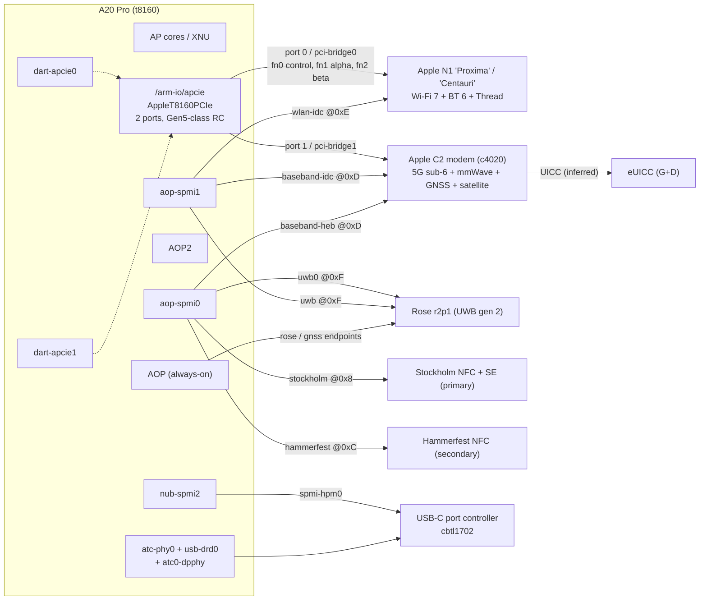
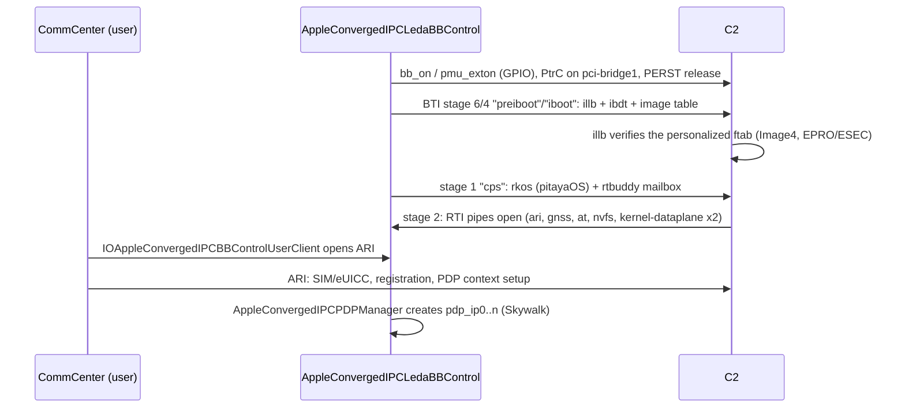
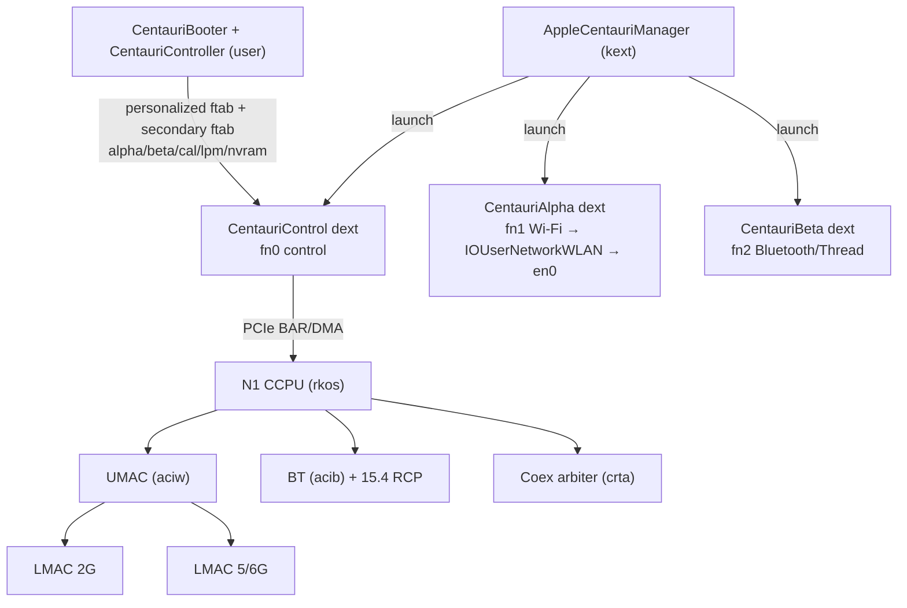
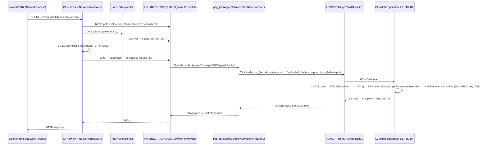

# 07: Networking and connectivity

This chapter covers every radio and wired link on the iPhone Duo (iPhone19,4, V68AP, t8160, iOS 27.2 24B91020). It follows each one from the chip, across the bus, through the co-processor firmware and kernel driver, to the daemon and the API an app calls. It ends with two complete paths for one HTTPS request from Safari: one over 5G mmWave and one over Wi-Fi 7.

Evidence labels: **[DT]** device tree, **[KC]** kernelcache (kext personalities, C++ classes, strings), **[FW]** firmware image, **[DSC]** dyld shared cache, **[PUB]** public source, **[INF]** inference. Excerpts of the raw evidence are in [`data/07-networking/`](../data/07-networking/).

> **About the DSC evidence.** The dyld shared cache was deleted from the shared scratch area partway through this work. The deletion was not caused by this chapter's work. The [DSC] facts below come from what was extracted before then: the full image list, plus the strings and symbols of the `Centauri*` frameworks and `libCentauriUpdater`. Userland daemons such as `CommCenter`, `wifid`, `bluetoothd`, `nearbyd`, `nfcd`, `locationd`, `mDNSResponder` and `apsd` are standalone executables. They are not in the DSC in any case, so their names are labelled [INF] or [PUB] unless a kernel or firmware string names them. *(Updated by [chapter 11](11-userland-radios-power-sensors.md): the daemons' Mach service names are in the DSC, so their names are now [DSC] there; only the executables are missing. Each N1 PCIe function has its own device ID (control 0x1900/0x1901, Wi-Fi 0x1902, BT 0x1903), and the kernel also has `AppleHammerfestControl`/`AppleHammerfestSPMI` personalities for the second NFC controller.)*

---

## 1. The map at a glance



The two big radios are both **Apple silicon on PCIe**. N1 sits on root port 0 as one multi-function endpoint, and C2 sits on root port 1. Every other radio (UWB, NFC) and every coexistence or SAR side-channel is on an **SPMI bus owned by the always-on processor (AOP)**. USB-C is an on-SoC ATC PHY with a Synopsys-derived dual-role controller.

---

## 2. Link table: every link, end to end

| # | Endpoint A | Endpoint B | Bus / transport | Kernel driver (kext → IOClass) | Firmware | Userland owner |
|---|---|---|---|---|---|---|
| 1 | AP PCIe RC port 1 (`/arm-io/apcie/pci-bridge1`) | C2 modem (`baseband-pcie-leda`) | PCIe, MSI (limit 8), DART `dart-apcie1` `mapper-apcie1` | `AppleT8160PCIe` → `APCIECoreRCGen5p1HostBridge`; `AppleConvergedIPCBBControl` → `AppleConvergedPCILedaBB` → `AppleConvergedIPCLedaBBControl`; `IOACIPCFamily` [DT][KC] | `Firmware/c4020iphone/Release/patched/ftab.bin` (`Cellular1,*`) [FW] | CommCenter → CoreTelephony [INF]/[DSC] |
| 2 | AP (`/baseband`, `baseband,int1`) | C2 power, reset and GPIO | PMU/GPIO functions `bb_on`, `pmu_exton`, `bb_warm_reset`, `reset_det` | `AppleBasebandINT1` → `AppleBasebandINT1` [DT][KC] | n/a | CommCenter / AppleBasebandManager [INF] |
| 3 | AOP SPMI0 (`aop-spmi0/baseband-heb`, SPMI addr 0xD) | C2 | SPMI, 7 SPMI interrupts, "billboard"/OCP mailbox registers | `AppleBasebandSPMIHEB`; `AppleSARService` → `AppleSARSPMIHEB` [DT][KC] | n/a | n/a |
| 4 | AOP SPMI1 (`aop-spmi1/baseband-idc`, 0xD) | C2 | SPMI in-device-coexistence / SAR billboard | `AppleBasebandSPMIHEB` (IDC personality); `AppleSARSPMIIDC` [DT][KC] | n/a | WirelessCoexManager [DSC] |
| 5 | AP PCIe RC port 0 (`pci-bridge0`) | N1 function 0 `centauri-control` | PCIe (Gen3 link cap, see §5.2), DART `mapper-apcie0-control` (SID 1) | `AppleCentauriManager` (kernel) + `CentauriControl` dext [DT][KC] | `Firmware/t2026phoneG2/Release/ftab.bin` (`Wireless1,*`) [FW] | CentauriBooter / CentauriController [DSC] |
| 6 | same | N1 fn 1 `centauri-alpha` (Wi-Fi, owns the Wi-Fi MAC) | PCIe, `mapper-apcie0-alpha` (SID 2) | `CentauriAlpha` DriverKit dext on `IOUserNetworkWLAN` (IOSkywalkFamily) [KC] | `aciw` UMAC + `w2lp`/`w5lp` LMAC + PHY and Tx/Rx cores [FW] | wifid, IO80211.framework, CoreWiFi [INF]/[DSC] |
| 7 | same | N1 fn 2 `centauri-beta` (Bluetooth + Thread) | PCIe, `mapper-apcie0-beta` (SID 3) | `CentauriBeta` DriverKit dext [KC] | `acib` BT core + `phyb`, `bt5p`, `scab` [FW] | bluetoothd, MobileBluetooth, CoreBluetooth; Thread: CoreThreadRadio [DSC] |
| 8 | AOP SPMI1 (`wlan-idc`, 0xE) / AOP SPMI0 (`wlan-heb`, 0xE) | N1 | SPMI coex and SAR billboard | `AppleSARService` → `AppleSARSPMIIDCWLAN` [DT][KC] | N1 `crta` CoexRealTimeArbiter [FW] | WirelessCoexManager [DSC] |
| 9 | `/centauri` platform node | N1 interrupt and power | GPIO interrupt, SAC function `mard` | `AppleCentauriManagerHelper` [DT][KC] | n/a | n/a |
| 10 | AOP (`iop-aop-nub/rose`) + SPMI `uwb0`/`uwb` (0xF) | Rose UWB r2p1 | AOP-hosted endpoint, DART `dart-sbr/mapper-scm`, PMU GPIO power and reset; SPI/QSPI inside Rose FW | `AppleSPURose` → `AppleSPURoseDriver` / `AppleSPURoseDriverV2` [DT][KC] | `Firmware/Rose/r2p1/ftab.bin` (`Rap,*`) [FW] | nearbyd [INF]; NearbyInteraction [DSC] |
| 11 | AOP SPMI0 `stockholm-spmi` (0x8) | NFC controller + SE "Stockholm" (primary) | SPMI (data over SPMI, host wake) + GPIOs | `AppleStockholmControl` → `AppleStockholmSPMI`, `AppleStockholmControl` [DT][KC] | `Firmware/SE/Stockholm91.RELEASE.sefw` [FW] | nfcd, seserviced [INF]; CoreNFC, SEService [DSC] |
| 12 | AOP SPMI0 `hammerfest-spmi` (0xC) | Second NFC controller "Hammerfest" | SPMI + GPIOs | same kext, `nfc,secondary,*` personalities [DT][KC] | (none separate in IPSW) | nfcd [INF] |
| 13 | C2 | eUICC | ISO-7816-class UICC interface [INF] | via C2 / ARI | `Firmware/vinyl_20.vnlfw` (`eUICC,Gold`, `eUICC,Main`) [FW] | CommCenter, CellularPlanManager [DSC] |
| 14 | C2 GNSS engine (`GNS0`) | AP | multiplexed on the C2 PCIe link (RTI `gnss` pipes 6/7) | `AppleConvergedIPCLedaBBControl` [KC] | `GNS0` inside the C2 ftab [FW] | locationd [INF]; CoreLocation [DSC] |
| 15 | AOP (`iop-aop-nub/gnss`) | GNSS time-mark | GPIO `gnss-time-mark` + AOP endpoint | `AppleSPU` → `AppleSPUGNSSDriver` [DT][KC] | AOP/AOP2 firmware `AOP2GNSS` endpoint [FW] | locationd [INF] |
| 16 | `spmi-hpm0` on `nub-spmi2` (0xC) | USB-C port controller (`usbc,cbtl1702,spmi`) | SPMI | `AppleHPM` → `AppleHPMARMSPMI` [DT][KC] | not in IPSW as a separate image | IOAccessoryManager [DSC] |
| 17 | `usb-drd0` + `atc-phy0` | USB-C receptacle | USB 2 HS + USB 3 SS (on `h19p` variant), DART `dart-usb0` | `AppleT8160USBXHCI` (host), `AppleT8160USBXDCI` (device), `AppleT8160TypeCPhy` [DT][KC] | n/a | usbmuxd, IOUSBHost [INF]/[DSC] |
| 18 | `atc0-dpphy` / `atc0-dpxbar` → `display-crossbar0` | DisplayPort alt mode | ATC PHY lanes → display crossbar → DCP-ext | `AppleDisplayCrossbar` → `AppleT602XATCDPXBAR`, `AppleATCDPAltModePort` [DT][KC] | DCP firmware (see chapter on display) | — |
| 19 | AOP2 | AP kernel | AFK/Tightbeam endpoints `ulpn.*`, shared memory `aop2.network.aop2apkernel` | `RTKitNet` → `RTKitNetKernelPacketCapture`, `RTKitNetKernelSharedMemory` [KC] | AOP2 FW: lwIP-class TCP/UDP + mbedTLS + APSD keep-alive [FW] | apsd [INF] |
| 20 | MagSafe ring (`port-magsafe-1`, `dock,0pin`) | Qi2 charger / accessory | inductive + data | `IOAccessoryDock0PinBuiltin` [DT][KC] | `WirelessPower.v68.im4p` (`wchf`) [FW] | covered by [the power chapter](06-power-battery-thermal.md) |

---

## 3. Cellular: Apple C2 modem (c4020)

### 3.1 What it is

- **[PUB]** The public spec gives the C2 as 5G (sub-6 GHz and mmWave), 4×4 MIMO, eSIM-only, and satellite messaging.
- **[FW]** The firmware's version string (`bver`) reads `241.3431052001000000.19|24.1.0.0|BBFW:1.02.05|date:2026 10 13|c4020iphone|chip_revision_a0`. That gives the silicon name **c4020**, baseband firmware **1.02.05**, and silicon revision **A0**. N1 and Rose both report `chip_revision_b0`.
- **[FW]** The main OS reports `BUILD-INFO ... "DisplayName":"roottask.BB_C4020_CPS.RELEASE","DisplayVersion":"1223.40.8~1601","ProjectName":"pitayaOS" ... "TargetArchitectures":"arm64e"`. The modem's application processor runs Apple's own **pitayaOS**, a compartmentalised OS (`/compartments/roottask/...`), on arm64e. It runs alongside RTKit (`RTKit_armv8_cl4_Oz_flto_pac-3514.40.18`). The product family string is `INITIUM2BaseBandFW` / `INITIUM26`.
- **[FW]** The modem is several processors, not one: arm64e "cl4" (main/CPS), arm64 "chinook" cores for L1 and the data path, an `armv7emd16` core (`cdph`), and an `armv6m` PMU core (`apmu`).

### 3.2 The firmware container: every ftab section

`Firmware/c4020iphone/Release/patched/ftab.bin` is 206,061,155 bytes. It is an `rkosftab` with **183 entries** (`data/07-networking/c4020iphone.ftab.txt`). The header was parsed directly: magic `rkosftab` at 0x20, count at 0x28, and 16-byte entries of `tag, offset, size, pad`.

| ftab tag | Size | BuildManifest component (name match, [INF]) | Content, from its strings [FW] |
|---|---|---|---|
| `illb` | 781,856 | `Cellular1,LLB` | Modem low-level bootloader |
| `ibdt` | 272 | `Cellular1,iBootData` | Boot data block |
| `rkos` | 91,097,120 | `Cellular1,RTKitOS` | pitayaOS roottask + RTKit + protocol stacks (LTE/NR, IMS, Stewie, eUICC, GNSS client) |
| `l1cs` | 13,924,320 | `Cellular1,L1CL1S` | Layer-1 controller (RTKit armv8 chinook) |
| `cdpd` | 1,504,928 | `Cellular1,CdpAscDl` | Cellular data-path ASC, downlink (RTKit chinook, no implicit float) |
| `cdpu` | 4,096 | `Cellular1,CdpAscUl` | Uplink data-path slot. 4 KiB, all zeros in this build [FW] |
| `cdph` | 408,768 | `Cellular1,CdpHost` | Data-path host core (RTKit armv7emd16) |
| `apmu` | 6,376 | `Cellular1,PMUFW` | Modem PMU firmware (RTKit armv6m) |
| `pmfw` | 8,788 | `Cellular1,PMUFW2` | Second PMU firmware |
| `rcpi` | 13,434 | `Cellular1,Recipe` | Recipe table, `Ganymede_HWID_0038.csv`, 63 rows |
| `bver` | 91 | — | Version string |
| `CR04`…`CR71` (40) | 0.23–0.39 MB | not personalized | Per-variant config blobs |
| `FR10`, `FR20`, `FR21` | 487 KB / 461 KB / 6 B (`"empty"`) | not personalized | `fecaedfe` (Mach-O-like magic) RF/front-end images |
| `GNS0` | 494,452 | not personalized | **GNSS engine firmware** `INITIUM26-1.02.05` |
| `P104`…`P173` (42), `P200`…`P243` (23) | | not personalized | Per-variant tables |
| `R104`…`R171` (40), `R200`…`R243` (23) | 1.3–2.5 MB / 15–113 KB | not personalized | Per-variant RF data |

**The recipe** (`rcpi`, `data/07-networking/c2-recipe-rows.txt`) chooses one combination per hardware ID. Every row has the form `FR10 FR2x GNS0 R1xx R2xx P1xx P2xx CRxx`, which matches the `bver` values. In all 63 rows, `FR20` appears exactly when the second RF set is not `R200`/`P200`, and `FR21` ("empty") appears exactly when it is. **[INF]** The `R2xx/P2xx/FR20` group is an optional RF sub-system: either a second front-end firmware or a mmWave antenna-module set. `R200` is the "not fitted" choice, so SKUs without that module load an empty `FR21`. The source does not say which physical part `FR20` drives.

**Signing.** In BuildManifest, the ten `Cellular1,*` components (`CdpAscDl`, `CdpAscUl`, `CdpHost`, `L1CL1S`, `LLB`, `PMUFW`, `PMUFW2`, `RTKitOS`, `Recipe`, `iBootData`) all carry `IsFTAB: true, Personalize: true`, plus RestoreRequestRules that set `EPRO`/`ESEC` from AP production and security mode [FW]. The `CR`/`P`/`R`/`FR`/`GNS0` sections have no manifest entry. **[INF]** They are therefore covered by the personalized `Recipe` or `RTKitOS` measurement, or loaded as unsigned data. These sources do not show which.

### 3.3 How the AP talks to the modem: PCIe + "Converged IPC"

**Device tree [DT]**
- `/arm-io/apcie` (`apcie,t8160`, `#ports: 2`, config space at `reg addr=0x1cb0000000 sz=0x10000000`, interrupts 0x5b1/0x5bd/0x5ac, MSI base vector `0x5ed`).
- `/arm-io/apcie/pci-bridge1` (`apcie-port: 1`, `enable-ptm: 1`, `pci-max-payload-size: 1`, `manual-enable`, `manual-enable-s2r`, PIODMA SID 17, PLCE SID 19).
- `/arm-io/apcie/pci-bridge1/baseband-pcie-leda` (`pci-msi-limit: 8`, `pci-aspm-default: 2`, L1 sub-states enabled, `iommu-parent: 430` = `/arm-io/dart-apcie1/mapper-apcie1`). `dart-apcie1` is at `0x109000000` with 20 SIDs.
- `/baseband` (`baseband,int1`):
  - `function-pcie_port_control` decodes to `<apcie phandle 0x19e, 'PtrC', pci-bridge1 phandle 0x1a3>`, so the modem's power sequencing toggles **port 1**.
  - Other properties: `function-bb_on`, `function-pmu_exton`, `function-bb_warm_reset`, `function-reset_det`, `supports-cpms-via-spmi: 1`, `region-sku: syscfg/RSKU`, `gnss-comms-interface: 2`, `baseband-heb: 209`, `baseband-idc: 218`, `ppm-max-budget: 0x2710`.
- `/arm-io/baseband-ptd` (`baseband,ptd`). Its interrupt-name list is `CPCC ISCC MUCC CCCC RSCC ESCC PMCC EMCC GRCC SRCC 0SCC 1SCC CTCC GTCC WTCC`, and it is driven by `AppleBasebandSARPTD`.

**Kernel [KC]**
1. `AppleT8160PCIe` → `APCIECoreRCGen5p1HostBridge` enumerates port 1.
2. `AppleConvergedPCILedaBB` matches `IONameMatch: ["baseband-pcie-leda", "pci106b,1c04", "baseband-pcie-pandia"]`. That gives the modem's **PCI ID: vendor 0x106b (Apple), device 0x1c04**.
3. The same kext also carries the legacy Intel path, `AppleConvergedPCIICEBB` matching `pci8086,7660`, and the `ICE` controller class. Those are not used on this board.
4. `AppleConvergedIPCLedaBBControl` (provider `AppleBaseband`) owns the boot transport. Its `BTIDevice` has `image_table: true`, so the ftab is pushed over PCIe. It also owns the run-time transport, `RTIDevice`. Its personality defines every logical channel:

| RTI protocol | Pipes | Boot stage | Role [INF from name] |
|---|---|---|---|
| `preiboot`, `iboot` | 18–21 | 6, 4 | Loading `illb` and the image table |
| `cps` | 22–24 | 1 | Main OS ("CPS") bring-up |
| `rtbuddy` (role `cps`) | 27, 28 | 1 | RTKit management mailbox |
| `ari`, `ari2` | 4/5, 73/74 | 2 | **ARI**, Apple's control protocol (the CommCenter command channel; ~846 `ari_` strings in `rkos`) |
| `gnss` | 6/7 | 2 | GNSS measurements and assistance to locationd |
| `at` | 12/13 | 2 | AT command channel |
| `vcom`, `loopback`, `nvfs` | 8/9, 14/15, 16/17 | 2 | Virtual COM, test, modem NV file system |
| `trace`, `lf-trace`, `lv-trace`, `iqtrace`, `hsfiler`, `mmapdebug` | various | 2 | Diagnostics |
| `rctth` | 29/30 | 2 | (unknown) |
| `user-pdp` | 25/26, completion rings 1–2 | 2 | User-space packet path |
| `kernel-dataplane` ×2 | 31–49 (ctx 1, MSI 4) and 50–68 (ctx 2, MSI 5), 21 completion rings each | 2 | **IP data path**, two contexts, 19 pipes each |
| `kernel-datapacketpool` | — | 2 | Shared buffer pool |
| `mediactl` | — | 2 | Media control |

- RTI contexts: `kernel-pdp-context-1/2` (22 completion rings, 20 transfer rings each), `kernel-pdp-context-metadata`, and `user-pdp-context` [KC].
- The packet pool (`AppleCellularDataPacketPool`): RX 8,700 × 32 KiB buffers in 128 KiB segments; TX 4,000 × 2 KiB buffers [KC].
- `AppleConvergedIPCPDPManager` sets `max_rx_tput: 1500000000` (1.5 Gb/s), 1,024 RX / 512 TX slots of 2 KiB, and `IFEF_3CA` on the interface [KC].
- `AppleConvergedIPCPDPADAM` sets soft flow control at 45,000 / 112,500 bytes for `pdp_ip0` [KC].
- Kernel classes include `AppleCellularNetworkInterfaceInt1`, `AppleCellularNetworkQueueDLInt1/ULInt1`, `AppleConvergedIPCSkywalkPacket`, `AppleConvergedIPCSkywalkPacketBufferPool`, `AppleCellularDoorbellManagerInt1` and `AppleCellularAQMReporter` [KC]. The cellular data plane is therefore a **Skywalk** native driver. Its interfaces are named `pdp_ip%u` [KC].

**The modem's side of the same link [FW].** The `rkos` strings include a channel-assignment printout (`data/07-networking/c2-xsio-channel-map.txt`):

```
ARI= PCIE.CTRL[0] ; AT= PCIE.CTRL[1] PCIE.CTRL[2] ; GNSS= PCIE.CTRL[4] ; TSYNC= PCIE.CTRL[5] ;
FILER= PCIE.FILER[0] ; AUDIO= PCIE.DATA[0] ; IMAS= PCIE.DATA[1] ; RCTTH= PCIE.CTRL[6] ; Trace=TnD; MBT= PCIE.TRACE[0]
```

- Voice samples travel on the same PCIe link (`voiceInstance_nextBlockFromPcieUplinkBuffer`, `pcieStreaming_*`).
- The modem-side IPC is the IOSM shared-memory protocol (`platform_sw/ipc/iosm`, `dev.pcie.iosm.*`).
- The modem's PCIe HAL supports L2/L3 ready (`pcie_hal_l23rdy_enable`).

**Side-band over SPMI [DT][KC].** Two SPMI targets at address 0xD on the AOP's SPMI buses carry low-latency messages without waking PCIe:
- `aop-spmi0/baseband-heb` has seven interrupts and an OCP/billboard mailbox (`msg-buffer-address-tx-ocp 0x1080`, `rx-ocp 160`, billboard send 0/1/2 IRQ offsets 18/19/31).
- `aop-spmi1/baseband-idc` carries SAR budget, VSWR config/report, MPE report, E85 mitigation, regulatory, accessory and device-update billboards (`supports-hsar-cellular: 1`, `supports-hsar-wifi-bt: 1`, `supports-cellular-boost: 0`).
- `AppleSARService` builds hybrid-SAR across radios on top of these: `AppleHSARMultipleRadio`, `AppleSARFusion`, `AppleE85Mitigation`, `AppleRFSensingINT`. Its kernel strings log `WiFi Power, Association, AWDL, PHS, 2.4 GHz, 5.0 GHz, 6.0 GHz, Connectivity TAS` [KC].

**PMU wake [DT].** `smc-pmu` names `event_name-gpio6: "baseband"` and `event_name-gpio16: "wifibt"`. The modem and N1 each have a PMU wake GPIO into the SMC.

### 3.4 Boot sequence (cellular)



- **[INF]** The ordering of the boot stages is inferred from the `bootstage` numbers in the kext personality.
- **[FW]** The Image4 check by `illb` is inferred from the ftab plus the BuildManifest `Personalize` flag.
- **[PUB]** Apple's Platform Security Guide documents that baseband firmware is personalized.

### 3.5 Radio capabilities visible in modem firmware [FW]

- **4×4 MIMO.** CQI tables `nr_mi_to_cqi_table4x4_fr1_qam1024`, `lte_mi_to_cqi_table_cl4x4_qam256`.
- **NR FR2 / mmWave.** 190 `fr2` strings, and power-log metrics `PowerLogNRmmWaveBeamID`, `...CarrierComponentInfo`, `...RSRPHist`, `...SINRHist`, `...DL_TBS`.
- **EN-DC** (118 strings), **VoNR** (20), **IMS** (409), **RedCap** neighbour handling (16).
- **Satellite.** The `stewie_stack/protocol_stack/stw_task` path, `StewieLLC`, `[stewiel1c_l1c]`, `PM_STEWIE`, `IBINetSatelliteSystemTrafficInfo`, `IBINetSetSatelliteSystemConfigReq`, `IBINetGeoMCCSatelliteAuthorization`, `SatelliteOoSPrediction`. "Stewie" is Apple's satellite-messaging stack. Here it runs **inside the C2 modem**, with its own L1 task.
  - **[INF]** Satellite traffic therefore reaches the AP over the same ARI/PCIe link as other cellular control traffic.
  - **[PUB]** Emergency SOS, Messages and Find My via satellite are listed in Apple's iPhone spec pages.
- **eUICC.** 74 `eUICC` strings, including pairing/eNonce, `SecureAKA` with GSMA and China CI PKIDs, `IBI_VINYL_TAPE_CMD_EUICC_MEMORY_RESET`, and `vinyl_stewie_partial_active_profile_op`. "Vinyl" is the eUICC firmware family.

### 3.6 eSIM (eUICC)

- **[FW]** The eSIM chip's firmware is `Firmware/vinyl_20.vnlfw` (19.6 MB) with `vinyl_20.plist`. BuildManifest components `eUICC,Gold` and `eUICC,Main` are listed **without** `Personalize`; they carry a digest only.
- **[FW]** The plist lists firmware images named `G&D_CI27AJEC_CSD_M<nnn>_V<xxxx>`, for example `M001002_V1A02`, `M113000_V2E00`. **[INF]** The eUICC silicon/OS is from Giesecke+Devrient. Each `M…_V…` entry is one current-version → update path, with `kVinylFwUpdateGoldFwMac` and `kVinylFwUpdateLoaderVersion` keys.
- **[INF]** The eUICC has no device-tree node and no kext. It is reached only through the modem, as the `vinyl` command set over ARI.
- **[DSC]** Userland: `CellularPlanManager.framework`, `SIMSetupSupport.framework`, `CTCarrierSpace.framework`, CoreTelephony (`CTParser`, `libCommCenterBase`, `libCommCenterCommandDrivers`).

### 3.7 Userland cellular stack

- **[DSC]**
  - Core frameworks: `CoreTelephony.framework` plus its `Support/` dylibs (`libCommCenterBase`, `libCommCenterCommandDrivers`, `libCommCenterKCommandDrivers`, `libCommCenterMCommandDrivers`, `libSystemDetermination`, `libCellularDecoders`, `CTParser`).
  - Baseband libraries: `libBasebandCommandDriversARI.dylib`, `libBasebandCommandDriversMIPC.dylib`, `libBasebandCommandDriversQMI.dylib`, `libMIPCSdk.dylib`, `libIOACIPC.dylib`, `libIOACIPCBB.dylib`, `libBasebandManager.dylib`, `libBasebandManagerICE.dylib`, `libTelephonyIOKitDynamic.dylib`.
  - Baseband frameworks: `AppleBasebandManager.framework`, `AppleBasebandServices.framework`, `AppleBasebandLink.framework`, `BasebandTraceHelper.framework`, `SymptomBasebandChannel.framework`, `IPTelephony.framework/Support/libIPTelephony.dylib`.
  - The ARI, QMI (Qualcomm) and MIPC (MediaTek-style) command drivers all ship. **[INF]** One iOS image serves Apple-, Qualcomm- and other-modem iPhones, and this board uses ARI (the C2 strings are ARI).
- **[INF]/[PUB]** The daemon is `CommCenter`. Apps reach it through `CTTelephonyNetworkInfo` (CoreTelephony) and, for data, through `NWPathMonitor` / `NWInterface.InterfaceType.cellular`.

---

## 4. GNSS (location)

There is **no separate GPS chip node** in the device tree: no Broadcom BCM47xx node and no UART GPS node [DT]. The evidence instead points to the GNSS engine being **inside the C2 modem**:

- **[FW]** The C2 ftab carries `GNS0` (`INITIUM26-1.02.05`), and **every** recipe row includes `GNS0`.
- **[FW]** The modem channel map assigns `GNSS= PCIE.CTRL[4]`. The `rkos` strings include `GNSS CLIENT`, `IBIMsLpGnssAbortCnf`, `UtaIdcSetCellImdGnssMitigationConfigReq` (cellular-intermod-on-GNSS mitigation) and `IBILpGanssBadSatelliteInfo`.
- **[KC]** The Leda RTI personality opens a `gnss` protocol on pipes 6/7 at boot stage 2.
- **[DT]** `/baseband` has `gnss-comms-interface: 2`; `/product` has `gps-capable: 1`.
- **[DT][KC]** `/arm-io/aop/iop-aop-nub/gnss` (driver `AppleSPUGNSSDriver`) carries `function-gnss-time-mark` (a GPIO pulse) and `ap-time-mark-with-boot-arg`.
- **[FW]** The AOP2 firmware has `aop2.gnss-aop-rx`, `aop2.gnss-aop-tx`, `aop2.gnss-shm` and `AOP2GNSS` endpoints.
- **[FW]** The AOP firmware has `[CMGNSSMotionJob] writePayloadToGNSS,SPI driver return`. **[INF]** The AOP may also have an SPI path to a GNSS function. Whether that path is used on V68, or is shared code from other boards, cannot be told from strings.
- **[DSC]** `GNSSPassthroughLib.plugin` (inside `AppleSPU.kext`) and `CoreLocation`, `LocationSupport`, `MicroLocation` and the related frameworks are present.

**[INF]** The likely path: GNSS RF in the C2 front-end → `GNS0` engine → PCIe `gnss` pipe → locationd. In parallel, AOP/AOP2 handle time-marking and low-power motion fusion with GNSS (`CMGNSSMotionJob`). Constellation support (GPS L1/L5, GLONASS, Galileo, BeiDou, QZSS, NavIC) is a public spec item [PUB]. The strings examined do not enumerate it.

---

## 5. Wi-Fi, Bluetooth and Thread: Apple N1

### 5.1 Identity

- **[DT]** `/product` has `wifi-chipset: "proxima"`. The kernel and device tree call the chip **Centauri**: `/centauri`, `centauri-control|alpha|beta`, and `AppleCentauriManager`.
- **[KC]** The kernel matches it with `IOPCIMatch 0x1900106b`, which is **vendor 0x106b (Apple), device 0x1900**. Matching also works through `IOPropertyExistsMatch: centauri-builtin`.
- **[FW]** The firmware directory is `t2026phoneG2`, so the silicon is **t2026**, and `bver` says `chip_revision_b0`.
- **[PUB]** Apple markets this chip as N1: Wi-Fi 7, Bluetooth 6, Thread.
- **[KC]** No Broadcom code is present. There is no `AppleBCMWLAN*` kext and no "Broadcom"/"BCOM" string in the N1 firmware.

### 5.2 PCIe attachment [DT][KC]

- `/arm-io/apcie/pci-bridge0` has `apcie-port: 0`, `maximum-link-speed: 3`, `enable-ptm`, `centauri-builtin`, `keep-root-port-on`, `terminate-missing-endpoint` and `manual-enable-defer-scan`. Its `function-pcie_port_control` points at `pci-bridge0` (phandle 0x19f).
  - **[INF]** `maximum-link-speed: 3` means PCIe Gen3 (8 GT/s), even though the root complex IP is "Gen5p1" (`APCIECoreRCGen5p1`).
- It is **one multi-function endpoint with three functions**:
  - `centauri-control` (unit 0, `iommu-parent` 422 = `mapper-apcie0-control`, DART SID 1)
  - `centauri-alpha` (unit 1, SID 2). It carries `local-mac-address: macaddr/wifiaddr, syscfg/WMac` and `network-interface-unit-en: 0`, so it becomes **en0**.
  - `centauri-beta` (unit 2, SID 3).
- `dart-apcie0` is at `0x108000000`. Its mappers are also SID 17 for PIODMA (`apcie0-piodma`, `ApplePCIePIODMA`) and SID 19 for PLCE (`apcie0-plce`, `APCIECoreRCGen5PLCE`, the link-control engine with `ApplePLCELinkScripts`).
- `/centauri` (`AppleCentauriManagerHelper`) has `pci-bridge-handle: /arm-io/apcie/pci-bridge0`, `wifi-antenna-sku-info: syscfg/WSKU`, `wifi-rfem-info: syscfg/RFEM`, `function-sac: "mard"`, an interrupt and an `error_detect` function.
- `/arm-io/bluetooth` has `reg: 15` (on the AOP side), `local-mac-address: syscfg/BMac` and `transport-encoding`.
- `/fillmore` (`fillmore,bt`, `arch-type: "bt1"`) has `local-mac-address: macaddr/otaddr, syscfg/TMac/8`. That is an **8-byte EUI-64 for the 802.15.4 (Thread) radio**, hosted by the BT subsystem.

### 5.3 Firmware: every ftab section (`t2026phoneG2/Release/ftab.bin`, 91 entries) [FW]

The complete table is in `data/07-networking/t2026phoneG2.ftab.txt`. Section → manifest key mapping is by name and size **[INF]**, and the full `Wireless1,*` key list is confirmed by `CentauriBooter` strings [DSC].

| Group | ftab tags (production / manufacturing / LPM / trim) | `Wireless1,` component | Processor / role |
|---|---|---|---|
| Central CPU | `rkos` / `rkol` | `RTKitOS` / `RTKitOSLPEM` | **CCPU**, RTKit armv8 "chinook" with PAC. Hosts the PCIe endpoint (`pcie_ep`, `APCIE` LTSSM debug), FLR per subsystem (`FLR_SEQ_FOR_WIFI/BT`), boot stages `BT_MAIN`, `BT_SEC`, `BT2G`, `BT5G`, and the AOP links (`WIFI_AON_CCPU_AOP`, `BT->AOP`) |
| Wi-Fi upper MAC | `aciw` / `awma` | `ACIWIFI` / `ACIWiFiTxManuf` | **UMAC**, RTKit armv7emd16. NAN (`NAN PMK Name`) and AWDL (`__AWDL_P`) symbols live here |
| Wi-Fi lower MAC | `w2lp`, `w5lp` / `w2lm`, `w5lm` | `Wifi2GLMAC`, `Wifi5GLMAC` (+`Manuf`) | Two LMAC cores (Cortex-M vector tables at 0x100000), **one 2.4 GHz and one 5/6 GHz** |
| Wi-Fi PHY | `w2pp`, `w5pp` / `w2pm`, `w5pm` / `w2pt`, `w5pt` | `Wifi2GLPhy`, `Wifi5GLPhy` (+`Manuf`, `Trim`) | Per-band PHY controllers |
| Wi-Fi Tx / Rx | `wftp`, `wfrp` / `wftm`, `wfrm` | `WiFiTx`, `WiFiRx` | Tx and Rx DSP cores |
| Wi-Fi scan | `scaw` / `swfm` | `ScanWifi` | Dedicated scan core |
| Bluetooth | `acib` / `acim` / `lpbt` | `ACIBT` / `ACIBTManuf` / `ACIBTLPEM` | BT host-controller CPU (RTKit armv7emd16). Also hosts the **802.15.4 RCP** (`RCP 15.4 FW Version`, `OPENTHREAD/`) |
| BT secondary | `btse` / `btsm` | `BTSecondary` | Secondary BT core |
| BT PHY | `phyb`, `bt5p` / `pbtm`, `bt5m` / `pbtl` / `pbtt`, `bt5t` | `PhyBlueTooth`, `PhyBlueTooth5G` (+`Manuf`, `LPM`, `Trim`) | 2.4 GHz and **5 GHz BT PHY** |
| BT scan | `scab` / `sbtm` / `sbtl` | `ScanBluetooth`, `ScanBTManuf`, `ScanBTLPEM` | RTKit armv7m scan core |
| Coex | `crta` | `CoexRealTimeArbiter` | Real-time arbiter |
| Reg/cal data | `wfrd`, `P055`–`P079` (`ACIRegulatoryPowerTables-323.200.13`), `R000`–`R022`, `S000`–`S003`, `C000`–`C00D`, `W000`–`W003` | `WifiRegData` (+ `BTRegData`, OTP DBs per the booter) | Per-SKU regulatory power, RF, calibration and antenna tables |
| Debug metadata | `_wfa`, `_wma`, `_wcl`, `_osl` | — | XML assert-string databases keyed by address for the `UMAC`, `LMAC2G`, `LMAC5G`, `PHY2G`, `PHY5G`, `TX`, `RX` and `SCAN` cores (9,261 asserts); crash-log schema |
| Layout | `2ftb` | — | Second-stage memory map, 34 regions: `msww`, `mswb`, `mswc`, `tbtm`, `tbts`, `tblp`, `tb2g`, `tb5g`, `twf*`, `w2lr`/`w5lr`, `wusb`, `cras`, `pcmn`, … (`data/07-networking/n1-2ftb-memory-map.txt`) |
| — | `ccaf` | `CCPUApplicationFirmware` | 32-byte placeholder (`CCAF_CCAF_…`) in this build |

**Core count [INF].** N1 is at least ten programmable cores: CCPU, UMAC, two LMACs, two Wi-Fi PHYs, Tx, Rx, Wi-Fi scan, BT, BT secondary and BT scan. All of them are loaded from one personalized ftab.

### 5.4 Boot and drivers

**Kernel side [KC]**
- `AppleCentauriManager` (bundle `AppleCentauri-129`) binds to the N1's PCI functions.
- It launches three **DriverKit** extensions and watches them. The kernel strings say `CentauriControl dext launch timed out`, `CentauriAlpha dext launch timed out`, `CentauriBeta dext launch timed out` and `Dext crashed for pci device %s`, and there is a `centauri-driverkit=0` boot-arg path.
- Wi-Fi networking goes through IOSkywalkFamily's DriverKit WLAN class **`IOUserNetworkWLAN`**, with `IOUserNetworkPacket`, `IOUserNetworkTx/RxSubmissionQueue` and related classes.
- **There is no in-kernel Wi-Fi kext on this device.**

**Userland boot [DSC]** (from the `CentauriBooter`, `CentauriController`, `CentauriAlphaPatchBay`, `CentauriBetaPatchBay` and `libCentauriUpdater` strings)
- The firmware path is `/usr/standalone/firmware/Centauri/`.
- The booter supports a custom ftab (`/tmp/FTABHarvest/centauri-custom-ftab.bin`) and rejects unsigned images: "attempted to load unsigned firmware on a secure fused chip".
- Boot runs in two stages ("CCHI stage", "Second stage send image"). The booter builds a **secondary ftab** and adds `alpha`, `beta`, `calibration`, `lpm` and `nvram` tags.
- Personalization uses `Wireless1,ChipID`, `ECID`, `Nonce`, `Ticket`, `SecurityDomain`, `ProductionMode`, `MinEpoch` and `FirmwareDigestArray`.
- **Patch bays** are runtime parameter blobs built from IORegistry properties:
  - Alpha: `wifi_power_bo_2g_table`, `wifi_power_bo_5g_table`, `wifi_duty_cycle_table`, `wifi_volt_lo/hi_threshold`, `ppm-alert-conf`.
  - Beta: `bt-coex-spmi-disable`, `bt-hwlogs-config`.
- Crash logs are `Crashlog.CTRL.bin`, `Crashlog.WFMAIN.bin` and `Crashlog.BTMAIN.bin`. Assert strings and the crash-log schema are written to `/tmp/Centauri/wifi-assert-strings.bin` and `wifi-crashlog-schema.plist`, which line up with ftab `_wfa` and `_wcl`.



### 5.5 Wi-Fi 7 / MLO, AWDL, NAN (Wi-Fi Aware), hotspot

- **Bands.** Two LMAC/PHY pairs, 2G and 5G, are separate cores [FW]. The kernel SAR code logs `2.4 GHz`, `5.0 GHz` and `6.0 GHz` states separately [KC]. **[INF]** The "5G" LMAC/PHY also serves 6 GHz.
- **Wi-Fi 7 multi-link [INF].** Two independent LMACs allow simultaneous 2.4 GHz + 5/6 GHz links, which is what Wi-Fi 7 MLO STR needs. No `MLO`, `EHT`, `MLD` or `320` strings survive in the stripped firmware, so neither the MLO mode nor 320 MHz support is confirmed here. **[PUB]** Apple lists Wi-Fi 7 (802.11be) for the N1.
- **AWDL / NAN.**
  - UMAC symbols `__AWDL_P`, `__AWDLCO` and `__NANCOD`, and NAN key derivation, are present [FW].
  - Kernel strings include `wifi_awdl`, `awdl_rtobase` ("Initial RTO for AWDL interface"), `com.apple.private.network.awdl.restricted`, and `llw`, the low-latency WLAN interface (82 strings) [KC].
  - Userland frameworks: `WiFiAware.framework` (public Wi-Fi Aware API), `WiFiPeerToPeer.framework`, `WiFiInfrastructure.framework` [DSC].
- **Personal Hotspot.**
  - The kernel SAR log has a `PHS` field [KC].
  - `WirelessModemSettings.bundle` and the `WiFiSharing.platform` CoreAccessories plug-in are present [DSC].
  - **[INF]** Hotspot bridges `pdp_ip*` to an `ap1` soft-AP on the N1 alpha function, plus `bridge`/NCM interfaces for USB tethering. `usb-drd0` carries `device-mac-address: syscfg/EMac` for the USB-Ethernet gadget [DT].
- **Userland frameworks [DSC]:** `IO80211.framework`, `CoreWiFi`, `MobileWiFi`, `WiFiPolicy`, `WiFiKit`, `WiFiAnalytics`, `WiFiVelocity`, `WiFiLogCapture`, `CaptiveNetwork`, `AirshipCentauriHelper`.
- **Daemons [INF/PUB]:** `wifid` owns association and policy, and `wifip2pd` owns AWDL and NAN. The macOS-style `airportd` is not the iOS daemon.
- **Public API:** `NEHotspotConfiguration`, `NEHotspotNetwork`, `WiFiAware`, Network.framework.

### 5.6 Bluetooth and Thread

- **Bluetooth [FW].** The `acib` strings include `hci_thread`, `link_manager_thread`, `icc_thread` (inter-core mailbox `ICC handshake: mailbox full!`) and `aop_thread`. The core has a PCIe function-interrupt handler (`PCIE: Func Interrupt error status`). BT PHYs exist for both 2.4 GHz and 5 GHz (`PhyBlueTooth5G`). **[INF]** The 5 GHz BT PHY supports Apple's higher-band BT/LE features. The public spec says Bluetooth 6.
- **Bluetooth on the AP [DT][DSC].** `/product` has `bluetooth-lea2: 1` (LE Audio).
- **BT userland [DSC]:** `MobileBluetooth`, `BluetoothManager`, `BluetoothServices`, `BluetoothAudio`, `CoreBluetooth` (public), `FindMyBluetooth`, `ACIPCBTLib.dylib`.
- **BT daemon [INF/PUB]:** `bluetoothd`.
- **Thread [FW][DT].** The 802.15.4 radio runs as an **OpenThread RCP inside the N1 BT core** (`RCP 15.4 FW Version`, `OPENTHREAD/`). Its EUI-64 comes from `/fillmore` `syscfg/TMac`.
- **Thread userland [DSC]:** `CoreThreadRadio.framework`, `CoreThread.framework`, `ThreadNetwork.framework` (public), `HomeKitMatter`.
- **Thread daemon [INF]:** `threadradiod`. The RCP is reached through the BT function's transport, not a separate UART; there is no UART node for BT or Thread in the DT.

### 5.7 Coexistence

Five mechanisms cooperate:

1. **Inside N1:** the real-time arbiter core (`crta`) [FW].
2. **N1 ↔ C2 over SPMI.** The BT core logs `Coex SPMI RCS error!`, `bt_coex_spmi_timeout` and `bt_coex_spmi_full_recovery` [FW], and the beta patch bay sets `bt-coex-spmi-disable` [DSC].
   - **[INF]** The cellular↔connectivity real-time coex signals ride the SPMI targets `wlan-idc` (0xE on `aop-spmi1`), `wlan-heb` (0xE on `aop-spmi0`), `baseband-idc` and `baseband-heb` (0xD).
   - **[INF]** Whether N1 and C2 talk SPMI directly, or through AOP relaying, is not determinable.
3. **C2 internal.** `UtaIdc*` in-device-coexistence and GNSS intermod mitigation [FW].
4. **Rose ↔ cellular/BT.** `coex_cb.watch_lte_blanking_task` and `IO_MASK_BT_SYNC` [FW].
5. **Policy.** `WirelessCoexManager.framework` [DSC] and `AppleSARService` (kernel).

---

## 6. UWB: Rose r2p1 (second-generation Ultra Wideband)

- **Firmware [FW].** `Firmware/Rose/r2p1/ftab.bin` (1,069,300 bytes, 5 entries):

  | Tag | Size | Manifest component | Content |
  |---|---|---|---|
  | `rkos` | 617,408 | `Rap,RTKitOS` / `SE,RapRTKitOS` | RTKit armv7em main core |
  | `sbd1` | 403,840 | `Rap,SoftwareBinaryDsp1` / `SE,RapSwBinDsp` | RTKit armv8 "chinook" DSP |
  | `icnf` | 2,944 | `Rap,RTKitIOConfig` | IO config |
  | `bver` | 66 | — | `chip_revision_b0` |
  | `_osl` | 44,912 | — | OS log metadata |

  The `SE,Rap*` copies are listed without `Personalize`. **[INF]** The Secure Element holds or verifies a copy of the Rose images for secure ranging; this matches public descriptions of SE-attested UWB for CCC Digital Key.
- **Strings [FW].** The firmware has:
  - Narrowband and UWB band handling (`HMD_BAND_TYPE_NB`, `channel.band == HSI_BAND_UWB`), and a host serial interface (`hsi_msg_t`).
  - **SPI/QSPI** (`SPI crash`, `periodic_spi_ts`, `Unrecoverable QSPI error`).
  - STS secure-preamble handling (`UWBSEC_BYTES_PER_CTR`), CCC Digital Key (`CCCDKAv1`), LTE blanking, and BT time sync.
- **Attachment [DT][KC].**
  - The host-side node is `/arm-io/aop/iop-aop-nub/rose`, driven by `AppleSPURoseDriver`/`V2` in `AppleSPURose.kext`, with crash/coredump/log classes.
  - Its DMA goes through `iommu-parent 152` = `/arm-io/dart-sbr/mapper-scm`.
  - Power and reset are PMU GPIO functions (`function-rose_pwr`, `rose_reset`, `rose_coredump`, with on/off/reset sequences).
  - Rose also appears as SPMI target 0xF on both AOP SPMI buses (`uwb0`, `uwb`), with no kernel driver.
  - **[INF]** The bulk data link is AOP ↔ Rose over SPI. SPMI carries wake, interrupt and coex. The AP sees Rose only through AOP endpoints.
- **Userland [DSC]:** `NearbyInteraction.framework` (public `NISession`), `NearbySessions`, `libRoseBooter.dylib` (loads the firmware), `updaters/libRoseUpdater.dylib`, `FindMyBluetooth`. **[INF/PUB]** The daemon is `nearbyd`.

---

## 7. NFC and Secure Element: Stockholm + Hammerfest

- **Two NFC controllers [DT].** These are not in the public spec. **[INF]** They are probably one per half of the folding body, so tap-to-pay works folded or unfolded.

  | Node | SPMI addr | `nfccModel` (A0) | Properties |
  |---|---|---|---|
  | `aop-spmi0/stockholm-spmi` (`nfc,primary,spmi`) → `stockholm` (`nfc,primary,gpio`) | 0x8 | 223 (218) | `rf-antenna-name: RTM8_8`, `nfcWithRadio: 1`, `sn450WithLoadSwitch: 1`, `eos-halley-config: 1`, `supports-nfc-reader-mode`, `function-se_boot_measurements`, `function-boot_measurements`, interrupts 0xb0–0xb6 |
  | `aop-spmi0/hammerfest-spmi` (`nfc,secondary,spmi`) → `hammerfest` (`nfc,secondary,gpio`) | 0xC | 189 (188) | `rf-antenna-name: RTM8_8S`, `nfcWithRadio: 1`, interrupts 0xa0–0xa6 |

  Both require `support_host_wake_spmi` and `support_data_over_spmi`, so **NFC data itself flows over SPMI**.
- **Driver [KC].** `AppleStockholmControl.kext`: `AppleStockholmSPMI` (SPMI transport) → `AppleStockholmControl` (GPIO/power, user client), plus `AppleStockholmRingBuffer` and `AppleStockholmDebugDevice`.
- **Firmware [FW].** `Firmware/SE/Stockholm91.RELEASE.sefw` (5.98 MB, `SE,UpdatePayload`, personalized). It is a DER envelope with ID `DP-00-000` and version string `22.7.14-014;22.7-1.14-0060`. Its `.plist` holds production and development payload hashes. **[INF]** The "sn450" property and the NXP-style model numbers point to an NXP SN-series NFC+SE part. The firmware is encrypted or opaque beyond its header.
- **Userland [DSC]:** `libNFC_HAL.dylib`, `libNFC_Comet.dylib`, `CoreNFC.framework` (public), `SEService.framework`, the `NFC.transport` CoreAccessories plug-in. **[INF/PUB]** Daemons are `nfcd` and `seserviced`. `/product` `nfc-express: 1` [DT] enables Express Mode.

---

## 8. USB-C: data, DisplayPort and accessory ID

**[DT]**
- **Port controller.** `/arm-io/nub-spmi2/spmi-hpm0` (`usbc,cbtl1702,spmi`, SPMI 0xC, `hpm-class-type: 15`, `transports-supported: [1,2,3,5]`, `features-supported: [1,2,5]`, `port-type: 2`, `dock: 453` → `/port-usb-c-1`). It handles CC/PD and alt-mode negotiation through `AppleHPMARMSPMI` [KC].
- **PHY.** `/arm-io/atc-phy0` (`atc-phy,t8160`, regs at `0x322418000`, `0x322448000`, `0x323000000`, `0x320000000`, interrupt 0x5ce, DP training tables for RBR/HBR) uses `AppleT8160TypeCPhy`.
- **Controller.** `/arm-io/usb-drd0` (`usb-drd,t8160`, interrupts 0x5d9–0x5dc/0x5c9, `iommu-parent` = `dart-usb0/mapper-usb`) is bound by `AppleT8160USBXHCI` (`AppleSynopsysUSBXHCI` kext) in host role and `AppleT8160USBXDCI` (`AppleUSBXDCIARM`) in device role.
  - Ports: `usb-drd0-port-hs` (USB 2, port 1) and, under the `:borneo_h19p_5` variant node, `usb-drd0-port-ss` (USB 3, port 2).
  - The `:borneo_h19a_5` variant instead sets `usb-max-speed-capability: 2`. **[INF]** The A-variant chip binning is USB 2-only. This V68 board is `h19p` (A20 Pro), so SuperSpeed is present. 10 Gb/s is the [PUB] figure; the DT does not state a Gen 2 rate.
  - Gadget configuration string: `stdMuxPTPEthValIDA`, i.e. usbmux, PTP, Ethernet (NCM), ValID, A[ccessory] [INF decoding].
  - `device-mac-address: syscfg/EMac`, `host-mac-address: syscfg/WMac`.
- **DisplayPort alt mode.** `atc0-dpphy` (`transport-type: 5`, `dpxbar-parent: 220`) → `atc0-dpxbar` (`atc-dpxbar,t602x` → `AppleT602XATCDPXBAR`) → `display-crossbar0` (`ufp-endpoints: dispext0, dispext1`; `dfp-endpoints: atc0, lpdptx`) → DCP-ext. Driven by `AppleDisplayCrossbar` → `AppleATCDPAltModePort` [KC]. See [the display chapter](03-gpu-and-displays.md) for DCP.
- **USB networking kexts [KC]:**
  - Device side: `AppleUSBDeviceNCM`, `AppleUSBDeviceMux`, `AppleUSBEthernetDevice`.
  - Host side: `usb.cdc.ncm`, `usb.cdc.ecm`, `usb.ethernet.asix`, `AppleUSBEthernetHost`, `IOUserEthernet`.
- **Accessory ID [KC][DSC].** `IOAccessoryManager.kext` (`IOAccessoryDockUSB_UFP`, `IOAccessoryManagerHSAID`, `IOAccessoryIDBus*`) and the `IOAccessoryManager.framework` / `AccessoryCommunications` frameworks.

---

## 9. AOP2 networking offload (ULPN): a finding

- **[FW]** The AOP2 firmware (`aop2fw-v68aop2.RELEASE.im4p`, IM4P type `aop2`) contains a **complete small TCP/IP + TLS stack**:
  - `TCP_PCB`, `UDP_PCB`, `TCPIP_MSG_API` (lwIP-style), `mbedtls_ssl_tls`, `establishTLS`.
  - **Apple Push**-specific code: `APSProtocolPubSubToken`, `APSProtocolSerialPresenceItemTCPHandshakeTimeMilliseconds`, `KeepAliveInterval`.
  - Interface selection `AONNet::FlowManagerProxyInterface::INTERFACE_TYPE_CELLULAR / _WIFI` with `APSD_CELLULAR_CONNECTION_INDEX`.
  - Endpoints `ulpn.apsd.default`, `ulpn.xnu`, `ulpn-tbfeth-tx/rx`.
- **[KC]** In the kernel, `RTKitNet.kext` matches `com.apple.aop2.ulpn.xnu-...ap.client-fwd/-rev` (`RTKitNetKernelPacketCapture`) and shared memory `aop2.network.aop2apkernel` (`RTKitNetKernelSharedMemory`).
- **[INF]** "ULPN" means ultra-low-power networking. The push-notification (`apsd`) TLS connection can be kept alive by AOP2 while the AP sleeps, with packets forwarded between AOP2 and XNU over a "Tightbeam Ethernet" (`tbfeth`) channel. **[DSC]** `SymptomLinkAdvisoryAOPShim.framework` supports this.

---

## 10. Kernel and userland network stack

### 10.1 Kernel [KC]

- **Skywalk.** XNU source paths under `bsd/skywalk/nexus/flowswitch/{fsw.c, fsw_dp.c, fsw_ethernet.c, fsw_ip_frag.c, flow/*}` are present, with 204 `nexus`, 45 `flowswitch`, 272 `netif` and 149 `kpipe` strings. `IOSkywalkFamily` provides `IOSkywalkNetworkInterface`, packet pools, Rx/Tx submission and completion queues, and the DriverKit `IOUserNetwork*` mirror classes, including `IOUserNetworkWLAN`.
  - Cellular (`AppleConvergedIPCSkywalkPacket*`) is an in-kernel netif nexus.
  - Wi-Fi is a DriverKit netif nexus.
  - Flows attach to the flowswitch.
- **BSD.** `necp` (487 strings) gives per-app/per-flow policy and the "netagent" paths. `utun` (95) and `ipsec` (268) support VPN. L4S controls are present (`System L4S mode`, `enable_l4s`, `l4s_developer`), as are ECN (76) and QUIC-related strings (68). `IONetworkingFamily` (`IONetworkStack`, `IOEthernetController`) handles legacy Ethernet. `mDNSOffload` (52) is linked by IOSkywalkFamily (`com.apple.driver.mDNSOffloadUserClient-Embedded`).
- **VPN kext starter.** `AppleBSDKextStarterVPN` starts `com.apple.nke.ppp`, `com.apple.nke.l2tp` and `com.apple.nke.pptp` when `IOBSD` is published. These are codeless kext personalities; modern IKEv2 and Network Extension VPNs use `utun`/`ipsec` and NECP instead [KC][INF].

### 10.2 Userland [DSC unless marked]

- **Socket and path layer:**
  - `libsystem_networkextension.dylib`, `libnetworkextension.dylib`, `NetworkExtension.framework`.
  - `Network.framework` (`nw_connection`, user-space TCP over Skywalk channels [INF/PUB]), `CFNetwork.framework`, `libboringssl.dylib`.
  - `libsystem_dnssd.dylib` and `libmdns.dylib`, which are clients of `mDNSResponder` [INF].
  - `NetworkServiceProxy`, `NetworkRelay`, `NetworkQuality`, `NetworkStatistics`, `NetworkInfo`, `NetworkScore`, `libipsec.A.dylib`.
- **Policy and telemetry:** `Symptoms` (`SymptomEvaluator`, `SymptomAnalytics`, `SymptomNetworkDiagnostics*`, `SymptomLinkAdvisory`), `libsystem_symptoms.dylib`, `WirelessDiagnostics`, `WirelessInsights.framework`.
- **Push:** `ApplePushService.framework`, `PushKit`, `SessionPushNotifications`.
- **Continuity:** `Rapport`, `Sharing`, `SharingCore`, `CoreUtils`, `ContinuitySing`, `DSContinuityPairing`, `WirelessProximity`, `IDS`, `IDSFoundation`.
- **Daemons [INF/PUB]:** `configd` (SystemConfiguration), `symptomsd`, `nsurlsessiond`, `mDNSResponder`, `apsd`, `identityservicesd`, `rapportd`, `sharingd`, `networkserviceproxy`, `nehelper`, `neagent`, `wifid`, `wifip2pd`, `bluetoothd`, `CommCenter`, `locationd`, `nearbyd`, `nfcd`, `threadradiod`.
- **Continuity and Handoff [INF/PUB].** BLE advertisements (bluetoothd) discover the peer, then AWDL (N1 alpha, `awdl0`/`llw0`) carries the bulk data (AirDrop, Universal Clipboard), coordinated by `sharingd`, `rapportd` and IDS.

---

## 11. End to end: one HTTPS request from Safari

### 11.1 Over 5G mmWave



1. **App to path [INF/PUB].** WebKit's NetworkProcess issues an `NSURLSession` task. CFNetwork uses Network.framework (`nw_connection`) [DSC images]. NECP decides the interface: symptomsd and `WiFiPolicy` may keep the flow on cellular.
2. **DNS [INF].** `libsystem_dnssd` → `mDNSResponder` resolves the name over the chosen interface.
3. **Transport [KC].** TCP or QUIC in XNU (ECN/L4S per policy) → Skywalk flowswitch (`fsw_dp.c`) → netif nexus for `pdp_ip0`.
4. **Driver [KC].** `AppleCellularDataPlaneInt1` queues to `AppleCellularNetworkQueueULInt1`. It submits to an RTI transfer ring in `kernel-dataplane` (pipes 31–49), rings the doorbell (`AppleCellularDoorbellManagerInt1`), and buffers are DMA-mapped through `dart-apcie1` [DT].
5. **Link [DT].** PCIe port 1 → C2, PCI ID `106b:1c04`.
6. **Modem [FW].** The CDP cores (`cdph` host, `cdpu`/`cdpd` uplink/downlink ASC) feed the protocol stack in `rkos` and L1 in `l1cs`. FR2 beam management (`PowerLogNRmmWave*` metrics) drives the mmWave front end.
   - **[INF]** The front end is the `R2xx`/`FR20` RF set chosen by the recipe for this HWID.
   - **[PUB]** mmWave is supported only on some SKUs and regions.
7. **Return [KC].** The downlink lands in the RX pool and the completion ring raises MSI vector 4 or 5. It goes back up the flowswitch to the socket, then CFNetwork, then WebKit.
8. **Side effects [DT][KC].** `AppleSARService` adjusts TX power from the `baseband-idc` SPMI billboard: SAR, MPE (mmWave exposure) and E85 mitigation.

### 11.2 Over Wi-Fi 7

1. **App to path [INF].** As above, but NECP selects `en0`. wifid has associated it, possibly as a multi-link association across 2.4 GHz and 5/6 GHz [INF].
2. **Kernel [KC].** The flowswitch → netif nexus is backed by **`IOUserNetworkWLAN`** in the `CentauriAlpha` DriverKit dext. The packet goes into `IOUserNetworkTxSubmissionQueue`, and the dext rings an N1 doorbell over PCIe function 1. DMA goes through `dart-apcie0` `mapper-apcie0-alpha`, SID 2 [DT].
3. **N1 [FW].** CCPU/PCIe endpoint (`UMAC_DATA_FABRIC_TX2SOC_LLT_PCIe`, `RX2SOC_PCIe` throttling strings) → UMAC (`aciw`): 802.11 framing and encryption, and MLO link selection [INF] → LMAC 2G and/or LMAC 5G (`w2lp`/`w5lp`) → PHY (`w2pp`/`w5pp`) → Tx DSP (`wftp`) → RF. `crta` arbitrates against BT, Thread and cellular.
4. **Return.** Rx DSP (`wfrp`) → LMAC → UMAC → PCIe DMA into an `IOUserNetworkRxSubmissionQueue` buffer → completion → flowswitch → socket → CFNetwork → WebKit.
5. **Power [FW][DSC].** CCPU links to AOP (`WIFI_AON_CCPU_AOP`). The alpha patch bay applies thermal and voltage backoff tables.

---

## 12. Surprises and contradictions with public specs

1. **Two NFC controllers** (`stockholm` primary + `hammerfest` secondary, separate antennas `RTM8_8` / `RTM8_8S`) [DT]. Public specs say only "NFC".
2. **GNSS appears to be part of the C2 modem** (`GNS0` in every recipe row, PCIe `gnss` pipe, `GNSS= PCIE.CTRL[4]`). No discrete GPS chip node exists [FW][KC][DT].
3. **Satellite ("Stewie") runs inside C2**, as a full `stewie_stack` with its own L1 [FW].
4. **No in-kernel Wi-Fi or BT driver.** N1 is driven by three DriverKit dexts (`CentauriControl`, `CentauriAlpha`, `CentauriBeta`) under a small `AppleCentauriManager` kext [KC].
5. **N1 link is capped at Gen3** (`maximum-link-speed: 3`) on a Gen5-class root complex [DT].
6. **Thread is an RCP inside the BT core**, not a separate radio [FW].
7. **AOP2 carries a TLS/TCP stack for push keep-alive** (ULPN) [FW][KC].
8. **The C2 modem is chip revision A0** while N1 and Rose are B0 [FW].
9. **The ftab carries a 5 GHz Bluetooth PHY** (`PhyBlueTooth5G`) [FW].
10. **Mixed modem silicon references.** The kernel still carries Intel-modem (`pci8086,7660`, "ICE") and "Pandia" (`baseband-pcie-pandia`) matches, and userland ships QMI and MIPC drivers. These are shared-image leftovers, not used on V68 [KC][DSC][INF].

---

## 13. Gaps and limits

- **DSC loss.** After the deletion, these userland facts could not be verified: daemon executables, Mach service names, ObjC classes of CoreTelephony / IO80211 / CoreWiFi / Network.framework, and launchd plists. Daemon names in this chapter are [INF/PUB].
- **DriverKit dexts.** *(Corrected by [chapter 11](11-userland-radios-power-sensors.md): the `AppleCentauriAlpha`, `Beta` and `Control` dexts are in the restore ramdisk, cataloged in [`reference/ramdisk/`](../reference/ramdisk/README.md). Wi-Fi publishes six `IOUserNetworkWLAN` interfaces (STA, AWDL, LowLatency, SoftAP, NAN, NAN-data) and Bluetooth runs over shared-memory PCIe rings, not UART. Their WLAN/HCI code proper is not in the ramdisk.)*
- **Encrypted or opaque firmware.**
  - The Stockholm SE payload and eUICC (vinyl) images are opaque beyond their headers.
  - The C2 `CR`/`P`/`R`/`FR` blobs have no readable strings that name their purpose. The interpretations of `FR20`/`R2xx` and of the per-SKU sets are inferences.
- **Section → manifest key mapping** for the ftabs is inferred from names and sizes. The ftab itself does not store the `Wireless1,*` / `Cellular1,*` key.
- **Wi-Fi 7 specifics.** No MLO, EHT, 320 MHz or 4096-QAM strings survive in the stripped N1 cores, so the Wi-Fi 7 feature set rests on [PUB].
- **mmWave hardware.** No device-tree node exists for antenna modules, and no RFFE/MIPI-RFFE bus is visible to the AP: the RF front ends are controlled by the modem. Module count and placement in the folding chassis are unknown.
- **GNSS.** The relationship between the C2 `GNS0` path and the AOP `GNSS ... SPI driver` code path is unresolved. Constellations and bands are not enumerated in strings.
- **Physical layer.** Lane counts, PCIe Gen negotiated at runtime, register-level behaviour of the SPMI billboards, the meaning of "HEB", and every schematic, antenna and RF-front-end part number are not public.
- **One build only.** Offsets, versions and pipe numbers are observations of iOS 27.2 24B91020.

Related chapters: `00-method-and-evidence.md`. The display chapter covers the DCP/DisplayPort path past the crossbar. The power chapter covers MagSafe (`WirelessPower.v68.im4p`) and the SPMI PMUs.
