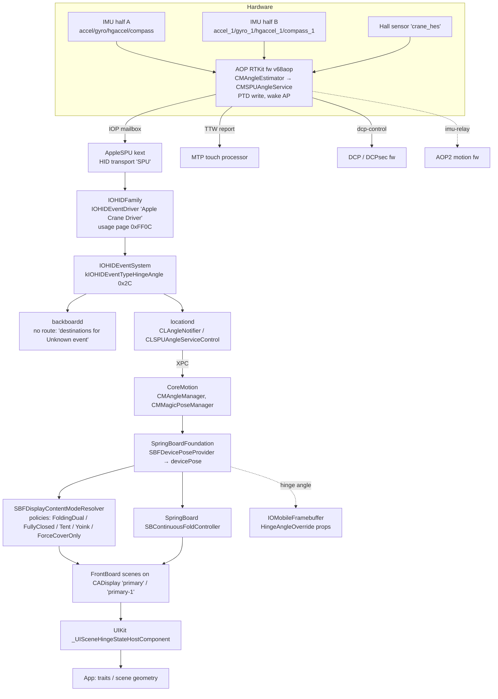

# 08 — The foldable as a system, and the chassis

iPhone Duo (`iPhone19,4`, board `V68AP`, SoC t8160 / A20 Pro), iOS 27.2 (24B91020).

This chapter covers what makes the Duo a foldable. That means the hinge and what crosses it, how
the two halves divide the hardware, the sensors that measure the fold, and every software layer
between the hinge-angle sensors and an app. It also lists the physical chassis facts and ends with
what the vphone-duo virtual machine project learned by trying to emulate the fold.

Evidence labels: **[DT]** device tree (`Firmware/all_flash/DeviceTree.v68ap.im4p`, dumped in
`data/devicetree.txt`), **[KC]** kernelcache `kernelcache.release.v6x-pandia`, **[FW]** firmware
payloads from the IPSW, **[DSC]** the iOS 27.2 dyld shared cache, **[PUB]** a public source (URL
given), **[INF]** inference by this author. Small string excerpts that back the [FW] claims are in
`data/08-foldable/`.

> **Evidence note.** The dyld shared cache named in the brief was deleted from disk partway through
> this work (not by this chapter's author). The [DSC] facts below come from a string and ObjC
> extraction that the vphone-duo project made from the same 27.2 cache before it was deleted
> (`fold-strings.txt` and `poseprovider.txt` in that project's scratch), and from that project's
> research notes. Statements about which framework image holds a class rely on class-name prefixes
> unless a note says otherwise. That attribution is marked **[DSC/INF]**. `/usr/libexec/locationd`
> is a separate binary that the project pulled from the guest, and it was still readable.

Related chapters: displays and DCP (see [the display chapter](03-gpu-and-displays.md)), touch/MTP, the AOP/SPU sensor hub,
power/battery/SMC, and cameras. This chapter cross-references them only where the fold depends on
them.

---

## 1. Summary

| Question | Answer | Evidence |
|---|---|---|
| How many panels does the hardware describe? | Two internal display pipelines: `disp0` (460 ppi, surface 1 = cover/outer) and `dispsec` (430 ppi, surface 2 = inner), plus `dispext0` for DisplayPort | [DT] `/arm-io/disp0`, `/arm-io/dispsec` `dot-pitch-float` = 460.0 / 430.0, `surface-type` 1 / 2 |
| How many touch controllers? | Two, both behind the one MTP coprocessor: `multi-touch` (→ `disp0`) and `multi-touch2` (→ `dispsec`) | [DT] `service-display` phandles 233 / 258 |
| How is the hinge angle measured? | By **fusing two IMUs, one in each half**, on the AOP (`CMAngleEstimatorInterface`: `rot0`/`rot1`, `accelBias0`/`accelBias1`, relative gyro bias), with a Hall-effect sensor ("HES", "crane_hes") for the closed state | [DT] `accel`+`accel_1`, `gyro`+`gyro_1`, `compass`+`compass_1`; [FW] AOP strings |
| What carries the angle to iOS? | HID hinge-angle events (type 0x2C). The kernel has two personalities, "Apple Crane Driver" (0xFF0C/0x1C) and "Hinge Angle" (0x20/0xE4); per [chapter 10](10-userland-display-fold-touch.md), CoreMotion reads 0x20/0xE4 on real hardware and opens 0xFF0C/0x21; nothing in userland consumes 0x1C | [KC] IOHIDFamily personality; [DSC] HID.framework; locationd strings |
| Who consumes it? | locationd (`CLAngleNotifier`, `CLSPUAngleServiceControl`) → CoreMotion `CMAngleManager` / `CMMagicPoseManager` → SpringBoardFoundation `SBFDevicePoseProvider` → `SBFDisplayContentModeResolver` policies → SpringBoard `SBContinuousFoldController` → scenes → UIKit `_UISceneHingeStateHostComponent` | [DSC], locationd binary |
| Does the display firmware see the hinge? | Yes. `IOMobileFramebuffer` has runtime properties `HingeAngleOverrideValue` / `EnableHingeAngleOverride`, and the AOP has a `dcp-control` endpoint (`AppleSPUDCPDriver`) | [KC], [DT] |
| Batteries? | Two packs: `number-of-battery-packs = 2`, `bmu-num-enabled = 2`, `bmu-board-id`/`bmu2-board-id` = 0x8193, both BMU chips 0xE505. The kernel has `AppleSmartBatteryPack` with per-pack "rebalance" logic | [DT] `/arm-io/pmgr/ppm`, `/product`; [KC] |
| One board or two? | iFixit reports a **single-layer logic board** and "a flexible cable carries power and data between the two halves" | [PUB] |
| Can a VM fold? | No. Virtualization.framework allows **one display per VM** (`_maximumAllowedDisplayCount` = 1). With a graft and an identifier trick the guest draws the inner layout, but never both panels in one boot | vphone-duo research |

**Most surprising finding.** The inner pipeline's canvas in the device tree is **2007 × 2853**
(`/arm-io/dispsec` `canvas-width`/`canvas-height`). Apple's spec page says the inner panel is
**1878 × 2670**. Both axes differ by the same ratio, ≈1.0686. That points to a downsampled render
canvas: the UI is laid out at 669 × 951 pt @3× and scaled to the panel **[INF]**, much as the
iPhone 6 Plus–class phones did. The Duo's Simulator profile also uses 2007 × 2853 for the inner
display (vphone-duo research). `/product/display1`'s `Fold` special region is drawn on the
**panel's** 1878-pixel width, at row 1335 = 2670 / 2.

---

## 2. Physical chassis [PUB]

From Apple's spec page, <https://www.apple.com/iphone-duo/specs/> (fetched 2026-10-29):

| | Open | Closed |
|---|---|---|
| Width | 164.6 mm | 84.1 mm |
| Height | 117.8 mm | 117.8 mm |
| Depth | **5.2 mm** | 11.3 mm |
| Weight | 254 g | 254 g |

- **Enclosure:** titanium ("titanium foldable design"). **Internal structural frame:** 100% recycled
  aluminum. **Hinge cover:** 100% recycled titanium, 3D-printed.
- **Glass:** front is Ceramic Shield 2 and back is Ceramic Shield. The inner display has a polymer
  cover with a nano-texture finish, not glass. iFixit describes it as a matte, replaceable polymer
  layer above the OLED.
- **Ingress:** IP68 under IEC 60529, 6 m for up to 30 minutes.
- **Displays:** inner 7.6" (7.58" as a rectangle) folding OLED, 1878 × 2670 at 430 ppi. Outer 5.4"
  (5.36"), 1398 × 2034 at 460 ppi. Both have ProMotion up to 120 Hz, Always-On, 2,000,000:1, 1000 /
  1600 HDR / 3000 outdoor / 1 nit, and Dynamic Island. Apple Pencil (USB-C) is supported, without
  hover. This matches [DT] `/product supports-apple-pencil = 1`.
- **Batteries:** "dual built-in rechargeable lithium-ion batteries". Apple quotes video playback of
  up to 44 h on the outer display and 31 h on the inner, and MagSafe/Qi2 25 W. The brief's figures
  (11.567 Wh + 7.506 Wh) agree with iFixit's rounded 11.6 + 7.5 = 19.1 Wh.
- **Magnets (Apple):** only a MagSafe magnet array, an alignment magnet, and accessory-ID NFC. Apple
  does not publish hinge or closure magnets.

**Hinge construction**, from secondary sources only. Apple's own hinge text was not retrievable:
- "More than 100 components", controlling opening and closing and supporting the centre of the
  display. This is reported widely after the 9 September 2026 event:
  <https://thenextweb.com/news/apple-iphone-duo-foldable-1999-price>,
  <https://global.iteschina.com/ru/news/details/2998>,
  <https://www.metal-am.com/apples-iphone-duo-adds-multi-million-part-titanium-am-application>.
- The 3D-printed titanium hinge cover is the one hinge detail Apple's spec page confirms. Reports
  that the hinge also uses Liquidmetal parts, mixes titanium and aluminium, or has ceramic or carbon
  fibre plates are leaks or unconfirmed.
- Closure magnets ("magnets built into the body pull the two halves together") are reported by
  secondary outlets
  (<https://www.australianmanufacturing.com.au/apple-launches-foldable-iphone-duo-with-3d-printed-titanium-hinge-cover/>),
  not by Apple. The firmware does show magnet effects on the sensors (§5.4).

**iFixit teardown** (provisional **5/10**, the best iFixit score for a foldable; Galaxy Z Fold8 and
Pixel 11 Pro Fold scored 4). Sources:
<https://www.iphoneincanada.ca/2026/10/26/ifixit-iphone-duo-teardown-repairability-score/>,
<https://idevice.com/ifixit-links-iphone-duo-screen-cracks-to-a-stress-point-in-the-hinge.md>,
<https://winbuzzer.com/2026/10/27/iphone-duo-teardown-finds-easier-battery-swaps-xcxwbn/>,
<https://www.techradar.com/phones/iphone/ifixit-tears-down-the-iphone-duo-and-awards-it-the-highest-repair-score-yet-for-a-foldable-but-replacing-the-inner-screen-and-hinge-takes-a-lot-of-work>.

- **Batteries:** two cells held by **electrically released adhesive**: current through the release
  tabs debonds them. Metal shells around the cells allow prying as a fallback. Back glass comes off
  first. The reports do not say which half holds which cell.
- **Board:** a **single-layer logic board**, not the stacked "sandwich" board iPhones have used since
  the iPhone 8. Five screwdriver types are needed.
- **Inner screen:** the hardest repair. Its glue sits in "21 pockets around the enclosure" and must
  set for an hour before pressing. Out of warranty it costs US$999 in the US and C$1,499 in Canada.
  The nano-texture cover layer costs US$49, or US$19 with AppleCare+. The outer display and the
  inner-display trim both came off intact.
- **Crack theory (iFixit's hypothesis, not confirmed).** iFixit built a 3D hinge model from CT
  scans, teardown footage and Apple patents. Reported inner-screen cracks cluster **just below where
  the display flex cable passes through the centre of the hinge**, at the edge of the central hinge
  support, "where several edges meet". In one simulation the **central support bar does not drop far
  enough on closing**, so the curved panel presses on it and creates a stress hotspot. **Curved guide
  rails** rise above the flat plates while folding, and one lines up with the damage. Other suspects
  are a trapped particle, repeated bending, or a manufacturing defect. A broken trace can also look
  like a crack.
- **Dust:** in a fluorescent powder test, adhesive barriers stopped most dust before it reached the
  electronics. Some reached the hinge, which then "crunched", though less than on the Fold8 and
  Pixel 11 Pro Fold.

---

## 3. Product identity in the device tree [DT]

`/product` (phandle 469) carries the product-level personality that MobileGestalt and SpringBoard
read:

| Property | Value | Meaning |
|---|---|---|
| `product-name`, `product-description` | "iPhone Duo" | |
| `sub-product-type`, `fdr-product-type` | `iPhone19,4` | |
| `unique-model` | `V68AP` | board |
| `compatible-device-fallback` | `iPhone18,3` | App compatibility falls back to an iPhone 18-class model **[INF: likely for apps without Duo-specific assets]** |
| `artwork-device-subtype` | `0x7f2` = **2034** | The outer panel's pixel height. Artwork is keyed to the cover display. |
| `artwork-scale-factor` | 3 | |
| `artwork-device-idiom` | `phone` | The Duo is a phone idiom, not an iPad |
| `artwork-display-gamut` | `P3` | |
| `artwork-dynamic-displaymode` | `"0"` | |
| `app-macho-architecture` | `arm64e.x1` | A20 userland ABI. The vphone-duo bring-up chapter covers the CSSC consequence. |
| `graphics-featureset-class` | `APPLE11` (fallbacks APPLE10…GLES2,0) | |
| `large-format-phone`, `thin-bezel`, `oled-display` | 1 | |
| `display-mirroring` | 1 | |
| `supports-apple-pencil` | 1 | |
| `framebuffer-identifier` (product level) | `1C896A2B-F0D7-405C-8D0F-66E4B80AD044` | Same as `display0`: the "default" display is the cover |
| `chrome-identifier` | `com.apple.dt.devicekit.chrome.phone15` | Xcode device-chrome asset |
| `island-notch-location` | 144 | |
| `bmu-num-supported` / `bmu-num-enabled` | 3 / **2** | Battery management units (§4.3) |
| `bmu-chip-id`, `bmu2-chip-id` | 0xE505, 0xE505 | |
| `bmu-board-id`, `bmu2-board-id` | 0x8193, 0x8193 | |
| `exclaves-enabled`, `has-exclaves` | 1 | |

There are two children, **`display0`** (phandle 470) and **`display1`** (phandle 471). Neither has a
`compatible`, so no kernel driver matches them. They describe each panel to userland: its geometry,
cutouts, buttons, cameras and its framebuffer UUID.

| | `display0` (outer / cover) | `display1` (inner) |
|---|---|---|
| `display-index` | 0 | 1 |
| `display-rotation` | 0 | **270** |
| `display-scale` | 3 | 3 |
| `surface-type` | 1 | 2 |
| `framebuffer-identifier` | `1C896A2B-F0D7-405C-8D0F-66E4B80AD044` | `BF0DC480-5EE2-4EC1-B02B-C75E94759832` |
| `chrome-identifier` | `…chrome.phone15` | `…chrome.phone14` |
| `display-corner-radius` (float32 ×4, pt) | 8, 8, 59, 59 | 55, 55, 55, 55 |
| `special-region-0` | `Jindo` (Dynamic Island), circle 111 px at (1199, 88) | `BlankableRR`, circle 111 px at (63, 710) |
| `special-region-1` | — | **`Fold`**, frame (0, 1335, 1878, 0): a zero-height line across the full 1878 px width at row 1335 |
| `has-prox` | 1 | 0 |
| button / camera geometry | `side-`, `volume-up/down-`, `camera-button-location`, `front-`/`rear-cam-offset-from-center` | its own set, re-expressed in the inner panel's frame |

Notes:
- The **`Fold` special region** is the crease, published to software as a display cutout-like region.
  The inner panel's native orientation is portrait, 1878 wide × 2670 tall. The fold is the horizontal
  line at half height, and with `display-rotation = 270` it becomes the vertical spine when the
  phone is open in landscape.
- `display1`'s region 0 is a "blankable rounded rect" rather than `Jindo`. **[INF]** It is probably
  the inner FaceTime camera area, which the brief describes as under-display. Apple's spec page
  lists Dynamic Island for both displays, so `BlankableRR` may be how the inner island is
  implemented: a region the system can blank over the under-display camera.
- The `/arm-io/i2c3/display-eeprom-generic-data` and `…-data-2` nodes carry `display-index` 0 and 1.
  The `exdisplaypipe`/`exdisplaypipe1` exclave pipes do too. The `core-brightness` node has
  `brightness-primary` (`display-id 0`), `brightness-secondary` (`display-id 1`) and
  `brightness-secondary-doe1`. Each layer of the stack keys on the same 0/1 index.

**Contradiction worth noting:** `/arm-io/dispsec` has `canvas-width = 2007` and
`canvas-height = 2853`, while `display1`'s `Fold` region and the public spec use 1878 × 2670 (see
§1). `/arm-io/disp0` has no canvas property, and its public size of 1398 × 2034 is used directly
(466 × 678 pt @3×).

---

## 4. How the hardware splits across the hinge

### 4.1 Paired blocks in the device tree [DT]

The clearest way to see the fold in the device tree is to look for blocks that come in pairs:

| Function | Half A instance | Half B / second instance | Shared parent |
|---|---|---|---|
| Display controller + pipe | `/arm-io/dcp` + `/arm-io/disp0` (`AppleCLCD2`, 460 ppi, `primary = 0`, `surface-type = 1`) | `/arm-io/dcpsec` + `/arm-io/dispsec` (`AppleCLCD2`, 430 ppi, `primary = 1`, `surface-type = 2`) | separate DARTs (`dart-disp0`, `dart-dispsec`, …), separate exclave mailboxes (`dcp-exclave-mailbox`, `dcpsec-exclave-mailbox`) |
| Secure display pipe | `/arm-io/exdisplaypipe` (`display-index 0`) | `/arm-io/exdisplaypipe1` (`display-index 1`) | `EXDisplayPipe` driver |
| Touch | `mtp/iop-mtp-nub/multi-touch` (`hid-merge-personality "V68PS1"`, `service-display` → `disp0`) | `mtp/iop-mtp-nub/multi-touch2` (`"V68SS1"`, `service-display` → `dispsec`) | one MTP coprocessor `/arm-io/mtp` (RTKit, `V68_MtpFirmware.im4p` `mtpf`, `V68_Multitouch.im4p` `mtfw`) |
| Panel auth chip | `i2c3/mogul-display` (`mogul,a1222`, addr 0x10, `component-index 1`) | `i2c3/mogul-display2` (addr 0x60, `component-index 2`) | `i2c3` |
| Panel EEPROM | `i2c3/display-eeprom` (0x52) + `-hi` (0x53) | `i2c3/display-eeprom-2` (0x54) + `-2-hi` (0x55) | `i2c3` |
| IMU | `aop-nub/accel`, `gyro`, `hgaccel` | `aop-nub/accel_1`, `gyro_1`, `hgaccel_1` | AOP |
| Magnetometer | `aop-nub/compass` | `aop-nub/compass_1` (`compass-orientation` from syscfg `JRot`, not `CRot`) | AOP |
| Ambient light | `aop-nub/als` (`digitizer-location-id 544`, `use-prox-for-occlusion 1`) | `als2a`, `als2b` (`digitizer-location-id 545`, **`angle-dependent = 1`**) | AOP |
| Always-on processor | `/arm-io/aop` (`v68aop`, `aopf`) | `/arm-io/aop2` (role `AOP2`, `aop2fw-v68aop2`, `aop2`) | — |
| PMU | `nub-spmi0/pmu-main` (`pmu,becketts`) | `…/pmu-secondary` (`pmu,fairmont`, behind an SGPIO bridge) | SPMI0 |
| NFC controller | `aop-spmi0/stockholm-spmi` (`nfc,primary,spmi`) | `aop-spmi0/hammerfest-spmi` (`nfc,secondary,spmi`) | AOP SPMI0 |
| Battery packs | BMU 1 (`bmu-board-id 0x8193`) | BMU 2 (`bmu2-board-id 0x8193`) | SMC / PPM (`number-of-battery-packs = 2`) |

The display, touch and panel-auth rows are certainly per panel, because their properties say which
display they serve. The IMU, compass and ALS pairs are per half by inference, and the AOP firmware's
two-IMU angle estimator backs that up (§5). The second PMU and NFC controller **may** sit in the
other half, but nothing here proves where they are mounted **[INF]**.

### 4.2 What crosses the hinge **[INF from DT bus topology + iFixit]**

iFixit reports one logic board and a flex cable that "carries power and data between the two
halves" through the centre of the hinge, and that cable sits where the cracks cluster. The board
therefore lives in one half, and everything in the other half reaches the SoC through hinge flex.
Which half holds the board is not public. The two lists below use the DT to bound what the flex(es)
must carry in each case.

The inner display spans both halves, so its connections must reach the board from whichever side
the panel connector is on. It needs:
- the inner panel's **MIPI DSI/display link** from `dispsec` (lane count and timing are not in the DT
  dump);
- the inner **touch** link from MTP `multi-touch2`;
- the inner panel's **I²C** devices (`display-eeprom-2`, `mogul-display2`), which share the `i2c3`
  bus with the outer panel's EEPROM and Mogul chip. So `i2c3` is one bus routed to both panels.
- the **ALS2a/2b** sensors if they sit under the inner panel (`digitizer-location-id 545`, distinct
  from the outer `als` at 544), and the **inner FaceTime camera** (`/product/camera inner-camera = 1`,
  `inner-max-video-fps-1080p = 30`).

If the board is in half A, the hinge must carry to half B:
- the second IMU (`accel_1`/`gyro_1`/`hgaccel_1`) and the second magnetometer (`compass_1`), on AOP
  sensor buses that the device tree does not describe. The AOP firmware owns those buses.
- **battery power and gauge data** for whichever cell is in half B (§4.3);
- whichever of the outer-display, camera, MagSafe, side-button/Touch ID and speaker blocks live
  there. Apple's renders and iFixit's photos would settle this. The DT cannot.

What the DT does **not** describe is the hinge flex itself. No node is called "hinge", "b2b",
"flex", "interposer" or similar (checked across all 552 node names). The flex is passive
interconnect: it has no `compatible`, no driver and no device-tree presence.

### 4.3 Two batteries [DT][KC]

- `/arm-io/pmgr/ppm` (`ppm,iphoneacsk`, driver `ApplePPMCPMSv2` in `com.apple.driver.AppleiPhoneACSKPPM`)
  has **`number-of-battery-packs = 2`**. The kernel strings
  `ApplePPMCPMSSysCapMonitorv2::batteryPackServiceArrivalHandler` and
  `ApplePPMSystemCapabilityMonitor::findBatteryPackEntry` show the peak-power manager tracking each
  pack.
- `com.apple.driver.AppleSmartBatteryManagerEmbedded` contains the `AppleSmartBatteryPack` class and
  `BatteryPackCount`, with asserts such as `packIdx >= 0 && packIdx < getNumBatteryPacks()` and
  `_numberOfBatteryPacks > 0 && _numberOfBatteryPacks < MAX_NUMBER_BATTERY_PACKS`. It has a
  **per-pack rebalance path**: `AppleSmartBatteryPack: ID: %d updateRebalanceData…`, which reads
  DOD, temperature and an impedance key per pack and writes a PPM-computed impedance array back to
  the SMC. The SMC firmware (not covered here; see [the power chapter](06-power-battery-thermal.md)) therefore balances charge and
  discharge between the two cells using the impedances the kernel computes **[INF from strings]**.
- `/product` `bmu-num-enabled = 2` of `bmu-num-supported = 3`. Both BMUs are chip 0xE505 on board
  0x8193. The extracted BMU firmware (`bmu_fw.bin`, `bmu_cfg0.bin` under the scratch `fw/power/`) is
  covered in [the power chapter](06-power-battery-thermal.md).
- The PMU chain has `pmu-main` (Becketts) and `pmu-secondary` (Fairmont). AOP firmware also contains
  `RailEnergyBecketts` (powerlog).
- **Not knowable here:** which cell (11.567 Wh or 7.506 Wh) is in which half, and whether each cell
  has its own protection board and gauge on its side of the hinge.

---

## 5. Sensing the fold

### 5.1 Hinge angle: two IMUs fused on the AOP [DT][FW]

The device tree lists two complete inertial sets under `/arm-io/aop/iop-aop-nub`. Each has its own
syscfg calibration keys: `ARot`/`GRot` orientation for both, and different interrupt calibrations
(`AICl` vs `A2CL`, `GICl` vs `G2CL`). The AOP firmware
(`Firmware/AOP/aopfw-v68aop.RELEASE.im4p`, IM4P type `aopf`, built from `SPUMotion8160v68` in
`CoreLocation-3187.0.1`) holds the estimator that uses both:

```
[CMAngleEstimatorInterface] Angle=%.2f deg, relGyroBias=%.3f deg/s, rot0=[…] deg, rot1=[…] deg,
    accelBias0=[%.4f, %.4f] g, accelBias1=[%.4f, %.4f] g, yOffset=%.3f deg, applyOffset=%u, externalCal=%u
[CMAngleEstimatorInterface] cal: gyroScaleDevY=[%.4f,%.4f] percent, gyroBiasY=[…] deg/s, accelBiasXZ=[[…],[…]] g
[CMAngleGyroBiasEstimator] Resetting IMU%u bias estimator (invalid covariance or NaN)
[CMAngleOffsetCalibrator] Pushed candidate=%.4f deg (raw=…), median=…, n=%zu
```

**[INF]** The structure is a classic two-body hinge estimator. Each half's gyro integrates rotation
about the hinge (Y) axis, the *relative* gyro bias between halves is estimated online, and each
half's accelerometer (X/Z bias terms) anchors the result against gravity. `rot0`/`rot1` are the
mounting rotations of the two IMUs, and `yOffset` is a learned zero offset. Only the Y-axis gyro
terms are calibrated, which fits a single-axis hinge.

The AOP then publishes the result through the `CMSPUAngleService`:

```
[CMSPUAngleService] PTD = 0x%llX, mechanicalAngleDegrees = %f, isAngleValid = %d, timestamp = %llu
[CMSPUAngleService] Sent wake event: ma=%f, p=%u, s=%u, began=%llu, cur=%llu, now=%llu
[CMSPUAngleService] kSpuPropertyCoreMotionMinAngleThreshold (%f) not in [%f, %f]
[CMSPUAngleService] kSpuPropertyCoreMotionMinAngleThresholdToWake (%f) not in [%f, %f]
[CMSPUAngleService] FIR config changed to { numTaps = %u, { … } }
[CMSPUAngleService] SPU_aon_ptd_write_entry failed with %u
[CMSPUAngleService] AP on / AP off
```

- It runs while the application processor sleeps and **wakes the AP** on a fold gesture, with a
  minimum-change threshold and a separate wake threshold settable from the AP. An FIR smoothing
  filter is configurable.
- It writes the angle into an **always-on PTD** (shared data page). The kernel has a matching
  `function-ptd_lookup_mult` in MTP's `mtp-info` node. **[INF]** Other always-on agents read the
  angle there without a round trip.
- `[CMAngleSimulator] … sA=%f, eA=%f, dur=%llu, del=%llu, opts=%u` is a firmware-side simulator,
  and `Sending simulated new calibration report` exists too. Apple can script folds inside the
  sensor hub.
- `[DeviceState][Service] TTW MTP report,grossMotion,%u,faceOrientation0,%u,faceOrientation1,%u,angleState,%u`
  shows the AOP sending a per-half face orientation and the angle state to the **touch processor**
  (MTP endpoint). **[INF]** This drives tap-to-wake and touch rejection on whichever panel is facing
  the user.

### 5.2 AOP2 [DT][FW]

`/arm-io/aop2` is a second always-on ASC (`iop,ascwrap-v8`, role `AOP2`, mailbox 1, DART
`mapper-aop2`, exclave proxy `aop2-exclave-mailbox` → `com.apple.service.SecureRTBuddyAOP2`).
Its firmware `aop2fw-v68aop2.RELEASE.im4p` (type `aop2`) is a **motion** build
(`v68aop2:MOTION:RELEASE:AppleSPUFirmwareBuilder-990.40.5`). It contains `AOP2IMU1`, `AOP2IMU2`,
`[CMAOP2App][imu_%hhu] fastpath …`, NeuralPDR and AttitudeFilterLite. The AOP side has
`imu-relay`, `imu-relay_1` and `aop2.imu100aop2`. **[INF]** AOP owns both IMUs and relays both
sample streams to AOP2 for ML motion workloads. AOP2 does not compute the hinge angle. Whether AOP2
exists only because of the Duo, or is a t8160 feature shared with other A20 phones, is a question
for the AOP chapter.

### 5.3 Closed detection: the Hall-effect sensor ("HES", "Crane") [FW][KC]

The AOP firmware has a Hall-effect service for the hinge:

```
crane  crane_hes  crane-hes-cli  crane-hes-srvr     HESProxy.cpp  HESRelay.cpp
[CMSPUHES] HES changed to %u, t=%llu
CraneAngleRelay: Could not find crane service '%s' / failed to set min angle threshold / report interval
[MedinaState] state changed from %u to %u, t=%llu, hes=%u, faceDownStatic=%u, angleDeg=%.2f, …
New state:%s ts:%llu hes:0x%x prox:0x%x, event:%u
```

and locationd has `CLMotionLogger::onHESData`, `Registering for HES notifications`, and `CMMsl::AngleHES`.

- **"Crane"** is the codename of the hinge-sensing subsystem. The kernel personality
  `HID SensorEvent Driver - Apple Crane Driver` (in `com.apple.iokit.IOHIDFamily`, IOClass
  `IOHIDEventDriver`, `IOPropertyMatch Built-In = true`) matches **usage page 0xFF0C (65292), usage
  0x1C (28)**, with `PrimaryVendorEvents` 0xFF0C001C and 0xFF000023. locationd checks
  `usage == kHIDUsage_AppleVendorMotion_CranePrivateData` and logs `Crane virtual service connect failed`.
- The vphone-duo research found CoreMotion's `CLAngleNotifier` matching **0xFF0C / 0x21** for hinge
  angle events of type 0x2C. **[INF]** The vendor page has at least two Crane usages: 0x21 for the
  angle event itself, and 0x1C for "Crane private data" (calibration and diagnostics) handled by the
  kernel Crane personality.
  *(Corrected by [chapter 10](10-userland-display-fold-touch.md): no CoreMotion consumer matches the Crane usage 0xFF0C/0x1C. CoreMotion opens 0xFF0C/0x21 and, on real hardware, the kernel's "Hinge Angle" personality 0x20/0xE4, which is the one `copyEvent` reads.)*
- **MedinaState** combines HES, face-down/static, angle and proximity into a device state, and has a
  Tightbeam endpoint to the EIC (`MedinaStateService --> EIC Tightbeam endpoint`). **[INF]** It
  feeds the exclave and indicator side, for example camera/mic indicator placement or privacy
  decisions that depend on which panel faces the user.
- **Where the Hall sensor is wired is not in the DT.** It is an AOP-private peripheral. The DT does
  have a `Hall` property and `halle-calibration = syscfg/PSCl` on the `cs42l79` audio codec
  (`/arm-io/i2c2/audio-codec`), and `function-hall_ctrl` on the haptics nodes. The AOP audio firmware
  exports `setAmpHallCalibration` through an exclave call. **[INF]** These look like amplifier or
  speaker Hall channels, not the hinge HES. The generic `halleffect`/`hesattach` strings in
  `AppleM68Buttons` are iPad Smart-Cover heritage: V68's `/buttons` node declares only volup,
  voldown and hold.

### 5.4 Magnets seen by the sensors

The firmware and DT show magnets and the fold disturbing the sensors, even though Apple publishes
no closure magnets:
- `compass` has both `compass-sens-calibration` (`CSCM`) and **`compass-sens-calibration-closed`**
  (`CSCa`), plus `compass-orientation-p2` **[DT]**. The magnetometer needs a separate calibration for
  the closed pose. **[INF]** Closure magnets, or the other half's steel, shift the field when the
  phone is folded.
- `compass-sens-angle-table` (hex table) **[DT]** is an angle-indexed magnetometer correction table:
  hard-iron compensation as a function of hinge angle **[INF]**.
- Camera: `FigCaptureMagneticInterferenceMonitor _addServiceIfOnInnerDisplay:` and
  `_kFigCaptureStreamAutoFocusPositionSensorOffsetEstimatorInfoKey_HingeAngle` **[DSC]**. The camera
  autofocus position sensor (a Hall-based lens sensor) gets a hinge-angle-dependent offset estimate.
- `als2a`/`als2b` `angle-dependent = 1` **[DT]**: the ALS reading is corrected for fold angle.
- `/arm-io/aop/iop-aop-nub/jarvis` **[DT]** with `R187SmartCover` / `Jarvis` firmware strings: a
  magnetometer-based accessory-attach detector with theta/phi attach/detach thresholds. It drives
  `aop-smart-cover` → kernel `AppleSPUSmartCoverDriver` (HID 0xFF00/0x29) **[KC]**. **[INF]** This
  detects a magnetic case or cover accessory, not the hinge.

### 5.5 Calibration after repair [DSC: locationd binary]

`CLSPUAngleServiceControl` (locationd) caches the estimator's calibration:
`rotation={4}, relativeGyroBias, offsetAngle, temperature, accelBias={4}`. It saves this in
`AngleRepairState.plist` and checks `repairStateForComponentsAffectingIMUExtrinsics()`. On a
component repair (`Repair state changed from %@ to %@`, `BootAfterRepair`, `hasBeenRepaired`) it
**throws the cached hinge calibration away** and reconverges. It reports
`timeToAngleConvergence`/`timeToRotationConvergence`/`timeToAccelBiasConvergence` to Core
Analytics. Hinge-angle accuracy therefore depends on the relative mounting of the two IMUs, and
replacing either half's parts invalidates it. This ties directly to the iFixit repair story.

---

## 6. The software stack, layer by layer



### 6.1 Firmware → kernel

- **AOP mailbox and SPU [DT][KC]:** `/arm-io/aop` → `AppleASCWrapV8` → `iop-aop-nub` (`RTBuddy`,
  plus `AppleSPUTimesyncV2`, `AppleLVBOOST`). Sensor endpoints become `AppleSPUInterface` /
  `IOHIDInterface` nubs with `Transport = SPU`. The kernel's SPU service list includes `aop_crane`
  next to `aop_prox`, `aop_flip`, `aop_orientation` etc. (kernel strings near
  `AppleSPUSimpleAsyncEventSource`).
- **HID event type [KC][DSC]:** IOHIDFamily knows a `HingeAngle` event (kernel string table), and
  IOKit exports `IOHIDEventCreateHingeAngleEvent(allocator, timestamp, angle,
  mechanicalAngle, velocity, options)` and an `HIDEvent (HIDHingeAngleEventPrivate)` category with
  `hingeAngleAngleDegrees`, `hingeAngleMechanicalAngleDegrees`, `hingeAngleVelocityDegreesPerSecond`
  and `hingeAngleState` (+ setters). The fields are **angle** (smoothed, UI-facing) and
  **mechanical angle** (raw), velocity and state.
  *(Corrected by [chapter 10](10-userland-display-fold-touch.md): `IOHIDEventCreateHingeAngleEvent` is exported by IOKit (not HID.framework), beside a private `__IOHIDEventTypeDescriptorHingeAngleEvent`; and HID.framework has `HIDEvent` hinge accessors. Event type 0x2C carries angle, mechanical angle and velocity as doubles plus a state.)*
- **Display firmware [KC][DT]:** `com.apple.iokit.IOMobileGraphicsFamily` defines
  `iomfb_RuntimeProperty_hingeAngleOverrideValue` / `…enableHingeAngleOverride`, exposed as
  `HingeAngleOverrideValue` / `EnableHingeAngleOverride`. `IOMobileGraphicsFamily-DCP` has
  `AppleClamshellState` with `set_dcp_clamshell_state ClamshellState %d` and `get_clamshell_state
  fAPClamshellState %d … fReceivedClamshellStateFromSkyLight`. The AOP node `dcp-control`
  (`AppleSPUDCPDriver`) is a direct AOP↔DCP channel. **[INF]** The DCP receives the hinge angle and
  a clamshell state, from the AOP and/or the AP, to switch panels, power-gate the hidden one, and
  possibly compensate the inner panel across the crease. The override properties are a test hook
  that lets the DCP use a forced angle. The XNU power-management strings (`PMRD: Clamshell
  closed/opened`, `Wake On Clamshell Open`) are generic Mac code. Whether iOS calls them on the Duo
  is not shown.
- **Touch [DT]:** `multi-touch` and `multi-touch2` each name their display service. backboardd routes
  a touch to the display its HID service names (`BKIOHIDService.displayUUID`, see §8). The
  kernel's `getVersatileSenselArrayFolding` / `folded` / `unfolded` strings are in
  `AppleM2ScalerCSCDriver` and concern Bayer pixel formats, not the hinge.

### 6.2 backboardd

Hinge events reach backboardd's event system, which has **no route** for them. Every hinge event
produces `com.apple.BackBoard: destinations for Unknown event: ()` (vphone-duo runtime capture,
§8). The angle's consumer is locationd/CoreMotion, which opens the HID service itself. backboardd's
role in folding is **display and touch arbitration**, not the angle:
- `BKSDisplayService traitsForDisplayUUID:` answers each display's `DeviceSurfaceType`, taken from
  MobileGestalt `DisplayExtendedProperties` (entry N for framebuffer index N).
- `BKIOHIDService.displayUUID` binds each touchscreen to its panel.
- `SBFDevicePoseProvider` also implements `BKSAccelerometerDelegate`, so the device-orientation
  feed still comes through backboardd **[DSC]**.

### 6.3 locationd and CoreMotion [locationd binary][DSC]

- `CLAngleNotifier` (`Shared/Motion/Notifiers/Angle/CLAngleNotifier.mm`):
  `onIoHidEvent(IOHIDEventRef, bool)`, `copyEvent`, assert `IOHIDEventGetType(event) ==
  kIOHIDEventTypeHingeAngle`. It logs `phase, state, angle, mechanicalAngle, velocity, timestamp,
  continuousTimestamp, gestureBeganContinuousTimestamp, messageSentContinuousTimestamp,
  isWakeEvent`. Latency metrics: `CMAngleGestureBeganToWakeEvent`, `CMAngleWakeEventSentToAPArrival`,
  `CMAngleAPArrivalToNotified`. It has VM guards: `Skipping open for physical HID device on
  VM/Simulator` and `sendCommand skipped, no physical HID driver (VM/Simulator)`.
- `CLSPUAngleServiceControl`: the command and calibration side (§5.5), plus power-log metrics
  (`hingeIdentifier`, gesture duration, previous/current gravity and angle, max/mean angular rate,
  `wasPreviousAngleAmbiguous`, `isAPAwake`, `isSimulated`).
- `CMAngleInterpolator` (`Shared/Motion/DeviceState/CMAngleInterpolator.mm`):
  `interpolateToAngle:duration:` animates the published angle between samples.
- CoreMotion client classes used by SpringBoard: **`CMAngleManager`** and **`CMMagicPoseManager`**
  (ivars `_cmAngleManager`, `_cmMagicPoseManager` of `SBFDevicePoseProvider`) [DSC]. The "magic
  pose" carries `deviceOrientation`, `deviceOrientationForCover`, `deviceOrientationForInner`,
  `tabletopPose`, `hingeState`, `fromHingeState`/`toHingeState` and a progress value [DSC, type
  encoding below]. A `CLLidAngleNotifier` with a `LidAngleSensor` (`lidAngleSensorDevice()`) is also
  in the cache. **[INF]** It is the Mac lid-angle code path shared in CoreLocation's source tree,
  distinct from the Duo's `CLAngleNotifier`.

### 6.4 SpringBoardFoundation: `SBFDevicePoseProvider` [DSC]

`@interface SBFDevicePoseProvider : NSObject <BKSAccelerometerDelegate, PTSettingsKeyPathObserver,
BSInvalidatable>`. Its methods include `_handleAngle:`, `_publishedMechanicalAngleDegreesForAngle:`,
`_updateDevicePoseBoxForReason:usingBlock:`, `_beginTransitionAutocompletion`,
`continuousFoldEffectProgress`, `isContinuousFoldEnabled`, `makeHingeAngleHUDView`,
`setTransitionStyle:`, `setDisplayToolProfileOverride:` and
`setUpdateLinkSource:backlightActive:`. It runs on a `UIUpdateLink` heartbeat.

The **pose struct** (from the ObjC type encoding) is the most complete specification of the fold
state machine in the evidence:

```
devicePose {
  orientation, coverOrientation, innerOrientation            (long long ×3)
  hinge {
    isAvailable, position, state
    fullyClosedRegion / closedRegion / partiallyOpenRegion / openFlatRegion /
    activateFoldAvoidanceRegion / transitionToOpenRegion / transitionToClosedRegion
        each {start, end, isActive, canBecomeActive}
    isTransitioning, transitionProgress, progressToSwap, progressFromSwap,
    continuousFoldPosition, velocity, acceleration
  }
  uiHingeStatus { isAvailable, status, magicPose, hingeAngle, nextStatus, progress, timestamp }
  cmAngle       { minAngleDegrees, maxAngleDegrees, angleDegrees, velocityDegreesPerSeconds,
                  isAvailable, timestamp }
  cmMagicPose   { deviceOrientation, deviceOrientationForCover, deviceOrientationForInner,
                  tabletopPose, hingeState, progressValid, fromHingeState, toHingeState,
                  progressValue, isAvailable, timestamp }
  flipState     { isAvailable, showYoinkingAffordance }
  settings      { showDebugHUD, showDisplaySupport3Required, usesStrictCoreMotion, invertHingeAngles,
                  continuousFoldEnabled, closedToPartiallyOpenBoundary, partiallyOpenToOpenFlatBoundary,
                  openTransitionBeginBoundary, closeTransitionBeginBoundary,
                  transitionAutoCompleteDuration, velocitySmoothingFactor,
                  enterFoldAvoidancePredictionWindow, sustainFoldAvoidancePredictionWindow }
  internal      { isInitialized, forceStrictCoreMotion, invertHingeAngles, isOnVM, isDisplaySupport3Set,
                  hingeRegionsAreDefault, needsTransitionAutocompletion, … }
  displayTool   { state, duration, deviceOrientation, profileOverride, waitForCompletion,
                  targetMode, targetHingePosition, lockedForTestingUntil }
}
mechanicalAngleDegrees, autocompletionMin/MaxDelay, likelyToOpenVelocityDegreesPerSecond,
swapDegreesForContinuousLiveStyle, swapDegreesForContinuousSnapshotStyleWhenOpening/Closing,
swapDegreesForFadeInFadeOutStyle, transitionStyle, continuousFoldEffectProgress, …
```

What this says, read plainly:
- The hinge range is cut into **named regions with hysteresis**: fully closed, closed, partially
  open, open flat, plus transition-to-open and transition-to-closed bands. Each has a start, an end
  and `canBecomeActive`. The boundaries are tunable settings
  (`closedToPartiallyOpenBoundary`, `partiallyOpenToOpenFlatBoundary`, …).
- There is **velocity-based prediction**: `likelyToOpenVelocityDegreesPerSecond`, a
  `SBFDevicePoseLikelyTransitionDelegate`, and **fold avoidance** with prediction windows
  (**[INF]** this keeps critical UI off the crease during a fold).
- Displays are **swapped at a configurable angle** that depends on the transition style:
  continuous-live, snapshot (opening vs closing), or fade.
- `isOnVM` is a field in the pose's internal state. The provider knows when it runs in a VM.
- `flipState.showYoinkingAffordance` goes with `SBFYoinkDisplayContentModeResolutionPolicy`.
  **[INF]** "Yoink" is moving content from one panel to the other with a gesture when the phone is
  flipped over.

### 6.5 Display content modes [DSC]

`SBFDisplayContentModeResolver` (`_surfaceTypeForWindowScene:`, `_mechanicalHingeAngleDegrees`,
`acquireForceCoverDisplayOnlyEnabledAssertionWithReason:`) chooses among policies:
`SBFSingleIntegratedDisplayContentModeResolutionPolicy`,
`SBFFoldingDualDisplayContentModeResolutionPolicy`,
`SBFFullyClosedDisplayContentModeResolutionPolicy`,
`SBFTentModeDisplayContentModeResolutionPolicy`,
`SBFYoinkDisplayContentModeResolutionPolicy`, and
`SBFForceCoverDisplayOnlyDisplayContentModeResolutionPolicy`. Each implements
`shouldBeActiveForDevicePose:prevailingPolicy:candidatePolicy:`,
`resolvedModeForDisplayProxy:devicePose:`, `targetModeForDisplayProxy:devicePose:` and
`preferredPrimarySurfaceTypeForDevicePose:`. Surfaces come from `SBFDisplayProxy`
(`coverIntegratedDisplayWithIdentifier:`, `innerIntegratedDisplayWithIdentifier:`). The logged
vocabulary on a real run (vphone-duo, §8) is `DCMResolved: FullyClosed→FoldingDual`, `DCMPose:
180.0° (1.00 fold:1.00): openFlat`, `COMPLETED: .cover:aux`, and `keeping .cover inactive for
.passiveShield`. When the phone is open flat, the cover display gets "auxiliary" content (a passive
shield with the backlight off), and primary content moves to `.inner`.

Other SpringBoard pieces: `SBContinuousFoldController` (ivar `_lastHingeAngleDegrees`; functions
`SBContinuousFoldAngleProgressForHingeAngleDegrees` and its inverse), `SBDisplayContentModeCoordinator`,
`SBCoverDisplayConfigurationTransformer` (insets, rotation and scale for the cover display),
`SBCoverDisplayCompanionScenePresenter` and `SBInnerDisplayCompanionScenePresenter` (companion
scenes such as `CoverDisplayCamera`, which shows the camera preview on the cover while shooting
with the inner screen open, and `InnerDisplayStandbyAlarmGlow`), `SBSwitcherController
isOnV68InnerDisplay`, `CSMainPageContentViewController _isV68InnerDisplay`,
`CSInadvertentTouchIDRecognizer innerDisplayModeCap` (Touch ID false-trigger handling on the inner
display), `SBHomeGestureSettings butterfly{Cover…,Inner…}InterpolationDistance` (the home-gesture
"butterfly" animation between panels), and a debug HUD (`SBFHingeAngleHUDView`,
`SBWindowSceneDebugHUDWindowRootViewController _isHingeAngleHUDEnabled`, default
`SBShowHingeAngleHUD`). SpringBoardServices exports `SBSCurrentCoverDisplaySize()`, and a
test-automation SPI `SBSTestAutomationService setDevicePoseOverride:` takes `{long long; int; int;
int}` (orientation, then magic-pose device orientation, hinge state, tabletop pose). It is entitled
by `com.apple.springboard.testautomation`.

### 6.6 FrontBoard, UIKit and the app [DSC]

- Each panel is a separate `CADisplay`: "LCD"/`primary` for the cover and "LCD-1"/`primary-1` for
  the inner one, per the Simulator profile in vphone-duo research. A FrontBoard scene's
  `FBSDisplayConfiguration.hardwareIdentifier` is the display's `uniqueId` (= framebuffer
  `IOMFBUUID` = the DT `framebuffer-identifier`). Scenes therefore live on one panel at a time, and
  a fold moves them between displays.
- **UIKit:** `_UISceneHingeStateHostComponent` with `setHingeAngle:`. That is a host-side scene
  component that pushes the hinge state from SpringBoard into client scenes. It is underscored SPI.
- Other framework consumers: `UIViewController(MEP) isOnInnerDisplay_mep` (a Messages extension
  helper), the `AMCoverDisplayEnabled`/`AMInnerDisplayEnabled` keys, `PRDisplayTypeIsCoverDisplay`
  (PosterBoard), `CMMediaSession feedPoseAnchorWithAttitude:position:lidAngleDeg:…` and
  `CMRelDMService parseLidAngleDeg` (CoreMotion relative device motion takes the fold angle for
  camera/head pose), `BWStartupCalibrationAnalyticsPayload setHingeAngle:` (camera calibration
  telemetry), and `abm::kRFSensingSubCommandQueryHingeAngle` / `kHingeAngleValue` in the baseband
  manager. **[INF]** The cellular stack queries the hinge angle for RF sensing or antenna tuning,
  because the antenna geometry changes when folded.
- **Public, app-facing API found:** **WebKit's W3C Device Posture API**: `WebCore::DevicePosture`,
  `NavigatorDevicePosture`, a `device-posture` CSS media feature
  (`devicePostureFeatureSchema`), `WebPageProxy::setDevicePostureType`, and the preference
  `WebKitDevicePostureAPIEnabled` / `DevicePostureAPIEnabled`. Web content can read
  `navigator.devicePosture.type` ("continuous" vs "folded") and use
  `@media (device-posture: folded)` once that preference is on. Whether it is on by default in
  Safari for iOS 27.2 is not determined.
- **Native public API:** none confirmed. No public UIKit or SwiftUI symbol named hinge, fold or
  posture appears in the extracted strings, and only underscored or SPI names were found
  (`_UISceneHingeStateHostComponent`). **[INF]** A native app likely sees the fold indirectly:
  through scene/window geometry and size-class changes when its scene moves from the 466 × 678 pt
  cover display to the inner display, plus the safe-area and cutout system (the `Fold` and
  `BlankableRR` special regions are the kind of region UIKit turns into insets or avoidance areas).
  A full ObjC/Swift dump of UIKitCore and SwiftUI would settle this. It was not possible after the
  cache was deleted.
  *(Corrected by [chapter 10](10-userland-display-fold-touch.md): there is a public API, `UIHinge` / `UIHingeInteraction`, available from iOS 27.1 in the iOS 27.2 SDK. It reports a status (Unknown, Closed, PartiallyOpen, FullyOpen) and the angle in radians. `CMAngleManager` is SPI.)*

### 6.7 One concrete operation: opening the phone

1. The user starts unfolding. Both halves' gyros see opposite rotation about the hinge axis. The
   AOP's `CMAngleEstimator` integrates the relative rate and corrects it with the accelerometers, and
   the HES reports "not closed" **[FW]**.
2. When the change passes `kSpuPropertyCoreMotionMinAngleThresholdToWake`, `CMSPUAngleService` writes
   the angle to the PTD and sends a **wake event** to the AP (`Sent wake event: ma=…`) **[FW]**. The
   AOP also tells MTP the per-half face orientation (`TTW MTP report`) **[FW]**.
3. The AP wakes. AppleSPU delivers the report as a HID event on page 0xFF0C, and IOHIDFamily turns it
   into an `IOHIDEvent` of type HingeAngle **[KC]**. backboardd's dispatcher sees it and drops it
   ("Unknown event") **[runtime]**.
4. locationd's `CLAngleNotifier::onIoHidEvent` takes the event and computes latency metrics. CoreMotion
   publishes `cmAngle` and `cmMagicPose` (hinge state "open-ish", tabletop pose) to SpringBoard over
   XPC **[locationd, DSC]**.
5. `SBFDevicePoseProvider::_handleAngle:` updates `hinge.position` and the active region
   (closed → partiallyOpen → openFlat), the velocity, and `transitionProgress`. Once
   `likelyToOpenVelocityDegreesPerSecond` is exceeded, the likely-transition delegate pre-warms the
   inner display **[DSC/INF]**.
6. At the swap angle for the current `transitionStyle`, the resolver activates
   `SBFFoldingDualDisplayContentModeResolutionPolicy`. Primary content moves to the `.inner`
   surface, and `.cover` gets the passive shield **[DSC + vphone log]**.
7. FrontBoard re-hosts the foreground scene on the inner `CADisplay`. `SBContinuousFoldController`
   drives the continuous-fold animation from `SBContinuousFoldAngleProgressForHingeAngleDegrees`, and
   `_UISceneHingeStateHostComponent setHingeAngle:` updates the client's scene **[DSC]**.
8. The DCPsec brings `dispsec` up and the DCP blanks `disp0` (clamshell state) **[KC/INF]**. MTP
   enables `multi-touch2`, and touches now carry the inner display's UUID **[DT/INF]**. The app
   re-lays out for the 669 × 951 pt canvas **[INF]**.

---

## 7. Product-specific strings ("V68") elsewhere [DSC]

`SBSwitcherController isOnV68InnerDisplay`, `CSMainPageContentViewController _isV68InnerDisplay`,
`SBAssistantIslandStageTransientCanvasOnV68CoverDisplayAssertionReason`, `V68 cover native width %g
px from SBSCurrentCoverDisplaySize()`, and `Resolved screen type to D76 cover (SBSCurrentCoverDisplaySize
SPI)`. **[INF]** D76 is a related codename: a cover-display class shared with another product, or
the Duo's own cover-display program name. Firmware is board-named: `aopfw-v68aop`, `aop2fw-v68aop2`,
`V68_MtpFirmware`, `V68_Multitouch`, `V68_LeapHapticsFirmware`, `V68_MandoFirmware`,
`V68_HapticAssets`, `WirelessPower.v68`, `AppleLPM.v68`, `securem3fw-v68`, `adc-boreas-v68`
(ISP), `v68-boot-chime`, `exclavecore_bundle.v68` (see `data/firmware-inventory.tsv`).
  *(Resolved in [chapter 10](10-userland-display-fold-touch.md): D76 is a home-screen layout class in SpringBoardHome; the cover display resolves to it.)*

---

## 8. What emulation taught us (vphone-duo)

Source: `vphone-duo/Research/Guest/iphone_duo_bringup.md` and `iphone_duo_fold.md` (read-only).
The project boots the real iOS 27.1/27.2 Duo userland (`iPhone19,4`, `v68ap`) on Apple's virtual
research board (`vphone600`, cloudOS 26.4) under Virtualization.framework on an A18 Pro Mac.

1. **Instruction set first.** The A20 userland is `arm64e.x1` and uses the CSSC scalar instructions
   (ABS/CNT/CTZ/SMIN/SMAX/UMIN/UMAX). On a host without `FEAT_CSSC`, launchd died with SIGILL
   (namespace 2, subcode 4). The fix was a kernel fallback that emulates those instructions on the
   undefined-instruction trap. It works, but app launches take 4–10 s.
2. **One display per VM.** `VZMacGraphicsDeviceConfiguration +_maximumAllowedDisplayCount` is 1, and
   two display configurations fail validation whether or not `_setDisplayPortCount:2` is used. Live
   resizing (`reconfigure(sizeInPixels:)`) is refused for an iOS guest ("Display does not support
   reconfiguration at this time"). **A VM can show the inner or the outer panel per boot, never both.**
3. **The VM's tree lacks the panels.** The virtual board's `/product` has no `display0`/`display1`.
   Grafting them from `DeviceTree.v68ap` (`cfw patch-dt-iphone-product --panels`, 151 → 153 nodes)
   boots, and userland visibly reads them: the Lock Screen gains the `Jindo` circle at display0's
   coordinates. The layout still stays the outer one.
4. **Layout follows display identity, not size.** Booting the single framebuffer at 1878 × 2670 or
   2670 × 1878 gives broken phone layouts. SpringBoard picks a role through
   `BKSDisplayService traitsForDisplayUUID:` → MobileGestalt `DisplayExtendedProperties` →
   `DeviceSurfaceType`, keyed on the `CADisplay` `uniqueId` (= `IOMFBUUID`). Setting the host display's
   `_displayIdentifier` to the inner panel's UUID `BF0DC480-…`, grafting with the inner panel first,
   and booting at 2007 × 2853 produces **iOS's real inner layout**: the two-page home screen with
   widget columns. That 2007 × 2853 matches `dispsec canvas-*` in §3.
5. **The angle path.** A virtual `HIDVirtualEventService` (page 0xFF0C, usage 0x21, event type 0x2C)
   in backboardd delivers angles exactly (87.5°, 33.25°, 0°, 180°). backboardd logs `destinations for
   Unknown event: ()` for each. locationd's `CLAngleNotifier` deliberately skips the physical HID
   device when MobileGestalt says `IsVirtualDevice`/`IsSimulator`. In 4,889 log lines nothing asked
   for the angle. `SBFDevicePoseProvider`'s `hinge.isAvailable` stays off and the
   `ForceCoverDisplayOnly` policy wins.
6. **Pose injection works.** `SBSTestAutomationService setDevicePoseOverride:` (native caller with
   `com.apple.springboard.testautomation`) installs a "Test Automation" pose transformer. SpringBoard
   then logs `DCMResolved: FullyClosed→FoldingDual … openFlat` and moves primary content to a
   `.inner` surface. With no second display, the screen goes black: it blanks `.cover` as a passive
   shield.
7. **Touch must name its panel.** backboardd routes touches by the HID service's `displayUUID`. On
   hardware that comes from `multi-touch`/`multi-touch2` `service-display` (§4.1). In the VM, a
   second virtual touchscreen service with the inner `displayUUID` was needed before taps landed.
8. **The magnet and calibration side cannot be emulated.** The AOP estimator, HES, `CMAngleSimulator`
   (a sensor-hub firmware command) and the per-half calibration all live in AOP firmware that the VM
   does not run.

So the fold is a **two-display** behaviour built on display identity, a fused two-IMU angle and a
pose state machine. A one-display VM can show either personality, and a real fold needs both
pipelines at once.

---

## 9. Gaps and limits

- **No schematics, flex pinouts or board layout.** Which half holds the logic board, the two
  batteries, the second PMU, the second NFC controller and the second IMU is not in the DT. The hinge
  flex has no device-tree presence. iFixit's single-board and single-flex description is the only
  physical evidence.
- **Hinge mechanics.** Apple publishes only the 3D-printed titanium cover. The 100+ part count,
  Liquidmetal, aluminium and fibre-plate claims, and closure magnets come from secondary or leak
  sources. iFixit's crack theory is explicitly unconfirmed.
- **The AOP sensor buses** (IMUs, HES, compass) are owned by AOP firmware. There are no reg or IRQ
  entries for those sensors in the DT, so their bus type (SPI/I²C/I3C) and addresses are unknown.
  Register-level behaviour of the estimator is not knowable from strings.
- **Usage 0x21 vs 0x1C.** This chapter shows 0x1C from the kernel personality and takes 0x21 from
  the vphone research. Which usage carries the production angle events on hardware is
  **[INF]**.
- **Native public API.** After the cache was deleted, UIKitCore and SwiftUI could not be dumped. The
  absence of a public hinge or posture API is unproven. The WebKit Device Posture API is the only
  public, app-reachable posture API confirmed.
  *(Resolved in [chapter 10](10-userland-display-fold-touch.md): public `UIHinge` / `UIHingeInteraction`, iOS 27.1+.)*
- **DCP use of the angle.** The override properties prove the DCP stack carries a hinge angle. What it
  does with it (panel power, crease compensation, refresh) is not visible in these sources.
- **The 2007 × 2853 canvas** is interpreted as a downsampled render canvas. That is an inference, not
  confirmed against a real device's `UIScreen` values.
- **Image attribution** of the [DSC] class names relies on name prefixes. The extraction did not
  record image paths.

---

## Sources

- Apple, iPhone Duo technical specifications: <https://www.apple.com/iphone-duo/specs/>
- iFixit coverage: <https://www.iphoneincanada.ca/2026/10/26/ifixit-iphone-duo-teardown-repairability-score/>,
  <https://idevice.com/ifixit-links-iphone-duo-screen-cracks-to-a-stress-point-in-the-hinge.md>,
  <https://winbuzzer.com/2026/10/27/iphone-duo-teardown-finds-easier-battery-swaps-xcxwbn/>,
  <https://www.techradar.com/phones/iphone/ifixit-tears-down-the-iphone-duo-and-awards-it-the-highest-repair-score-yet-for-a-foldable-but-replacing-the-inner-screen-and-hinge-takes-a-lot-of-work>,
  <https://www.techrepublic.com/article/news-iphone-duo-ifixit-screen-failures/>
- Hinge part count and materials (secondary): <https://thenextweb.com/news/apple-iphone-duo-foldable-1999-price>,
  <https://global.iteschina.com/ru/news/details/2998>,
  <https://www.metal-am.com/apples-iphone-duo-adds-multi-million-part-titanium-am-application>,
  <https://www.australianmanufacturing.com.au/apple-launches-foldable-iphone-duo-with-3d-printed-titanium-hinge-cover/>,
  <https://3dprintingindustry.com/news/apple-brings-two-distinct-3d-printing-processes-to-the-hinge-of-its-first-foldable-iphone-254601/>
- Local: `data/devicetree.txt`, `data/devicetree-nodes.json`, `reference/devicetree/README.md`,
  `data/firmware-inventory.tsv`, `data/08-foldable/aop-angle-strings.txt`,
  `data/08-foldable/locationd-angle-strings.txt`.
