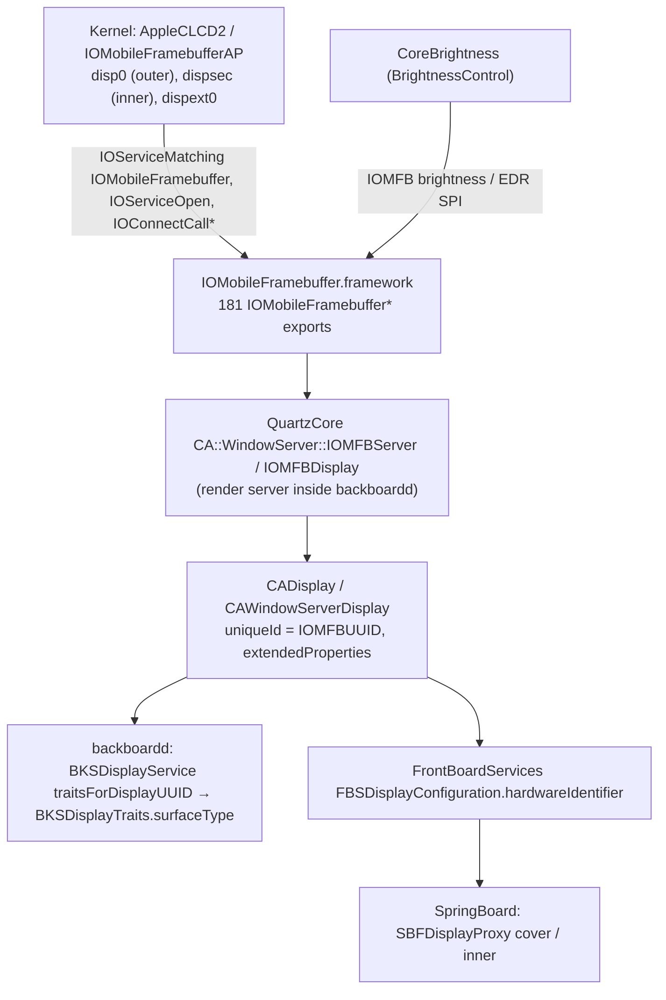
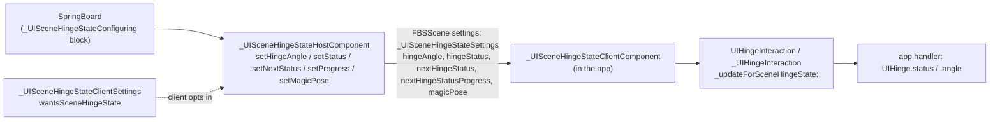

# 10: Userland for the displays, the fold and touch

Scope: the userland half of [03 GPU and displays](03-gpu-and-displays.md), the touch and fold parts of [05 Sensors, touch, buttons](05-sensors-touch-audio-haptics.md), and [08 The foldable system](08-foldable-system-and-chassis.md). Those chapters were written while the iOS 27.2 dyld shared cache was unavailable, so many of their userland claims were marked **[INF]** or came from earlier research. This chapter re-reads the cache (iOS 27.2 `24B91020`, `iPhone19,4`, 4,776 images) and replaces inference with evidence where it can.

Evidence labels follow [00-method-and-evidence.md](00-method-and-evidence.md). **[DSC]** here means one of three things:

- ObjC metadata (`ipsw dyld macho --objc`);
- C strings and symbols (`--strings`, `--symbols`, `ipsw dyld str`);
- for the hinge HID usages, disassembly of `CoreMotion` extracted from the cache (`ipsw dyld macho -x`, then `llvm-objdump`), with stub targets resolved through `ipsw dyld disass` and `ipsw dyld a2s`.

**[PUB]** in this chapter also covers the public iOS 27.2 SDK headers in the local Xcode install (`iPhoneOS27.2.sdk`, "DisplayName: iOS 27.2"). Those headers are Apple's published API contract.

Per-image reference pages: [QuartzCore](../reference/userland/System__Library__Frameworks__QuartzCore.framework__QuartzCore.md), [IOMobileFramebuffer](../reference/userland/System__Library__PrivateFrameworks__IOMobileFramebuffer.framework__IOMobileFramebuffer.md), [CoreBrightness](../reference/userland/System__Library__PrivateFrameworks__CoreBrightness.framework__CoreBrightness.md), [BackBoardServices](../reference/userland/System__Library__PrivateFrameworks__BackBoardServices.framework__BackBoardServices.md), [BackBoardHIDEventFoundation](../reference/userland/System__Library__PrivateFrameworks__BackBoardHIDEventFoundation.framework__BackBoardHIDEventFoundation.md), [BackBoardHIDTouchEventProcessor](../reference/userland/System__Library__PrivateFrameworks__BackBoardHIDTouchEventProcessor.framework__BackBoardHIDTouchEventProcessor.md), [FrontBoardServices](../reference/userland/System__Library__PrivateFrameworks__FrontBoardServices.framework__FrontBoardServices.md), [SpringBoardFoundation](../reference/userland/System__Library__PrivateFrameworks__SpringBoardFoundation.framework__SpringBoardFoundation.md), [SpringBoard](../reference/userland/System__Library__PrivateFrameworks__SpringBoard.framework__SpringBoard.md), [UIKitCore](../reference/userland/System__Library__PrivateFrameworks__UIKitCore.framework__UIKitCore.md), [CoreMotion](../reference/userland/System__Library__Frameworks__CoreMotion.framework__CoreMotion.md), [HID](../reference/userland/System__Library__PrivateFrameworks__HID.framework__HID.md), [MultitouchHID](../reference/userland/System__Library__Extensions__AppleMultitouchSPI.kext__PlugIns__MultitouchHID.plugin__MultitouchHID.md), [IOGPU](../reference/userland/System__Library__PrivateFrameworks__IOGPU.framework__IOGPU.md), [AGXMetalG19P](../reference/userland/System__Library__Extensions__AGXMetalG19P.bundle__AGXMetalG19P.md).

**Limit that applies throughout.** The daemon executables (`/usr/libexec/backboardd`, `locationd`, `SpringBoard.app/SpringBoard`) are not in the dyld cache. Their code is mostly in cached frameworks (`BackBoardHIDEventFoundation`, `CoreMotion`, `SpringBoard.framework`), so this chapter can show which framework does the work. It cannot show the executable's own entitlements or the glue `main()` adds. Entitlement strings quoted below are strings the frameworks check, not entitlement plists.

## Summary of findings

| # | Finding | Evidence |
|---|---|---|
| 1 | **The fold has a public native API.** `UIHinge` (`status`: Unknown, Closed, PartiallyOpen, FullyOpen; `angle` in **radians**) and `UIHingeInteraction` (`initWithUpdateHandler:`, `enabled`) are in the iOS 27.2 SDK, `API_AVAILABLE(ios(27.1))`. This contradicts chapter 08 ("Native public API: none confirmed"). | [PUB] SDK `UIKit.framework/Headers/UIHinge.h`, `UIHingeInteraction.h`; [DSC] UIKitCore classes |
| 2 | **CoreMotion's `CLAngleNotifier` opens two HID services: 0xFF0C/0x21 and 0x20/0xE4.** It always opens 0xFF0C/0x21. It opens 0x20/0xE4, the kernel's "Hinge Angle" personality, only when not on a VM or Simulator. `copyEvent` reads from 0x20/0xE4 on hardware. No CoreMotion HID consumer uses 0xFF0C/0x1C ("Crane"). | [DSC] disassembly of `CLAngleNotifier::openHIDDriverInterfaceIfNeeded()` and `copyEvent` |
| 3 | **The hinge event layout is now known.** Event type 0x2C. Fields: 0x2C0001 angle, 0x2C0002 mechanical angle, 0x2C0003 velocity (doubles), 0x2C0004 state (integer, < 3). A child vendor-defined event, page 0xFF0C usage 0x80, carries 21 bytes: 16 bytes, a float and a flag bit. | [DSC] disassembly of `angleDataFromAngleHIDEvent` |
| 4 | **`IOHIDEventCreateHingeAngleEvent` is an exported IOKit function, not a HID.framework one.** IOKit's symbol table lists `_IOHIDEventCreateHingeAngleEvent` as external at 0x18eea44c8, next to the other `IOHIDEventCreate*` constructors and the private `__IOHIDEventTypeDescriptorHingeAngleEvent`. HID.framework has the `HIDEvent (HIDHingeAngleEventPrivate)` accessors. Chapters 05 §4.3 and 08 §6.1 are right that it is an export, wrong about the image (corrected by [FACTCHECK-2](FACTCHECK-2.md)). | [DSC] |
| 5 | **CoreBrightness consumes the hinge angle directly.** It does this through `CBCMAngleService` (wrapping `CMAngleManager`), `CBAngleFilter`, `CBBottomPanelAngleDropPolicy` (drops ALS samples below 20°, re-weights three ALS between 20° and 70°), and an ML colour estimator `CBCE5` that refuses to run without a hinge angle. This is the userland half of the DT's `angle-dependent` ALS. | [DSC] CoreBrightness ObjC and strings |
| 6 | **QuartzCore's `fold_transparency_layer` has nothing to do with the hinge.** It is `CA::CG::ContextDelegate::pop_and_try_fold_transparency_layer`, a CoreGraphics transparency-layer optimisation. This contradicts chapter 03 §4.2. | [DSC] QuartzCore symbols |
| 7 | **`IOMobileFramebufferSetClamshellState` is exported, and QuartzCore has `CA::WindowServer::Display::set_clamshell_state(unsigned)`.** QuartzCore does not import the IOMFB function. Which process calls it was not found. | [DSC] |
| 8 | **"D76" is a SpringBoardHome screen-layout class**, not a hardware codename. `D76` and `D77` sit in the same table as `D22`…`D94`, but are the only entries without a marketing name and without a `Zoomed` variant. The cover display resolves to D76 through `SBSCurrentCoverDisplaySize`. | [DSC] SpringBoardHome strings |
| 9 | **WebKit wires the fold into the Device Posture API through `UIHingeInteraction`.** The code path is `-[WKContentView(WKInteraction) setUpHingeInteraction]` → `WebPageProxy::setDevicePostureType` → `navigator.devicePosture`. | [DSC] WebKit, WebCore symbols |
| 10 | **Touch routing per panel is per-display in backboardd.** `BKHIDDirectTouchEventProcessor` keeps a `_queue_perDisplayInfo` dictionary and resolves `_queue_displayUUIDForDigitizerService:`. It still elects one `mainDisplayDigitizerService`, plus AOP and pencil digitizers. | [DSC] BackBoardHIDTouchEventProcessor |

---

## 1. Display pipeline: IOMFB → QuartzCore → backboardd

### 1.1 Chain

### 1.2 IOMobileFramebuffer.framework **[DSC]**

- **Kernel service.** It matches the class name `IOMobileFramebuffer` with `IOServiceMatching` and opens a user client with `IOServiceOpen`. Calls go through `IOConnectCallMethod`, `…ScalarMethod` and `…StructMethod`. It also knows `AppleDisplayManager` ("Found ADM service") and pairs each framebuffer with a BrightnessControl object ("matched IOMFB (%p) to BC (%p) for embedded panel with display ID (%d)").
- **174 exported `IOMobileFramebuffer*` functions** (plus 7 private notify callbacks, 181 in all). The ones that matter for two panels:
  - `GetMainDisplay`, `GetSecondaryDisplay`, `IsMainDisplay`, `OpenByName`;
  - `GetCanvasSizes`, `SetCanvasSize`; the strings `canvas-width` / `canvas-height` (the DT property names) and `canvas_width` / `canvas_height`;
  - `SetClamshellState`;
  - `SetRenderingAngle` ("angle needs to be a multiple of 90", "kernel rejected the rendering angle trap");
  - the brightness/EDR set: `SwapSetBrightness`, `SwapSetBrightnessLimit`, `SwapSetDisplayEdr`, `SwapSetDisplayEdrHeadroom`, `SwapSetIndicatorBrightness`, `SwapSetLayerEDRCompensation`, `SetBrightnessCorrection`, `GetBrightnessControlCapabilities`;
  - `SwapSecureLayer`, `SwapSetSecureAnimation`;
  - `ProxSensingNeeded`, `APTQuantaSwitch`, and a panel-calibration TLV parser with blocks named `PDCp`, `PCS`, `EMMP`, `ALSS`, `ACSS`, `GSC`, `PTUC` ("Parser e: …").
- **The hinge angle.** No IOMFB string mentions a hinge. The angle reaches the DCP from the AOP/PTD path ([03 §4.3](03-gpu-and-displays.md)), not from userland.

### 1.3 QuartzCore (the render server in backboardd) **[DSC]**

- **Canvas.** `CA::WindowServer::IOMFBDisplay::set_physical_and_canvas_sizes()` exists as a private symbol. QuartzCore imports `IOMobileFramebufferGetCanvasSizes` but **not** `SetCanvasSize`: CA reads the canvas, and something else sets it. Related strings:
  - the overrides `CA_CANVAS_WIDTH`, `CA_CANVAS_HEIGHT`, `OverrideCanvas`, `OverrideCanvasWidth`, `OverrideCanvasHeight`;
  - `IOMFBScalingLimits`, and `Display %u Canvas Scaling Req[…] over Limit[…] DownScaleLimit[DISP:%.2f MSR:%.2f]`.

  This confirms chapter 03 §3.2's mechanism at the symbol level. The scaler stage itself is still not visible.
- **Display identity.**
  - `-[CADisplay uniqueId]` comes from the `IOMFBUUID` key.
  - `-[CADisplay extendedProperties]` exposes `DisplayExtendedProperties`.
  - `DeviceSurfaceType` is a string only QuartzCore contains. No BackBoard, FrontBoard or SpringBoard image contains it.

  So the surface type is read in QuartzCore and surfaced through `CADisplay`. The 1 = cover, 2 = inner mapping comes from vphone-duo runtime work and was not re-derived here.
- **Power and blanking.** `CAWindowServerDisplay setBlanked:`, `setBlankingRemovesPower:`, `powerStateDidChange:` and `displayStateChangedCallback`. Also the log `IOMFBDisplay::update_power_state display_id=%u … sil_power_hold=%i`. These are the hooks a "passive shield" display state would use **[INF]**.
- **Clamshell.** `CA::WindowServer::Display::set_clamshell_state(unsigned int)` exists. No ObjC method exposes it.
- **Not hinge-related.** `fold_transparency_layer` belongs to `CA::CG::ContextDelegate::pop_and_try_fold_transparency_layer` (Finding 6).
- **Flipbook / AOD.** `CA::WindowServer::FlipBook::*` and `IOMFBFlipBook::_enter/_exit/_suspend/_resume` confirm chapter 03 §3.3.

### 1.4 CoreBrightness **[DSC]**

CoreBrightness runs one display container per panel: `CBDisplayContaineriOS<%p>: ID=%lu built-in=%d service=%u containerID=%@`. It reads the device tree directly:

- the paths `IODeviceTree:/core-brightness`, `IODeviceTree:/backlight`, `IODeviceTree:/exbright` and `IODeviceTree:/arm-io/aop/iop-aop-nub`;
- "Failed to get child iterator", "Found %s : %d in core-brightness node";
- the keys `dcp-brightness-node`, `DCP`, `DCPSEC`, `plt-logic-version`, `ring-light-supported`, `sil-enabled`, `user-accessible-max-nits`, `bdm-nits1/2`, `rtplc-nits-table-ref`, `angle-dependent`, `hotspot-center-x/y`, `digitizer-location-id`, `aml-table`, `boost-enabled`.

It therefore walks `/core-brightness`'s children and binds each to the DCP or DCPSEC framebuffer. This closes chapter 03's "CoreBrightness's use of the `/core-brightness` tables" at the key level. How it chooses between `brightness-secondary` and `-doe1` was not found: the node names themselves are not strings in CoreBrightness, so the choice is by property (probably `display-id` plus a panel ID) **[INF]**. A second pass over the re-extracted cache found no `doe` string at all, only a generic `Brightness-%@` name format **[DSC]**.

**Angle-dependent ALS.** This is new, and it is the userland side of chapter 03 §3.5:

- `CBCMAngleService` (ivar `CMAngleManager _cmManager`) provides the angle, with `canPairWithALS:` and `newFiltersForALS:logCategory:`.
- `CBCMAngleEvent` wraps a `CMAngle` together with an `IOHIDServiceClient` and an `IOHIDEvent`.
- `CBAngleFilter` (`_angleThreshold`, `_currentAngle`, `_alsNode`) is a coex filter on each ALS.
- ALS selection policies: `CBTopPanelALSSelectionPolicy`, `CBBottomPanelALSSelectionPolicy`, `CBBottomPanelAngleDropPolicy`, `CBStandardALSSelectionPolicy` and `CBColorALSSelectionPolicy`.
  - "Ignore ALS with placement %d for panel with placement = %d", and the key `DisplayPanelPlacement`: each ALS has a placement, and each panel has one too.
  - "[%@] angle %f < 20 -> dropping sample"
  - "[%@] angle=%f (20-70) -> {Darwin(%f), Cairns(%f), Brisbane(%f)}"
  - "All fronts unusable -> {Brisbane}"
  - "Cairns occluded, Darwin clear -> %@"

  **Darwin, Cairns and Brisbane are three ALS channel names.** Cairns and Darwin are "fronts". Mapping them onto `als2a`, `als2b` and the third ALS is **[INF]**.
- `CBCE1`…`CBCE5` are Core ML colour estimators (`CBCE%d.mlmodelc`). `CBCE5` takes extra inputs: "CEOverride: extended input (xdxt: %@, hingeAngle: %f)" and "CBCE5: refusing inference for NaN hingeAngle". So **the ambient colour estimate on this device is a function of the hinge angle**.
- Rear ALS: `CBRearALSModule`, `AABRear`, "Rear ALS sampling policy: angle=%.1f rearActive=%d", `RearALSSamplingPolicyAngleThreshold` / `…Hysteresis`. The rear ALS is the Grimaldi sensor (`CBGrimaldiModule`; DT `grimaldi`), and it is sampled according to the hinge angle.
- EDR: `CBEDRModule`, "Not supporting LibEDR, uses CBEDR instead". QuartzCore has `IOMFBServer::register_libedr_callbacks`. Aurora (outdoor boost) keys such as `AuroraMaxNits` and `SupportCLTMAwareAurora` match the DT's "aurora" properties.
- Exclave brightness: `EXBrightUIBrightness`, `EXBrightUIBrightnessDisplayID`, `EXBrightSILStateUntrusted(DisplayID)`. CoreBrightness feeds per-display UI brightness and the secure-indicator state to the `EXBrightCore` exclave ([03 §3.3](03-gpu-and-displays.md)).
- Clamshell strings (`KeyboardBacklight clamshellClosed`, `CBColorModuleShared updateClamshellState:`) belong to the Mac-shared keyboard and colour modules. They are not evidence of a Duo clamshell path **[INF]**.

### 1.5 backboardd display services **[DSC]**

- **The traits client.** `BKSDisplayService` (`+sharedInstance`, `-traitsForDisplayUUID:`, `-setScreenBlankNotificationSuppressedDisplayUUIDs:`) returns a `BKSDisplayTraits` whose only state is `int _surfaceType`. It is protobuf- and NSSecureCoding-serialisable.
- **Server-side strings.** In BackBoardHIDEventFoundation: `com.apple.backboardd.displayTraits`, `com.apple.backboardd.disableDisplays`, `com.apple.backboardd.displayArrangement`, `com.apple.backboardd.virtualDisplay`, and "cannot connect to '%@': missing entitlement %@". These are probably the entitlement names for those services **[INF]**.
- **Other display SPI.**
  - `BKSDisplayServicesSetArrangement`;
  - `…SetCloneMirroringModeForSourceDisplayToDestinationDisplay`;
  - `BKSDisplayBrightnessSet` and its transactions;
  - `BKSDisplayArrangementItem initWithDisplayUUID:relativeToDisplayUUID:alongEdge:atOffset:`;
  - per-display `BKSHIDUISensorService serviceForDisplayUUID:`.
- **Orientation per display.** `BKDisplayOrientationController interfaceOrientationForDisplayUUID:` / `setInterfaceOrientation:forDisplayUUID:`. The cover and inner panels carry independent interface orientations.
- **No hinge.** Nothing in BackBoardServices, BackBoardHIDEventFoundation, BackBoardHIDEventProcessors or BackBoardHIDTouchEventProcessor mentions hinge, fold or angle. This agrees with chapter 08 §6.2: backboardd arbitrates displays and touch, and is not the angle consumer.

### 1.6 FrontBoard **[DSC]**

`FBSDisplayConfiguration` carries `hardwareIdentifier` (the `_initWithIdentity:hardwareIdentifier:…` initializer). `SpringBoardDisplay` logs `hardwareIdentifier`, `productName`, `physicalSize`, `nativeResolution` and the logical-scale range per display. It keeps `hardwareIdentifiersToBacklightOn`. Neither FrontBoard nor FrontBoardServices contains hinge, fold or surface-type strings. Scenes are per display, and the fold logic lives above them in SpringBoard. The claim that a fold moves a scene from one `FBSDisplayConfiguration` to the other is **[INF]**, consistent with §3.

---

## 2. The hinge angle: kernel service → CoreMotion → consumers

### 2.1 Which HID usages userland matches **[DSC, disassembly]**

All CoreMotion HID consumers build a `CLIoHidInterface` through one helper. It takes a packed `{usagePage, usage}` pair loaded from a constant pool, and builds a matching dictionary with the keys `PrimaryUsagePage` and `PrimaryUsage` (IOHIDServiceClient matching). Every caller and its pair:

| Consumer (from the nearest function-name string) | Page / usage |
|---|---|
| `CLAngleNotifier` (always) | **0xFF0C / 0x21** |
| `CLAngleNotifier` (skipped on VM/Simulator) | **0x20 / 0xE4** |
| `CLDeviceStateNotifier` (constructor; source of `CMMagicPose`) | 0xFF0C / 0x22 |
| `CLDeviceStateNotifier::openHidDevice` | 0xFF0C / 0x1D |
| `CLSPUDeviceStateInterface` (commands, `simulateDeviceStateEvent`) | 0xFF0C / 0x14 |
| `CLEclipseNotifier` | 0xFF0C / 0x14 |
| `CLSPUEclipseInterface` | 0xFF0C / 0x15 |
| `CLSPUHIDDriverInterface::sendCommand` | 0xFF0C / 0x17 |
| `CLSPUFlipInterface` (`CMFlipReport`) | 0xFF0C / 0x20 |
| `CLGestureService1` | 0xFF0C / 0x1F |
| a "Service required to send command" helper | 0xFF0C / 0x03 |
| `CMRecordedDeviceMotionArray` path | 0xFF0C / 0x16 |
| ISP sideband (`CLIspDataVisitor`) | 0xFF0C / 0x01, 0x07 |
| `CLAccelerometer`, `CLGyro`, `CLMagnetometer`, `CLCompass`, display-angle path | 0xFF00 / 0x03, 0x09, 0x0A, 0x08, 0x0E |
| `CLPressure` | 0x20 / 0x31 |
| `CLOrientationNotifier` | 0x20 / 0x8A |

**0xFF0C / 0x1C ("Crane") is not matched by any CoreMotion consumer.** The kernel's Crane personality ([05 §4.2](05-sensors-touch-audio-haptics.md)) emits vendor events `0xFF0C001C` and `0xFF000023` (its `PrimaryVendorEvents`). Who consumes those in userland was not found.

### 2.2 `CLAngleNotifier::openHIDDriverInterfaceIfNeeded()`

1. If `this+0x30` is empty, open `CLIoHidInterface(0xFF0C, 0x21)` and register an event callback on it.
2. Call two predicates. When either is true, log `[CLAngleNotifier] Skipping open for physical HID device on VM/Simulator` and stop.
3. Otherwise open `CLIoHidInterface(0x20, 0xE4)` into `this+0x20`, and register two callbacks on it.

`CLAngleNotifier::copyEvent` picks `this+0x30` (0xFF0C/0x21) when a flag at `this+0x4D` is set, otherwise `this+0x20` (0x20/0xE4). On a real Duo, therefore:

- **0x20/0xE4 (the HID Sensors-page hinge angle, matched in the kernel by "HID SensorEvent Driver - Hinge Angle") is the "physical HID device"**. It is used for event callbacks and synchronous `copyEvent`.
- **0xFF0C/0x21 is a second service that is opened unconditionally.** On the VM it is the only one. vphone-duo's virtual service used exactly this usage.

What publishes 0xFF0C/0x21 on hardware is still not shown. No kernel personality matches it, so it is probably an AppleSPU-published service whose primary usage comes from the AOP's HID descriptor **[INF]**. The `CLSPUDeviceStateInterface` log `sendCommand skipped, no physical HID driver (VM/Simulator)` follows the same physical/virtual split.

This resolves FINDINGS' "three hinge usages" row as far as userland goes:

| Usage | Role |
|---|---|
| 0x20/0xE4 | Production hinge-angle sensor service |
| 0xFF0C/0x21 | Second angle service, always opened; the only one on VM |
| 0xFF0C/0x1C | Crane / closure vendor events; not a CoreMotion input |

### 2.3 The event payload

`angleDataFromAngleHIDEvent` (resolved stubs: `IOHIDEventGetType`, `IOHIDEventGetPhase`, `IOHIDEventGetDoubleValue`, `IOHIDEventGetIntegerValue`, `IOHIDEventGetEvent`, `IOHIDEventGetVendorDefinedData`, `IOHIDEventGetTimeStampOfType`):

- It requires `type == 0x2C`.
- It reads doubles at field 0x2C0001 (angle), 0x2C0002 (mechanical angle) and 0x2C0003 (velocity). It reads integer 0x2C0004 (state) and rejects values ≥ 3.
- NaN values are replaced by defaults from a table indexed by state, and a validity flag is cleared.
- It reads the event phase.
- It looks for a child event of type 1 (vendor-defined). If that child is **page 0xFF0C, usage 0x80**, with 0x15 = 21 bytes of data, it copies 16 bytes, a float and bit 0 of byte 20.

That matches the logged fields `gestureBeganContinuousTimestamp`, `messageSentContinuousTimestamp` and `isWakeEvent` **[INF on the exact field mapping]**. So the AOP's wake-latency metadata travels as a vendor child event attached to each hinge event.

### 2.4 CoreMotion API surface **[DSC; PUB for "not public"]**

- **`CMAngleManager`**: `+isAvailable`, `+minAngleDegrees`, `+maxAngleDegrees`, `-startAngleUpdatesToQueue:handler:`, `-setAngleHandler:interval:`, `-stopAngleUpdates`, `angleUpdateInterval`, `isAngleActive`.
- **`CMAngle`**: `angleDegrees`, `mechanicalAngleDegrees`, `progress`, `velocityDegreesPerSeconds`, `state`, `eventPhase`, `angleValid`, `velocityValid`.
- **`CMMagicPoseManager`** / **`CMMagicPoseEvent`**: `deviceOrientation`, `deviceOrientation0/1`, `hingeState`, `tabletopPose`, `stableOrientationState`, `from/toHingeState`, `progressValue`. `createMagicPoseEventFromDeviceStateEvent:` shows the magic pose is derived from `CLDeviceStateNotifier`, which uses 0xFF0C/0x22 and 0x1D.
- **Not public.** `CMAngle` and `CMAngleManager` are listed in the SDK's `CoreMotion.tbd`, but no SDK header declares them. They are exported SPI, not public API. This closes chapter 05's open question.
- `CMFactoryAngleManager` / `CLFactoryAngleService` is a separate factory-calibration angle path.
- `CMDisplayAngleService` / `-[CMMotionManager setDisplayAngleHandler:interval:]` (0xFF00/0x0E) is a display-angle feed. Whether it is the hinge is **[INF]**: it uses a different usage and sits beside the gravity and display handlers, so probably not.

### 2.5 Who consumes `CMAngleManager` **[DSC]**

- **SpringBoardFoundation** `SBFDevicePoseProvider`: ivars `_cmAngleManager`, `_cmMagicPoseManager`, `BKSAccelerometer _accelerometer`, and `UIUpdateLink _heartbeat`. `SBFSyntheticCMAngle : CMAngle` and `SBFSyntheticMagicPoseEvent` produce synthetic samples for tests and replay. `SBFHingeSamples`, `SBFHingeRun`, `SBFHingeSweep` and `SBFHingeLoop` replay `/var/mobile/Library/SpringBoard/hinge-samples.csv`, driven by `SBSDisplayToolService replayHingeSamplesWithSettings:samplesPath:completionHandler:`.
- **CoreBrightness** `CBCMAngleService` (§1.4).
- **WebKit** consumes it indirectly through `UIHingeInteraction` (§4).

---

## 3. SpringBoard: pose → content mode → displays **[DSC]**

Chapter 08 §6.4–6.5 is confirmed against this cache, with these additions.

- **`SBFDisplayContentModeResolver`.**
  - It keeps `_policies`, a dedicated `_yoinkPolicy` and `_forceCoverDisplayOnlyPolicy`, `_displayProxies` and `_preferredTransitionStyle`.
  - It reacts to `poseProvider:didUpdateFromPose:toPose:`.
  - Its assertions are `acquireForceCoverDisplayOnlyEnabledAssertionWithReason:`, `acquireForcePrimaryContentAssertionForWindowScene:…` and `acquireYoinkActivationAssertionForWindowScene:…`.
- **`SBFResolvedDisplayContentMode`** keeps, per display identifier, the target mode, the resolved mode and a `swapsContentMode` flag. It also holds the prevailing policy and the full `devicePose` struct.
- **`SBFDisplayProxy`** has `surfaceType`, `external`, `appliedContentMode` and `targetContentMode`. Factories: `coverIntegratedDisplayWithIdentifier:`, `innerIntegratedDisplayWithIdentifier:`, `defaultIntegratedDisplayWithIdentifier:`, `externalDisplayWithIdentifier:`. The assertion "surfaceType == SBFSurfaceTypeInner || surfaceType == SBFSurfaceTypeCover" holds for integrated displays.
- **Content-mode vocabulary.** `.primaryContent`, `.auxiliaryContent`, `.cover`, `.inner`, `FoldingDual`, `ForceCoverDisplayEnabledOnly`, and `.passiveShield` (SpringBoard). The `[Auxiliary Content]` log family is:
  - "keeping %@ inactive for %@ (mode=… interactive=… shouldReveal=… companion=…)";
  - "turning the display on for %@ …";
  - "leaving the backlight alone on %@".
- **`SBDisplayContentModeCoordinator`** connects the pose provider, the resolver and the window scenes. Its members include `_preventBacklightActivationAssertions`, `_prewarmAssertionsBySurfaceType`, `_turnOnDisplayForWindowScene:`, `poseProvider:transitionIsLikelyFromHingeState:mechanicalAngleDegrees:velocityDegreesPerSecond:` (it pre-warms the target surface) and `attemptToYoinkToAuxiliaryContentDisplayWithReason:`.
- **Continuous fold.** `SBContinuousFoldController` has `_lastHingeAngleDegrees` and `_lastContinuousFoldPosition`, and `handleSwapTransitionFromPrimaryWindowScene:toPrimaryWindowScene:…`. The related classes are `SBContinuousFoldCoordinator`, `…SnapshotCoordinator`, `…ResizeMorph*`, `…EdgeFillView`, `…BackdropView`, and `SBButterflyContinuousFoldModifier`. "Hinge stalled at %.2f°; swap boundary %.1f° -> %.1f° for style %@, so the settle may land on the other display" shows that the swap angle depends on the transition style.
- **Other fold-aware SpringBoard classes.** `SBHingeMotionUnintendedInteractionMonitor` and `SBHingeMotionDetectionSettings` suppress touches while the hinge is moving. `SBBiometricOcclusionMonitor` uses the pose for Touch ID occlusion. `SBFoldingDualDisplayPhoneSceneSnapshotRequestStrategy`, `SBCoverDisplayCompanionScenePresenter`, `SBInnerDisplayCompanionScenePresenter` and `SBCoverDisplayConfigurationTransformer` are also present.
- **SpringBoardServices.**
  - `SBSCurrentCoverDisplaySize()`, with the published default `SBCoverDisplayCropped`: "Resolved cover display size: {%g, %g} (cropped=%u …)", tied to `EdgeSwipeBandExpansionEnabled`.
  - `SBSDisplayToolService`: `getDevicePose`, `enable/disableYoinkingFlipOverride…`, hinge replay, `targetHingePosition`.
  - `kSBSTestAutomationServiceMessageKeyDevicePoseOverride`, entitled by `com.apple.springboard.testautomation`.

  `EdgeSwipeBandExpansionEnabled` is also a property in `SensingAlgsCodexV68AP` (§5). The cover display's usable size is linked to a touch-algorithm setting.
- **D76.** SpringBoardHome's screen-type table: "Resolved screen type to D76 cover (SBSCurrentCoverDisplaySize SPI)", and Finding 8. That D77 is the inner layout is **[INF]**.

---

## 4. App-facing API

### 4.1 UIKit: public **[PUB][DSC]**

The SDK headers, quoted in part:

- `UIHinge : NSObject <NSCopying>`, with `status` (`UIHingeStatusUnknown = 0`, `Closed = 1`, `PartiallyOpen = 2`, `FullyOpen = 3`) and `angle` (`CGFloat`, "in radians").
- The header warns that update rate and granularity are "system policy", and recommends `status` over `angle`.
- `UIHingeInteraction : NSObject <UIInteraction>`, with `initWithUpdateHandler:(void(^)(UIHingeInteraction *, UIHingeInteractionUpdate *))` and `enabled`.
- `UIHingeInteractionUpdate.hinge` is nil when the view leaves a hierarchy that provides hinge updates.
- All are `API_AVAILABLE(ios(27.1), tvos(27.1), visionos(27.1))`. Swift names: `UIHinge.Status`, `UIHingeInteraction.Update`.

The implementation, from UIKitCore:

- `_UISceneHingeState` (BSXPC- and NSSecure-coded) holds `angleDegrees`, `status`, `nextStatus`, `progress`, `magicPose`, `identifier` and `sceneRegionIdentifier`. The scene carries degrees; the public `UIHinge.angle` is radians.
- `sceneRegionIdentifier`, together with `_UIHingeInteractionUpdate _hingeStates` (plural), means the SPI is built for **more than one hinge or region per scene**. The public API exposes one.
- `_UISceneHingeStateClientSettings wantsSceneHingeState` is an opt-in, so the host sends hinge updates only to scenes that asked for them **[INF]**.
- `_UIHingeInteraction` (SPI subclass) adds `_setEnabled:`, `_hingeStateAvailability` and `_hingeStates`. Users: AVKit, PaperBoardUI, CommunicationsUICore, WebKit (`UIHingeInteraction`), and Swift code (`So18UIHingeInteractionCSg`).
- Test hooks: `UIApplication setHingePoseStateForTesting:` and `hingePoseForTestIfNeeded:scene:…`, plus `_UIApplicationHingeStateWaiter`.
- `FBSScene ui_hingeState` and `ui_hingeStateClientComponent` are categories on FrontBoard scenes.

### 4.2 SwiftUI **[PUB][DSC]**

The SDK's `SwiftUI.swiftinterface` has no hinge, fold or posture API. It has only the unrelated `SpatialEventCollection.Event.InputDevicePose`. `RootHingeStateProvider` (chapter 05) is internal. A SwiftUI app uses `UIHingeInteraction` through UIKit interop **[INF]**.

### 4.3 WebKit Device Posture **[DSC]**

WebCore has `DevicePosture`, `NavigatorDevicePosture`, `JSDevicePosture`, `jsNavigator_devicePosture`, `devicePostureFeatureSchema` (the CSS media feature) and `Page::devicePostureTypeChanged`. WebKit has `WebPageProxy::setDevicePostureType`, the IPC `WebPage_SetDevicePostureType`, and the preference `DevicePostureAPIEnabled`. **The source of the posture is `-[WKContentView(WKInteraction) setUpHingeInteraction]`, a block over `UIHingeInteraction`/`UIHingeInteractionUpdate`.** Whether `DevicePostureAPIEnabled` defaults to on in Safari 27.2 is still not determined.

### 4.4 What an app sees, summarised

1. **Scene geometry.** Its scene moves between the cover and inner `UIScreen`. The canvas sizes are those in chapter 03 **[INF from SpringBoard design; not runtime-verified]**.
2. **Hinge state.** `UIHingeInteraction` gives status and angle **[PUB]**.
3. **The web.** `navigator.devicePosture` and `@media (device-posture)` **[DSC]**.

`CMAngleManager` is SPI.

---

## 5. Touch on two panels: userland **[DSC]**

- **MultitouchHID.plugin** (in `AppleMultitouchSPI.kext/PlugIns`) is the userland HID service plugin for `AppleMultitouchDevice`. It publishes `Built-In`, `DisplayIntegrated`, `LocationID`, `SurfaceDimensions` and `DigitizerSurfaceCovered`. It pushes host state down to the touch controller: "Host state - graphics orientation: %u, cover closed: %u, display off: %u, device orientation: %u", plus `setting surface orientation (mode)`. **"cover closed" and "display off" are what tell a panel's touch controller its half is folded away or dark** **[INF on Duo semantics]**. Its parser is `MTParserPath::filterContactForScreenUI` (hysteresis).
- **SensingAlgs.** `SensingAlgsCodexV68AP` contains `SASInterfaceCobalt` (outer, PS) and `SASInterfaceIndigo` (inner, SS). `SensingAlgsService` contains `SASInterfaceTouch`. These are the `SensingAlgsConfig` classes named in the `V68_Multitouch` firmware ([05 §5.2](05-sensors-touch-audio-haptics.md)). They are loaded as `BinaryFilters` by the multitouch HID plugin, so they run in the process that hosts the HID event system (backboardd) **[INF]**. Codex properties include `EdgeSwipeBandExpansionEnabled`, `DFIsCaseOnToggle` and `cmfs-calibration` (the FDR `CMFS` class).
- **MultitouchSupport.framework** matches `AppleMultitouchDevice` and `AppleMultitouchSPI`, plus legacy USB and dummy drivers. It reads `Sensor Surface Width/Height`.
- **backboardd** (`BackBoardHIDTouchEventProcessor`):
  - `BKHIDDirectTouchEventProcessor` has `+digitizerMatchingDictionaries`, `_queue_perDisplayInfo` (`BKDirectTouchPerDisplayInfo`), `_queue_displayUUIDForDigitizerService:`, `_queue_enumerateDigitizersForDisplay:`, `cancelTouchesOnDisplay:`, `cancelAndSuppressTouchesOnDisplay:reason:`, `setHitTestRegions:forDisplay:` and `setInterfaceOrientation:forDisplayUUID:`.
  - It still elects one `mainDisplayDigitizerService`: "*** acquired main display digitizer (after %gs)", "*** lost main display digitizer ***".
  - Logs: "ignoring digitizer event for display %@ from unsupported service" and "digitizer:%llX - display:%@".
  - `BKIOHIDService` carries `_displayUUID`, `_builtIn`, `_primaryUsagePage/_primaryUsage`, `_authenticated` and `_transport`. `-[BKIOHIDService initForSimulatorWithDisplayUUID:]` exists.
  - `BKCADisplayMonitor displayUUIDIsActive:` tracks which display is active: "Display is inactive %@ because: size is (%g,%g)".

  A touch on the panel whose display is inactive (the passive shield) can therefore be dropped per display **[INF]**.
- **Not found.** The key from which `displayUUID` is filled. Neither the kernel nor any of these images contains `service-display` or a `DisplayUUID` property name as a string. The only display key the kernel shares is `DisplayIntegrated`. The resolution probably happens in backboardd's executable or by registry walk **[INF]**, so chapter 05 §9.1 step 5 remains **[INF]** at the "how" level. That it is per-display is confirmed.

---

## 6. Metal / AGX user side **[DSC][KC]**

- The kernel personality `AGXG19P` (`AGXAcceleratorG19P`, IONameMatch `gpu,t8160`) publishes `MetalPluginName = "AGXMetalG19P"`, `IOGLESBundleName = "AppleMetalGLRenderer"` and `IOMatchCategory = IOAcceleratorES` **[KC]**.
- Metal.framework reads `MetalPluginName` and `IOAcceleratorES`, and loads the bundle from `/System/Library/Extensions` **[DSC]**. This is the binding from silicon to driver bundle.
- `IOGPU.framework` opens the accelerator (`IOServiceOpen`, "Failed to create an IOGPUDevice… IOServiceOpen returned …") and maps `IOGPUDeviceShmem`.
- `AGXMetalG19P` calls `IOConnectCallStructMethod` and `IOConnectCallAsyncScalarMethod` itself. `-[AGXG19FamilyDevice initWithAcceleratorPort:simultaneousInstances:]` takes the port.
- The class inventory in [03 §1.5](03-gpu-and-displays.md) stands. No display-, hinge- or canvas-specific code was found in the GPU user driver. Frame pacing per display is QuartzCore's job (`AGX vsync hints will track display %u …`).

---

## 7. Gaps from chapters 03, 05 and 08: closed or not

| Chapter gap | Status |
|---|---|
| 03 §9: full backboardd/FrontBoard display arbitration code | **Partly closed.** Classes, SPI and services in §1.5–1.6 and §3. The policy itself is in SpringBoard(Foundation), not backboardd. The executables are not in the cache. |
| 03 §9: CoreBrightness's use of `/core-brightness` | **Mostly closed** (§1.4): it walks the node and its keys and binds DCP/DCPSEC. The doe1-versus-secondary choice is not found. |
| 03 §9 / 05 / 08: which public UIKit API surfaces the hinge | **Closed:** `UIHinge` / `UIHingeInteraction`, iOS 27.1+ (§4.1). |
| 03 §9: the 2007 × 2853 canvas scaler not seen in code | **Partly:** `set_physical_and_canvas_sizes`, `GetCanvasSizes`, `IOMFBScalingLimits` and the canvas override env vars are confirmed. The scaler programming is not visible (kernel/DCP side). |
| 03 §4.2: `fold_transparency_layer` as a fold-transition layer | **Refuted** (Finding 6). |
| 05 Gaps: which framework exports which hinge symbol | **Closed:** CoreMotion (`CLAngleNotifier`, `CMAngleManager`), IOKit (type descriptor), HID.framework (`HIDEvent` hinge category), UIKitCore (`UIHinge*`, `_UISceneHingeState*`). `IOHIDEventCreateHingeAngleEvent` is exported by IOKit. |
| 05: whether `CMAngleManager` is public | **Closed:** SPI; in the `.tbd`, no header. |
| 05 / 08: hinge HID usage 0x21 vs 0x1C vs 0xE4 | **Closed for userland** (§2.1–2.2). The publisher of 0xFF0C/0x21 on hardware is still open. |
| 05: backboardd → UIKit touch routing code | **Partly:** per-display processor and services (§5). How the displayUUID is sourced is still open. |
| 05: which process hosts SensingAlgs | **Partly:** loaded by MultitouchHID.plugin as binary filters, so the HID event-system host **[INF]**. |
| 08 §9: native public API unproven | **Closed** (§4.1). |
| 08 §9: image attribution of [DSC] class names by prefix | **Closed** for every class cited here: each was read from the named image. |
| 08 §7: "D76" meaning | **Closed** as a SpringBoardHome screen-layout class (Finding 8). |
| 08 §9: DCP use of the angle | **Not closed.** No userland path sends the angle to IOMFB. It is firmware and kernel ([03 §4.3](03-gpu-and-displays.md)). |
| WebKit posture default | **Not closed.** |

## 8. Contradictions with earlier chapters

- [08 §6.6](08-foldable-system-and-chassis.md): "Native public API: none confirmed … only underscored or SPI names were found." **Wrong**: `UIHinge` and `UIHingeInteraction` are public in the iOS 27.2 SDK.
- [03 §4.2](03-gpu-and-displays.md): "QuartzCore has a `fold_transparency_layer` string … suggests a compositor-level layer for the fold transition [INF]." **Wrong**: it is a CoreGraphics transparency-layer fold.
- [05 §4.3](05-sensors-touch-audio-haptics.md) and [08 §6.1](08-foldable-system-and-chassis.md): "HID.framework exports `IOHIDEventCreateHingeAngleEvent(...)`". **Owner corrected**: the export is in IOKit, not HID.framework.
- [05 §4.3](05-sensors-touch-audio-haptics.md), [03 §4.1](03-gpu-and-displays.md) diagram, and [08 §8](08-foldable-system-and-chassis.md) (0xFF0C/0x21 as *the* angle usage). **Incomplete.** On hardware CoreMotion also opens 0x20/0xE4 and prefers it for `copyEvent`. 0xFF0C/0x21 is the one that remains on a VM.
- [08 §6.1](08-foldable-system-and-chassis.md) diagram: "IOHIDEventDriver 'Apple Crane Driver' … → locationd". **Not supported**: no CoreMotion consumer matches 0xFF0C/0x1C.
- [08 §7](08-foldable-system-and-chassis.md): "D76 is a related codename: a cover-display class shared with another product, or the Duo's own cover-display program name [INF]". **Refined**: it is a SpringBoardHome screen-type key with no product name attached.
