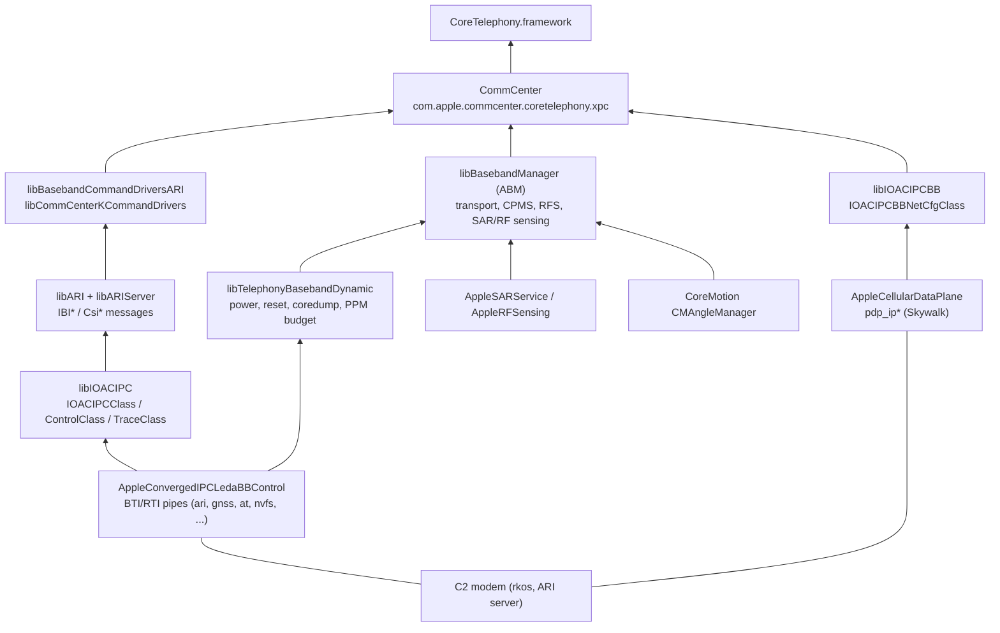
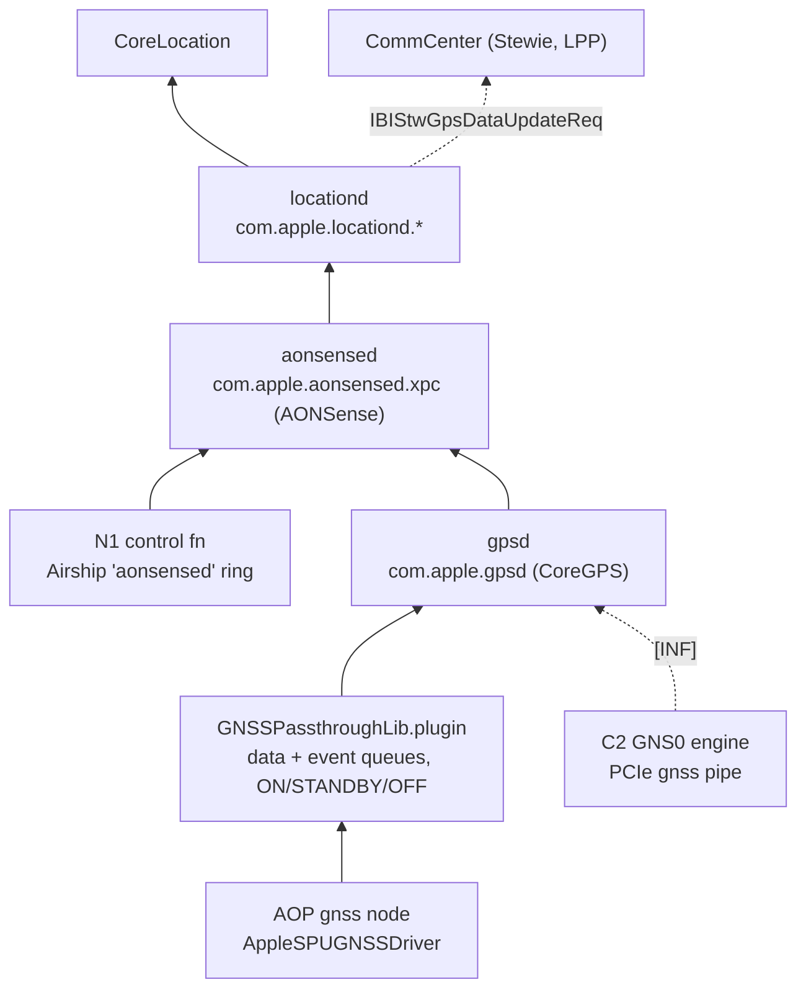
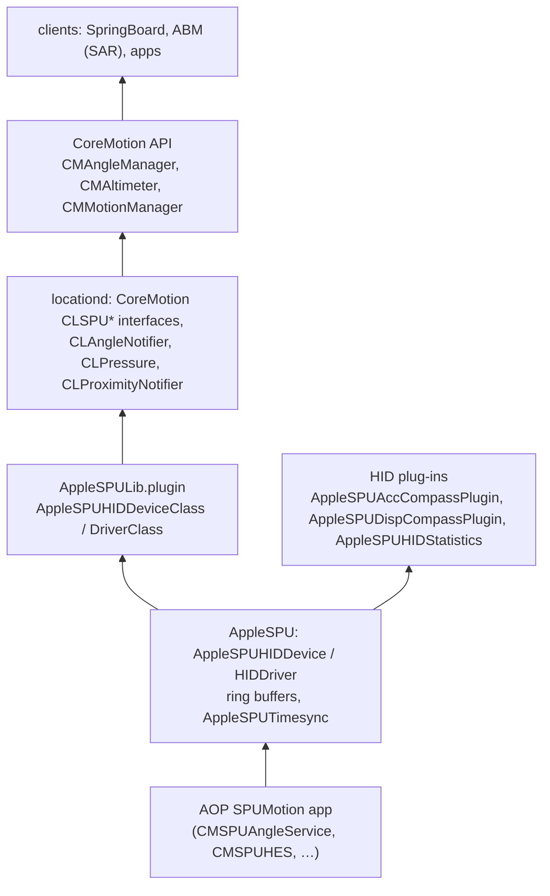

# 11: Userland for radios, power and sensors

This chapter fills in the userland layer that chapters [05](05-sensors-touch-audio-haptics.md), [06](06-power-battery-thermal.md) and [07](07-networking-and-connectivity.md) had to leave thin. Those chapters were written while the iOS 27.2 dyld shared cache (DSC) was unavailable. The cache is back, and the restore ramdisk now has its own catalogue in [`reference/ramdisk/`](../reference/ramdisk/README.md). This chapter follows each subsystem upward: from the kernel driver's user client or IOKit service, through the private libraries and the daemon that owns it, to the framework and API an app calls. It ends with a ledger of every gap listed in the three chapters, and says which ones are now closed.

Device: iPhone Duo (`iPhone19,4`, board V68AP, t8160), iOS 27.2 build 24B91020.

Evidence labels are the ones used in the rest of the map: **[DSC]** dyld shared cache, **[KC]** kernelcache, **[DT]** device tree, **[FW]** firmware image, **[PUB]** public source, **[INF]** inference. Facts read from the restore ramdisk (141-29011-104.dmg) are tagged **[RD]**. The ramdisk is part of the IPSW, but it is not one of the sources listed in [chapter 00](00-method-and-evidence.md), so it gets its own tag.

---

## 0. How this was read, and what it can't show

**Method.** All strings, ObjC metadata and symbols were read from the cache with `ipsw`:

```bash
ipsw dyld info -l  <dsc>                       # image list (4,776 images)
ipsw dyld macho    <dsc> <image> --strings     # C strings of one image
ipsw dyld macho    <dsc> <image> --objc        # ObjC classes, methods, ivars
ipsw dyld macho    <dsc> <image> -n            # symbol table
ipsw dyld str      <dsc> "<s1>" "<s2>" ...     # which image holds a string
```

DriverKit extensions and their frameworks were read from the generated ramdisk pages (`reference/ramdisk/System__Library__DriverExtensions__*`, `System__DriverKit__System__Library__PrivateFrameworks__*`).

**The limit that remains.** iOS daemons are standalone executables on the system volume. They are **not** in the dyld shared cache, and the system volume was not extracted. So `CommCenter`, `wifid`, `bluetoothd`, `nearbyd`, `nfcd`, `locationd`, `powerd`, `thermalmonitord` and the rest cannot be disassembled here. What the cache *does* hold is:

- every framework and dylib those daemons link;
- the client side of every daemon: the frameworks an app or another daemon uses to reach it. Those carry the daemon's **Mach/XPC service name**.

A daemon is named in this chapter when a client library in the cache connects to a Mach service with that daemon's name. That is labelled **[DSC]** for the service name. Saying that a particular executable registers that service is still **[INF]**, unless the name itself is the executable's (for example `com.apple.gpsd`).

---

## 1. Summary

| Subsystem | Kernel side the userland opens | Userland library (in DSC unless marked) | Daemon (Mach service, from client library) | App-facing API |
|---|---|---|---|---|
| Cellular C2 control | `AppleBaseband`, `AppleConvergedIPCLedaBBControl` (also `AppleBasebandPCIControl`, `AppleConvergedIPCICEBBControl` for other modems) | `libTelephonyBasebandDynamic`, `libIOACIPC`, `libARI`, `libARIServer`, `libBasebandCommandDriversARI`, `libBasebandManager` | CommCenter (`com.apple.commcenter.coretelephony.xpc`, `com.apple.commcenter.xpc`) | CoreTelephony (`CTTelephonyNetworkInfo`) |
| Cellular data plane | `AppleCellularDataPlane` (`kACDPNetCfgUserClientOpen`) | `libIOACIPCBB` (`IOACIPCBBNetCfgClass`) | CommCenter **[INF]** | Network.framework |
| eSIM (Vinyl eUICC) | none: via the modem's ARI channel | `libVinylNonUpdater`, `libVinylUpdater`, `CellularPlanManager` | `com.apple.CellularPlanDaemon.xpc` | CoreTelephony cellular plan APIs |
| Satellite (Stewie) | none: via ARI (`IBIStw*`) | `libARI`, CoreTelephony `CTStewie*` | CommCenter (no separate Stewie daemon name found) | none public; Messages / Find My / Emergency SOS |
| SAR / RF sensing (fold-aware) | `AppleSARService` user client (`AppleRFSensing`) | `libBasebandManager` (`StateABDelegateObserverImpl`) + CoreMotion `CMAngleManager` | AppleBasebandManager, hosted by CommCenter **[INF]** | none |
| Wi-Fi (N1 alpha) | `AppleCentauriAlpha.dext`: `AppleWLANDriver`, six `IOUserNetworkWLAN` interfaces, `IO80211APIUserClient` **[RD]** | `IO80211`, `CoreWiFi`, `MobileWiFi`, `WiFiPolicy`, `WiFiKit`, `WiFiPeerToPeer` | `com.apple.wifi.manager` (wifid), `com.apple.wifip2pd` | `NEHotspot*`, `WiFiAware`, Network.framework |
| N1 boot and power | `AppleCentauriManager` (kext) + `AppleCentauriControl.dext` (`CentauriControlUserClient`, `AirshipCentauriHelperBootUserClient`) **[RD]** | `CentauriController`, `CentauriBooter`, `Centauri`, `AirshipCentauriHelper` | `com.apple.centaurid.xpc` (centaurid) | none |
| Bluetooth (N1 beta) | `AppleCentauriBeta.dext` (HCI/ACL/SCO/LE/LE-audio rings) **[RD]** | `MobileBluetooth`, `BluetoothManager`, `CoreBluetooth` | `com.apple.server.bluetooth.*.xpc`, `com.apple.BTServer`, `com.apple.bluetoothuser.xpc` | CoreBluetooth |
| Thread | through the BT function **[INF]** | `CoreThreadRadio`, `CoreThread` | `com.apple.wpantund.xpc`, `com.threadradiod.ctr` | ThreadNetwork |
| UWB (Rose) | `AppleSPURose` via `RoseControllerLib.plugin` **[RD]** | `libRoseBooter`, `libRoseUpdater`, `NearbyInteraction` | `com.apple.nearbyd.xpc.nearbyinteraction` | `NISession` |
| NFC ×2 | `AppleStockholmControl` + `AppleHammerfestControl` user clients, kernel-control socket `com.apple.stockholm` | `libNFC_HAL`, `libNFC_Comet` (NXP `phLibNfc` stack) | `com.apple.nfcd.service.corenfc`, `com.apple.seserviced` | CoreNFC, PassKit |
| GNSS | `AppleSPUGNSSDriver` via `GNSSPassthroughLib.plugin`; modem `gnss` pipe | `CoreGPS`, `AONSense`, `LocationSupport` | `com.apple.gpsd`, `com.apple.aonsensed.xpc`, `com.apple.locationd.*` | CoreLocation |
| Network stack | Skywalk nexus/channels (`os_channel_*` in `libsystem_kernel`) | `Network.framework` (absorbs libnetcore), `libsystem_dnssd` | mDNSResponder (`/var/run/mDNSResponder`, `com.apple.mDNSResponder`) | Network.framework, NSURLSession |
| Push + AOP2 ULPN | AOP2 Tightbeam endpoint `com.apple.aop2.ulpn.aluminium` | `ApplePushService`, `ULPNHeuristicsClientFramework`, `SymptomLinkAdvisoryAOPShim` | `com.apple.apsd` | PushKit, UserNotifications |
| Power / battery | `AppleSmartBattery` (IOPS), powerd XPC | `IOKit` (IOPMLib/IOPS), `BatteryCenter`, `PowerUI`, `LowPowerMode` | `com.apple.iokit.powerdxpc`, `com.apple.powerd.lowpowermode` | `UIDevice.batteryLevel`, `ProcessInfo.isLowPowerModeEnabled` |
| Motion, hinge, baro, ALS, prox | `AppleSPU` HID services (`AppleSPUHIDDeviceClass`, ring buffers, timesync) | `AppleSPULib.plugin`, `CoreMotion` (`CLSPU*`), compass HID plug-ins | locationd (`com.apple.locationd.Motion`) | CoreMotion (`CMAltimeter`, `CMMotionManager`) |

The most useful new results:

1. **The cellular stack watches the hinge.** `libBasebandManager` subscribes to CoreMotion's `CMAngleManager`, sorts the hinge angle into three **"Osiris" states** with min/max angle thresholds, and drives an antenna **tuner "State A/B"**. It hands both to the kernel's `AppleSARService` / `AppleRFSensing`, whose own telemetry buckets the angle at 0°, 45°, 57°, 92°, 135°, 177°, 180° and 183° [DSC][KC]. §2.6.
2. **The N1 DriverKit drivers are in the evidence after all,** in the restore ramdisk. They give the N1's three PCI device IDs, the six Wi-Fi interfaces with their roles (`Infrastructure`, `AirLink`=AWDL, `LowLatency`, `SoftAP`, `WiFi-Aware Discovery`, `WiFi-Aware Data`), Skywalk queue sizes, MSI counts, and the transport rings of every function: Bluetooth runs `hci`, `acl`, `sco`, `le` and `lea` rings to the N1 [RD]. §3.
3. **The second NFC controller has its own kernel personalities** (`AppleHammerfestControl`, `AppleHammerfestSPMI`), and the NFC HAL drives a primary and a "Secondary NFCC" context through the NXP `phLibNfc` stack [DSC][KC]. §6.
4. **Satellite messaging is an ARI message family.** `libARI` carries 123 `IBIStw*` (Stewie) messages, including `IBIStwV2GpsDataUpdateReq` and `IBIStwFuzzedLocation`. CoreTelephony exposes it to system clients as `CTStewieDataClient` and about 30 `CTStewie*` message classes (emergency, roadside, Find My, iMessage Lite, satellite SMS) [DSC]. §2.4.
5. **Push keep-alive offload to AOP2 is visible from userland** (`DeviceSupportsAOP2`, "Forcing device to offload to AOP." in ApplePushService; "Keep Alive Handled by ULPN APSD" in the ULPN heuristics framework; Tightbeam endpoint `com.apple.aop2.ulpn.aluminium.ap.client`) [DSC]. §9.
6. **Wi-Fi 7 multi-link operation has userland support** (`CWFMLOLink`, `currentMloLinks`, `hasColocatedMLD`, `isEHT`, `hasAssocToWiFi7`) [DSC]. The firmware gave no such strings. §3.6.

---

## 2. Cellular: C2 modem, eSIM and satellite

Kernel background: [chapter 07 §3.3](07-networking-and-connectivity.md#33-how-the-ap-talks-to-the-modem-pcie--converged-ipc); kext pages [`AppleConvergedIPCBBControl`](../reference/kexts/com.apple.driver.AppleConvergedIPCBBControl.md), [`AppleSARService`](../reference/kexts/com.apple.driver.AppleSARService.md).

### 2.1 The chain



### 2.2 Libraries that touch the kernel

| Library | What it opens | Evidence |
|---|---|---|
| `/usr/lib/libTelephonyBasebandDynamic.dylib` | Matches **`AppleBaseband`**, **`AppleConvergedIPCLedaBBControl`**, `AppleBasebandPCIControl` and `AppleConvergedIPCICEBBControl`. Exports `TelephonyBasebandControllerResetModem`, `…ResetSPMI`, `…SetBasebandState`, `…SetModemCoredumpGPIO`, `…GetCoredumpReadyStatus`, `…GetPPMBudget`, `…SetPPMReportConfig`, `…EnableModemUSBEnumerationWithAP`, `…IsBootStageDownABP`, `…PollGPIO`. Logs "received baseband alive message", "received PCIAER message", "received coredump ready message", and PMU trace points `kTelephonyBasebandPMUTrace_S2R_TO_SOC_PRE/POST`, `…VCXO_TO_SOC_POST`. | [DSC] strings |
| `/usr/lib/libIOACIPC.dylib` | Converged-IPC client classes `IOACIPCClass`, `IOACIPCControlClass` and `IOACIPCTraceClass` (`IOAppleConvergedIPCTraceBackendRaw`). Methods: `open`, `sendImage(Async)`, `mapMemory(Async)`, `updateMemory`, `notifyMemory`, `abortTransferRing(Async)`, `collectSnapshotAsync`, `readLogsAsync`, `generateNonce`, `getCompletionRingInfo`, `enable/disableKernelTraceBuffers`. It reads `AppleConvergedIPCTransferRingProperties` and `…CompletionRingProperties`. About 60 `kACIPC*` error codes name the link's failure modes: `kACIPCLinkDown`, `kACIPCAERFatalError`, `kACIPCDARTError`, `kACIPCDeviceWakeTimeout`, `kACIPCLinkBWNotification`, `kACIPCLinkStateSoftDown/HardDown/ManualDown/UnpoweredUp`. | [DSC] strings; also in ramdisk [RD] |
| `/usr/lib/libIOACIPCBB.dylib` | `IOACIPCBBNetCfgClass` opens **`AppleCellularDataPlane`** (`kACDPNetCfgUserClientOpen`). It reads a `sim-context` property per service, so there is one data plane per SIM context; it calls `addNetIf` (logged with `id`, `prioUL`, `rss`) and handles **filter-rule offload requests** from the kernel ("AppleCellularDataPlane Offloading Request Received, rule-id"). | [DSC] strings; also [RD] |
| `/usr/lib/ACIPCBTLib.dylib` | `ACIPCBTClass` / `ACIPCBTControlClass`, which wait up to 90 s for an `AppleConvergedIPCControl` service and use `ACIPCInterfaceProtocol` with `bootstage`, timesync, quiesce and `kACIPCWLANTriggeredResetForDebug`. **[INF]** This is the converged-IPC transport for a Bluetooth part on another platform. On the Duo, Bluetooth goes through the Centauri beta dext instead (§4). The kernelcache's only converged-IPC control personalities are the baseband ones (`AppleConvergedIPCBBControl`, `…LedaBBControl`, `…ICEBBControl`) [KC]. | [DSC] |

### 2.3 ARI and the command-driver layer

- **`libARI.dylib`** (9,469 strings) is the ARI message dictionary. Message families by string count [DSC]:

  | Family | Count | Meaning **[INF from names]** |
  |---|---|---|
  | `IBICall*` | 329 | call control, PS data calls |
  | `IBINet*` | 304 | registration, bands, cell info |
  | `IBISim*` | 233 | SIM / UICC |
  | `CsiIce*` | 159 | modem system services (`CsiIceSecActivationTicketSetRespCb`) |
  | **`IBIStw*`** | **123** | **Stewie satellite** (§2.4) |
  | **`IBIVinyl*`** | **74** | **eUICC** (§2.5) |
  | `IBIMs*`, `IBILp*` | 72, 42 | measurements and location protocol (`IBILpGpsAcquisitionElement`, `IBIMsLpGpsAlmanacIndCb`) |
  | `CsiIdc*` | 46 | in-device coexistence |
  | `IBIIms*`, `IBIEmbms*`, `IBISms*`, `IBISs*` | 44, 32, 27, 29 | IMS, broadcast, SMS, supplementary services |
  | `IBIFiler*` | 18 | the modem's file service |

- **`libARIServer.dylib`** is the AP-side ARI endpoint ([DSC], 531 strings).
- **Command-driver factories.** `libBasebandCommandDrivers.dylib` holds `ARICommandDriverFactory`, `QMICommandDriverFactory` and `MipcCommandDriverFactory` [DSC]. CommCenter's flavours split the same way:
  - `libCommCenterKCommandDrivers` is the **ARI** flavour: 184 `IBI*` strings, `AriACK`, `IBICallPsStartDataCallReq`, `IBIVinylPartialActiveProfileOpRspCb`.
  - `libCommCenterMCommandDrivers` is the **QMI** (Qualcomm) flavour: `QMIContext`, `QMIDriver`, `qmiOnline`.
  - Chapter 07 listed both libraries without decoding the letters. K is ARI and M is QMI; MIPC is a third, separate factory with no CommCenter flavour of its own in the cache [DSC].
- The eUICC updater names three modem families as "valves": `eUICCVinylDALValve`, `eUICCVinylMAVValve` and a KTL path that says "opening ARI channel". ABM also names `MobileAsset.DALBasebandAssets`, `INTBasebandAssets` and `MAVBasebandAssets`, and logs `MAV_AP_WAKE_QMAP_FLOW_CONTROL` [DSC]. **[INF]** MAV is the Qualcomm/QMI family. The Duo's C2 speaks ARI, because the C2 firmware's own strings are ARI ([chapter 07 §3.3](07-networking-and-connectivity.md#33-how-the-ap-talks-to-the-modem-pcie--converged-ipc)).

### 2.4 Satellite: Stewie

- **Transport [DSC].** `libARI` has a full Stewie message family: `IBIStwV2ActivateReq`, `IBIStwV2SendFileReq`, `IBIStwV2SuspendRspCb`, `IBIStwV2ResumeReq`, `IBIStwGetCapabilityReq`, `IBIStwInitiateRegistrationReq`, `IBIStwGetServiceInfoReq`, `IBIStwServiceOutageInfo`, `IBIStwQueryFringeCellConditionRspCb`, `IBIStwSecurityParam`, `IBIStwIQConfigReq`, `IBIStwMmcDumpConfigReq`, **`IBIStwGpsDataUpdateReq` / `IBIStwV2GpsDataUpdateRspCb`** and **`IBIStwFuzzedLocation`**, plus `stw_provisioning_status`. This closes chapter 07's [INF] that satellite traffic reaches the AP over the same ARI/PCIe link: it does, as ARI messages on the `ari` pipe.
- **The AP feeds the modem its position** for satellite pointing and messaging (`IBIStwGpsDataUpdateReq`) [DSC]. **[INF]** GNSS for Stewie is therefore computed outside the satellite stack (by gpsd/locationd) and pushed back to the modem.
- **CommCenter side [DSC].** `libCommCenterBase` has `isStewieActive`, `kStewieMode`, `kStewie_Mode` and `kBootedInStewieMode`. CoreTelephony has `CTStewieDataClient`, `CTStewieStateMonitor`, `CTStewieState`, `CTStewieSupport`, `CTStewieDeviceOrientationData` (`targetLocked`, `isDeviceStationary`), and message classes `CTStewieEmergencyStartMessage`, `CTStewieEmergencyTextMessage`, `CTStewieRoadsideStartMessage`, `CTStewieFindMyMessage`, `CTStewieIMessageLite*`, `CTStewieSatSms*`, `CTStewieOffGridModeMessage`, `CTStewieCompressionRequest`, `CTSatelliteMessagingProvisioning`.
- **Power and SAR [DSC][KC].** ABM logs "%s stewie SAR wait time (%u sec)", `kStewieTransmission`, `kStewieTransmissionLowBattery`, "Stewie Emergency Policy" / "Stewie Non-Emergency Policy", and "Initial TX state from ARBuffer: cell_on=%u, stewie_on=%u". The kernel's HSAR metric line includes `Stewie_on` ([`AppleSARService`](../reference/kexts/com.apple.driver.AppleSARService.md)).
- **Daemon.** A byte search of the whole cache for `stewied` and `com.apple.stewie` found nothing; `StewieClient` appears only in CoreTelephony [DSC]. **[INF]** No separate satellite daemon exists: Stewie runs inside CommCenter and is reached through CoreTelephony's XPC service.

### 2.5 eSIM (Vinyl eUICC)

- `libVinylNonUpdater.dylib` (on the ramdisk too [RD]) carries the eUICC restore and identity path. It logs "Initializing KTL options struct, opening ARI channel", includes `ARI/ari_sdk_msg.h`, and handles `EUICCChipID`, `eUICCPublicKey`, `euiccCertificate`, `euiccSignature`, `euiccSignedLPAData`, `FirmwareLoaderVersion`, `VinylForceGold`, `OptimizeRefurbFirmwareUpdatePath` and "Bootstrap profile ICCID found on eUICC" [DSC]. **This confirms chapter 07's [INF]** that the eUICC has no AP-side driver and is reached only through the modem's ARI channel (the `IBIVinyl*` family: `IBIVinylSecureAkaReq`, `IBIVinylLPASigningReq`, `IBIVinylTapeCmd`, `IBIVinylPartialActiveMetaDataReq`).
- `libVinylUpdater.dylib` (updater) and `CellularPlanManager.framework` (client of `com.apple.CellularPlanDaemon.xpc`, plus `com.apple.CommCenter.CellularPlanProvisioning`) are the update and LPA layers [DSC].
- CoreTelephony's eSIM requests include `CTXPCConvertPhysicalToeSIMRequest`, `CTXPCEmbeddedSIMHealthRequest`, `CTXPCTraveleSIMCheckRequest` and `CTXPCSupportsDynamicSIMConfigurationRequest` [DSC].

### 2.6 Fold-aware antenna tuning and SAR (new)

`libBasebandManager.dylib` is AppleBasebandManager (ABM). Its source paths are `AppleBasebandServices_Manager-1594/…/Server/{ABMServer, Transport/TransportModule, CPMS/CPMSModule, RFS/FSModule, Stats}` [DSC]. It is the user-space policy engine for the modem's RF exposure and antenna state, and it is fold-aware:

- **Hinge input [DSC].** ObjC ivars `CMAngleManager fAngleManager`, `fCMAngleHandler`, `fAngleIsAvailable`. Logs: "Received hinge angle: %f", "Hinge angle: %.1f", "Failed to create Angle Manager!", "CMAngle is not available in this device!", "Received invalid angle, fall back to query device state".
- **Osiris states [DSC].** `StateABDelegateObserverImpl` has `get/setOsirisState{1,2,3}{Min,Max}Threshold` and ivars `fOsirisState1ThresholdMin` … `fOsirisState3ThresholdMax`. The log reads "Osiris thresholds - State 1: %.1f-%.1f°, State 2: %.1f-%.1f°, State 3: %.1f-%.1f°, Tuner threshold: %.2f". Keys: `kOsirisState`, `kOsirisOverrideFlag`, `kState{1,2,3}OsirisThreshold{Min,Max}`, `kHingeAngleValue`.
- **Tuner State A/B [DSC].** "State A/B for Tuner: %s", "Updated Tuner threshold to %.2f°", "Sending SAR Selection: 0x%x, Tuner State: 0x%x", "Failed to set tuner AB state".
- **To the kernel [DSC][KC].** ABM sends RF-sensing subcommands `kRFSensingSubCommandQueryHingeAngle` and `kRFSensingSubCommandQueryOsirisState`, and "SensingCAInfo: angle=%.1f (bucket %u), fdDist=%u, pitch=%u, roll=%u, facing=%u, case=%s". The kernel side is `AppleSARServiceUserClient::extSARSelectionTunerState`, `updateStateABTunerGated`, `stateABOsiris_block_invoke`, and an analytics flush whose angle buckets are `neg/0/45/57/92/135/177/180/183`, with `angle_57_duration_s`, `angle_92_duration_s`, `angle_135_duration_s` and `angle_180_duration_s` counters [KC].
- **Other SAR inputs [DSC].** Hand grip, speaker, accessory (`SAR Fusion: Accessory`), a list of MagSafe accessory classes (`AppleMagSafeTextileFolio2026`, `AppleMagSafeSiliconCase2025`, `AppleMagSafeBatteryPack2025`, …), "Device Material Values are as Bottom Enclosure / Top Enclosure / FCM Type / BCM Type", antenna-on-top state, VSWR mode, and Wi-Fi coex through `com.apple.WirelessCoexManager`.

**What this means [INF].** On a foldable phone the antennas' surroundings change with the fold: the two halves shadow each other, and the other half's metal comes within millimetres when the phone is closed. The modem's userland therefore maps the hinge angle to one of three "Osiris" states, and that state chooses the antenna tuner setting (A or B) and the SAR table. The kernel buckets mirror the physical poses: closed (≈0°), tent and laptop (45° to 135°), and open flat (≈180°). "Osiris" is an internal codename; it is not expanded anywhere in the evidence.

### 2.7 Daemon and API

- **Mach services [DSC].** `com.apple.commcenter.coretelephony.xpc`, `com.apple.commcenter.xpc`, `com.apple.CTServerConnection`, `com.apple.CommCenter.CellularPlanProvisioning`, plus notifications `com.apple.commcenter.SimStatus.changed` and `…Plmn.changed` (CoreTelephony). ABM uses `com.apple.AppleBasebandManager`, `…NetworkPolicy`, and power assertions `com.apple.AppleBasebandManager.RadioNotReady.Bootup` / `.Shutdown`.
- **Hosting [INF].** `AppleBasebandManager.framework` has entry points `AppleBasebandManagerInitServer`, `…StartServer`, `…StopServer` and `…ShutdownServer`, loaded with "Failed on loading AppleBasebandManagerInitServer". So ABM is a server module loaded into a host process, most likely CommCenter. `libBasebandSharedServices` is only a small `Registry`/`Factory` object exposing `getRouterServer`, `getABMRestServer` and `getCommandDriverFactory` [DSC symbols].
- **Public API [PUB].** CoreTelephony `CTTelephonyNetworkInfo`, `CTCellularPlanProvisioning`; data through Network.framework.

---

## 3. Wi-Fi and the N1 control function

Kernel background: [chapter 07 §5](07-networking-and-connectivity.md#5-wi-fi-bluetooth-and-thread-apple-n1); kext [`AppleCentauriManager`](../reference/kexts/com.apple.driver.AppleCentauriManager.md).

### 3.1 The three DriverKit extensions [RD]

All three are in the restore ramdisk under `/System/Library/DriverExtensions/`. Each is built for `driverkit.iphoneos27.2.internal`, runs as its own sandboxed process (`IOUserServerOneProcess`), and links its own DriverKit framework plus `AirshipCentauriHelperServices` and `CentauriDebug`.

| Dext | `IOPCIMatch` | MSIs | Main `IOUserClass` | User clients | Weak-linked implementation |
|---|---|---|---|---|---|
| [`AppleCentauriControl`](../reference/ramdisk/System__Library__DriverExtensions__AppleCentauriControl.dext__Info.plist.md) | `0x1901106b 0x1900106b` | 3 | `CentauriControl`, `CentauriControlRemoteInterface` (publish entitlement `com.apple.driver.centauri.publish`), `CentauriControlSystemEvents`, `CoProcBinaryLogger` | `CentauriControlUserClient`, `AirshipCentauriHelperBootUserClient`, `…InterfaceUserClient`, `…MemregionUserClient`, `…TimesyncUserClient` | `CoProcBinaryLogger.framework` |
| [`AppleCentauriAlpha`](../reference/ramdisk/System__Library__DriverExtensions__AppleCentauriAlpha.dext__Info.plist.md) | `0x1902106b` | 10 | `CentauriAlpha` → `AirshipDriverDK` (`AirshipDriverDKAlpha`) → **`AppleWLANDriver`** (`Chipset: proxima`, `Vendor: Centauri`) | `CentauriAlphaUserClient`, `AppleWLANCLIUserClient`, `AppleWLANVendorUserClient`, `AppleWLANWDUserClient`, `IO80211APIUserClient` (per interface) | **`AppleWLANPrime.framework`** (not on the ramdisk) |
| [`AppleCentauriBeta`](../reference/ramdisk/System__Library__DriverExtensions__AppleCentauriBeta.dext__Info.plist.md) | `0x1903106b 0x1181106b` | 2 | `CentauriBeta` → `AirshipDriverDK` (`AirshipDriverDKBeta`) | `CentauriBetaUserClient` | **`MobileBluetoothDK.framework`** (not on the ramdisk) |

- **PCI identity [RD].** The N1's functions have **separate PCI device IDs**: 0x1900/0x1901 (control), 0x1902 (Wi-Fi), 0x1903 (Bluetooth). The kernel's `AppleCentauriManager` also matches 0x1900 [KC]. The second Beta ID, 0x1181, is **[INF]** another chip's Bluetooth function sharing the driver.
- **Entitlements [RD].** All three have `com.apple.developer.driverkit.transport.pci` **and `…transport.afk`** (AppleFirmwareKit), `com.apple.private.driverkit.driver-launch-configuration`, and per-dext panic coredump names (`cent-ctrl`, `cent-alpha`, `cent-beta`). Alpha alone has `com.apple.private.wifi.driverkit`.
- **Power [RD].** Every PCI personality sets `IOPMSystemOffPhase2Allow = True`, and user clients carry `IOPMAOTAllow` (128 Alpha, 256 Beta, 384 Control). **[INF]** These are bitmasks that let each user client stay usable in IOPM's "AOT" low-power state; the expansion of AOT is not in the evidence. The per-function masks differ, so the power manager can keep, say, Bluetooth reachable while Wi-Fi is not. The N1's separate LPEM firmware ([chapter 06 §6](06-power-battery-thermal.md#6-applelpm-lpem-and-power-reserve)) points the same way.
- **Logging [RD].** Each dext has CoreCapture pipes: `CentauriAlphaFwLogs` (90 × 10 MB, `hfevents`), `CentauriBetaFwLogs`, and `CentauriCoexLogs` from the control function (`coexlogger` resource).

**This closes the chapter 07 gap** "DriverKit dexts are not in the evidence": their IOClass names, queue counts and interface set are now known. The actual 802.11 and HCI code lives in `AppleWLANPrime` and `MobileBluetoothDK`, which are not on the ramdisk. Those remain unread.

### 3.2 The Wi-Fi interfaces [RD]

`AppleWLANDriver` publishes six Skywalk network interfaces, each an `IOUserNetworkWLAN` (provider `IOSkywalkFamily`) with its own `IO80211APIUserClient`:

| Personality | `IOUserClass` | Role | Unit | BSD name **[INF]** |
|---|---|---|---|---|
| `Interface_IO80211InfraInterface` | `AppleWLANInterfaceSTA` | `Infrastructure` (`IOPMAOTAllow 128`) | — | `en0` |
| `Interface_IO80211AwdlInterface` | `AppleWLANInterfaceAWDL` | `AirLink` | 0 | `awdl0` |
| ↳ `Interface_IO80211AWDLLLWInterface` | `AppleWLANLowLatencyInterface` | `LowLatency` | 0 | `llw0` |
| `Interface_IO80211HotspotInterface` | `AppleWLANInterfaceHotspot` | `SoftAP` | 1 | `ap1` |
| `Interface_IO80211NANInterface` | `AppleWLANInterfaceNAN` | `WiFi-Aware Discovery` | 0 | `nan0` |
| ↳ `Interface_IO80211NANDataInterface` / `NANLLWInterface` | `AppleWLANInterfaceNANData`, `AppleWLANLowLatencyInterface` | `WiFi-Aware Data`, `LowLatency` | 0 / 1 | `nan*`, `llw1` |

Skywalk sizing [RD]: `SkywalkPoolProperties` `PoolSize 4096`, `packetBufferSize 4096`, one packet per buffer; `SkywalkQueueProperties` RX submission/completion 1,024 each, **TX submission 1,536, TX completion 4,096**. A `ReporterProxy` (`IO80211ReporterProxy`) publishes IOReporting counters.

**This confirms chapter 07 §5.5's [INF]** that the hotspot is an `ap1` soft-AP on the alpha function, and adds that the low-latency `llw` interface is a child of AWDL (and of NAN).

### 3.3 Airship transport rings [RD]

`AirshipDK.framework` describes each function's shared-memory IPC in `t2026-Centauri{Control,Alpha,Beta}.plist` (`chipset t2026`). The `resource` names are the logical channels:

| Function | Resources (rings) |
|---|---|
| Control | `boot`, `cchi` (the "CCHI stage" boot channel), `SystemEvents`, **`aonsensed`**, `coexlogger`, `binlogger`, `loopback`, `dbg` |
| Alpha (Wi-Fi) | `command`, `events`, `management`, `data-tx`, `data-rx`, **`data-rx-llw`**, `eapol`, `monitor`, `debug`, `region-debug` (doorbells `ringdb-control`, `ringdb-data-tx`, `ringdb-data-rx`) |
| Beta (BT) | **`hci`, `acl`, `sco`, `le`, `lea`**, `lmp`, `lla`, `tsi`, `debug` (16 doorbells) |

Two of these matter beyond Wi-Fi:

- **`aonsensed` on the control function.** **[INF]** The always-on location daemon (§7.2) gets Wi-Fi and BT scan results straight from the N1's control processor.
- **`data-rx-llw`.** AWDL low-latency traffic has its own receive ring.

### 3.4 User side

- **N1 bring-up.** `CentauriController.framework` (DSC and ramdisk) wraps the Control dext's user client. Its methods are `getChipState`, `getChipPower`, `getResetHint` ("only beta can set reset hint"), `setMemSwapRegions` and `mapSecondaryMemory` ("only control can …"), `getCrashlogs`, `collectLogs` and `setHardwareHealth`, with boot timestamps `openROMStart/End`, `openCCHIStart`, `openSecondStageStart/End` and `memswapHandOffEnd`. `CentauriBooter` sends the firmware ([chapter 07 §5.4](07-networking-and-connectivity.md#54-boot-and-drivers)) [DSC].
- **centaurid.** `Centauri.framework` is the client of **`com.apple.centaurid.xpc`**: `CENRebootIntoLowPowerMode(Async)`, `CENGetPowerStats`, `CENGetPMUFaultInfo`, `CENGetSiKPublicKey`, `CENSendHelloCommand`, `CENSendRawCommand`, `CENSendShellCommand`, `CENCollectLogs`, and a **power-table voting** protocol (`CENCheckForNewPowerTables`, `CENCastPowerTableVote`, `CENSetPowerTableEvaluationReadiness`; sessions on `com.apple.centaurid.PowerTableEvaluation` with states `RequestingReadiness`, `RequestingVotes`, `Accepted`, `Rejected`; voters `WiFi` and `BT`) [DSC]. **[INF]** New regulatory power tables (`P055`–`P079` in the ftab) arrive as assets, and the Wi-Fi and BT stacks vote on when to apply them.
- **Wi-Fi frameworks [DSC].**
  - `IO80211.framework` exports `Apple80211BindToInterface(WithParams/WithService/WithIOCTL)` and the `IO80211Interface*` property keys, including `IO80211InterfaceDualPowerCellularTxStarted`, `…DualPowerCallInProgress` and `…DualPowerCellularTxShort` (a cellular TX coex input). It still names the Broadcom class `AppleBCMWLANCore`, which is unused here.
  - `MobileWiFi` and `WiFiKit` connect to **`com.apple.wifi.manager`** (wifid). `WiFiPolicy` uses `com.apple.wifid` and `com.apple.wifipolicy.*`. `WiFiPeerToPeer` connects to **`com.apple.wifip2pd`**. CoreWiFi uses `com.apple.corewifi.xpcproxy`.
- **Public API [PUB].** `NEHotspotConfiguration`, `NEHotspotNetwork`, `WiFiAware`, Network.framework.

### 3.5 AWDL and mDNS

`WiFiPeerToPeer.framework` carries `AWDLServiceDiscoveryConfiguration`, `AWDLTrafficRegistrationConfiguration` and `AWDLState.*` keys (`channelSequenceKey`, `peerMasterChannelKey`, `supportsSoloModeKey`, …) [DSC]. mDNSResponder is reached through `libsystem_dnssd` over the UNIX socket `/var/run/mDNSResponder` (`DNSSD_UDS_PATH`), with Mach services `com.apple.mDNSResponder` and `com.apple.mDNSResponder_Helper` (`libmdns`) [DSC].

### 3.6 Wi-Fi 7

`CoreWiFi` has `CWFMLOLink` and `mLOLinks`, and the usage monitor in `WiFiPolicy` has `WiFiUsageLQMMLOSample`, `currentMloLinks`, `currentMloLinksCount`, `currentMloPreferredBand`, `isMLOPreferredLink`, `mloTrafficSwitchEnabled`, `hasColocatedMLD`, `hasEHT`, `isEHT` and `hasAssocToWiFi7`, plus "colocatedMLD_2G / _5G / _6G" [DSC]. This is generic iOS code, not proof of the N1's PHY capabilities. It does show that **multi-link (MLO) association with per-link statistics and a preferred band** is a userland concept on iOS 27.2. The 320 MHz and 4096-QAM claims still rest on [PUB].

---

## 4. Bluetooth and Thread

### 4.1 Bluetooth

- **Kernel/driver.** `AppleCentauriBeta.dext` [RD] (§3.1). Its Airship rings `hci`, `acl`, `sco`, `le`, `lea` and `lmp` show that the **HCI transport is shared memory over PCIe**, not UART. The DT has no BT UART node, which agrees ([chapter 07 §5.6](07-networking-and-connectivity.md#56-bluetooth-and-thread)). **[INF]** `lea` is LE Audio (isochronous) traffic, matching `/product bluetooth-lea2 = 1` [DT]. The HCI handling code is in the weak-linked `MobileBluetoothDK` DriverKit framework, which is not on the ramdisk.
- **Daemon.** CoreBluetooth connects to `com.apple.server.bluetooth.le.att.xpc`, `…le.pipe.xpc`, `…general.xpc`, `…classic.xpc` and `com.apple.bluetoothuser.xpc`. BluetoothManager uses `com.apple.BTServer` and `com.apple.BTServer.le` [DSC]. These are bluetoothd's services **[INF: the executable name]**. `MobileBluetooth` has `BTLocalDeviceReadTransportSwitchStatistics` and HCI-trace control over XPC [DSC].
- **API.** CoreBluetooth [PUB].

### 4.2 Thread

- **Userland [DSC].** `CoreThreadRadio.framework` connects to **`com.apple.wpantund.xpc`** and uses the `com.threadradiod.ctr` channel, with a family of `com.apple.private.fillmore.*` entitlements (`threadStart`, `commissionOrFormNetwork`, `attachToNetwork`, `masterkey.get/set`, `pskc.get/set`, `channel.set`, `startFWUpdate`, `provideEmac`). "Fillmore" is the DT node `/fillmore` (`fillmore,bt`, EUI-64 from `syscfg/TMac`). MobileGestalt has `ThreadRadioCapability`, `ThreadRadioMacAddress` and `ThreadRadioMacAddress64Bit`.
- **Transport [INF].** The Beta dext's rings have no separate 802.15.4 or Spinel channel. The OpenThread RCP inside the BT core ([chapter 07 §5.6](07-networking-and-connectivity.md#56-bluetooth-and-thread)) is therefore reached as vendor traffic on the BT function's rings (most likely `hci`), with threadradiod/wpantund on the host side.
- **API.** ThreadNetwork (`THClient`) [PUB].

---

## 5. UWB: Rose

- **Kernel side [RD][KC].** `AppleSPURose.kext` carries an IOKit CFPlugIn, `RoseControllerLib.plugin` (factory `RoseControllerLibFactory`), on the ramdisk. That is the user-space access library for `AppleSPURoseDriver` behind the AOP ([chapter 07 §6](07-networking-and-connectivity.md#6-uwb-rose-r2p1-second-generation-ultra-wideband)).
- **Booter [DSC][RD].** `libRoseBooter.dylib` loads `/usr/standalone/firmware/Rose/<rev>/ftab.bin` for revisions `r1p0`, `r1p1`, `r1p2`, `r1p3` and `r2p1`, adds an `rrko` object to the final ftab, and reads `RoseServiceState`, `RosePowerState`, `RoseControllerState` and `RoseIOReport` from the `RoseService`. It reports "RoseBooter FF Status" and the `RoseUpdater` version.
- **Daemon [DSC].** NearbyInteraction connects to **`com.apple.nearbyd.xpc.nearbyinteraction`** and `…observer`.
- **API [DSC][PUB].** `NISession`; ranging results include `horizontalAngle`, `horizontalAngleAccuracy`, `antennaMask`, `remoteTxAntennaMask` and `rxAntennaPacket1/2`, and an error `DeviceAngleNotSupported`. No fold or hinge term appears in NearbyInteraction or NearbySessions [DSC]. **[INF]** Whether UWB angle-of-arrival is adjusted for the fold is not visible in userland; if it is, it happens in nearbyd or in Rose/AOP firmware.

---

## 6. NFC: Stockholm and Hammerfest

- **Kernel personalities [KC].** The kext page lists four personalities: `AppleStockholmControl` (`nfc,primary,gpio`), `AppleStockholmSPMI` (`nfc,primary,spmi`), **`AppleHammerfestControl`** (`nfc,secondary,gpio`, class `AppleStockholmControl`, user client `AppleStockholmControlUserClient`) and **`AppleHammerfestSPMI`** (`nfc,secondary,spmi`). Kernel strings include `com.apple.spmi.nfc.hammerfest`, `_configureHammerfestSPMIGated` and "Hammerfest SPMI cannot be configured via itself" ([kext page](../reference/kexts/com.apple.driver.AppleStockholmControl.md)).
- **HAL [DSC].** `libNFC_HAL.dylib` names all four of those classes and drives them:
  - **Control path:** a kernel-control socket named **`com.apple.stockholm`** (`SYSPROTO_CONTROL`) with socket options `IO_STOCKHOLM_ON_DEMAND_CLIENT`, `IO_STOCKHOLM_CRC`, `IO_STOCKHOLM_SPMIERRORS` and `IO_STOCKHOLM_SPMI_CLEAR_ERRORS`, plus a `stockholm-spmi-data-socket` property and a legacy `/dev/tty.stockholm` UART path.
  - **Secondary controller:** `NFHardwareGPIOConfigureHammerfestSPMI`, "Setting Hammerfest SPMI config...", "Validating Hammerfest SPMI config...". The secondary chip's SPMI link is configured through the primary.
  - **Transport-layer calls:** `_phTmlNfc_ConfigureSPMI`, `_phTmlNfc_FollowerReset`, `_phTmlNfc_SEBootMeasurements`, `_phTmlNfc_NFCCBootMeasurements`, `_phTmlNfc_SetPMUStandbyEnabled`, `_phTmlNfc_SetDeviceWake`.
- **Stack [DSC].** `libNFC_Comet.dylib` is the NXP `phLibNfc` / `phNciNfc` NCI stack (`PHLIBNFC_*`, `PHNCINFC`, `PHTMLNFC`, antenna self-test). It logs **"####Secondary NFCC, DriverHandle"** and "####Secondary NFCC, LIBNFC context", so nfcd runs a second NCI context for Hammerfest. This **strengthens chapter 07's [INF] that the controllers are NXP SN-series parts**: the userland stack is NXP's.
- **Daemons [DSC].** CoreNFC connects to `com.apple.nfcd.service.corenfc`. SEService uses `com.apple.seserviced` and its sub-services. Notifications `com.apple.stockholm.express.state` and `com.apple.stockholm.express.keys.uwb.changed` link Express Mode to UWB keys.
- **Not shown.** Which controller nfcd uses for reader mode versus card emulation, and when it switches with the fold, is not in the strings. The two-antenna-per-half reading stays **[INF]**.

---

## 7. GNSS and location

### 7.1 Chain



### 7.2 What the userland shows

- **`GNSSPassthroughLib.plugin`** (inside `AppleSPU.kext`) is an IOKit CFPlugIn that maps a data queue and an event queue from `AppleSPUGNSSDriver` and sets a power state of `ON`, `STANDBY` or `OFF` [DSC] ([page](../reference/userland/System__Library__Extensions__AppleSPU.kext__PlugIns__GNSSPassthroughLib.plugin__GNSSPassthroughLib.md)).
- **gpsd [DSC].** `CoreGPS.framework` (`CoreGPSDevice`, Swift `GPSXPC`) connects to **`com.apple.gpsd`**, with `com.apple.coregps` as its subsystem.
- **aonsensed [DSC].** `AONSense.framework` connects to **`com.apple.aonsensed.xpc`**. It is the always-on location service: `CLP.LogEntry.AONLoc.*`, `ALFWiFiScanResultsRequester`, `ALFBtAdvResultsRequester`, `ALKappaConfigRequester`, and protobufs `Proto_Gpsd_Request`, `Proto_Gpsd_Indication`, `Proto_Gpsd_LtlInfo`, `Proto_Gnss_Fix` and `Proto_Gnss_Emergency_Init`. Together with the `aonsensed` ring on the N1 control function (§3.3), **[INF]** aonsensed sits between gpsd, the N1's scan engines and locationd, and can produce fixes without the full Wi-Fi stack.
- **locationd [DSC].** CoreLocation/LocationSupport use `com.apple.locationd.Core`, `.Motion`, `.Position`, `.Support`, `.Utility`, `.registration`, `.synchronous` and `com.apple.locationd.gnssbands`.
- **Bands [DSC].** `AONSense`, `CoreLocation` and `CoreMotion` enumerate `BAND_GPS_QZSS_L1CA`, `L1C`, `L2C`, `L5`, `BAND_GALILEO_E1`, `E5a`, `BAND_BEIDOU_B1i`, `B1c`, `B2a`, `BAND_GLONASS_L1F`, `BAND_NAVIC_L5` and `BAND_SBAS_L1`, plus `CLIENT_SATELLITE_CONSTELLATION_{GLONASS, GALILEO, BEIDOU, QZSS, NAVIC}`. This is the iOS-wide band list. It does not prove that this device's GNS0 engine receives every band.
- **Modem location protocol [DSC].** `libARI` has the `IBILp*` / `IBIMsLp*` families (`IBI_LP_POSITION_METHOD_GNSS`, `IBILpDgpsStatus`, `IBIMsLpGpsAlmanacIndCb`) for network-assisted positioning, and Stewie's `IBIStwGpsDataUpdateReq` (§2.4).

**Gap status.** Chapter 07 left open how the C2 `GNS0` path relates to the AOP's GNSS code. The userland shows the **AOP/SPU path** (`GNSSPassthroughLib` → gpsd) explicitly, and gives no user-space client of the modem's PCIe `gnss` pipe. The cache has no string tying gpsd to `libIOACIPC`. **[INF]** Either gpsd reaches the C2 GNSS engine through the AOP relay (consistent with the AOP2 `gnss-aop-rx/tx` endpoints), or the kernel bridges the pipe. **Partly closed.**

---

## 8. Network.framework, libnetcore and Skywalk

- **libnetcore is gone as a separate image.** The 4,776-image list has no `libnetcore`. Its code lives in `Network.framework`, which carries the `NETCORE_STATS_TCP_REPORT_REASON_*` enums [DSC].
- **Skywalk user side [DSC].** `Network.framework` creates **user-space channels to a flowswitch nexus**: `nw_channel_create_with_nexus_flow`, "Received nexus assignment, bringing up channel for %@", "Failed to create channel for flow id … nexus instance … port %u", `nexusAgent`, `nexusInstance`, `nexusPort`. The syscall wrappers `os_channel_create(_extended)`, `os_channel_attr_*`, `os_channel_advance_slot`, `os_channel_buflet_alloc` and `os_channel_configure_interface_advisory` are exported by `libsystem_kernel.dylib`. **This replaces chapter 07 §10.2's "[INF/PUB]" on user-space TCP over Skywalk channels with [DSC]:** a Network.framework flow gets a nexus assignment from NECP, opens an `os_channel` on the flowswitch port, and runs the protocol stack in-process.
- **Path to the drivers.** The flowswitch sits in front of either `pdp_ip*` (cellular, `AppleCellularDataPlane` in-kernel netif) or `en0`/`awdl0`/`llw0`/`ap1`/`nan*` (the Alpha dext's `IOUserNetworkWLAN` netifs, §3.2) [KC][RD].
- **Link advisories.** `IO80211` exposes `…DualPowerCellularTx*` keys, `os_channel_configure_interface_advisory` gives flows link advisories [DSC], and `SymptomLinkAdvisory` / `SymptomLinkAdvisoryAOPShim` publish link quality (§9).

---

## 9. apsd and the AOP2 push offload (ULPN)

Firmware and kernel background: [chapter 07 §9](07-networking-and-connectivity.md#9-aop2-networking-offload-ulpn-a-finding), [chapter 05 §2.3](05-sensors-touch-audio-haptics.md#23-aop2-the-second-always-on-processor).

- **apsd [DSC].** `ApplePushService.framework` connects to `com.apple.apsd` and contains the offload switches **`DeviceSupportsAOP2`**, **`AOPOffloading`**, `APSForceAOP` ("Forcing device to offload to AOP."), `ForceKeepAliveV1` and `keepAliveInterval`.
- **ULPN decision logic [DSC].** `ULPNHeuristicsClientFramework` decides when a push connection may move to AOP2. Its strings include "Connection Offload to ULPN", "Keep Alive Handled by ULPN APSD", "Keep Alive Handled by APSD", "ULPN data path regression", `OffloadHeuristicsEnabled`, `OffloadFailureCountThreshold`, `OffloadBackOffDurationSeconds`, and failure reasons `TxQueueDelayExceeded`, `RxPktDropExceeded`, `IPv4/IPv6FragmentationFailure`, `NetifCompletionFailure`, `netifBufferTimeout` and "PSK exhaustion detected for interface %s".
- **AOP2 endpoint [DSC].** `SymptomLinkAdvisoryAOPShim.framework` is built from `RTKitNet_AP_Libraries`. It speaks **Tightbeam** over an `AFKEndpointInterface` to `com.apple.aop2.ulpn.aluminium` / `com.apple.aop2.ulpn.aluminium.ap.client` (`fwd`/`rev`), behind entitlement `com.apple.symptoms.linkAdvisory.ULPN`. Its `ALUminium` service has `Enable`, `ReportSnapshot` and `GetTelemetry`, and the AP pushes **battery percentage (0–100) and thermal pressure level (0–5)** to AOP2 with each snapshot.

**This closes chapter 07's [INF]** that apsd's TLS connection can be offloaded to AOP2: the user-space switch, the heuristics and the AP↔AOP2 control endpoint are all present [DSC]. The packet path (`ulpn.xnu`, `tbfeth`) stays [FW][KC] as in chapter 07.

---

## 10. Power, battery and thermal

Kernel background: [chapter 06 §3.4](06-power-battery-thermal.md#34-kernel-side-kc) and [§10](06-power-battery-thermal.md#10-userland); kexts [`AppleSmartBatteryManagerEmbedded`](../reference/kexts/com.apple.driver.AppleSmartBatteryManagerEmbedded.md), [`AppleT8160CLPC`](../reference/kexts/com.apple.driver.AppleT8160CLPC.md), [`AppleiPhoneACSKPPM`](../reference/kexts/com.apple.driver.AppleiPhoneACSKPPM.md).

### 10.1 powerd and IOPMLib [DSC]

- **IOKit.framework** (IOPMLib and IOPowerSources) connects to **`com.apple.iokit.powerdxpc`**. It also uses `com.apple.PowerManagement.control`, the notifications `com.apple.system.powersources.percent` and `com.apple.system.accpowersources.timeremaining`, `IOPMConnection` ("Created IOPMConnection with id 0x%x"), `IOPMAssertionCreate`, and `IOPSPrivateBatteryHealthState`. It names the kernel classes **`AppleSmartBattery`** and **`AppleSmartBatteryManager`**, and its charge-limit keys are `chargeSocLimitSoc`, `chargeSocLimitReason`, `chargeSocLimitDrain`, `chargeSocLimitIsEOC`, `chargeSocLimitNoChargeToFull`, `chargeSocLimitToken` and `chargeSocLimitAction`.
- **Low Power Mode.** `LowPowerMode.framework` talks only to powerd: `com.apple.powerd.lowpowermode`, `com.apple.powerd.smartpowernap`, `com.apple.powerd.coresmartpowernap`, with reconnect handling ("Powerd has restarted"). **[INF]** powerd owns the LPM bit and pushes it down; the CLPC `pkg-lpm-power-target` is applied in the kernel, and no user-space image names it.
- **PowerExperience / PowerUI.** `com.apple.powerexperienced.powermitigationsmanager.service` (powerexperienced), and PowerUI's smart-charging and charge-limit state (`chargeLimitTargetSoC`, `MCLSavedTargetSoC`, "Device reached target SoC at %@") [DSC].
- **Public API [PUB].** `UIDevice.batteryLevel` / `batteryState`, `ProcessInfo.isLowPowerModeEnabled`, `ProcessInfo.thermalState`.

### 10.2 Two packs, one percentage

What the userland shows [DSC]:

1. **BatteryCenter** (`BCBatteryDeviceController`, `_BCPowerSourceController`, `BCBatteryDevice`) builds **one `BCBatteryDevice` per IOPS power source**, keyed by `kIOPSPowerSourceIDKey` ("Missing kIOPSPowerSourceIDKey in %@"). It reads `Current Capacity`, and each device has one `percentCharge`, plus `isInternal`, `powerSourceState` and a `parts` list (used for multi-part accessories such as earbuds).
2. **IOKit's IOPS code** knows the keys **`BatteryPacks`** and **`PackID`**. So the internal power source dictionary can carry a per-pack array.
3. **MobileGestalt** names `AppleSmartBatteryPack` (§12).
4. **Powerlog** already models multiple packs (`-[PLBatteryAgent setBatteryPackCount:]`, chapter 06 §10).

**[INF] How the merge works.** The kernel's `AppleSmartBattery` publishes one aggregate `CurrentCapacity` / `uiSOC` for both packs (chapter 06 §3.4). powerd turns it into a single internal IOPS power source, and BatteryCenter and the status bar render that one source's `Current Capacity`. The two packs are never separate battery devices in the UI. Per-pack detail rides along as `BatteryPacks` / `PackID` for diagnostics (Settings → Battery Health, Powerlog), not for the percentage. No userland code was found that averages two percentages, which fits the merge being done below the API.

**Who reads the dual-pack keys.** A byte search of the whole cache for the kernel's dual-pack property names [DSC]:

| String | Images that contain it |
|---|---|
| `RebalanceData` (and event `com.apple.battery.RebalanceData`, `PLBatteryAgent_EventBackward_RebalanceData`) | `PowerlogCore`, `PowerlogLiteOperators`, `PowerlogHelperdOperators` |
| `OPDDualChargerState`, `IPDRatioOverride` | the same three Powerlog images |
| `IPDRatio` (exact) | only as part of `IPDRatioOverride` |
| `BatteryPackCount` | the three Powerlog images (`-[PLBatteryAgent setBatteryPackCount:]`) |
| `BatteryPacks` | **IOKit** and the Powerlog operators |

**This closes chapter 06's open question** of which framework consumes `RebalanceData` / `IPDRatio`: in the shared cache, only **Powerlog** does, as telemetry. No battery UI framework (BatteryCenter, BatteryKit, PowerUI) and no MobileGestalt or SpringBoard image contains these names. So the rebalance and dual-charger state is logged, not shown. The only dual-pack key a non-Powerlog framework knows is IOKit's `BatteryPacks` (with `PackID`), which comes through the IOPS power-source dictionary. powerd is not in the cache and may read more keys.

### 10.3 Battery intelligence and thermal

- **batteryintelligenced [DSC].** `BatteryIntelligence.framework` connects to `com.apple.batteryintelligenced.thermalprediction` and `com.apple.batteryintelligence.thermalprediction(client)`. Its outputs are `BIThermalPredictionOutput` ("willHitTLC=%d, confidence=%.2f"; **[INF]** TLC = thermal-limited charging, chapter 06's `TimeChargingThermallyLimited`), `ChargeTimeEstimatorOutput` (`estimate`, `endSOC`, `confidenceScore`) and `BatteryAnalysisOutput`. So it predicts when charging will become thermally limited, and estimates time to full.
- **thermalmonitord.** No thermal framework exists in the cache's image list; the daemon is a standalone executable. Its path **`/usr/libexec/thermalmonitord`** and the identifier `com.apple.thermalmonitord` are in the cache: CoreFoundation holds the identifier, and the path sits in a shared string pool that the byte search attributes to `libobjc` [DSC]. This upgrades chapter 06's "owning image not resolved" to a known executable path. `com.apple.peakpowermanagerd` is named in CoreFoundation and **ComputeSafeguards** [DSC]. The AP pushes its **thermal pressure level (0–5)** to AOP2 for ULPN decisions (§9) [DSC].
- **CLPC user side.** No image in the cache is named for CLPC. The closest user-space frameworks are `CPMS.framework` (userland side of the peak-power manager; [INF] the client of `peakpowermanagerd`), `RunningBoard` and `Recount` (per-thread-group CPU accounting) [DSC image list]. **[INF]** CLPC is steered from user space indirectly, through work intervals and thread groups (RunningBoard) and powerd's LPM state, not by a dedicated CLPC framework.

### 10.4 Modem power

`libTelephonyBasebandDynamic` exposes `TelephonyBasebandControllerGetPPMBudget` / `…SetPPMReportConfig` ("get peak power budget and thermal budget") [DSC], and ABM has a `CPMSModule` ("User space cpms kernel client module not supported") [DSC]. These connect the modem to the kernel's PPM/CPMS budgets in [chapter 06 §8.2](06-power-battery-thermal.md#82-ppm--cpms). Stewie transmissions have their own low-battery policy (`kStewieTransmissionLowBattery`) [DSC].

---

## 11. Sensors: motion, hinge, barometer, ALS, prox

Kernel and firmware background: [chapter 05 §2–4](05-sensors-touch-audio-haptics.md#2-the-always-on-complex-aop-aop2-smc-aon-ptd). The `CMSPU*` service names (`CMSPUAngleService`, `CMSPUHES`, `CMSPUMedinaStateService`) live in **AOP firmware**. Their AP-side counterparts are the `CLSPU*` interfaces in CoreMotion.

### 11.1 Chain



### 11.2 SPU access library [DSC]

`AppleSPULib.plugin` (inside `AppleSPU.kext`; [page](../reference/userland/System__Library__Extensions__AppleSPU.kext__PlugIns__AppleSPULib.plugin__AppleSPULib.md)) is the user-space side of every AOP sensor. Its classes are `AppleSPUHIDDeviceClass` and `AppleSPUHIDDriverClass`, with `SetAggregateDictionaryCallback`. It reads `AppleSPUTimesync` (`timesync`, `alignRef`, `slaveAlignment`, `calendar`, with clocks named `ap` and `spu`) so it can convert AOP timestamps to AP time. It walks a shared ring (`iop_ringbuffer.h`, `_spiDataContext`, `_historical_addr`/`_historical_size`) to fetch batched history. The source path is `Sources/AppleSPUKext/AppleSPULib/AppleSPULib.cpp`.

HID plug-ins [DSC]:

- **`AppleSPUAccCompassPlugin`** watches for verified magnetic accessories and turns AOP compass compensation on or off ("Accessory Compass Compensation enabled", "Unexpected Second Accessory Verified"). **[INF]** This is how a MagSafe case or wallet's magnet is subtracted from the compass.
- **`AppleSPUDispCompassPlugin`** sets the compass power mode from display state: it watches `com.apple.springboard.hasBlankedScreen` ("Forced compass power mode %d").
- `AppleSPUHIDStatistics` collects HID event statistics.

### 11.3 CoreMotion services in locationd [DSC]

- **Service.** CoreMotion clients connect to `com.apple.locationd.Motion`.
- **SPU interfaces** (C++ classes named in strings): `CLSPUHIDDriverInterface`, `CLSPUDeviceStateInterface`, `CLSPUEclipseClient` / `CLSPUEclipseInterface` (pocket/obstruction, matching the AOP `[Eclipse][ViewObstructed]` app), `CLSPUFlickGestureInterface`, `CLSPUFlipInterface`, `CLSPUMagicMountInterface`, `CLSPUInertialOdometryInterface`, `SPUHIDDevice`, `SPUConfiguration`.
- **Hinge.** `CLAngleNotifier` (source `Pop_CoreMotionFramework/Shared/Motion/Notifiers/Angle/CLAngleNotifier.mm`, asserting `IOHIDEventGetType(event) == kIOHIDEventTypeHingeAngle`); `CLLidAngleNotifier` (`lidAngleSensorDevice()`); `CLFactoryAngleService` / `CMFactoryAngleManager` (factory calibration). The public-shaped class is **`CMAngleManager`**: `+isAvailable`, `+minAngleDegrees`, `+maxAngleDegrees`, `-startAngleUpdatesToQueue:handler:`, `-setAngleHandler:interval:`, `-setAngleUpdateInterval:`, `-stopAngleUpdates`, `-isAngleActive`. Each update is a **`CMAngle`** with `angleDegrees`, `mechanicalAngleDegrees`, `progress`, `angleValid`, `velocityDegreesPerSeconds`, `velocityValid`, `state` and `eventPhase`. Wake-latency signposts are named `CMAngleGestureBeganToWakeEvent`, `CMAngleWakeEventSentToAPArrival` and `CMAngleStateChangeAPArrivalToNotified`, which matches the AOP waking the AP on a fold (chapter 05 §4.1).
- **Pose.** "deviceOrientation0:%@ deviceOrientation1:%@ hingeState:%@ tabletopPose:%@" in CoreMotion: **two per-half orientations** plus a hinge state.
- **Barometer.** `CLPressure` (`setPressureUpdateInterval`), `CLPressureSampleDatabase`, `CLFilteredPressure`, `-[CMAltimeter onFilteredPressure:]`, `-[CMMotionManager onAmbientPressure:]` / `onCompensatedAmbientPressure:`. The AOP2 relay `aop2.pressure120aop2` ([chapter 05 §2.3](05-sensors-touch-audio-haptics.md#23-aop2-the-second-always-on-processor)) has no AP-side name in these strings.
- **ALS and prox.** `CMProxPDPAndALSPhoneManager` (`_startALSPhoneUpdatesWithHandler:`, `_startPDPUpdatesWithHandler:`), `CMALSPhoneObject`, `CMProxPDPObject`, `CLProximityNotifier`, and decision strings such as "1 prox corroborated" and "5 not FaceDown, prox uncovered". Display brightness from the three ALS is CoreBrightness's job, covered in chapter 05 §3.
- **Hall sensor.** The only Hall string in CoreMotion is "Accessory Hall Effect sensor detected tablet mode %s". `MedinaState` does reach userland, but as a **logging record type**: the C++ type `CMMsl::MedinaState` (with `readFrom`, `formatText` and `CMMsl::Item::makeMedinaState`) has typeinfo in **CoreMotion**, **CoreMotionAlgorithms** and **MotionSensorLogging** [DSC byte search]. This confirms chapter 05's `CMMsl::MedinaState` claim. No runtime log string in CoreMotion mentions HES. **[INF]** At runtime, closure reaches CoreMotion clients folded into `CMAngle.state` and the pose's `hingeState`; the separate Medina record is for sensor logging and replay.
- **Hinge event constructor.** `_IOHIDEventCreateHingeAngleEvent` is an exported function of IOKit (0x18eea44c8, IOKit's symbol table). `ipsw dyld str` misattributes the string to libobjc. This contradicts chapter 05's original HID.framework attribution [DSC].

### 11.4 Always-on location (AONSense) [DSC]

Covered in §7.2. In short, `AONSense.framework` (`com.apple.aonsensed.xpc`) also logs `DeviceMotion`, `MotionActivity` and `MotionStateMediator` records, so aonsensed fuses motion with the N1's Wi-Fi/BT scans and gpsd fixes.

---

## 12. MobileGestalt capability keys for this hardware

Most MobileGestalt questions are obfuscated hashes, so only the plain-text keys in `libMobileGestalt.dylib` can be cited [DSC]. Searching them for fold, hinge, inner, outer, dual, secondary and DeviceClass gives:

- **No `fold`, `hinge`, `inner`, `outer` or `duo` key in plain text.** If the foldable form factor has a gestalt question, it is one of the hashed ones. **[INF]** SpringBoard more likely learns the fold from the device tree and CoreMotion ([chapter 08](08-foldable-system-and-chassis.md)).
- **Per-display device-tree reads.** "Failed to copyDeviceTreeProperty(IODeviceTree:/product side-button-location) on display %lu" and "Failed to copy EDT property for button %@ on display %lu". Gestalt answers button-position questions *per display index*, which is what a two-panel phone needs: the side button has a different position relative to each panel.
- **Display and multitasking keys:** `DeviceSupportsSingleDisplayEnhancedMultitasking`, `DeviceSupportsEnhancedMultitasking`, `HasPartiallyOccludedDisplay`, `DeviceSupportsAlwaysOnDisplay`, `DeviceSupportsHighLuminanceAlwaysOnDisplay`, `DeviceSupportsUSBTypeCDisplay`, `MainDisplayRotation`, `DisplayBootRotation`, `DeviceClass` / `DeviceClassNumber` ("Did not recognize DeviceClass: %s").
- **Part serials:** `LunaFlexSerialNumber`, `CoverglassSerialNumber`, `ScreenSerialNumber`, `AmbientLightSensorSerialNumber`, `MLBSerialNumber`, `BatterySerialNumber`. **[INF]** "Luna flex" is a flex-cable part; whether it is the hinge flex is not stated.
- **Radio keys:** `ThreadRadioCapability`, `ThreadRadioMacAddress(64Bit)`, `NFCRadio`, `NFCRadioCalibrationDataPresent`, `NFCUniqueChipID`, `EOSHalleyConfiguration` (matches the DT's `eos-halley-config` on `stockholm`), `DeviceSupportsActiveNFCReadingOnly`, `BluetoothLE2Capability`, `SecondaryBluetoothMacAddress`, `SecondaryWifiMacAddress`, `DualSIMActivationPolicyCapable`; raw DT property names `gps-capable`, `function-gps_time-mark`, `nfc-express`, `nfcWithRadio`, `supports-nfc-reader-mode`.
- **Battery keys:** `BatteryCurrentCapacity`, `BatteryIsCharging`, `DeviceSupportsBatteryModuleAuthentication`, and class names **`AppleSmartBatteryPack`** and `AppleBatteryAuth`. **[INF]** Gestalt reads at least one per-pack object directly, plausibly for the pack serial or authentication state.
- **Sensors:** `DeviceSupportsAlwaysOnCompass`, and "HallEffectSensorCability true using function-button_halleffect", a cover/accessory Hall sensor test that reads a DT function. The Duo's DT has no `button_halleffect` function, as far as chapter 05 records.

---

## 13. Gap ledger

Status: **Closed** means the gap is now answered with [DSC], [RD] or [KC] evidence. **Partly** means some of it is answered. **Open** means this pass could not reach it. Chapter quotes are verbatim.

### 13.1 Chapter 07: networking and connectivity

| # | Gap or [INF] claim in chapter 07 | Status | Evidence, and where it is answered here |
|---|---|---|---|
| 1 | "these userland facts could not be verified: daemon executables, Mach service names, ObjC classes of CoreTelephony / IO80211 / CoreWiFi / Network.framework, and launchd plists" | **Partly** | Mach service names are now [DSC] for every daemon in scope (§1 table). ObjC classes and strings read for CoreTelephony, IO80211, CoreWiFi, WiFiPolicy and Network.framework (§2, §3, §8). Daemon executables and launchd plists are on the system volume, which is in neither the DSC nor the ramdisk: **still open**. |
| 2 | "DriverKit dexts are not in the evidence … Their IOClass names, queue counts and MLO handling are unknown." | **Partly** | All three dexts are on the restore ramdisk: PCI IDs, personalities, IOUserClasses, user clients, entitlements, MSI counts, Skywalk queue sizes, the six WLAN interfaces and the Airship rings [RD] (§3.1–3.3). The 802.11/MLO and HCI implementation sits in weak-linked `AppleWLANPrime` and `MobileBluetoothDK`, which are not on the ramdisk: **open**. |
| 3 | Daemon names `CommCenter`, `wifid`, `wifip2pd`, `bluetoothd`, `nearbyd`, `nfcd`, `seserviced`, `locationd`, `mDNSResponder`, `apsd`, `threadradiod` labelled [INF/PUB] | **Closed for the services** | Client-side Mach service names [DSC]: `com.apple.commcenter.coretelephony.xpc`, `com.apple.wifi.manager`, `com.apple.wifid`, `com.apple.wifip2pd`, `com.apple.server.bluetooth.*.xpc` / `com.apple.BTServer`, `com.apple.nearbyd.xpc.nearbyinteraction`, `com.apple.nfcd.service.corenfc`, `com.apple.seserviced`, `com.apple.locationd.*`, `com.apple.mDNSResponder` + `/var/run/mDNSResponder`, `com.apple.apsd`, `com.threadradiod.ctr` / `com.apple.wpantund.xpc`. New daemons found: `com.apple.centaurid.xpc`, `com.apple.gpsd`, `com.apple.aonsensed.xpc`, `com.apple.CellularPlanDaemon.xpc`. Which executable registers each service is still [INF]. |
| 4 | Satellite: "[INF] Satellite traffic therefore reaches the AP over the same ARI/PCIe link as other cellular control traffic." | **Closed** | 123 `IBIStw*` ARI messages in `libARI`, including GPS data updates; `CTStewie*` classes in CoreTelephony; Stewie mode flags in `libCommCenterBase` [DSC] (§2.4). |
| 5 | eUICC: "[INF] … reached only through the modem, as the `vinyl` command set over ARI." | **Closed** | `libVinylNonUpdater`: "opening ARI channel", `ari_sdk_msg.h`; 74 `IBIVinyl*` ARI messages [DSC] (§2.5). |
| 6 | Hotspot: "[INF] Hotspot bridges `pdp_ip*` to an `ap1` soft-AP on the N1 alpha function" | **Partly** | The `SoftAP` interface, `AppleWLANInterfaceHotspot`, unit 1, is a personality of the Alpha dext [RD] (§3.2). The bridging to `pdp_ip*` is not visible in strings and stays [INF]. |
| 7 | "Wi-Fi 7 specifics. No MLO, EHT, 320 MHz or 4096-QAM strings survive in the stripped N1 cores" | **Partly** | MLO and EHT exist in userland: `CWFMLOLink`, `currentMloLinks`, `hasColocatedMLD`, `isEHT`, `hasAssocToWiFi7` [DSC] (§3.6). 320 MHz and 4096-QAM: **open** (still [PUB]). |
| 8 | Thread: "[INF] `threadradiod` … reached through the BT function's transport, not a separate UART" | **Partly** | `com.threadradiod.ctr` and `com.apple.wpantund.xpc` [DSC]. The Beta dext's rings are shared-memory PCIe (`hci`, `acl`, `sco`, `le`, `lea`, …) with no UART and no separate 802.15.4 ring [RD] (§4.2). Which ring carries Spinel is [INF]. |
| 9 | BT daemon `bluetoothd` [INF/PUB]; BT transport | **Closed for the transport** | HCI over Airship shared-memory rings in `AppleCentauriBeta.dext` [RD] (§4.1). |
| 10 | UWB daemon "[INF/PUB] The daemon is `nearbyd`" | **Closed for the service** | `com.apple.nearbyd.xpc.nearbyinteraction` [DSC]; `RoseControllerLib.plugin` [RD]; firmware revisions handled by `libRoseBooter` [DSC] (§5). |
| 11 | NFC: "[INF] The 'sn450' property and the NXP-style model numbers point to an NXP SN-series NFC+SE part." | **Strengthened, still [INF]** | The userland stack is NXP `phLibNfc`/`phNciNfc` (`libNFC_Comet`) with a "Secondary NFCC" context, and the kernel has `AppleHammerfestControl`/`AppleHammerfestSPMI` personalities [DSC][KC] (§6). The part number itself is not named. |
| 12 | NFC: "[INF] They are probably one per half of the folding body" | **Open** | No fold- or angle-related term in the NFC HAL, CoreNFC or SEService strings [DSC]. |
| 13 | ULPN: "[INF] … `apsd` TLS connection can be kept alive by AOP2 while the AP sleeps" | **Closed** | `DeviceSupportsAOP2`, `AOPOffloading`, "Forcing device to offload to AOP." (ApplePushService); "Keep Alive Handled by ULPN APSD" (ULPNHeuristicsClientFramework); Tightbeam endpoint `com.apple.aop2.ulpn.aluminium.ap.client` (SymptomLinkAdvisoryAOPShim) [DSC] (§9). |
| 14 | Network.framework: "user-space TCP over Skywalk channels [INF/PUB]" | **Closed** | `nw_channel_create_with_nexus_flow`, nexus assignment strings in Network.framework; `os_channel_*` exports in `libsystem_kernel` [DSC] (§8). libnetcore is merged into Network.framework. |
| 15 | "GNSS. The relationship between the C2 `GNS0` path and the AOP `GNSS ... SPI driver` code path is unresolved. Constellations and bands are not enumerated in strings." | **Partly** | Bands and constellations are enumerated in userland (`BAND_GPS_QZSS_L5`, `BAND_NAVIC_L5`, `BAND_GALILEO_E5a`, `BAND_BEIDOU_B2a`, …) [DSC], but as iOS-wide lists. The user-space path is `GNSSPassthroughLib` (AOP/SPU) → gpsd → aonsensed → locationd [DSC]. No userland client of the modem's PCIe `gnss` pipe was found, so the C2-versus-AOP split stays open (§7). |
| 16 | "Encrypted or opaque firmware" (SE, eUICC, C2 `CR`/`P`/`R`/`FR` blobs) | **Open** | Userland can't decrypt firmware. |
| 17 | "Section → manifest key mapping for the ftabs is inferred" | **Open** | Not addressed by userland strings beyond what `CentauriBooter` already gave. |
| 18 | "mmWave hardware … Module count and placement in the folding chassis are unknown." | **Open** | ABM has antenna-on-top, FCM/BCM antenna mode, and top/bottom enclosure material [DSC], but no mmWave module count. |
| 19 | "Physical layer. Lane counts, PCIe Gen negotiated at runtime, … the meaning of 'HEB' …" | **Open** | Not in userland. |

### 13.2 Chapter 06: power, battery, thermal

| # | Gap or [INF] claim in chapter 06 | Status | Evidence |
|---|---|---|---|
| 1 | "Userland daemons (`powerd`, `thermalmonitord`, `batteryintelligenced`, `peakpowermanagerd`) are outside the shared cache. Their logic is not analysed here." | **Partly** | Service names are now [DSC]: `com.apple.iokit.powerdxpc`, `com.apple.powerd.lowpowermode` (IOKit, LowPowerMode); `com.apple.batteryintelligenced.thermalprediction` (BatteryIntelligence). Their logic is still not in evidence, because the executables are not in the DSC (§10). |
| 2 | §10 table: `powerd`: "Not verified in this evidence." | **Closed for the service** | IOKit's IOPMLib connects to `com.apple.iokit.powerdxpc`; LowPowerMode.framework re-registers with powerd ("Powerd has restarted") [DSC] (§10.1). |
| 3 | "Which framework consumes `RebalanceData`/`IPDRatio`" | **Closed (for the cache)** | Only `PowerlogCore`, `PowerlogLiteOperators` and `PowerlogHelperdOperators` contain `RebalanceData`, `OPDDualChargerState`, `IPDRatioOverride` and `BatteryPackCount`; IOKit has `BatteryPacks` [DSC byte search] (§10.2). powerd itself is not in the cache. |
| 3a | §10 table: `thermalmonitord` "owning image not resolved"; `peakpowermanagerd` | **Partly** | Executable path `/usr/libexec/thermalmonitord`; identifiers in CoreFoundation; `com.apple.peakpowermanagerd` also in ComputeSafeguards [DSC] (§10.3). |
| 4 | "how BatteryCenter shows one merged percentage for two packs" | **Partly** | BatteryCenter builds one `BCBatteryDevice` per IOPS power source and reads `Current Capacity` from it, with `percentCharge` per device [DSC]. The internal battery is one power source, so the merge happens below BatteryCenter (powerd/kernel). IOKit's IOPS code knows `BatteryPacks` and `PackID` keys [DSC] (§10.2). |
| 5 | "how Low Power Mode maps to CLPC `pkg-lpm-power-target`" | **Open** | LowPowerMode.framework only talks to powerd (`com.apple.powerd.lowpowermode`) [DSC]; no user-space image names `pkg-lpm-power-target`. The powerd → kernel → CLPC step is not visible. |
| 6 | "SMC firmware `t8160smc` … not present" | **Open** | Out of userland's reach. |
| 7 | Rail map, charger/gauge buses, hinge power path, units of CLPC/PPM constants | **Open** | Out of userland's reach. |
| 8 | "Two 'B' CLPC targets … the selection condition is not stated." | **Open** | The only A/B selection found in userland is the antenna tuner "State A/B" in ABM (§2.6), which is a separate mechanism. |

### 13.3 Chapter 05: sensors and always-on processors (not touch or display)

| # | Gap or [INF] claim in chapter 05 | Status | Evidence |
|---|---|---|---|
| 1 | "which framework exports which hinge symbol beyond `CLAngleNotifier` → CoreMotion" | **Partly** | CoreMotion holds `CMAngleManager`, `CMAngleManagerInternal`, `CMAngle` (`angleDegrees`, `mechanicalAngleDegrees`, `progress`, `velocityDegreesPerSeconds`, `state`, `eventPhase`), `CMFactoryAngleManager`, `CLFactoryAngleService`, `CLLidAngleNotifier` and `CLAngleNotifier` [DSC] (§11). |
| 2 | "whether `CMAngleManager` and `UIHinge` are public SDK API" | **Open** | A cache can't show SDK headers. |
| 3 | New consumer of the hinge angle | **New** | `libBasebandManager` subscribes to `CMAngleManager` for antenna tuning and SAR (§2.6) [DSC]. |
| 4 | "the audio daemon chain …; haptics daemons; and which process hosts the SensingAlgs frameworks" | **Open** | Not in this chapter's scope. |
| 5 | "Physical buses of AOP sensors" | **Open** | Not in userland. |
| 6 | "Hinge HID usages … Which service a real Duo publishes" | **Open** | Needs a live `ioreg`/`hidutil` dump. |
| 7 | "Where the Hall-effect closure sensor is" | **Open** | The only Hall strings in CoreMotion concern an accessory ("Accessory Hall Effect sensor detected tablet mode") [DSC]. |
| 8 | AOP2 relays and ULPN [FW] | **Corroborated** | The AP-side endpoints and switches are in the DSC (§9). |
| 9 | "CoreMotion has a matching `CMMsl::MedinaState` and `CMMsl::FoldState` [DSC]" | **Confirmed for MedinaState** | `N5CMMsl11MedinaStateE` typeinfo in CoreMotion, CoreMotionAlgorithms and MotionSensorLogging [DSC]. `FoldState` was not re-searched. |

### 13.4 Where this chapter disagrees with an earlier one

1. **Chapter 07 §13:** "DriverKit dexts are not in the evidence. The `CentauriAlpha`, `Beta` and `Control` dext binaries live under `/System/Library/DriverExtensions` on the system volume, which was not extracted." All three dexts, their Info.plists, entitlements and DriverKit frameworks are in the restore ramdisk and cataloged in `reference/ramdisk/` (§3.1). Only `AppleWLANPrime` and `MobileBluetoothDK` are missing.
2. **Chapter 07 §0 and chapter 06 §10:** userland daemons "are not in the DSC in any case, so their names are labelled [INF] or [PUB]". Their *names* can be [DSC], through the Mach service names that client frameworks connect to (§1). Only the executables are missing.
3. **Chapter 07 §5.4** describes one PCI device (`0x1900`) with three functions. The dexts show that each function has **its own device ID**: control 0x1900/0x1901, Wi-Fi 0x1902, BT 0x1903 [RD]. This refines rather than contradicts the multi-function reading.
4. **Chapter 07 §7** lists `AppleStockholmControl.kext` as `AppleStockholmSPMI` → `AppleStockholmControl` only. The kext also has the `AppleHammerfestControl` and `AppleHammerfestSPMI` personalities for the secondary controller (same classes, `nfc,secondary,*` names), and the HAL addresses them by those names [KC][DSC].
5. No [DSC] fact here contradicts a hardware claim in chapters 05–07.
