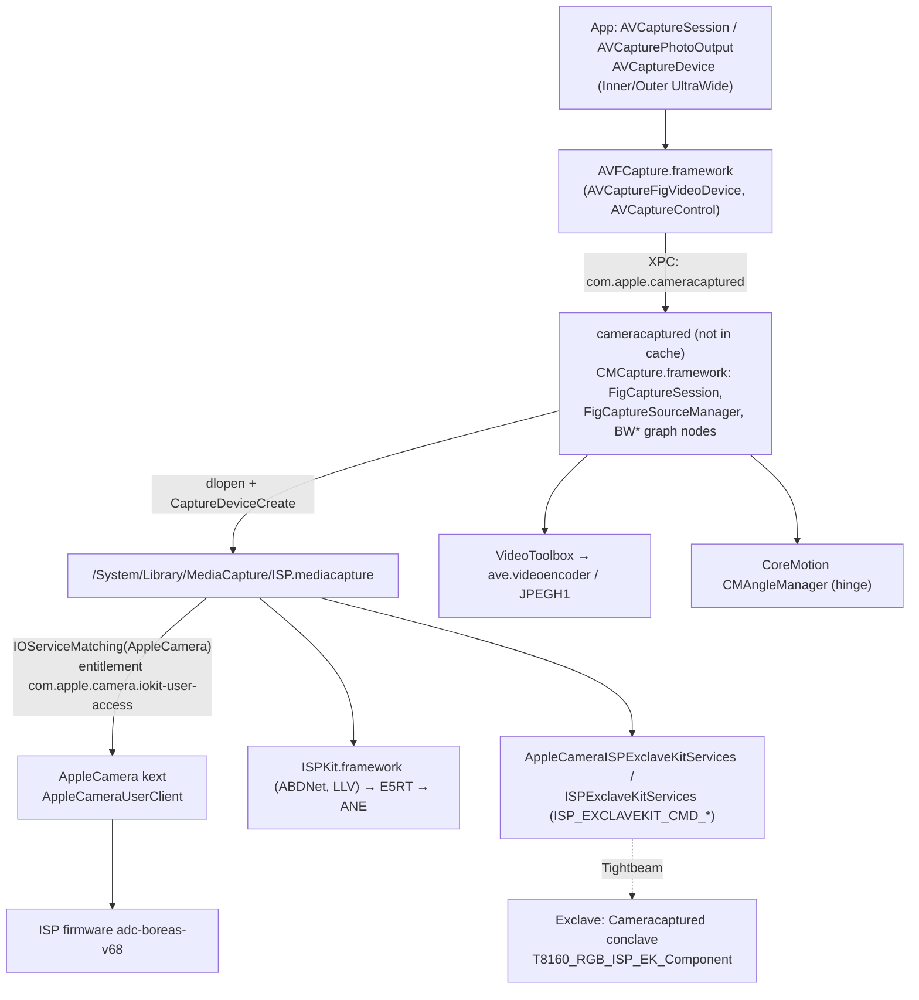
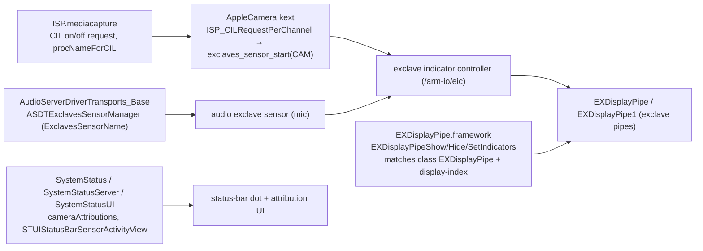
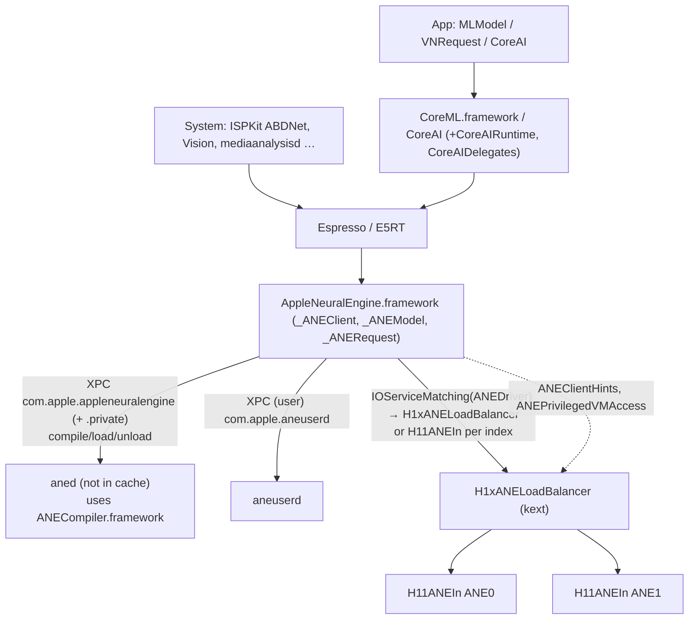
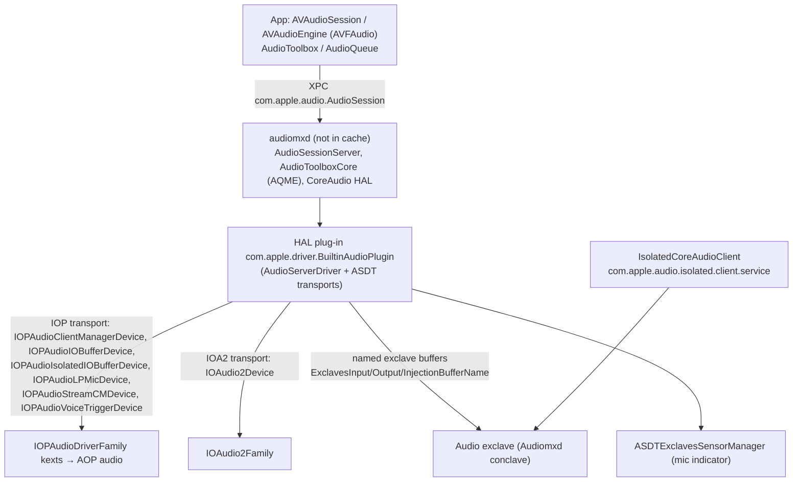
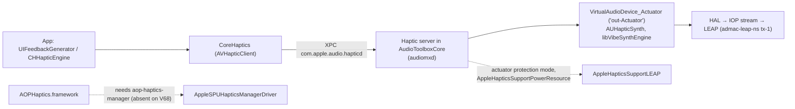
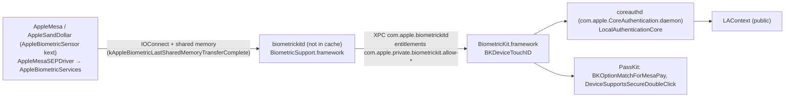

# 12: Userland for camera, media, Neural Engine, audio, haptics and security

This chapter is the userland pass for three earlier chapters:
[04 (camera, media, Neural Engine)](04-camera-media-neural-engine.md),
[02 (boot and security, userland parts)](02-boot-and-security.md) and
[05 (audio and haptics parts)](05-sensors-touch-audio-haptics.md).
Those chapters were written while the iOS 27.2 dyld shared cache was unavailable, so their userland claims were limited to an image list or marked **[INF]**. The cache (iOS 27.2 `24B91020`, iPhone19,4, 4,776 images) is now back. This chapter reads the images themselves and replaces inference with evidence where it can.

Evidence labels are as in [00-method-and-evidence.md](00-method-and-evidence.md). **[DSC]** here means a string, Objective-C class/method or symbol read from the named image in the cache with `ipsw dyld macho <image> --strings | --objc | -n`. The restore ramdisk binaries (catalogued in [`reference/ramdisk/`](../reference/ramdisk/README.md)) are labelled **[FW]**, because they come from the IPSW's ramdisk image rather than the cache.

> **One limit applies to the whole chapter.** The daemons themselves (`cameracaptured`, `mediaserverd`, `audiomxd`, `aned`, `biometrickitd`, `coreauthd`, `securityd`, `keybagd`, `nfcd`, `seld`, `seserviced`, `passd`) are **not in the dyld shared cache**. Their executables live on the root filesystem, which was not extracted. So each daemon is identified here by the frameworks that run inside it, by the Mach service names those frameworks connect to, and by the kernel's own list of permitted user-client processes. Where a ramdisk copy exists (`seputil`, `keystorectl`, `restorecameraispd`, `YonkersUtil`, `dietappleh16camerad`), its entitlements and strings are cited. String addresses are omitted; every string below can be found again with `ipsw dyld macho <dsc> <image> --strings | grep -F '<string>'`.

---

## 1. Summary of findings

| # | Finding | Evidence |
|---|---|---|
| 1 | **The inner camera is called "Reno" in userland, and it has a public device type.** AVFCapture defines `AVCaptureDeviceTypeBuiltInInnerUltraWideCamera` and `AVCaptureDeviceTypeBuiltInOuterUltraWideCamera`. CMCapture names the ports `PortTypeRenoFrontSuperWide` and `RenoWide`/`RenoSuperWide`, with display names "Inner Ultra Wide Camera", "Inner Wide Camera", "Outer Ultra Wide Camera" and "Outer Wide Camera". The kernel's `FrontRenoCamera` and the ISP tuning `Glenbrook_RNO` use the same name. | [DSC] AVFCapture, CMCapture; [KC] |
| 2 | **Capture is fold-aware.** CMCapture's `FigCaptureAngleMonitor` reads the hinge angle through CoreMotion's `CMAngleManager`. `FigCaptureSourceManager` tracks an **"Omaha Reno Angle Drop Zone"** and a **"Reno Occluded"** state from the angle and the primary display region. In the drop zone, recorded movie frames are dropped and streamed frames are blackened. AVFCapture exposes `-[AVCaptureDevice primaryDisplayRegion]` and `AVCaptureDevicePrimaryDisplayRegionDidChangeNotification`. | [DSC] CMCapture, AVFCapture |
| 3 | **The under-display camera's ML clean-up runs in userland on the ANE, not in ISP firmware.** The ISP's UDC multi-pass mode hands a pyramid output pool (`CISP_POOL_PYROUTPUT_UDC_ABDNET`) to **ABDNet**, a network run by `ISPKit.framework` through E5RT. ISPKit logs `ABDNet: network hint: Bonded` or `Single ANE`. So the UDC network can use **both ANEs in bonded mode**. | [DSC] ISP.mediacapture, ISPKit |
| 4 | **ProRes is resolved: there is a ProRes kext, but no device-tree node for it to bind.** `com.apple.driver.AppleProResHW` 600.53 is in the kernelcache, with 19 personalities matching `apr,a0`…`apr,s0` on `AppleARMIODevice`. The V68 device tree has no `apr,*` node. The HW plug-ins call `IOServiceMatching("AppleProResHW")`. ProRes capture is separately gated by the MobileGestalt query `DeviceSupportsProResVideo`. A software ProRes encoder and decoder also ship. | [KC] [DT] [DSC] |
| 5 | **The camera plug-in actually used is `ISP.mediacapture`**, which matches the kext class `AppleCamera`. `H16ISP.mediacapture` matches `AppleH16CamIn`, which this kernel does not have. CMCapture probes six plug-ins in turn. | [DSC] [KC] |
| 6 | **The Camera Control is the `nova` touch-sensitive button, confirmed.** `SensingAlgsTouchButtonHost.framework` is versioned `SensingAlgsNovaHost-114.1` and runs a `NovaButtonStateMachine` with force stages, half-press and a tact switch. SpringBoard's `SBCaptureHardwareButton` turns it into launches and presses. `CameraOverlayServices` publishes the `com.apple.CameraOverlayAngel` services used by AVFCapture's public `AVCaptureControl` classes. | [DSC] |
| 6a | **SpringBoard ties display power to the secure indicator.** It logs "thisDisplayIsRequired … hasSecureIndicator" for display power assertions and keeps a `secureIndicatorProximityModeAssertion`. This is how the exclave-drawn camera/mic dot stays visible on whichever panel is in use. | [DSC] |
| 7 | **Face ID code is present in userland but gated off.** BiometricKit carries both `BKDevicePearl` and `BKDeviceTouchID`. Selection depends on the MobileGestalt keys `PearlIDCapability` (LocalAuthentication) and `PearlCameraCapability` (CMCapture's `CMGQPearlCameraCapability`), and on which kernel services exist (`AppleBiometricSensor`, `ApplePearlSEPDriver`). The ISP plug-in's Face ID path needs a `FRONT_IR` channel and an IR projector. The V68 ISP board table has neither. **Not reachable on this device [INF, strong].** | [DSC] [FW] [DT] [KC] |
| 8 | **Keybags on this device are xART-based.** MobileKeyBag reads the device-tree flag `no-effaceable-storage` and has `KeybagxART`, `KBisxARTBasedKeyBag` and "System KeyBag plist still contains keys! Not xART based!". This turns chapter 02's inference into evidence. | [DSC] MobileKeyBag; [DT] |
| 9 | **Audio's HAL runs in `audiomxd`.** AudioToolbox logs "audiomxd starting" and stores HAL captures under `/private/var/mobile/tmp/com.apple.audiomxd/AudioCapture/HAL/`. The HAL driver transports open the IOP audio devices (`IOPAudioIsolatedIOBufferDevice`, `IOPAudioLPMicDevice`, `IOPAudioVoiceTriggerDevice` …) and `IOAudio2Device`. Exclave-owned buffers are mapped by name, and an `ASDTExclavesSensorManager` drives the mic-indicator sensor. | [DSC] |
| 10 | **Haptics go through a virtual audio device.** AudioToolboxCore's haptic server waits until "the haptics VAD is routed to the actuator" (`VirtualAudioDevice_Actuator`). AudioToolbox knows `DeviceSupportsClosedLoopHaptics` and `AppleHapticsSupportPowerResource`. `AOPHaptics.framework` targets `AppleSPUHapticsManagerDriver`, which needs an `aop-haptics-manager` node. The V68 tree has none. | [DSC] [KC] [DT] |
| 11 | **The second NFC controller is driven from userland.** `libNFC_HAL.dylib` opens `AppleStockholmControl` **and** `AppleHammerfestControl`, and validates a "Hammerfest SPMI config". Data moves over a kernel control socket (`stockholm-spmi-data-socket`, `IO_STOCKHOLM_*` socket options). | [DSC] |
| 12 | **The ANE stack knows this SoC and bonded mode end to end.** ANECompiler has targets `H19`, `H19A` and `H19P`. It compiles every network as a *family* of a bonded and a non-bonded procedure, with `ForceAllToANE0OnBondedProcedure`, work-stealing and TSR checks. AppleNeuralEngine.framework opens the kernel class `ANEDriver` (the superclass of `H1xANELoadBalancer`), and has a per-client opt-out, `+[_ANECompileFlavorPolicy shouldDisableBondedForCsIdentity:]`. | [DSC] [KC] |

---

## 2. Camera and capture

### 2.1 The chain



**[DSC]** for the userland boxes; **[KC]** for the kext. The XPC and plug-in arrows are read from strings: the service name `com.apple.cameracaptured` (CMCapture, AVFCapture), the six `/System/Library/MediaCapture/*.mediacapture` paths and "Failed to load CaptureDeviceCreate function" (CMCapture).

### 2.2 Daemon and plug-in

- **Daemon.** `cameracaptured` hosts CMCapture **[DSC: service name `com.apple.cameracaptured`; KC: the AppleCamera user-client allow-list names it]**. It is not in the cache, so its own entitlements were not read. The capture plug-in it loads needs `com.apple.camera.iokit-user-access`, the entitlement the AppleCamera kext checks (`com.apple.camera.iokit-user-access` and `com.apple.pearl.iokit-user-access` are both in the kext) **[KC]**. The ramdisk camera daemons `restorecameraispd` and `dietappleh16camerad` carry that same entitlement **[FW]** ([page](../reference/ramdisk/usr__libexec__restorecameraispd.md)).
- **Plug-in selection.** CMCapture lists `H6ISP`, `H9ISP`, `H10ISP`, `H13ISP`, `H16ISP` and `ISP.mediacapture`, and the kernel class names `AppleH6CamIn` … `AppleH16CamIn` and `AppleCamera` **[DSC]**. `ISP.mediacapture` matches `AppleCamera` and `AppleCameraPhotonDetector`. `H16ISP.mediacapture` matches `AppleH16CameraInterface` and `AppleH16PhotonDetector` **[DSC]**. This kernel has `AppleCamera` and `AppleCameraPhotonDetector` but no `AppleH16CamIn` **[KC]**. **On the Duo the live plug-in is `ISP.mediacapture` [DSC+KC].** Only two plug-in images are in the cache (`H16ISP`, `ISP`); the other four paths are dead references.
- **What `ISP.mediacapture` contains [DSC].**
  - An exclave graph for each channel: `ISPGraphExclaveISPManagerNode`, `…StatsManagerNode`, `…AutoExposureNode`, `…FaceTrackingNode`, `…PCENode`, `…PostProcessNode`, `…AttentionDetectionNode` and a sync node.
  - The commands `ISP_EXCLAVEKIT_CMD_CH_ON`/`OFF`/`STOP` and "Error setting exclusive exclave streaming mode".
  - The CIL path: "CIL on request", "CIL off request", `ISP_CILRequestPerChannel` and a `procNameForCIL:%s / audit_token:…` log that attributes the camera light to a process.
  - Strobe: "Initiating shutter+strobe operation", `GetStrobeLEDCalibrationValues`, `TorchLevelOverride`, `LowCurrentTorchEnabled`, and `com.apple.camera.displaystrobe` (the screen-as-flash path, which matches chapter 04's reading of `front-flash-capability`).
  - Module identity keys: `BackCameraSNUM`, `BackSuperWideCameraSNUM`, `FrontCameraModuleSerialNumString`, **`FrontCameraRenoModuleSerialNumString`**, plus calibration keys `FrontCameraCalSwide` and `MultiCameraCalSwide`.
  - VIO feature extraction through `CVHWAFeatureExtraction*` (`ISPGraphVIOCameraControlNode`). "Camera controls" here means 3A controls (`CameraControlsSemanticHints`, `RegionOfInterestForCameraControls`), not the Camera Control button.
- **Exclave-side helpers [DSC].** `AppleCameraISPExclaveKitServices` and `ISPExclaveKitServices` implement the host side of the `ISP_EXCLAVEKIT_CMD_*` protocol. Errors include `ISP_EXCLAVEKIT_CMD_HANDLER_ERR_IDL_CALL_FAIL`, which suggests a generated IDL (Tightbeam) client. They also have per-channel services: "Device Proximity Detection", "Motion to Wake" and "Perception". AppleCameraISPExclaveKitServices connects to `com.apple.cameracaptured.ExclaveFDRDecodeRawDataStoreKitService`, the userland end of the `ExclaveFDRDecodeRawDataStoreService` component chapter 02 found in the exclave broker.
- **Vision HW acceleration [DSC][KC].** `VisionHWAccelerationServices` looks for `AppleCVHWA` and for the camera interfaces, and runs inside `mediaserverd` or `visionhwserverd` ("launched via …"). This kernelcache has **no** `AppleCVHWA` class **[KC: absent from `data/kernel-cpp-classes.txt`]**. Its feature extraction is reached through the ISP plug-in's `CVHWAFeatureExtraction*` calls instead **[INF]**.

### 2.3 Camera modules: WIDE, SWIDE, FCAM, INTCAM in userland

| ISP firmware rail name (ch. 04 §3.3.1) | Kernel / ISP plug-in name | CMCapture port type | AVFoundation device type | Display name |
|---|---|---|---|---|
| WIDE | `BackCamera…` | `PortTypeBack` | `…BuiltInWideAngleCamera` | "Back Camera" |
| SWIDE | `BackSuperWideCamera…` | `PortTypeBackSuperWide` | `…BuiltInUltraWideCamera` | "Back Ultra Wide Camera" |
| FCAM | `FrontCamera…` | `PortTypeFront` / `PortTypeFrontSuperWide` | `…BuiltInOuterUltraWideCamera` | "Outer Ultra Wide Camera", "Outer Wide Camera" |
| INTCAM | `FrontRenoCamera`, `FrontCameraReno…` | `PortTypeRenoFrontSuperWide` (`RenoSuperWide`, `RenoWide`) | `…BuiltInInnerUltraWideCamera`, metadata twin `…BuiltInRenoUltraWideMetadataCamera` | "Inner Ultra Wide Camera", "Inner Wide Camera" |

- **Columns 2–5** are **[DSC]** (CMCapture, AVFCapture, ISP.mediacapture) and **[KC]** (AppleCamera). The device-type and display-name strings are read directly. The row alignment is by name: `Front…Reno` ↔ `Inner`, `Back…SuperWide` ↔ `Ultra Wide`.
- **Which rail is which (FCAM ↔ Outer, INTCAM ↔ Inner/Reno) [INF, strong].** No single string ties `INTCAM` to `Reno`. The link runs through the tuning name `Glenbrook_RNO` and the kernel's `FrontRenoCamera`. Together with chapter 04's frame-rate argument, this **confirms chapter 04's weak inference that Glenbrook/IMX916 is INTCAM**, since RNO is Reno and Reno is the inner camera in userland.
- **No telephoto.** The `PortTypeBackTelephoto` and `Tele*` strings are generic. Nothing V68-specific uses them.
- **Infrared / TrueDepth.** `PortTypeFrontInfrared`, "Front TrueDepth Camera" and `AVCaptureDeviceTypeBuiltInTrueDepthCamera` are present, but gated by `CMGQPearlCameraCapability` (see §6.3).

### 2.4 Fold handling in the capture stack

All of the following is read from CMCapture and AVFCapture **[DSC]**. Interpretation is marked.

- **The angle source.** `FigCaptureAngleMonitor` (`startMonitoring`, `_handleAngleUpdate:`, queue `com.apple.FigCaptureAngleMonitor`) checks `CMAngleManager.isAvailable`. CoreMotion's angle API is the hinge path described in [chapter 05 §4.3](05-sensors-touch-audio-haptics.md#43-userland).
- **The drop zone.** `FigCaptureSourceManager` logs "Updating Device Angle to %ld (angleMonitorActive: %d, normalizedAngle: %f)" and "Updating Reno Occluded to %d (angleMonitorActive, normalizedAngle, displayRegion)". It also logs "Omaha Reno Angle Within Drop Zone to %s (normalized=%f, displayRegion=%lu)".
  - `BWQuickTimeMovieFileSinkNode`: "Dropping frame within Omaha Reno Angle Drop Zone".
  - `BWRemoteQueueSinkNode`: "Blackening streaming frame within the Omaha Reno Angle Drop Zone".
  - Frames carry a `FrameWithinOmahaRenoAngleDropZone` attachment.
  - **[INF]** At some fold angles the inner panel covers or tilts the inner camera's view. Inside that band the pipeline does not record the frames, and it blacks out live ones.
- **Display region.** `primaryDisplayRegion` is on AVCaptureDevice, AVCaptureSession (`_updatePrimaryDisplayRegionIfNeeded`) and `AVCaptureDeviceRotationCoordinator` (`_systemReferenceAngleForDeviceOrientation:onDisplayRegion:`). `BWCameraStreamingMonitor` reacts to `displayRegion:blankingStateWillChangeFrom:to:`, and `PreviewPrimaryTargetIsRenoDisplay` is a preview option. **[INF]** Which panel is primary (chapter 03's `disp0`/`dispsec`) drives preview rotation and camera choice.
- **"Omaha" variant devices.** AVCaptureDevice has `isOmahaVariant`, `activeOmahaConstituentDeviceType` and `_exposesOmahaConstituentDevices`. CMCapture has "Omaha Wide Camera", "Omaha Ultra Wide Camera", `OmahaPrimarySourceDeviceType`, "Omaha Live Reconfiguration", "Adjusting output rotation degrees … for Omaha", "Transposed still image output dimensions … for Omaha Reno 90° rotation" and "AF Position not supported for Omaha variants".
  - **[INF]** An Omaha variant is a virtual capture device that switches its *constituent* physical camera live (a wide or ultra-wide variant) as the fold or display region changes, and rotates its output by 90° when Reno is the source.
  - Whether "Omaha" is the product's internal code name cannot be settled from these strings.
- **Hinge statistics in the ISP plug-in.** "Failed to report hinge angle statistics to remote service assistant" is in ISP.mediacapture **[DSC]**.

### 2.5 Under-display (inner) camera: ABDNet

- **Firmware to plug-in.** ISP.mediacapture has `CISP_POOL_PYROUTPUT_UDC_ABDNET` and "SetABDNetConfiguration - CISP_CMD_CH_UDC_MULTI_PASS_ENABLE(%d)" **[DSC]**. That is the same `CISP_CMD_CH_UDC_MULTI_PASS_ENABLE` chapter 04 found in firmware.
- **The network.** ISPKit has `ABDNet`, `ABDNet-goodlight`, `ABDNet-lowlight`, a noise add-back by lux LUT (`ABDNet_noiseAddback_LUT_lux`, `…_gain`), "E5RT operation failed", and `ABDNet: network hint: Bonded` / `Single ANE` / `no hint` **[DSC]**. ISP.mediacapture logs "ABDNet: ABDProcessor not available - is ISPKit missing?" **[DSC]**.
- **Reading [INF].**
  - In UDC multi-pass mode the ISP outputs an image pyramid to a dedicated buffer pool.
  - The ISP plug-in in `cameracaptured` runs ABDNet on it through E5RT (Espresso's runtime) on the ANE. It may be bonded across both ANEs.
  - ABDNet adds back a lux-dependent amount of noise, and the result returns to the ISP for the remaining passes.
  - ABD probably stands for a de-blur or diffraction-artifact network for the under-display optics. The expansion is not in the strings.
- **What this changes.** Chapter 04 §9.1 inferred that "ISP-scheduled ANE procedures handle the ML stages". For the UDC stage at least, the ML runs from userland. The ISP↔ANE direct link of chapter 04 §8.4 still exists, for other procedures.

### 2.6 Center Stage

- **Public and private API [DSC AVFCapture].**
  - `+[AVCaptureDevice isCenterStageEnabled]`, `setCenterStageEnabled:`, `centerStageControlMode` and `centerStageFramingMode`.
  - The ivars `_centerStageFieldOfViewRestrictedToWide`, `_centerStageRectOfInterest` and `_centerStageUnavailableReasonsKey`.
  - An app allow-list, `+_centerStageAllowList`.
- **Implementation [DSC CMCapture].** "Center Stage (SmartCrop)", the `CinematicFraming*` keys (virtual-camera focal length, stereographic fisheye factor, physical-to-virtual transform, used face and body IDs) and `EnabledSmartFramingFieldsOfView`. Center Stage is a crop and warp of an ultra-wide stream inside cameracaptured.
- **Which camera.** **[INF]** On the Duo it runs on the square front sensors, consistent with chapter 04's square-sensor argument. No string names which of FCAM or INTCAM supports it.

### 2.7 Camera Control button

| Layer | Evidence |
|---|---|
| Sensor and firmware | `nova` on the MTP with Mando firmware ([ch. 05 §6](05-sensors-touch-audio-haptics.md#6-buttons-sidetouch-id-camera-control-volume)) **[DT][FW]** |
| Host algorithms | `SensingAlgsTouchButtonHost.framework`, version string `SensingAlgsNovaHost-114.1`. It has `[NovaButtonStateMachine] enter stage %u`, `ForceStages`, `HalfPressThresholdModifier`, `HalfPressSwitchPressedTimestamp`, `SwitchPressedTimestamp`, `CameraButtonScanActive` and **`NovaCaseAttachState`** (sensitivity changes with a case). Analytics events are `com.apple.TouchSensitiveButton.HalfPressPressed` / `.tactSwitchPressed`. It also has `PrimaryUsagePage` / `PrimaryUsage` (HID) **[DSC]** |
| Board-specific touch personalities | `SensingAlgsCodexV68AP.framework` (`SensingAlgsCodexV68-62.8~10`) has `V68CobaltAPPersonalityV68SDC`, `V68CobaltMTPPersonalityV68SDC`, `V68IndigoAPPersonalityV68SDC` and `V68IndigoMTPPersonalityV68SDC` **[DSC]**. These belong to the two-panel touch path of chapter 05. Which of Cobalt and Indigo is which panel is not stated. |
| Geometry | `SensingAlgsService` has `CameraButtonNormalizedCGRect` **[DSC]**, from `/product/display*/camera-button-location` **[DT]** |
| System shell | `SpringBoard.framework` (in the cache) has `SBCaptureHardwareButton`, `SBCaptureHardwareButtonFullPressRecognizer`, `SBCaptureHardwareButtonAppActivator`, `SBCaptureButtonSession`, `SBCaptureButtonSuppressionManager`, `SBCaptureButtonRestrictionServer`, `CaptureButtonAccidentalActivationMitigation`, `CameraCaptureButtonScanMode`, `CaseCameraButton` and `Nova`, plus `-[SBPhysicalButtonSceneOverrideManager sendCameraCaptureButtonDown]` **[DSC]** |
| Capability flag | `CameraButtonCapability` is a MobileGestalt key: it is in `libMobileGestalt.dylib` and read by SpringBoard, UIKitCore, AVFCapture and CameraOverlayServices **[DSC]** |
| System overlay | `CameraOverlayServices.framework` has the services `com.apple.CameraOverlayAngel`, `.application-service` and `.client-app-service`, the keys `CameraButtonCapability` and `CameraButtonSensitivity`, and settings `systemOverlay.halfPressGestureEnabled` and `systemOverlay.swipeToPresentEnabled` **[DSC]** |
| App API | AVFCapture's `AVCaptureControl`, `AVCaptureSlider`, `AVCaptureIndexPicker`, `AVCaptureSystemExposureBiasSlider` and `AVCaptureControlsOverlay` (a `CAMOverlayServiceConnectionClient`) **[DSC]**. These are the public iOS 18+ `AVCaptureControl` API **[PUB]** |
| Capture trigger | CMCapture key `CameraCaptureButton` **[DSC]** |

This closes chapter 05's inference that `nova` is the Camera Control **[DSC]**. The HID usage page and usage values the button publishes are numbers in code, not strings, and were not recovered.

### 2.8 Privacy indicator userland (camera and microphone)



- **Two indicators.** The secure dot is drawn by the exclave into each panel's exclave display pipe ([ch. 02 §9](02-boot-and-security.md#9-exclaves), [ch. 03](03-gpu-and-displays.md)). The *attribution* UI (which app, the Control Center list) is ordinary userland: `SystemStatus*` (`cameraAttributions`, `cameraCaptureAttribution`, `com.apple.systemstatus.activityattribution`, `STUIStatusBarSensorActivityView`) **[DSC]**.
- **SpringBoard keeps the right panel lit for the secure dot [DSC SpringBoard].** The log line "[DisplayPower] … display power assertion; surface: %@, requiredSurface: %@, thisDisplayIsRequired: %u, hasSecureIndicator: %u" ties display power to the indicator. SpringBoard also has `SBSecureIndicatorMinimumOnTimeCoordinator`, `SBSecureIndicatorElevationServer` (entitlement-checked), `SecureIndicatorEnabled`, `usesSecureIndicatorLayer`, `SBAlwaysSuppressSecureIndicatorBacklightChanges`, `secureIndicatorProximityModeAssertion`, `digitizerActiveDuringSecureIndicator` and `SBSensorActivityDataProvider`. **[INF]** On a two-panel phone, SpringBoard must keep whichever surface is "required" powered while a sensor is active, so that the exclave-drawn dot is actually visible. The proximity assertion matches the `eic` policy flag `policy-allow-prox-suppression` **[DT]**.
- **The pipe's userland API.** `EXDisplayPipe.framework` exports exactly `_EXDisplayPipeShowIndicator`, `_EXDisplayPipeHideIndicator` and `_EXDisplayPipeSetIndicators`. Its strings add `GetStatus`, `GetStats`, `GetFrameInfo`, `GetSecureTEStatus`, `GetSCASessionHealth`, `SetPower` and `SetALSSEnable`. It opens the kernel class `EXDisplayPipe`, selecting by a `display-index` property, and draws "glyph %u" **[DSC]**. **[INF]** These are test and status calls. Production indicator decisions are made in the exclave, which is the point of the design. This framework's user is not identified.
- **Microphone side.** `AudioServerDriverTransports_Base` has `ASDTExclavesSensorManager`, `ExclavesSensorName` and "Exclaves sensor creation fails unexpectedly". `CoreAudioOrchestration` names `com.apple.audio.micactivityd` and `com.apple.audio.isolated.micactivityd` **[DSC]**. **[INF]** The HAL registers each isolated mic stream as an exclave "sensor", which is the audio twin of `exclaves_sensor_start(CAM)`.
- **Gap partly closed.** Chapter 02 §9 marked steps 4–5 of "the green camera dot" as [INF]. Userland now shows the CIL request API, process attribution and the exclave pipe API. The exclave's internal decision logic is still not observable.

### 2.9 Lock-screen capture

`SecureCaptureKit.framework` (`com.apple.securecapture.process.assertion`, "Acquiring secure capture process assertion for bundle identifier") and the public `LockedCameraCapture.framework` **[DSC]**. Chapter 04 listed these by path only.

---

## 3. Video codecs: VideoToolbox, AVE, AVD, JPEG, ProRes

| Plug-in (cache path) | Encoder/decoder IDs it registers [DSC] | Kernel service it matches [DSC] | Kext [KC] |
|---|---|---|---|
| `/System/Library/VideoCodecs/ave.videoencoder` | `com.apple.videotoolbox.videoencoder.h264`, `.hevc`, `.ohvc` | `AppleAVE2Driver` (also `IOPIPC`) | `AppleAVE2Driver` ([page](../reference/kexts/com.apple.driver.AppleAVE2.md)) |
| `/System/Library/VideoDecoders/AVD.videodecoder` | (H.264, HEVC, MV-HEVC, AV1 paths in strings) | `AppleAVD`, via `AppleAVDUserClient::createDecoder` | `AppleAVD` |
| `JPEGH1.videoencoder` / `.videodecoder` | JPEG | `AppleJPEGDriver` (`AppleJPEGNumCores`, `AppleJPEGRequiresMCUAlignment`) | `AppleJPEGDriver` |
| `AppleProResHWEncoder.videoencoder` | `…appleproreshw.422`, `.422hq`, `.422lt`, `.422proxy`, `.4444`, `.4444xq`, `.raw`, `.rawhq` | `AppleProResHW` | `AppleProResHW` 600.53, **unbound on V68** |
| `AppleProResHWDecoder.videodecoder` | `com.apple.videotoolbox.videodecoder.appleproreshw` | `AppleProResHW` | (same) |
| `AppleProResSWEncoder`/`SWDecoder`, `AV1SW.videoencoder`/`.videodecoder`, `H264SW`, `VCPHEVC`, `VCH263`, `VCPMP4V` | software | none | — |

- **AVE [DSC].** The plug-in has the MV-HEVC rules ("MCTF unsupported for MV-HEVC", "MV-HEVC does not support Multipass / Parallelization / DRL/CBR / 4:2:2/4:4:4") and the `MVHEVCLeftAndRightViewIDs` keys. **It registers no AV1 encoder ID.** Its strings contain only `AV1` and `av1C`, and VideoToolbox's internal IDs list `ave.avc` and `ave.hevc`. Chapter 04 §6 found AV1 *encode* code in the kext (`AV1 GenerateTileMap`). **[INF]** On iOS 27.2, AV1 encoding reaches apps through `AV1SW.videoencoder` (software), and the kext's AV1 path is not exposed by this plug-in. `ohvc` is most likely the MV-HEVC ("spatial") encoder ID **[INF]**.
- **AVD [DSC].** Multi-view HEVC (`kAppleAVDMultiViewDecodeClient`), MV-AV1 (`kAppleAVDSetMVAV1DisplayLayerIDs`), AV1 film grain, and ADS secure-decode switches (`AVD_InhibitADSForAVCHEVC`, `AVD_InhibitADSForVP9`, `AVD_AllowADSOnUnsupported`). These confirm chapter 04 §7's ADS reading from the userland side.
- **The daemon.** VideoToolbox runs in the client process, and in `mediaserverd` for system playback **[INF]**. VideoToolbox has `paravirtualized:` variants of the AVE IDs, for VMs **[DSC]**.

### 3.1 ProRes: "a power state but no kernel node", resolved

1. **The SoC has a ProRes block.** pmgr's `soc-device-ps-map` lists `PRORES` **[DT]**. The SoC/MCC kext has fabric agent names `PRORES_TXL`, `PRORES_RXL` and `PRORES IPCE` ([AppleT8160 page](../reference/kexts/com.apple.driver.AppleT8160.md)) **[KC]**.
2. **There is a kernel driver.** `com.apple.driver.AppleProResHW` 600.53 has classes `AppleProResHW` and `AppleProResUserClient`, and 19 personalities whose `IONameMatch` values run from `apr,a0` to `apr,s0`, all on `AppleARMIODevice` ([page](../reference/kexts/com.apple.driver.AppleProResHW.md)) **[KC]**. Chapter 04 said "no ProRes node or kext". **The kext half of that is wrong.**
3. **Nothing in the V68 device tree matches.** There is no `apr,*` `compatible` anywhere in `data/devicetree.txt` **[DT]**. So the kext loads but never attaches, and `IOServiceMatching("AppleProResHW")` in both HW plug-ins finds nothing ("ERROR AppleProResHW: IOServiceMatching failed") **[DSC]**.
4. **Capture is gated separately.** CMCapture and AVFCapture ask MobileGestalt `DeviceSupportsProResVideo` (`CMGQ…`/`AVGQ…`), plus `AppleLogSupportedForProRes` and `10BitVideoHDRSupportedForProRes`. They also have ProRes storage rules ("Capturing ProRes on this device requires Pro Video Storage", "4k120 … only on external storage") **[DSC]**.

**Conclusion [INF, strong].** The t8160 die carries a ProRes engine, but the V68 board template does not publish it. Hardware ProRes is unavailable on this build, whatever the reason: fused off, reserved, or published under a different tree on another product. ProRes *playback* and *export* fall back to `AppleProResSWDecoder`/`SWEncoder`. Whether the Camera app offers ProRes recording depends on the device's `DeviceSupportsProResVideo` answer, which is computed on the device and is not in the IPSW.

---

## 4. Neural Engine: aned, AppleNeuralEngine, Espresso, ANECompiler, Core ML, Vision

### 4.1 The chain



### 4.2 Evidence

- **Device open [DSC AppleNeuralEngine/ANEServices].**
  - Strings: "Found matching service: ANEDriver", "Found matching service: H11ANEIn", "(Multi-ANE System) Opening ANEDriver device", "(Possible Multi-ANE System) Opening ANEDevice at index %d", "… Selected ANE device at index %d based on subType match" and "(Single-ANE System with ANEDriver) …".
  - In the kernel, `ANEDriver` is the superclass of `H1xANELoadBalancer` ([kext page](../reference/kexts/com.apple.driver.AppleH16ANEInterface.md)) **[KC]**. On the Duo, normal clients therefore open the load balancer, which picks ANE0, ANE1 or a bonded pair (ch. 04 §8.3). A client can also bind to one `H11ANEIn` by index and subtype.
  - The side services `ANEClientHints` and `ANEPrivilegedVMAccess` are opened by name **[DSC]**.
- **Device info [DSC].** `+[_ANEDeviceInfo numANEs]` reads `ANEDevicePropertyNumANEs`, and `numANECores` reads `ANEDevicePropertyNumANECores`. They default to 1 ANE and 2 cores if the properties are missing. `aneSubType`, `aneSubTypeVariant` and `aneSubTypeProductVariant` also exist. The values are kernel properties, so they are not in the cache.
- **Daemons [DSC].** `+[_ANEStrings machServiceName]`, `machServiceNamePrivate` and `userMachServiceName`, with the names `com.apple.appleneuralengine`, `com.apple.appleneuralengine.private`, `com.apple.aneuserd`, `com.apple.aned.launch` and `com.apple.aneuserd.launch`. The cache paths are `/var/tmp/com.apple.aned/Cache/` and `/var/mobile/Library/Caches/com.apple.aned`. `_ANEDaemonConnection` implements `compileModel:…`, `loadModel:…`, `loadModelNewInstance:…`, `prepareChainingWithModel:…`, `beginRealTimeTaskWithReply:` and `purgeCompiledModel…`.
- **Entitlements [DSC].** `com.apple.aned.private.allow`, `…secondaryANECompilerServiceAccess.allow`, `…aggressivePowerSaving.allow`, `…processModelShare.allow`, `com.apple.ANECompilerService.allow`, `com.apple.ANELargeModelCompilerService(.allow)` and `com.apple.ane.memoryUnwiringOptOutAccess.allow`. Real-time priority "requires restricted access connection and (%@) entitlement".
- **Bonded mode, end to end [DSC].**
  - *Compiler (ANECompiler).*
    - Knobs: `DisableBondedNetworks`, `EnableNonbondedNetworks`, `PerProcedureBondedNetworks`, `EnableWorkStealingForBondedNetworks`, `EnableForcedMaximalBondedSplit`, `DisablePerDmaRdtidForBondedNetworks` and `BondedNetworksTestAssignment`.
    - "For architectures supporting bonded networks, either generate_bonded_procedures or generate_nonbonded_procedures must be enabled".
    - "Expected exactly 2 family members (bonded+nonbonded) for family '%s'".
    - "Bonded mode TSR validation failed: ANE %zu has %u context switch points, but ANE 0 has %u …". All bonded ANEs must share context-switch points.
    - "Exclave context switch SW workaround does not support bonded mode yet".
    - Platform targets include `H19`, `H19A` and `H19P`, which match the two chip bins in chapter 01 (`h19a`/`h19p`).
  - *Espresso.* `ForceAllToANE0OnBondedProcedure` and `WrapNonBondedAneOperationsInBlock`.
  - *Runtime (AppleNeuralEngine).* `kANEFDisableBondedNetworksKey` and `+[_ANECompileFlavorPolicy nonBondedCsIdentities]` / `shouldDisableBondedForCsIdentity:`. Code-signing identities can be steered to non-bonded flavours.
  - The strings near these name `com.apple.mediaserverd`, `com.apple.voiced`, `com.apple.photoanalysisd` and `com.apple.mediaanalysisd`. That these four form the non-bonded list is **[INF]**, because the list itself is code-built.
  - *User.* ISPKit's ABDNet "network hint: Bonded" (§2.5).
- **Core ML / Core AI / Vision [DSC].**
  - CoreML's configuration dump includes `e5rtComputeDeviceTypeMask` and `e5rtCustomANECompilerOptions`. CoreML hands models to E5RT (Espresso's runtime), which compiles through ANECompiler via aned.
  - Vision has `AppleNeuralEngineSubtype`, "ANE generation cannot be determined" and Espresso model files.
  - `ParavirtualizedANE.framework` and `com.apple.applevirtioneuralengine` are the VM path, not used on hardware.
  - The reference pages [CoreML](../reference/userland/System__Library__Frameworks__CoreML.framework__CoreML.md) and [Espresso](../reference/userland/System__Library__PrivateFrameworks__Espresso.framework__Espresso.md) hold the full symbol lists.

---

## 5. Audio, voice trigger and haptics

### 5.1 The audio chain



- **Where the HAL runs [DSC].**
  - AudioToolbox: "audiomxd starting", "mediaserverd/audiomxd died", "Recording implicitly allowed for AQIONodeClient %p hosted in audiomxd", and the capture path `/private/var/mobile/tmp/com.apple.audiomxd/AudioCapture/HAL/`.
  - CoreAudio also contains macOS-shared `coreaudiod` strings ("this driver was not launched by coreaudiod", "MCP and HAL Can Coexist in coreaudiod").
  - **On iOS the HAL is hosted in `audiomxd`** **[DSC+INF]**. This matches the exclave conclave chapter 02 calls `Audiomxd`.
  - The session service is `com.apple.audio.AudioSession` **[DSC]**.
- **HAL plug-in [DSC].** CoreAudioOrchestration names `com.apple.driver.BuiltinAudioPlugin`. The plug-in bundle is not in the cache. It is built on `AudioServerDriver` (ASD) and `AudioServerDriverTransports_*` (ASDT). The transports open these kernel classes:
  - IOP: `IOPAudioClientManagerDevice`, `IOPAudioIOBufferDevice`, `IOPAudioIsolatedIOBufferDevice`, `IOPAudioLPMicDevice`, `IOPAudioStreamCMDevice` and `IOPAudioVoiceTriggerDevice`. The entitlement is `com.apple.private.audio.hal.aop-audio.user-access`.
  - IOA2: `IOAudio2Device`.
  - Both have `exclavesReadInput` paths. The IOA2 transport has `ExclavesInputBufferName`, `ExclavesOutputBufferName`, `ExclavesInjectionBufferName`, `IsolatedInputUseCaseID` and `IsolatedOutputUseCaseID`. IOP has "Failed to map exclaves named buffer".
  - These match the kernel classes in [chapter 05 §7](05-sensors-touch-audio-haptics.md#7-audio) one for one (`IOPAudioLPMicDevice`, `IOPAudioIsolatedIOBufferDevice` …).
- **Isolated (exclave) audio clients [DSC].** `IsolatedCoreAudioClient` has services `com.apple.audio.isolated.client.service` and `com.apple.isolatedcoreaudioclient.service`, entitlement `com.apple.private.isolated.audio.coreaudioclient(.shareddsp)`, `com.apple.shareddspd`, an `IsolatedCoreAudioClientExclaveKitProxy` and "hardwareSupportsExclaves". CoreAudioOrchestration has `ExclaveAudioFormat` ("from EDT", the exclave device tree), `com.apple.audio.isolated.historicalaudiod`, `com.apple.audio.isolated.micactivityd` and `com.apple.coreaudio.orchestration.securepairing` / `com.apple.securepairingd` (chapter 02's `SecurePairingdConclave`).
- **Public API [PUB].** AVAudioSession, AVAudioEngine, AudioToolbox and Core Audio.

### 5.2 Voice trigger

- **Frameworks [DSC].** VoiceTrigger, CoreSpeech, CoreSpeechFoundation and CoreSpeechExclave. The trigger modes are `BuiltInAOPVoiceTrigger`, **`BuiltInAlwaysOnProcessorExclave`**, `ApplicationProcessorExclave`, `ApplicationProcessorExclaveWithConnectedCall` and `ApplicationProcessorExclaveWithRingtone`. Also present: `AOPVoiceTrigger`, `AOPVoiceTriggerData`, `com.apple.corespeech.SecondPassWakeUp`, `aopFirstPassTriggerWakeupLatency`, `CSExclaveRecordClient`, "Exclave Siri Fast Start", `requestExclaveAudio` and "Exclave audio Injection Enabled".
- **Daemon [DSC].** `corespeechd`, with `/var/mobile/tmp/com.apple.corespeechd/AudioCapture/siri` and services `com.apple.corespeech.corespeechd.attending.service` and `….attsiri.service`.
- **Reading [INF from DSC].** The first pass runs on the AOP, as `VoiceTrigger64V5_*` in chapter 05. The *trusted* path continues in the exclave (`BuiltInAlwaysOnProcessorExclave`). corespeechd on the AP runs the second pass, reading exclave-owned audio through `CSExclaveRecordClient`. This replaces the "[INF] flow" in chapter 05 §7.3 with named components. The exact hand-off messages are not visible.

### 5.3 Haptics



- **[DSC] CoreHaptics.** `com.apple.audio.hapticd`, `com.apple.corehaptics`, `CHHapticErrorCodeServerInitFailed`, `-[CHHapticEngine handleMediaServerDeath:]` and `com.apple.private.allow-background-haptics`. The haptic server lives with the media server.
- **[DSC] AudioToolboxCore and AudioToolbox.**
  - "Detected actuator routing delay - added property listener to defer Haptic Server initialization until the haptics VAD is routed to the actuator".
  - "AQMEIO_HAL for kVirtualAudioDeviceUID_Actuator not found!".
  - `setActuatorProtectionMode`, with `HapticActuatorProtectionModeNotification_DefaultProtection` / `_MinimalProtection`.
  - `DeferFuncUntilFWReadyAndActuatorVADRouted`, `DeviceSupportsClosedLoopHaptics` and `AppleHapticsSupportPowerResource.mm`.
  - "HapticServer using VAD as underlying power budget server".
- **[DSC] libEmbeddedSystemAUs.** `AUHapticSynth`, a synthesiser audio unit. Its output is the waveform stream that chapter 05 found entering LEAP over `admac-leap-ns` tx-1.
- **Reading [INF from DSC+DT].** Haptics are audio. CoreHaptics patterns are rendered by `AUHapticSynth` in audiomxd into a virtual "Actuator" output device. The HAL streams that through the IOP/LEAP path, where the LEAP firmware runs closed-loop control on the Hall sensor. The kernel's `AppleHapticsSupportLEAP` supplies calibration and power state. This closes the "daemon path is [INF]" note in chapter 05 §8, with the HAL device names named.
- **AOPHaptics [DSC][KC][DT].** `AOPHaptics.framework` opens `AppleSPUHapticsManagerDriver` (AppleSPU kext, `IONameMatch aop-haptics-manager`). It plays assets by `SlotIndex`, `Gain` and `PreSilenceDuration`. **There is no `aop-haptics-manager` node in the V68 tree.** So this AOP-autonomous haptic playback path (as used on products where the AOP fires haptics itself) **does not bind on the Duo**. `V68_HapticAssets.im4p` (ch. 05 §8) is delivered through the FUD path to `AppleHapticsSupport*` instead.

---

## 6. Security userland: SEP, keybags, Touch ID, Face ID residue, Secure Element, exclaves

### 6.1 SEP

| Tool / framework | What it opens | Evidence |
|---|---|---|
| `/usr/libexec/seputil` (ramdisk, 204 KB) | `AppleSEPUserClient` on `AppleSEPManager`; entitlement `com.apple.private.applesepmanager.allow` | **[FW]** [page](../reference/ramdisk/usr__libexec__seputil.md) |
| `/usr/local/bin/keystorectl` (ramdisk) | links `AppleKeyStore.framework`, `MobileActivation`, `APFS`, `LockdownMode` | **[FW]** [page](../reference/ramdisk/usr__local__bin__keystorectl.md) |
| `AppleKeyStore.framework`, `MobileKeyBag.framework` | `IOService:/IOResources/AppleKeyStore` (and `AppleKeyStoreTest`), `AppleEffaceableStorage` | **[DSC]** |

- **What seputil does [FW strings].**
  - SEP firmware loading: `--load`, `--wait`, "load fw returned", the `sepfw-loaded` property, `--slot` nonce slots, `--boot-check` against the ART, and "Img4DecodePayloadPropertyExistsByTag('rddg')", which matches chapter 02's `rddg` property on `sep-patches`.
  - xART: `IODeviceTree:/arm-io/sep/iop-sep-nub/xART`, "xART OS UUID setup failed", `--art-set`, `--art clear` and `--art ctrtest`.
  - Gigalocker: `gigalocker-init`.
  - Hilo transfer: `hilo-load-lth`, `hilo-load-dr-lth` and `hilo-load-lth-raw`, which tie in to the SEP `hilo` endpoint in chapter 02 §10.
  - Endpoint query: `get-endpoint-info`. Nonce: `get-nonce` and `--kill-nonce`. Security mode: `--securitymode`. Plus `--l4panic`, `--sepospanic` and factory `--pair`.

  This is the userland end of the boot-time SEP OS load, and it explains how `sep-firmware.v68.RELEASE.im4p` reaches the SEP after iBoot.
- **Keybags are xART-based [DSC MobileKeyBag].** The strings include `no-effaceable-storage`, `KeybagxART`, `KBisxARTBasedKeyBag`, "System KeyBag plist still contains keys! Not xART based! Do not delete!", "Saving SystemBag with NO EFFACEABLE ROLL", `aks_delete_xart_leak` and "Can't find EffaceableStorage kext!". The keybagd service names are `com.apple.mobile.keybagd.xpc`, `.lock_status`, `.user_changed` and `.passcode_threshold`. With `/defaults no-effaceable-storage` **[DT]**, this confirms chapter 02 §12's inference: **keybag wrapping is anchored in xART, not in NAND effaceable storage**.
- **securityd / Keychain [DSC Security].** The service names include `com.apple.security.securityd`, `com.apple.security.keychain`, `…ckks`, `…octagon` and `…sos`. Security.framework does not open IOKit itself. Keychain class keys go through `securityd` → AppleKeyStore. That route is **[PUB]** (Apple Platform Security). It is consistent with the strings, but not shown directly here.
- **LocalAuthentication / CoreAuthentication [DSC].** The daemon service is `com.apple.CoreAuthentication.daemon` (and `.libxpc`). LocalAuthenticationCore reads MobileGestalt `PearlIDCapability`, `OysterCapability` (Optic ID) and `+[LACMobileGestalt deviceHasOpticID]`, and logs "deviceHasTouchID returned %d", "deviceHasPearl returned %d" and "deviceHasSecureDoublePressHW returned %d". Policies include `LACPolicyDoublePressAndBiometrics`.

### 6.2 Touch ID (Mesa) userland chain



- **[DSC] BiometricSupport** (runs in biometrickitd).
  - Entitlement checks: `com.apple.private.biometrickit.allow-match`, `-enroll`, `-config`, `-id-mgmt`, `-internal` and `-default`. The legacy `com.apple.private.bmk.allow` draws "please set one of fine grained entitlements".
  - Queues: `com.apple.biometrickitd.ongoingBiometricOperation` and `…ongoingCatacomSaveTimer`.
  - The IOKit shared-memory handshake `kAppleBiometricLastSharedMemoryTransferComplete`.
  - It also opens `IOService:/IOResources/AppleKeyStore`, and embeds AppleKeyStore_libs (`aeskeywrap.c`, `backup_serialize.c`) for template catacombs (`BKCatacomb.m`).
- **[DSC] BiometricKit.**
  - The kernel class string `AppleBiometricSensor` (the Mesa kext bundle name).
  - The device classes `BKDeviceTouchID` (enroll, extend-enroll, match, presence-detect, background finger detection) and `BKDevicePearl`.
  - Configuration keys `BKSysCfgTouchID*` and `BKUserCfgTouchID*` (unlock, identification, login, Apple Pay), and `BKOptionMatchForMesaPay`.
- **Gap closed.** Chapter 02 §20 said biometrickitd's service name was the only one verified. Now `com.apple.CoreAuthentication.daemon`, `com.apple.mobile.keybagd.xpc`, `com.apple.security.securityd`, `com.apple.seserviced`, `com.apple.nearfield.nfcd.xpc`, `com.apple.nearfield.seld.xpc` and `com.apple.passd` are also read from client frameworks **[DSC]**.

### 6.3 Is the Face ID material reachable on this device?

**No, not as Face ID.** The evidence, layer by layer:

| Layer | Present | What gates it | On V68 |
|---|---|---|---|
| Public API | `LABiometryType.faceID` | coreauthd's `deviceHasPearl` ← MobileGestalt `PearlIDCapability` **[DSC]** | MobileGestalt value not in IPSW; the hardware below it is absent |
| BiometricKit | `BKDevicePearl`, `BKEnrollPearlOperation`, `BKDPHasFaceIDInExclave`, `com.apple.pearld` | device type chosen from kernel services: BiometricKit names `AppleBiometricSensor` (Mesa), BiometricSupport names `ApplePearlSEPDriver` **[DSC]** | `ApplePearlSEPDriver` matches `sep-endpoint,sprl` and `ApplePearlExclaveSEPDriver` matches `sep-endpoint,eprl` **[KC]**. SEP endpoints are announced by SEP OS at run time, not by the DT, so the endpoint list is not knowable from the IPSW (SEP OS is encrypted) |
| Capture | `PortTypeFrontInfrared`, "Front TrueDepth Camera", `AVCaptureDeviceTypeBuiltInTrueDepthCamera` | MobileGestalt `PearlCameraCapability` (`CMGQPearlCameraCapability`) **[DSC]** | — |
| ISP plug-in | `ISPGraphExclaveFaceIDNode`, `ISP_EXCLAVEKIT_CMD_CH_FID_SESSION_START/ENTER/EXIT`, "Pearl Calibration (RGBP)", Romeo/Rosaline projector messages | needs a `FRONT_IR` exclave graph and a projector ("Couldn't understand which projector is on this device") **[DSC]** | ISP board table names only WIDE, SWIDE, FCAM and INTCAM: no IR sensor, no projector rail **[FW]** |
| Kernel | `ApplePearlCam(UserClient)`, `AppleH10PearlCameraInterface` | — | `AppleH10PearlCameraInterface` has no personalities **[KC]** |
| Exclave | `Cameracaptured.T8160_IR_ISP_EK_Component`; host services `com.apple.cameracaptured.ISPIRManager` and `com.apple.cameracaptured.SharedMemIR` in (AppleCamera)ISPExclaveKitServices | — | SoC-wide component and generic host code, not board-specific **[FW][DSC]** |

**Verdict [INF, strong].** The Face ID / Pearl code is the shared t8160 / iOS-wide stack. Every entry point needs an IR camera channel, a structured-light projector, or the `sprl`/`eprl` SEP endpoints, and the V68 hardware description has none of these. The calibration keys `PrCL`/`RxCL` and `isp-aop-pearl-config` are template residue. Nothing on this device would populate or read them. The "IR" in `YonkersIR1`/`YonkersIR2` does **not** mean infrared camera. Those are the camera-module security chip patches for the two front modules (§6.4). Chapter 02's second explanation, "the Duo has an IR sensor that is not marketed as Face ID", is **not supported** by the userland evidence.

One RGB-only path uses Face ID code: ISP.mediacapture's "[FaceID] Frame eval: ch=%u faceDetected=%d … biocaptureActive" and "Notified RGB FaceID node … about biocapture start from IR stream". This is the RGB side of a Face ID capture. It is still triggered by an IR stream, so it does not run here **[DSC][INF]**.

### 6.4 Camera-module authentication (Yonkers, Savage), and the Glenbrook/Lakeville patches

- **The updater.** `/usr/lib/updaters/libSavageUpdater_iOS.dylib` **[DSC]** applies these files:
  - `Yonkers,SysTopPatch%X`, `YonkersIR%d,SysTopPatch%X` and `JasmineIR1,FWPatch%X`.
  - The `YonkersIR/YonkersIR1Patch.DER`, `…Certification`, `…Fusing` and `…ProvCertification` files under `/usr/standalone/firmware/Yonkers/`.
  - `SavagePatch*`.
- **The tool.** `/usr/libexec/YonkersUtil` (ramdisk) has application identifier `com.apple.savage-tool`, entitlement `com.apple.camera.iokit-user-access`, and the strings `YonkersIR1`, `YonkersIR2` and `AppleCamera` **[FW]** ([page](../reference/ramdisk/usr__libexec__YonkersUtil.md)).
- **The interface.** `SavageCameraInterface.framework` opens `AppleCamera` and reads `/private/preboot/*/usr/standalone/firmware/%s` **[DSC]**.
- **Gap closed (ch. 04 §10, "Yonkers … consumer unknown").** The `Firmware/Lakeville/YonkersIR1,SysTopPatch0–F` and `Firmware/Glenbrook/YonkersIR2,SysTopPatch0–F` blobs are consumed by the Savage/Yonkers updater during restore. The updater pushes them through the AppleCamera user client to the Yonkers security chip in each front camera module. Yonkers holds the module identity (`YonkersIR1Nonce`/`PubKey`/`UID` in the kext) **[DSC][FW][KC]**. Which processor executes the patch is the Yonkers chip itself **[INF]**.

### 6.5 Secure Element and Apple Pay

| Layer | Pieces | Evidence |
|---|---|---|
| HAL library (in nfcd) | `libNFC_HAL.dylib`: opens `AppleStockholmControl`, `AppleStockholmControlUserClient`, `AppleStockholmSPMI`, **`AppleHammerfestControl`**, `AppleHammerfestSPMI`; `/dev/tty.stockholm`; kernel control socket `stockholm-spmi-data-socket` with `SYSPROTO_CONTROL` options `IO_STOCKHOLM_ON_DEMAND_CLIENT`, `IO_STOCKHOLM_SPMIERRORS`, `IO_STOCKHOLM_SPMI_CLEAR_ERRORS`, `IO_STOCKHOLM_CRC`; reads `rf-antenna-name` ("antenna name is missing - no RF?"); "Validating/Setting Hammerfest SPMI config" | **[DSC]** |
| Daemons (service names) | nfcd (`com.apple.nearfield.nfcd.xpc`, `com.apple.nfcd.hwmanager`), seld (`com.apple.nearfield.seld.xpc`, `com.apple.seld.tsmmanager`), seserviced (`com.apple.seserviced`, `.session`, `.designatedkeys`), stockholm services (`com.apple.stockholm.services.NFRestoreService`, `NFRadioPowerSwitch`, `NFStorageServer` …) | **[DSC]** NearField, SEService |
| Wallet | passd (`com.apple.passd`, `.payment`, `.in-app-payment`, `.express.transaction.ready`, `.class-d`); `DeviceSupportsSecureDoubleClick`, `PKDoubleClickAllowed` | **[DSC]** PassKitCore |
| Public API | PassKit (`PKPaymentAuthorizationController`), CoreNFC, SecureElementCredential (`com.apple.developer.secure-element-credential`), NFC HCE (`com.apple.developer.nfc.hce`) | **[DSC]** entitlement strings; **[PUB]** |

- **Hammerfest has a userland owner.** Chapter 02 §15 and chapter 07 inferred that the secondary NFC controller is a second radio front end. **[DSC]** shows nfcd's HAL validates its SPMI configuration and controls it by name. Whether it hosts a Secure Element is still not shown, since only `stockholm` has `se_boot_measurements` in the DT.
- **SEP ↔ SE authorization.** Chapter 02 [INF]'d this as `AppleSSE`. No userland framework names `AppleSSE` **[DSC, negative]**. **[INF]** That fits a kernel-internal SEP↔SE channel that userland never opens.

### 6.6 Exclave userland (ExclaveKit / Tightbeam clients)

| Framework | Role | Evidence |
|---|---|---|
| `Tightbeam.framework` | Swift/C runtime: `tb_connection.c`, `tb_first_contact.c`, `message_splitter.c`, a "separation monitor" transport, `ComponentRuntime.swift`, and "Activating connection: service=%s" | **[DSC]** |
| `AlwaysOnExclavesDaemon.framework` | Host for always-on conclaves: `exclaves_aoe_enumerate_and_setup_services`, `exclaves_aoe_get_all_service_infos`, "failed to launch conclave", `crossConclaveIpcReceiver.swift`, "%s is feature-flag disabled, refusing to start conclave" | **[DSC]** |
| `AppleCameraISPExclaveKitServices`, `ISPExclaveKitServices` | Camera conclave host side (§2.2) | **[DSC]** |
| `IsolatedCoreAudioClient`, `CoreSpeechExclave`, `SiriRaiseToSpeakExclave` | Audio / Siri conclave clients (§5) | **[DSC]** |
| `ExclaveFDRDecode` | FDR (factory data) decode in the exclave, reached from cameracaptured | **[DSC]** |
| `ExclavesStats`, `ExclavesMessageQueue*`, `ExclavesOutbox*`, `PolarisExclave*`, `MobileAssetExclaveServices`, `ModelManagerExclaveInternal` | Telemetry, queues, Polaris (sensor) buffers, assets and models for conclaves | **[DSC]** image list; minimal strings |

`ExclaveCapability` is a common key read by IsolatedCoreAudioClient, ASDT, CoreSpeech and AlwaysOnExclavesDaemon **[DSC]**. **[INF]** It is the MobileGestalt/EDT switch for whether a service runs in an exclave on this hardware.

---

## 7. Gap ledger

### Chapter 04 (§10 "Gaps and limits")

| Gap | Status |
|---|---|
| Sensor-level wiring (I²C/LPDP per camera) | **Not closed.** Not in userland. Userland does give the *naming* map WIDE/SWIDE/FCAM/INTCAM ↔ Back/BackSuperWide/Front(Outer)/FrontReno(Inner) (§2.3) |
| Sensor → camera mapping inference (Glenbrook/IMX916 = INTCAM) | **Strengthened.** RNO = Reno = Inner in userland [DSC][KC] (§2.3) |
| Secure M3 location | Not closed. No userland strings name it |
| Strobe IC | Not closed. ISP.mediacapture has `StrobeYetiStatus` and `StrobeCastlepeakStatus` (likely part code names) but no V68 binding [DSC] |
| Camera Control force/touch path | **Closed** for userland: `nova` = Camera Control (SensingAlgsNovaHost, CameraOverlayServices, AVCaptureControl) (§2.7). HID usage numbers not recovered |
| Yonkers / Glenbrook / Lakeville patches | **Closed.** Applied by libSavageUpdater / YonkersUtil through AppleCamera to the Yonkers module-security chip (§6.4) |
| Exclave internals | Partly. Host-side command set and conclave names (§2.2, §6.6); inside still opaque |
| ANE core count / microarchitecture | Not closed. Userland reads `ANEDevicePropertyNumANECores` at run time; the value is not in the cache (§4.2) |
| RISC-V AVE slices | Not closed (firmware-internal) |
| ProRes engine | **Closed** (§3.1): `AppleProResHW` kext exists, no `apr,*` DT node, HW plug-ins cannot attach; SW codec and MobileGestalt gate cover the rest |
| Userland internals / flows marked [INF] in §9 | **Mostly closed.** §2 (capture plug-in, exclave graph, CIL), §3 (codec IDs and service names), §4 (ANE open path, aned services, bonded flavours). Daemon binaries still not examined (not in cache) |

### Chapter 02 (userland parts; §20)

| Gap | Status |
|---|---|
| Daemon names other than biometrickitd | **Closed** for service names (§6.2). Binaries not examined |
| Keybag / effaceable storage inference | **Closed**: xART-based keybags (§6.1) |
| How SEP OS is loaded from userland | **Closed**: seputil (§6.1) |
| Face ID material: residue or hidden IR sensor? | **Resolved as residue / unreachable** (§6.3) [INF, strong] |
| "green camera dot" steps 4–5 | Partly (§2.8) |
| SEP ↔ SE (`AppleSSE`) | Not closed. Userland does not open it (negative evidence) |
| Apple Pay flow | Userland participants named (§6.5). The cryptographic flow remains [PUB] |

### Chapter 05 (audio and haptics parts)

| Gap | Status |
|---|---|
| Audio daemon chain (mediaserverd / audiomxd / HAL plug-ins) | **Closed** (§5.1): HAL in audiomxd, `BuiltinAudioPlugin` on ASD/ASDT, IOP and IOA2 transports, exclave buffers |
| Voice-trigger flow [INF] | **Mostly closed** (§5.2): AOP → exclave (`BuiltInAlwaysOnProcessorExclave`) → corespeechd second pass |
| Haptics daemon path | **Closed** (§5.3): CoreHaptics → `com.apple.audio.hapticd` → actuator VAD → HAL → LEAP |
| Camera Control = `nova`/Mando | **Closed** (§2.7) |
| Speaker naming (`arc` / `btmspk`) | Not closed. Not in the frameworks examined |

---

## 8. Contradictions with earlier chapters

1. **Chapter 04 §6:** "There is **no ProRes node or kext** in the kernel's view."
   The kext exists: `com.apple.driver.AppleProResHW` 600.53, with `AppleProResHW` and `AppleProResUserClient` **[KC]**. What is missing is the DT node (`apr,*`) for it to bind. The FINDINGS line "there is no ProRes kernel node" stays correct.
2. **Chapter 04 §9.1 step 6:** "ISP-scheduled ANE procedures handle the ML stages **[FW][KC][INF]**."
   For the under-display camera the ML stage (ABDNet) is scheduled from **userland** (ISPKit/E5RT in cameracaptured) on an ISP output pool (§2.5). The direct ISP↔ANE link still exists, but it is not the only path.
3. **Chapter 02 §19.2:** "Another is that the Duo has an IR sensor that is not marketed as Face ID."
   Not supported. The Face ID paths need IR/projector hardware that the V68 board table lacks, and `YonkersIR1/2` are front-module security-chip patches, not IR sensors (§6.3, §6.4).
4. **Chapter 04 §6 (AVE) lists AV1 encode among what AVE encodes.**
   That is true of the kext, but the userland plug-in `ave.videoencoder` registers only `h264`, `hevc` and `ohvc`. AV1 encode reaches apps through `AV1SW.videoencoder` **[DSC]**. This is a qualification, not a reversal.
5. **Chapter 04 §9.2 shows `CML->>ANEF` with aned launched by the kernel, and the load balancer as the only open path.**
   Userland also opens `H11ANEIn` directly by index and subtype on "possible multi-ANE systems" (§4.2). This is an addition.

## 9. Reproduce

```bash
DSC=dsc/24B91020__iPhone19,4/dyld_shared_cache_arm64e_x1
ipsw dyld macho $DSC /System/Library/MediaCapture/ISP.mediacapture --strings | grep -E 'AppleCamera|ABDNET|CIL|FaceID'
ipsw dyld macho $DSC /System/Library/PrivateFrameworks/CMCapture.framework/CMCapture --strings | grep -E 'Reno|Omaha|AngleMonitor'
ipsw dyld macho $DSC /System/Library/PrivateFrameworks/AVFCapture.framework/AVFCapture --objc | grep -E 'primaryDisplayRegion|Omaha|AVCaptureControl'
ipsw dyld macho $DSC /System/Library/VideoEncoders/AppleProResHWEncoder.videoencoder --strings | grep -E 'AppleProResHW|IOServiceMatching'
ipsw dyld macho $DSC /System/Library/PrivateFrameworks/ISPKit.framework/ISPKit --strings | grep ABDNet
ipsw dyld macho $DSC /System/Library/PrivateFrameworks/ANECompiler.framework/ANECompiler --strings | grep -i bonded
ipsw dyld macho $DSC /System/Library/PrivateFrameworks/SensingAlgsTouchButtonHost.framework/SensingAlgsTouchButtonHost --strings | grep -i nova
ipsw dyld macho $DSC /System/Library/PrivateFrameworks/MobileKeyBag.framework/MobileKeyBag --strings | grep -i xart
ipsw dyld macho $DSC /usr/lib/libNFC_HAL.dylib --strings | grep -i hammerfest
grep -c 'apr,' data/devicetree.txt   # 0
```
