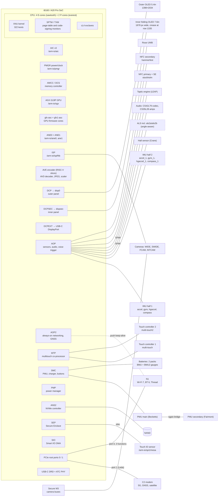

# Architecture at a glance

One picture of the Duo's SoC and the parts around it, built only from what the chapters and generated maps establish. Every box names its device-tree node; follow the links below the diagram for the evidence. Dashed boxes are Duo-only hardware ([09](09-what-makes-it-a-duo.md)).

## Where the evidence is

| Part of the picture | Chapter | Generated reference |
|---|---|---|
| CPU, AIC, PMGR, memory, ANS, buses | [01](01-soc-cpu-memory-storage.md) | [physical address map](../reference/maps/physical-address-map.md), [interrupt map](../reference/maps/interrupt-map.md), [bus devices](../reference/maps/bus-devices.md) |
| SEP, SPTM, TXM, exclaves, Touch ID | [02](02-boot-and-security.md) | [manifest](../reference/manifest.md) |
| GPU, DCP/DCPSEC/DCPEXT, panels | [03](03-gpu-and-displays.md), [10](10-userland-display-fold-touch.md) | [co-processor matrix](../reference/maps/coprocessors.md) |
| ISP, cameras, Secure M3, AVE/AVD, ANE | [04](04-camera-media-neural-engine.md), [12](12-userland-camera-ane-audio-security.md) | [firmware SBOM](../reference/maps/firmware-sbom.md) |
| AOP/AOP2, IMUs, Hall, ALS, MTP touch, audio, Taptic | [05](05-sensors-touch-audio-haptics.md), [08](08-foldable-system-and-chassis.md) | [function codes](../reference/maps/function-codes.md) |
| SMC, PMUs, batteries, charging | [06](06-power-battery-thermal.md) | [syscfg keys](../reference/maps/syscfg-keys.md), [GPIO pins](../reference/maps/gpio-pins.md) |
| C2, N1, Rose, NFC, USB-C | [07](07-networking-and-connectivity.md), [11](11-userland-radios-power-sensors.md) | [driver matches](../reference/maps/driver-matches.md) |

The diagram simplifies: it omits DARTs (IOMMUs), mailboxes, exclave proxies and per-block power domains, all of which are in the maps. Links drawn between a co-processor and a part mean "the chapters show this co-processor or bus owns that part", not a physical trace; board routing is not in the evidence.
